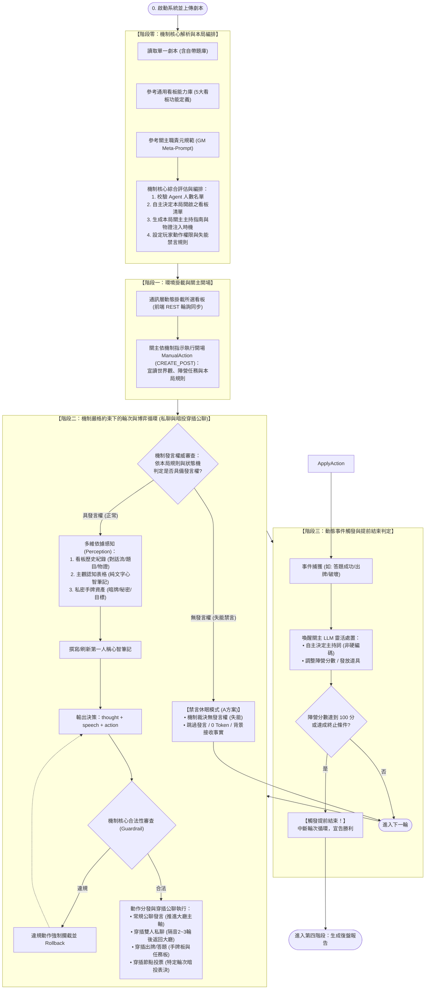
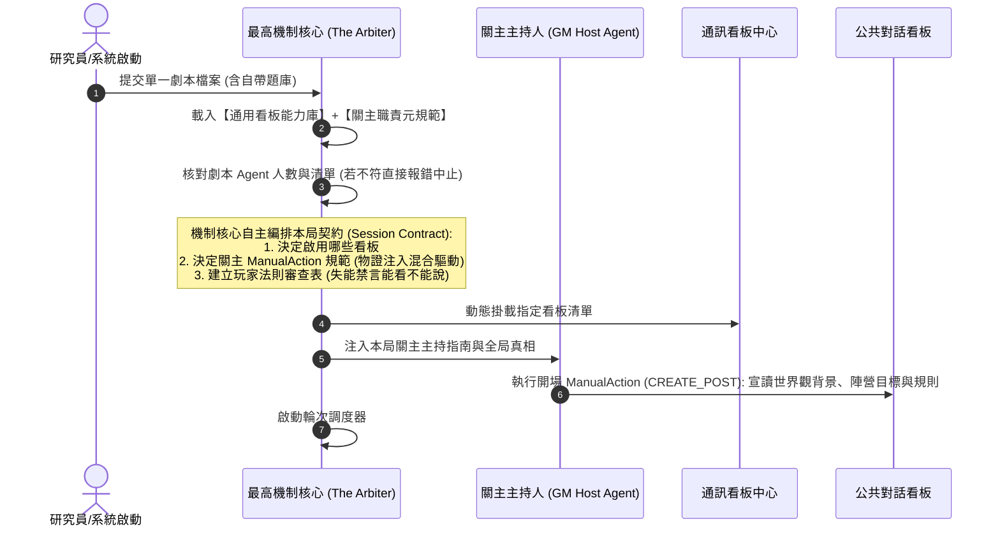
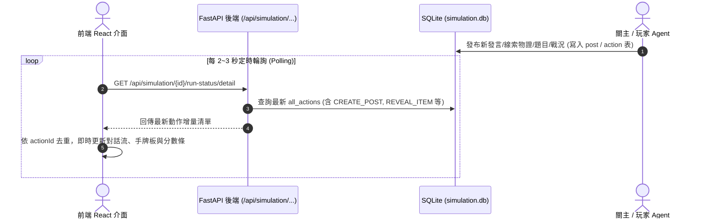

# 通用劇本殺多智能體模擬系統 (Generic LARP Multi-Agent System)
# 系統架構設計書 (System Architecture Document)

---

## 1. 系統總體架構概觀：最高權限機制核心體系 (System Architecture Overview)

```mermaid
graph TB
    subgraph Input_Sources["【機制核心之三維輸入源 (Mechanism Inputs)】"]
        direction TB
        Unified_Script["1. 單一劇本檔案 (Markdown)<br/>- 關主手冊 (機制指南 + 劇本自帶題庫)<br/>- 關主核心真相 (全局真相/僅 GM 可讀)<br/>- 角色客觀劇本庫 (公開區 vs 私密專區)"]
        Board_Lib["2. 後端通用看板能力庫 (Board Capabilities Library)<br/>- 對話板、手牌板、任務活動板、私聊室、暗投沙盒之能力定義"]
        GM_Meta_Prompt["3. 關主職責元規範 (GM Meta-Prompt Guidelines)<br/>- 主持人準則、裁判職責與 ManualAction 工具集"]
    end

    subgraph Supreme_Mechanism_Core["【最高權限遊戲機制核心 (The Arbiter Mechanism Engine)】"]
        direction TB
        Parser["劇本解析與人數校驗器 (script_parser.py)<br/>- 強制核對 Agent 數量與身分完全相符"]
        Contract_Orchestrator["本局契約編排器 (Session Contract Generator)<br/>- 綜合劇本、看板庫與GM規範，自主決定：<br/>  • 本局啟用之看板清單<br/>  • 本局關主主持與 ManualAction 規範 (物證混合驅動)<br/>  • 玩家合法動作約束矩陣 (失能禁言休眠)"]
        State_Machine["全局狀態機與守門員 (State Machine & Guardrail)<br/>- 掌握失能禁言休眠 (能看不能說，Zero Token)<br/>- 陣營分數累計與提前結束守衛 (Early Victory Guard)<br/>- 審查玩家發言、出牌、道具操作 (違規強制攔截)"]
    end

    subgraph Data_Storage_Layer["【資料與資產儲存層 (Storage Layer)】"]
        direction LR
        Clean_KG["純淨客觀知識圖譜 (Zep KG)<br/>- 僅存公開人設、生平、客觀關係、世界觀"]
        Unified_Asset_Store["單一私密資產資料表 (agent_private_assets)<br/>- 道具、秘密、任務存放於同一 SQLite 表<br/>- Key 區分: category, visibility (private/public)"]
        Truth_Store["關主真相庫 (GM Truth DB)<br/>- 僅 GM 可讀之作案真相"]
    end

    subgraph GM_Host_Layer["【關主主持人代行層 (GM Host Layer)】"]
        direction TB
        GM_Agent["關主主持人 (GM Host Agent)<br/>- 依據機制契約主持，從自帶題庫發題<br/>- 評估現場火候自主以 ManualAction 注入物證<br/>- 接收事件觸發後靈活生成即興戰況通報"]
    end

    subgraph Communication_Layer["【通訊與動態看板中心 (Communication & Fact Boards)】"]
        direction TB
        Scheduler["時序調度器 (Turn Scheduler)<br/>- 依狀態機排程：若 DISABLED 則【直接休眠跳過發言】"]
        Polling_API["REST 增量輪詢 API (/api/simulation/{id}/run-status/detail)<br/>- 前端每 2~3 秒定時拉取最新 Actions<br/>- 關主發題/報分/廣播均作為高權限 CREATE_POST 貼文"]
        
        subgraph Active_Boards["【本局由機制核心動態啟用之看板】"]
            Public_Stream["公共時間序對話看板 (Public Stream)"]
            Public_Card_Board["公共手牌/道具看板 (Public Card Board)"]
            Task_Board["任務活動與分數看板 (Task & Score Board)"]
            Whisper_Box["雙人微型私聊看板 (Whisper Sandbox)"]
            Secret_Ballot_Box["無記名暗投沙盒 (Secret Ballot Box)"]
        end
    end

    subgraph Agent_Mind["【Agent 第一人稱認知與決策閉環 (Cognitive Loop)】"]
        direction TB
        Perception["1. 感知環境事實 (Perception - 失能者仍接收)<br/>- 公共對話 + 任務題目 + 公共手牌<br/>- 本人 visibility=private 之道具/秘密/任務"]
        Cognitive_Notes["2. 半結構化純文字心智筆記 (Cognitive Notes)<br/>- 交叉比對全場事實，更新對每位玩家的第一人稱秘密日記"]
        Deliberation["3. 第一人稱決策行動 (Deliberation & Action)<br/>- 輸出 thought + speech + action (發言/出牌/答題/暗投)"]

        Perception --> Cognitive_Notes --> Deliberation
    end

    %% 連線交互
    Input_Sources --> Supreme_Mechanism_Core
    Parser --> Clean_KG
    Parser --> Unified_Asset_Store
    Parser --> Truth_Store

    Contract_Orchestrator -->|"派發本局主持契約"| GM_Agent
    Contract_Orchestrator -->|"動態掛載所選看板"| Active_Boards
    GM_Agent -->|"ManualAction CREATE_POST"| Polling_API
    Polling_API --> Active_Boards

    Scheduler -->|"輪次喚醒 (若非失能)"| Perception
    Clean_KG -.->|"客觀人設底色"| Perception
    Unified_Asset_Store -.->|"單表僅查本人 private"| Perception
    Active_Boards -.->|"拉取事實"| Perception

    Deliberation -->|"提交動作"| State_Machine
    State_Machine --"違規/失能"-->|"攔截駁回"| Deliberation
    State_Machine --"合法動作"--> Polling_API
    State_Machine -->|"事件上報"| GM_Agent
```

---

## 1.1 系統端到端總體運作流程圖 (End-to-End Operational Flow)



---

## 2. 核心時序流程 (Interaction Sequences)

### 2.1 機制編排、自主選板與關主開場時序 (Mechanism Orchestration Flow)


---

### 2.2 前後端通訊架構：MiroFish 原生定時輪詢時序 (Polling Interaction Flow)


---

## 3. 資料結構規範 (Data Schemas)

### 3.1 單一私密資產資料表 Schema (agent_private_assets)
所有玩家的道具、秘密、個人任務集中存放於單一 SQLite 資料表：
```sql
CREATE TABLE IF NOT EXISTS agent_private_assets (
    id TEXT PRIMARY KEY,                     -- 唯一識別碼 (如 "item_001", "sec_002")
    agent_id TEXT NOT NULL,                  -- 所屬玩家 ID (如 "Player_Li")
    category TEXT NOT NULL,                  -- 'item' (道具) | 'secret' (秘密) | 'objective' (個人任務)
    title TEXT NOT NULL,                     -- 名稱 (如 "泛黃借條", "我就是真凶", "陷害王掌櫃")
    content TEXT NOT NULL,                   -- 詳細內容 / 案件事實 / 勝利條件
    visibility TEXT DEFAULT 'private',       -- 'private' (私密) | 'public' (公開，亮牌後更新為此)
    status TEXT DEFAULT 'in_hand'            -- 'in_hand' (持有中) | 'revealed' (已公開) | 'completed' (已完成)
);
```

---

## 4. 模組部署與技術對齊 (Component Mapping)

| 模組名稱 | 負責後端元件 (Python) | 負責前端元件 (React) | 資料持久化與通訊方式 |
| :--- | :--- | :--- | :--- |
| **最高機制核心** | `mechanism_engine.py` (最高仲裁與編排中樞) | `GameEngineStatus.tsx` | 記憶體狀態機 + SQLite 審計日誌 |
| **單一劇本解析器** | `script_parser.py` (核對人數+分流) | `ScriptUploadView.tsx` | Markdown / Text 暫存 |
| **純淨圖譜生成** | `graph_builder.py` + `zep_tools.py` | `KnowledgeGraphView.tsx` | Zep 知識圖譜庫 (僅存公開區) |
| **單一私密資產庫** | `private_asset_service.py` (單表Key分流) | `PrivateAssetCard.tsx` (僅本人可見) | SQLite 表格 `agent_private_assets` |
| **Profile 玩家生成** | `player_persona_generator.py` (5大維度) | `PlayerPersonaCard.tsx` | SQLite 表格 `player_meta_personas` |
| **關主主持代行** | `gm_host_agent.py` (受機制驅動與約束) | `GMAdminPanel.tsx` (關主主持台) | GM 專用管道 + 貼文廣播隊列 |
| **通訊與動態看板** | `board_orchestrator.py` (原生輪詢) | `DynamicBoardContainer.tsx` | **原生定時輪詢 (每2~3秒拉取 detail)** |
| **第四階段報告** | `report_agent.py` (支援提前結束大綱) | `SimulationReportView.tsx` | Markdown 完整復盤報告 |
