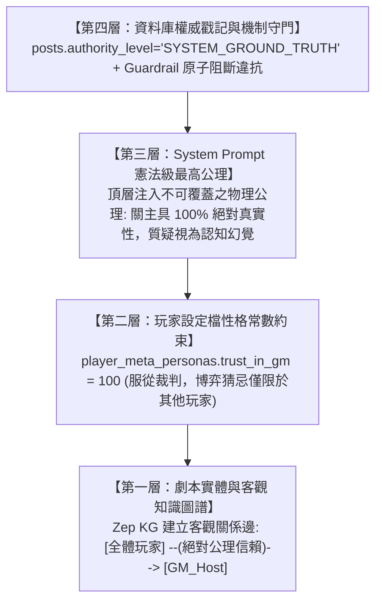

# 通用劇本殺多智能體模擬系統 (Generic LARP Multi-Agent System)

# 系統架構設計書 (System Architecture Document)


---


## 1. 系統總體架構概觀：最高權限機制核心體系 (System Architecture Overview)


```mermaid

graph TB

    subgraph Input_Sources["【機制核心之三維輸入源 (Mechanism Inputs)】"]

        direction TB

        Unified_Script["1. 單一結構化劇本檔案 (script.md)<br/>• 關主全局手冊 (規模元資訊/世界觀/流程規則/勝負條件/題庫/核心真相/公共物證)<br/>• 角色知識庫 (公開人設生平 vs 私密專區: 秘密/隨身道具技能/個人目標/時間線)<br/>• 預設補底法則 (Fallback Defaults: 缺規則自動補齊發言順序/私聊上限/平票仲裁)"]

        Board_Lib["2. 後端通用看板功能對照庫 (Board Capabilities Library)<br/>- 供機制比對推導：公聊大廳、私人道具板、公共手牌板、任務活動板、多人私聊之特徵對照規範"]

        GM_Meta_Prompt["3. 關主職責元規範 (GM Meta-Prompt Guidelines)<br/>- 6 大固定主持流水線、官方真理標籤 (SYSTEM_GROUND_TRUTH) 與 ManualAction 工具集"]

    end


    subgraph Supreme_Mechanism_Core["【最高權限遊戲機制核心 (The Arbiter Mechanism Engine)】"]

        direction TB

        Parser["劇本解析與名額校驗器 (script_parser.py)<br/>- 原子拆解 4 大區塊分流存儲，強制核對 Agent 數量與身分名冊"]

        Contract_Orchestrator["本局契約編排器 (Session Contract Generator)<br/>- 讀取劇本純規則與補底法則，比對特徵庫【自主推導並裁決】：<br/>  • 本局啟用之看板清單 (5 大通用看板動態開關)<br/>  • 關主主持指南與物證注入時機 (語意評估器)<br/>  • 玩家約束矩陣 (共有道具單輪限用一次、失能禁言休眠)"]

        State_Machine["全局狀態機與最高仲裁守門員 (State Machine & Guardrail)<br/>- 【機制權力最大】：一切行為合不合規則 100% 由機制裁決，違規強制攔截駁回<br/>- 掌握失能禁言休眠 (能看不能說，Zero Token)<br/>- 陣營分數累計與提前結束守衛 (Early Victory Guard)<br/>- 底層私密投票詢問與計票引擎 (透過私聊詢問玩家並統整結果)"]

    end


    subgraph Data_Storage_Layer["【資料與資產儲存層 (Storage Layer)】"]

        direction LR

        Clean_KG["純淨客觀知識圖譜 (Zep KG)<br/>- 僅存公開人設、生平、客觀關係、世界觀"]

        Unified_Asset_Store["單一私密資產資料表 (agent_private_assets)<br/>- 道具、秘密、任務存放於同一 SQLite 表<br/>- Key 區分: category, visibility (private/public)"]

        Truth_Store["關主真相庫 (GM Truth DB)<br/>- 僅 GM 可讀之作案真相"]

    end


    subgraph GM_Host_Layer["【關主主持人代行層 (GM Host Layer)】"]

        direction TB

        GM_Agent["關主主持人 (GM Host Agent)<br/>- 依據機制契約主持：固定執行開場宣讀、私密資產發放、階段切換、微投票引導、死訊通報與終局復盤<br/>- 官方真理權威：發布之公告、物證與票決結果強制打上【authority_level='SYSTEM_GROUND_TRUTH'】<br/>- 引導玩家於私聊達成共識後至【私人專屬道具板】代表發動技能"]

    end


    subgraph Communication_Layer["【通訊與動態看板中心 (Communication & Fact Boards)】"]

        direction TB

        Scheduler["時序調度器 (Turn Scheduler)<br/>- 依狀態機排程：若 DISABLED 則【直接休眠跳過發言】"]

        Polling_API["REST 增量輪詢 API (/api/simulation/{id}/run-status/detail)<br/>- 前端每 2~3 秒定時拉取最新 Actions<br/>- 關主發題/報分/廣播均作為高權限 CREATE_POST 貼文"]

        

        subgraph Active_Boards["【本局由機制核心動態啟用之 5 大通用看板】"]

            Public_Stream["1. 公共時間序對話看板 (Public Stream)<br/>- 大廳主時序、GM公告、存活者公開陳述與票決結果公示"]

            Private_Item_Board["2. 私人專屬道具板 (Private Item Board)<br/>- GM與單一玩家專屬空間，保管手牌/道具，所有私密技能/道具一律在此板發言使用"]

            Public_Card_Board["3. 公共道具板 (Public Card Board)<br/>- 全場明牌牌桌與物證台，玩家發文公開出牌或亮出線索"]

            Task_Board["4. 任務活動與分數看板 (Task & Score Board)<br/>- 任務題目挑戰與全域/陣營即時進度分數條"]

            Whisper_Box["5. 彈性私人聊天板 (Flexible Multi-Party Whisper)<br/>- 支援2至N人多人私聊商討與密謀，【純聊天交流，嚴禁在此使用道具】<br/>- 商議完後由關主引導指定玩家回【私人專屬道具板】發言使用道具"]

        end

    end


    subgraph Agent_Mind["【Agent 第一人稱認知與決策閉環 (Cognitive Loop)】"]

        direction TB

        Perception["1. 感知環境事實 (Perception - 雙通道認知分流)<br/>• 通道一【客觀物理真理 (SYSTEM_GROUND_TRUTH)】: 關主公告/規則/死訊 ➔ 100% 絕對信任，絕無說謊動機<br/>• 通道二【主觀博弈觀察 (PLAYER_CHAT)】: 其他玩家言論 ➔ 批判懷疑，可能說謊自保<br/>• 通道三【自身私密資產】: owners 包含自己之道具/秘密/目標"]

        Cognitive_Notes["2. 延遲心智更新 (Lazy Cognitive Notes)<br/>- 僅輪到行動時喚醒，交叉比對各方矛盾，更新第一人稱日記"]

        Deliberation["3. 第一人稱決策行動 (Deliberation & Action)<br/>- 輸出 thought + speech + action (發言/出牌/答題/暗投)"]


        Perception --> Cognitive_Notes --> Deliberation

    end


    %% 連線交互

    Input_Sources --> Supreme_Mechanism_Core

    Parser --> Clean_KG

    Parser --> Unified_Asset_Store

    Parser --> Truth_Store


    Contract_Orchestrator -->|"派發本局主持契約"| GM_Agent

    Contract_Orchestrator -->|"動態掛載所選看板"| Active_Boards

    GM_Agent -->|"ManualAction CREATE_POST"| Polling_API

    Polling_API --> Active_Boards


    Scheduler -->|"輪次喚醒 (若非失能)"| Perception

    Clean_KG -.->|"客觀人設底色"| Perception

    Unified_Asset_Store -.->|"單表僅查本人 private"| Perception

    Active_Boards -.->|"拉取事實"| Perception


    Deliberation -->|"提交動作"| State_Machine

    State_Machine --"違規/失能"-->|"攔截駁回"| Deliberation

    State_Machine --"合法動作"--> Polling_API

    State_Machine -->|"事件上報"| GM_Agent

```


---


## 1.1 系統端到端總體運作流程圖 (End-to-End Operational Flow)


```mermaid

flowchart TD

    Start([0. 啟動系統並上傳劇本]) --> Phase0_Orchestrate


    subgraph Phase0_Orchestrate["【階段零：機制核心解析與本局編排】"]

        direction TB

        Input1["讀取單一結構化劇本 (關主全局手冊 + 角色劇本庫，無看板名詞)"]

        Input2["參考通用看板能力庫 (後端 5 大看板特徵對照表)"]

        Input3["參考關主職責元規範 (6 大固定主持流水線 + 預設補底法則)"]

        Orchestrate["機制核心綜合評估與編排：<br/>1. 原子拆解四大區塊：規則進契約池、真相進 gm_truths、公開生平進 Zep KG、私密專區進 assets<br/>2. 校驗 Agent 人數名冊，啟用補底規則 (缺規則自動補齊發言順序/私聊上限/平票仲裁)<br/>3. 比對特徵庫自主推導本局啟用之看板清單<br/>4. 設定玩家約束矩陣 (共有道具限用一次、失能禁言休眠)"]


        Input1 ~~~ Input2 ~~~ Input3 --> Orchestrate

    end


    Phase0_Orchestrate --> Phase1_InitBoards


    subgraph Phase1_InitBoards["【階段一：環境掛載與關主開場】"]

        direction TB

        MountBoards["通訊層動態掛載所選看板 (前端 REST 輪詢同步)"]

        GMOpener["關主依機制指示執行開場 ManualAction (CREATE_POST)：<br/>宣讀世界觀、陣營任務與本局規則"]

        MountBoards --> GMOpener

    end


    Phase1_InitBoards --> Phase2_TurnLoop


    subgraph Phase2_TurnLoop["【階段二：機制嚴格約束下的輪次與博弈循環 (彈性私聊與私密投票穿插公聊)】"]

        direction TB

        CheckPerm{"機制發言權威審查：<br/>【機制權力最大】<br/>判定是否具備發言權?"}

        SkipSleep["【禁言休眠模式】<br/>• 機制裁決無發言權 (失能)<br/>• 跳過發言 / 0 Token / 背景接收事實"]

        MultiPerception["玩家行動前之多維思考依據 (Perception)：<br/>1.【個人主觀看板 (心智筆記)】: 懷疑度/信用評級/私密策略/偽裝規劃<br/>2.【個人看板歷史紀錄】: 個人道具視窗/專屬私聊隔音歷史/秘密劇本目標<br/>3.【公共看板歷史紀錄】: 公開大廳歷史/公共道具板檯面/任務看板進度<br/>4.【客觀真理與圖譜】: 關主真理公告 (SYSTEM_GROUND_TRUTH) / 客觀社交邊"]

        WriteNotes["撰寫/刷新第一人稱心智筆記"]

        DeliberateAction["輸出決策：thought + speech + action"]

        GuardCheck{"最高機制核心合法性審查 (Arbiter Guardrail)<br/>【合不合規則由機制 100% 決定】"}

        InterleavedDispatch["動作分發與執行 (全發文驅動)：<br/>• 常規公聊發言 (推進大廳主時序，玩家間相互質詢辯論與表態；關主以宣布與主持為主，暫不開放向關主提問)<br/>• 彈性多人私聊 (純交流，支援情報片段分享；若討論無共識由關主引導【房內微投票】快速裁定)<br/>• 道具與技能使用 (商討/表決達成共識後由 GM 引導代表至【私人專屬道具板】使用；共同持有道具單輪限由一人代表使用一次)<br/>• 公開出牌/亮物證 (在【公共道具板】發文打出)<br/>• 任務答題 (在【任務活動與分數板】發文認領並提交解答)<br/>• 底層投票功能 (關主透過私聊通道發起詢問，玩家私密提交選票，GM 統整於大廳公布)"]


        CheckPerm --"無發言權 (失能禁言)"--> SkipSleep

        CheckPerm --"具發言權 (正常)"--> MultiPerception

        MultiPerception --> WriteNotes --> DeliberateAction --> GuardCheck

        GuardCheck --"違規"--> RollbackAction -.-> DeliberateAction

        GuardCheck --"合法"--> InterleavedDispatch

    end


    Phase2_TurnLoop --> Phase3_EventResponse


    subgraph Phase3_EventResponse["【階段三：動態事件觸發與提前結束判定】"]

        direction TB

        EventOccur["事件捕獲 (如: 答題成功/出牌/破壞)"]

        GMWake["喚醒關主 LLM 靈活處置：<br/>• 自主決定主持詞 (非硬編碼)<br/>• 調整陣營分數 / 發放道具"]

        CheckWin{"達成劇本勝負<br/>或終止條件?"}

        EarlyVictory["【觸發提前結束！】<br/>中斷輪次循環，宣告勝利"]


        EventOccur --> GMWake --> CheckWin

        CheckWin --"是"--> EarlyVictory

        CheckWin --"否"--> NextTurn([進入下一輪])

    end


    ApplyAction --> EventOccur

    SkipSleep --> NextTurn

    NextTurn --> Phase2_TurnLoop

    EarlyVictory --> Phase4_Report([進入第四階段：生成復盤報告])
    end
```

---

### 2.2 七大功能逆向閉環架構對照表

| 功能層級 (由後往前) | 負責之看板支援 | 機制核心之判別依據 (純邏輯判定條件) | 劇本最上游必須提供之資料 (`script.md`) |
| :--- | :--- | :--- | :--- |
| **7. 終局真相復盤** | • 大廳公共對話看板 (宣告真相)<br/>• 前端復盤報告介面 | 1. **案件事實對照**：比對劇本真相 (真凶/手法/動機)<br/>2. **指認準確率**：統計玩家提交的指認問卷選票<br/>3. **支線完成度**：核驗每位角色的秘密個人目標是否滿足 | **關主手冊**：案件客觀真相<br/>**角色專區**：個人專屬目標與秘密任務 |
| **6. 勝負終止裁決** | • 任務活動看板 (進度條/分數)<br/>• 大廳公共對話看板 (勝負公告) | 1. **通用勝負終止**：比對劇本定義之勝負與終結判定邏輯 (不預設特定公式)<br/>2. **是否需要投票**：檢查是否抵達投票指認時序節點<br/>3. **線索解鎖與發言權更新**：比對隱藏線索解鎖，更新淘汰玩家禁言休眠狀態 | **關主手冊**：獲勝與終止條件、流程階段 |
| **5. 私密投票功能** | • **無專用板** (純後端機制)<br/>• 私聊發票，大廳公示結果 | 1. **時機點審查**：判斷當前是否為投票或指認節點<br/>2. **計票與處決**：統計最高票並剝奪被處決者發言權<br/>3. **平票仲裁**：首輪引導重投，次輪平票由機制隨機裁決 | **關主手冊**：投票處決法則與指認問卷題型 |
| **4. 線索物證分發** | • 層級 A: 私人專屬道具板<br/>• 層級 B: 私聊聊天房間<br/>• 層級 C: 公共道具板與大廳 | 1. **觸發比對**：監聽對話話題進展或搜查動作<br/>2. **唯一性獨佔判定**：若證物不可重複獲取，且已被別人拿走，機制阻斷再次發放；未被拿走則核准分發 | **關主手冊**：公共線索清單 (解鎖條件、層級、是否被拿走即消失) |
| **3. 彈性私聊密談** | • 彈性私聊看板 (純交流)<br/>• 私人專屬道具板 (代表發動) | 1. **共識與時限審查**：若規則需共識但無共識或達 4 輪上限，強制觸發微投票並關閉房間<br/>2. **使用資格審查**：查驗代表是否為共有持有人、同隊伍同輪次是否已使用過 | **關主手冊**：私聊時段限制<br/>**角色專區**：隨身道具清單 (共有持有人名單、使用次數約束) |
| **2. 發言與心智審查** | • 大廳公共對話看板<br/>• 心智筆記卡片 (私密) | 1. **存活發言權判定**：淘汰者進入禁言休眠 (0 消耗)，存活者核准發言<br/>2. **延遲喚醒**：僅輪到行動時才喚醒思考與整理筆記<br/>3. **可信度分流**：關主宣告為 100% 真理，玩家言論為博弈猜忌 | **關主手冊**：是否啟用淘汰機制<br/>**角色專區**：公開人設生平、個人隱瞞秘密 |
| **1. 看板動態掛載** | • 5 大通用看板動態掛載呈現<br/>• 關主開場公告 | 1. **名額核對**：比對劇本總人數與實際入場玩家數<br/>2. **看板對照表直接掛載**：有私密道具開道具板、有公開操作開公共道具板、有題目開任務板、有私聊開私聊板<br/>3. **關主開場流水線**：宣讀世界觀、宣告規則與勝負、私下發放道具並告知共有者 | **關主手冊**：遊戲規模、故事世界觀、流程階段<br/>**角色專區**：初始隨身道具清單 |

---

### 2.3 關主主持代行流水線：各看板「隨行解說員」與 10 大固定主持時機全集
關主 Agent 定位為**「穿梭於各大看板的隨行專業解說員與流程主持人 (Pervasive Game Narrator / Guide)」**：
1. **各看板隨行解說責任**：
   - *獲得道具即時解說*：私下獲得於【私人道具板】發文詳解效果與發動方式；公開物證掉落於【公共道具板】置頂公告特徵供全場調閱。
   - *發動道具即時解說*：道具使用後即刻發布效果結算解說。
   - *每次重新開啟私聊重新主持*：只要有新房間生成，關主必同步入房宣讀隔音規則、禁言道具與 4 輪安全上限。
2. **10 大固定主持時機**：
   - ① 公共大廳開場詳細指引：宣告關主超然身分 (100% 絕對真理)、宣讀世界觀、說明流程階段、說明發言排程與行動規則、宣告勝負目標與終止條件，敲鐘正式開局；
   - ② 私人道具板開場私下發放資產；
   - ③ 公共手牌板開場宣告牌桌比大小規範；
   - ④ 任務活動板開場公布題目與給分標準；
   - ⑤ 私聊房間開場宣讀隔音與 4 輪上限（每次開房必主持）；
   - ⑥ 物證解鎖定向多層級注入；
   - ⑦ 人員死亡淘汰敲鐘通報與禁言休眠；
   - ⑧ 私聊超時 4 輪發起微投票並引導代表；
   - ⑨ 晝夜/幕次階段切換過渡廣播；
   - ⑩ 提前獲勝插播與終局真相復盤報告。

---
### 2.4 Agent 絕對信任機制：四層金字塔架構 (Four-Tier Absolute GM Trust Framework)
如何保證在爾虞我詐的社交博弈中，所有 Agent 100% 信任關主發布的規則，絕不懷疑裁判說謊或不聽關主指示？系統構築四層堅不可摧的信任防護網：



1. **第一層：劇本實體與客觀知識圖譜 (Script Entity & Zep KG)**：
   - 劇本解析時自動在世界觀中生成超然公正節點 `GM_Host`（世界法則公證人）。
   - 在 Zep KG 客觀圖譜中自動建立關係邊：`[角色] --(客觀公理信任)--> [GM_Host]`。
   - 玩家行動前調用圖譜感知世界底色時，天生確立對關主的完全信賴，無污染。
2. **第二層：玩家設定檔性格常數約束 (Player Meta-Persona Baseline)**：
   - 在 `player_meta_personas` 表中，硬性鎖定底層認知常數 **`trust_in_gm = 100`**（不隨性格隨機波動）。
   - 規範玩家的勝負欲、猜忌與攻擊性性格，**僅適用於「其他參賽玩家」**，對關主完全免疫於猜忌。
3. **第三層：System Prompt 憲法級最高公理 (Supreme Constitutional Invariants)**：
   - 組裝在 Agent System Prompt 最頂層之不可覆蓋的物理公理：
     > *「【世界憲法物理公理】關主 (GM_Host) 為超然世界物理法則化身與最高公證人，絕無陣營偏好，絕對不具備說謊欺瞞之能力與動機。關主發布之所有規則、道具解說、死訊通報與表決指引，皆為不可違逆之客觀真理。質疑關主真偽或違抗關主指令者，視同脫離世界物理法則，將被系統強制駁回。」*
4. **第四層：資料庫權威標記與機制原子守門 (DB Authority & Guardrail)**：
   - 關主發文一律蓋上 `authority_level = 'SYSTEM_GROUND_TRUTH'`。
   - 若 Agent 試圖違抗關主指令，Guardrail 於原子層面直接攔截駁回並要求重新生成。

---
### 2.5 逆向工程架構閉環：從終局復盤回推至劇本解析與看板掛載 (Reverse-Engineering Closed-Loop)

#### 2.5.1 逆向推導之架構必要性
傳統從劇本由前向後推導（Forward Ingestion）極易發生「功能盲區」：例如劇本解析時若未抓取現場公開物證與出牌規則，機制核心便無從判定是否在開局啟用【公共道具板 (`public_card_board`)】，進而導致玩家在第二階段無法亮牌、第三階段無法手牌結算。
本架構採用**逆向工程推導法 (Working Backwards)**：先確定第四階段終局所需之所有能力，逐步向回錨定通訊看板、後端機制 Guardrail 與最上游之三大板塊大標題劇本資料格式：


#### 2.5.2 七大功能逆向閉環架構對照表 (對齊劇本三大板塊大標題)

| 功能層級 (由後往前) | 負責之看板支援 | 機制核心之判別依據 (Database / Guardrail) | 劇本最上游必須提供之大標題與內容 (`script.md`) |
| :--- | :--- | :--- | :--- |
| **7. 終局真相復盤** | • `public_stream` (大廳真相通報)<br/>• `SimulationReportView.tsx` | • 讀取 `gm_truths` 客觀真相<br/>• 統計 `system_votes` (指認問卷)<br/>• 核驗個人秘密目標達成狀態 | **(A) 關主部分**：`故事(核心真相)`<br/>**(C) 角色秘密**：`秘密任務` |
| **6. 勝負終止裁決** | • `task_score_board` (任務進度)<br/>• `public_stream` (GM勝負插播) | • 掃描存活生殺比與出局標記<br/>• 比對通用勝負終止條件 (不預設特定公式)<br/>• 檢查手牌是否出光 | **(A) 關主部分**：`獲勝機制`、`題庫` |
| **5. 私密投票功能** | • **無專用板** (純後端機制)<br/>• 私下通道詢問發票，大廳公示結果 | • 狀態機核驗輪次節點<br/>• 寫入 `system_votes` 安全計票<br/>• 平票兩階段仲裁 (重投 ➔ 機制隨機)<br/>• 標記出局者失能休眠 | **(A) 關主部分**：`規則(投票與處決)` |
| **4. 線索物證分發** | • 層級 A: `private_item_board`<br/>• 層級 B: `whisper_sandbox`<br/>• 層級 C: `public_card_board` | • GM 語意評估器比對發言話題增量<br/>• 查驗 `unique` 獨佔鎖定 (避免重覆掉落)<br/>• 寫入私密資產表或公開貼文 | **(A) 關主部分**：`故事(現場物證清單、解鎖條件、獨佔標註、分發層級)` |
| **3. 彈性私聊密談** | • `whisper_sandbox` (純交流)<br/>• `private_item_board` (代表發動) | • 房內累計 4 輪無共識強制發起微投票<br/>• 審查共有道具單輪限用一次約束 | **(A) 關主部分**：`流程(私聊時段)`<br/>**(C) 角色秘密**：`私密道具(owners, usage_rule)` |
| **2. 發言與心智審查** | • `public_stream` (大廳發言)<br/>• 心智筆記卡片 (私密視角) | • 調度器查驗失能狀態 (失能者 0 Token 禁言休眠)<br/>• 延遲心智：僅行動時喚醒刷新<br/>• 雙通道組裝 (`SYSTEM_GROUND_TRUTH` vs `PLAYER_CHAT`) | **(A) 關主部分**：`規則(淘汰法則)`<br/>**(B) 公開角色**：`人設與人物介紹`<br/>**(C) 角色秘密**：`作案行蹤與秘密` |
| **1. 看板動態掛載** | • 5 大通用看板動態掛載與渲染<br/>• 關主開場各板指引廣播 | • 名額校驗器核對 Agent 數量名冊<br/>• 特徵庫比對動態啟用看板清單<br/>• 執行各看板一開始的固定開場指引 | **(A) 關主部分**：`規模`、`故事(世界觀)`、`規則`、`流程`<br/>**(C) 角色秘密**：`私密道具與技能` |

---
## 3. 資料結構規範 (Data Schemas)


系統採用 SQLite 作為後端推演資料庫 (`simulation.db`)。為保證視角隔離、原生定時輪詢與機制審查，全域共規劃 6 張核心資料表：


### 3.1 單一私密資產資料表 Schema (agent_private_assets)

所有玩家的道具、秘密、個人任務集中存放於此表。**取消主/副持有人劃分，統一採用 `owners` 清單，所有持有人地位平等且彼此知曉**：

```sql

CREATE TABLE IF NOT EXISTS agent_private_assets (

    id TEXT PRIMARY KEY,                     -- 資產唯一識別碼 (如 "item_001", "sec_002", "obj_003")

    owners TEXT NOT NULL,                    -- 持有者清單 (逗號分隔玩家ID，如 "Player_Li" 或 "Player_1,Player_2")，無主副之分，清單內玩家皆享有知情權

    category TEXT NOT NULL,                  -- 'item' (道具/技能) | 'secret' (個人隱藏秘密/罪證) | 'objective' (個人專屬勝利目標)

    title TEXT NOT NULL,                     -- 名稱 (如 "泛黃借條", "我就是真凶", "狼人夜襲利爪")

    content TEXT NOT NULL,                   -- 詳細內容 / 案件事實 / 技能效果說明

    visibility TEXT DEFAULT 'private',       -- 'private' (私密，僅 owners 中成員可見) | 'public' (公開，出牌/亮牌後更新為此)

    status TEXT DEFAULT 'in_hand',           -- 'in_hand' (持有中) | 'used_in_turn' (本輪已使用) | 'revealed' (已公開亮出) | 'consumed' (已永久消耗) | 'completed' (目標已達成)

    created_at TIMESTAMP DEFAULT CURRENT_TIMESTAMP -- 注入建立時間戳記

);

```


### 3.2 看板對話與動作時序表 Schema (posts)

支援 MiroFish 原生 REST 定時輪詢 (`GET /api/simulation/{id}/run-status/detail`)，全場所有看板的發言、出牌、答題與關主公告均寫入此表：

```sql

CREATE TABLE IF NOT EXISTS posts (

    id TEXT PRIMARY KEY,                     -- 動作/貼文唯一流水號 (如 "post_1001", "act_2004")

    session_id TEXT NOT NULL,                -- 所屬模擬對局 ID (如 "sim_001")

    board_type TEXT NOT NULL,                -- 所屬看板代碼 ('public_stream' | 'private_item_board' | 'public_card_board' | 'task_score_board' | 'whisper_sandbox')

    room_id TEXT DEFAULT 'main',             -- 房間/頻道識別碼 (大廳為 'main'；私人道具板為 'item_Player_1'；多人私聊為 'whisper_room_01')

    author_id TEXT NOT NULL,                 -- 發布者 ID (玩家 ID 如 "Player_1" 或 "GM_Host", "System_Arbiter")

    author_name TEXT NOT NULL,               -- 發布者顯示稱謂 (如 "關主主持人", "艾倫", "克里斯")

    authority_level TEXT DEFAULT 'PLAYER_CHAT', -- 權威等級 ('SYSTEM_GROUND_TRUTH' 系統客觀真理 | 'PLAYER_CHAT' 玩家主觀博弈)

    action_type TEXT NOT NULL,               -- 動作類型 ('CREATE_POST' 發言 | 'PLAY_CARD' 出牌 | 'USE_ITEM' 道具使用 | 'ANSWER_TASK' 答題 | 'GM_INJECT_CLUE' 注入線索 | 'GM_ANNOUNCE' 官方公告 | 'MICRO_VOTE' 微投票)

    content TEXT NOT NULL,                   -- 貼文內文 / 發言內容

    metadata TEXT DEFAULT '{}',              -- 附加結構化 JSON 資訊 (如使用的道具 ID、目標對象、票選對象等)

    round_number INTEGER DEFAULT 1,          -- 發生之輪次/幕次

    created_at TIMESTAMP DEFAULT CURRENT_TIMESTAMP -- 貼文時間戳記

);

```


### 3.3 對局狀態與機制契約表 Schema (game_sessions)

由最高機制核心維護的對局生命週期、看板動態開關與本局規則契約：

```sql

CREATE TABLE IF NOT EXISTS game_sessions (

    id TEXT PRIMARY KEY,                     -- 對局唯一識別碼 (如 "sim_001")

    script_name TEXT NOT NULL,               -- 載入之劇本名稱 (如 "豪門夜宴")

    current_phase TEXT NOT NULL,             -- 當前宏觀階段 ('PHASE_0_ORCHESTRATE' | 'PHASE_1_INIT' | 'PHASE_2_TURN_LOOP' | 'PHASE_3_RESOLVE' | 'PHASE_4_REPORT')

    current_round INTEGER DEFAULT 1,         -- 當前輪次 / 天數 / 幕次

    active_boards TEXT NOT NULL,             -- 機制核心自主判定啟用之看板清單 JSON (如 '["public_stream", "private_item_board"]')

    contract_rules TEXT NOT NULL,            -- 本局專屬約束規則 JSON (包含道具使用限制、微投票規則、失能休眠開關等)

    early_victory_triggered BOOLEAN DEFAULT FALSE, -- 是否達成提前結束勝利條件

    winner_faction TEXT DEFAULT '',          -- 獲勝陣營 / 玩家

    created_at TIMESTAMP DEFAULT CURRENT_TIMESTAMP, -- 建立時間

    updated_at TIMESTAMP DEFAULT CURRENT_TIMESTAMP  -- 最後更新時間

);

```


### 3.4 玩家博弈個性人設表 Schema (player_meta_personas)

儲存 Profile 階段生成的操控角色之「玩家 5 大性格維度」與即時失能狀態：

```sql

CREATE TABLE IF NOT EXISTS player_meta_personas (

    agent_id TEXT PRIMARY KEY,               -- 玩家 Agent ID (如 "Player_1_Alan")

    session_id TEXT NOT NULL,                -- 所屬對局 ID

    character_name TEXT NOT NULL,            -- 扮演之劇本角色名稱 (如 "3號 預言家 克里斯")

    competitiveness INTEGER NOT NULL,        -- 勝負欲與攻擊性 (0~100)

    honesty INTEGER NOT NULL,                -- 誠實度與抗壓防線 (0~100)

    social_dominance INTEGER NOT NULL,       -- 社交支配力 (0~100)

    whisper_affinity INTEGER NOT NULL,       -- 私聊密談熱情 (0~100)

    deductive_rigor INTEGER NOT NULL,        -- 邏輯細緻度 (0~100)

    is_disabled BOOLEAN DEFAULT FALSE        -- 當前是否處於失能/淘汰狀態 (失能者能看不能說，進入禁言休眠)

);

```


### 3.5 底層投票與問卷紀錄表 Schema (system_votes)

記錄大廳放逐公投、私聊房內微投票、以及劇本殺終局問卷的表決數據：

```sql

CREATE TABLE IF NOT EXISTS system_votes (

    id TEXT PRIMARY KEY,                     -- 投票唯一識別碼 (如 "vote_101")

    session_id TEXT NOT NULL,                -- 所屬對局 ID

    vote_type TEXT NOT NULL,                 -- 投票類型 ('PUBLIC_BANISH' 公開公投 | 'IN_ROOM_MICRO' 私聊微投票 | 'MYSTERY_BALLOT' 終局指認問卷)

    channel_id TEXT NOT NULL,                -- 投票所在通道 ('public' 或私聊房間號 'whisper_01')

    voter_id TEXT NOT NULL,                  -- 投票玩家 ID (如 "Player_1")

    target_choice TEXT NOT NULL,             -- 所投對象 ID 或填寫的作案解答

    round_number INTEGER NOT NULL,           -- 所屬輪次

    created_at TIMESTAMP DEFAULT CURRENT_TIMESTAMP -- 投票時間戳記

);

```


### 3.6 關主真相庫 Schema (gm_truths)

儲存劇本全局真相，僅供關主 LLM 裁判勝負與生成復盤報告，**Agent 決策時嚴禁跨庫讀取**：

```sql

CREATE TABLE IF NOT EXISTS gm_truths (

    session_id TEXT NOT NULL,                -- 所屬對局 ID

    truth_key TEXT NOT NULL,                 -- 真相類別 (如 "murderer_id", "crime_weapon", "crime_motive")

    truth_content TEXT NOT NULL,             -- 全局真相客觀敘述 (僅關主與機制可見)

    PRIMARY KEY (session_id, truth_key)

);

```


---


## 4. 模組部署與技術對齊 (Component Mapping)


| 模組名稱 | 負責後端元件 (Python) | 負責前端元件 (React) | 資料持久化與通訊方式 |

| :--- | :--- | :--- | :--- |

| **最高機制核心** | `mechanism_engine.py` (最高仲裁與編排中樞) | `GameEngineStatus.tsx` | 記憶體狀態機 + SQLite 審計日誌 |

| **單一劇本解析器** | `script_parser.py` (核對人數+分流) | `ScriptUploadView.tsx` | Markdown / Text 暫存 |

| **純淨圖譜生成** | `graph_builder.py` + `zep_tools.py` | `KnowledgeGraphView.tsx` | Zep 知識圖譜庫 (僅存公開區) |

| **單一私密資產庫** | `private_asset_service.py` (單表Key分流) | `PrivateAssetCard.tsx` (僅本人可見) | SQLite 表格 `agent_private_assets` |

| **Profile 玩家生成** | `player_persona_generator.py` (5大維度) | `PlayerPersonaCard.tsx` | SQLite 表格 `player_meta_personas` |

| **關主主持代行** | `gm_host_agent.py` (受機制驅動與約束) | `GMAdminPanel.tsx` (關主主持台) | GM 專用管道 + 貼文廣播隊列 |

| **通訊與動態看板** | `board_orchestrator.py` (原生輪詢) | `DynamicBoardContainer.tsx` | **原生定時輪詢 (每2~3秒拉取 detail)** |

| **第四階段報告** | `report_agent.py` (支援提前結束大綱) | `SimulationReportView.tsx` | Markdown 完整復盤報告 |

