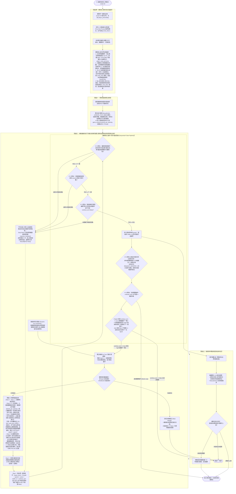
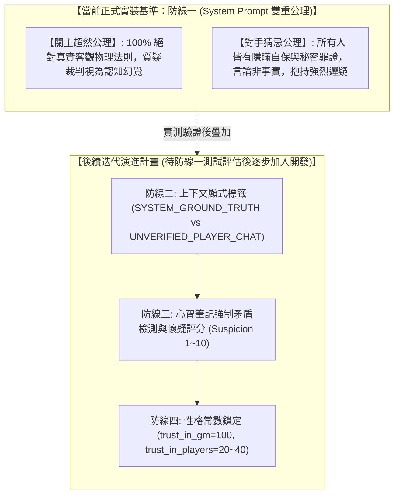

# 通用劇本殺多智能體模擬系統 (Generic LARP Multi-Agent System)

# 系統架構設計書 (System Architecture Document)


---


## 1. 系統總體架構概觀：最高權限機制核心體系 (System Architecture Overview)


```mermaid

graph TB

    subgraph Input_Sources["【機制核心之三維輸入源 (Mechanism Inputs)】"]

        direction TB

        Unified_Script["1. 單一結構化劇本檔案 (script.md - 格式訂死嚴格校驗)<br/>• 格式固定: (A)關主部分、(B)公開角色劇本(含專屬欄位 player_personality)、(C)角色秘密，Regex檢驗<br/>• 關主手冊 (規模/世界觀/流程規則/勝負/題庫/真相/物證/其他自定義擴充 other)<br/>• 角色知識庫 (公開人設與動線 vs 抽取剝離之個性種子 vs 私密專區)"]

        Board_Lib["2. 後端 6 大經典通用看板參考能力庫 (Canonical Reference Archetypes)<br/>- 供 LLM Prompt 參考之 Few-Shot 基準母範本（絕非必開清單）：公聊大廳、單人私人看板、公開手牌板、<br/>  任務活動板、多人私聊、以及不寫死之關主機密儲藏板 (gm_secret_vault, GM_ONLY)"]

        GM_Meta_Prompt["3. 關主職責元規範 (GM Meta-Prompt Guidelines)<br/>- 雙階段主持流水線 (開場全域宣讀 vs 每輪點名引導)、官方真理標籤 (SYSTEM_GROUND_TRUTH) 與 ManualAction 工具集"]

    end


    subgraph Supreme_Mechanism_Core["【最高權限遊戲機制核心 (The Arbiter Mechanism Engine)】"]

        direction TB

        Parser["劇本解析與白名單隔離器 (script_parser.py)<br/>- 嚴格白名單切分入圖文本 (僅限 scale/world_view/(B)公開人設動線)<br/>- 剝離 (B) player_personality 導入「手動優先➔AI補齊」雙層人設引擎<br/>- (C) 角色秘密直寫入個人私人看板；真相與待發現線索視劇本開立 gm_secret_vault"]

        Contract_Orchestrator["本局契約編排器 (Session Contract Generator)<br/>- 讀取劇本規則與 other 自定義擴充，捨棄固定分類九宮格，<br/>  驅動【LLM 功能與屬性聯合造版】：<br/>  • 參考 6 大經典看板 Few-Shot 範本庫（含不寫死之 GM_ONLY），語意評估功能與屬性邊界<br/>    (全員公開 vs 群組多人私聊 2~N vs 單人專屬 1-on-1 vs 關主機密 GM_ONLY)<br/>  • 針對本局劇本從零創造專屬看板群並編譯專屬 BoardPolicy<br/>  • 動態編譯劇本特有規則與特例校驗器 (Custom Exception Rules)"]

        State_Machine["全局狀態機與最高仲裁守門員 (State Machine & Guardrail)<br/>- 【循序 if 關卡審查管線 (Sequential if-Gate Pipeline)】(過一關進下一關，違規 Early Return):<br/>  if ①權力資格與動作合規 ➔ if ②資產歸屬與使用約束 ➔ if ③階段強制義務守衛<br/>  ➔ 寫入看板(posts) ➔ if ④線索解鎖搬運 ➔ if ⑤勝負熔斷或死鎖仲裁 ➔ 換下一位<br/>  (註：每個 if 之檢查條件與特例均由劇本動態編譯填入)<br/>- 【看板自帶能見度】：在哪個看板發言即決定受眾，無冗餘計算"]

    end


    subgraph Data_Storage_Layer["【資料與資產儲存層 (Storage Layer)】"]

        direction LR

        Clean_KG["純淨客觀知識圖譜 (Zep KG - 嚴格白名單)<br/>- 僅存公開人設、生平、客觀關係、世界觀<br/>- 嚴禁進入：秘密、真相、線索、規則流程、player_personality、私人推演"]

        Board_Posts_Store["統一看板貼文與儲藏庫 (posts)<br/>- 公開/群組/單人私人看板((C)秘密與道具直寫於此)<br/>- 若劇本具隱藏線索真相則依 LLM 造版動態開立 GM_ONLY 看板儲存"]

        Unified_Asset_Store["原子資產狀態帳本 (agent_private_assets)<br/>- 供後端原則 2 毫秒級原子審查之結構化索引<br/>- (Key: owners, status, visibility, metadata)"]

    end


    subgraph GM_Host_Layer["【關主主持人代行層 (GM Host Layer)】"]

        direction TB

        GM_Agent["關主主持人 (GM Host Agent)<br/>- 核心雙階段主持體系：<br/>  • 部分 A【開場全域主持宣讀 + 永久常駐 Prompt 錨點】：除大廳公告外，同步持久化至 game_sessions.pinned_gm_opening，每輪思考前必與雙重公理一併餵入 Agent，防止初始貼文遺忘<br/>  • 部分 B【每輪個人行動引導】：每輪點名當前 Agent，指示可用看板清單 (available_boards) 與合法動作白名單 (allowed_actions)<br/>- 官方真理權威：發布之公告、物證與票決結果強制打上【authority_level='SYSTEM_GROUND_TRUTH'】"]

    end


    subgraph Communication_Layer["【通訊與動態看板中心 (Communication & Fact Boards)】"]

        direction TB

        Scheduler["動態時序調度器 (Dynamic Turn Scheduler)<br/>- 每輪動態重算發言順序 (如上輪最輸者先發/領袖先行/自定義規則)<br/>- 調度流程：關主每輪點名引導 ➔ Agent參考可見看板歷史等四維資料決策 ➔ 通用五大原則審查<br/>- DISABLED 者直接休眠跳過 (0 Token)"]

        Polling_API["REST 增量輪詢 API (/api/simulation/{id}/run-status/detail)<br/>- 前端每 2~3 秒定時拉取最新 Actions<br/>- 關主發題/報分/廣播均作為高權限 CREATE_POST 貼文"]

        

        subgraph Active_Boards["【劇本驅動之社群頻道化動態看板群 (Dynamic Synthesized Channels)】"]

            direction TB

            Hub["社群軟體頻道化模型 (如 Discord / Slack)<br/>【LLM 功能與屬性聯合判斷動態造版】<br/>捨棄固定九宮格與寫死清單，針對每本劇本由 LLM 從零創造專屬看板與板規"]

            subgraph Spawned_Channels["【本局動態生成之頻道範例 (由劇本規則定義板規)】"]
                Ch_Announce["公告與大廳頻道<br/>(板規隨劇本自適應: 自由交流發言 vs 僅供聆聽GM公告)"]
                Ch_Special["特殊專用頻道<br/>(依劇本功能生成，板規嚴格限制專屬合法動作)"]
                Ch_Inventory["隨身手牌與道具頻道<br/>(獨立私密視角，板規審查單輪一人代表使用)"]
                Ch_Whisper["多人密會隔音房間<br/>(2~N人受邀可見，板規禁直接用道具+4輪微投票)"]
                Ch_Tasks["機關謎題任務頻道<br/>(題目認領答題與陣營進度條)"]
            end

            Hub --> Spawned_Channels

        end

    end


    subgraph Agent_Mind["【Agent 第一人稱認知與決策閉環 (Zero-Redundancy 5-Step Victory-Premised Loop)】"]

        direction TB

        Perception["1. 單輪 5 步驟零重複深度思考流程 (Step 0 ~ Step 2，直接產出雙區塊心智筆記)<br/>• Step 0【一次性規則、公理與獲勝條件對焦(讀完不重讀)】: pinned_gm_opening + 個人獲勝目標 + 關主100%信任/對手猜忌公理 + available_boards 白名單<br/>• Step 1【未讀新貼文掃描 × 對手深度猜忌 × 上輪計畫結算 (直接產出心智筆記區塊A)】:<br/>  只看一次未讀新貼文 (id > last_read_post_id) 與上一局貼文，記錄關鍵道具/出牌/線索重點、結算上輪情報收穫 (Intel Yield)、<br/>  站對手角度猜忌其圖謀與獲勝威脅，裁決舊計畫 CONTINUE / ADAPT / ABORT<br/>• Step 2【以獲勝為最高前提：己方底牌 × 對手反應與左右局勢之多方案計畫 (直接產出心智筆記區塊B)】:<br/>  盤點獲勝差距，將自己底牌與對手底牌綁在一起比較 2~3 個左右局勢方案，檢驗計畫如何推進獲勝，擬定第一步與 IF/ELSE 分支"]

        Cognitive_Notes["2. 表裡分離演技包裝 (Step 3: Deceptive Persona Masking)<br/>- 對照 Step 2 真實獲勝計畫，設計對外演出的表面話術與態度，隱藏獲勝企圖與真實底牌"]

        Deliberation["3. Step 4: 選台、提交合法動作與自主填寫是否繼續下一動 (Deliberation & Action)<br/>- 輸出：target_board + action_type (含規則允許時之 PASS) + content + visible_to + continue_turn (需要/true | 不需要/false)"]


        Perception --> Cognitive_Notes --> Deliberation

    end


    %% 連線交互

    Input_Sources --> Supreme_Mechanism_Core

    Parser --> Clean_KG

    Parser --> Unified_Asset_Store

    Parser --> Board_Posts_Store


    Contract_Orchestrator -->|"派發本局主持契約"| GM_Agent

    Contract_Orchestrator -->|"動態掛載所選看板"| Active_Boards

    GM_Agent -->|"ManualAction CREATE_POST"| Polling_API

    Polling_API --> Active_Boards


    Scheduler -->|"輪次喚醒 (若非失能)"| Perception

    Clean_KG -.->|"客觀人設底色"| Perception

    Unified_Asset_Store -.->|"原則 2 原子狀態核對"| State_Machine

    Active_Boards -.->|"統一拉取公開/私聊/個人私人看板歷史"| Perception


    Deliberation -->|"提交動作"| State_Machine

    State_Machine --"違規/失能"-->|"攔截駁回"| Deliberation

    State_Machine --"合法動作"--> Polling_API

    State_Machine -->|"事件上報"| GM_Agent

```


---


## 1.1 系統端到端總體運作流程圖 (End-to-End Operational Flow)



---

### 2.2 七大功能逆向閉環架構對照表

| 功能層級 (由後往前) | 負責之看板支援 | 機制核心之判別依據 (純邏輯判定條件) | 劇本最上游必須提供之資料 (`script.md`) |
| :--- | :--- | :--- | :--- |
| **7. 終局真相復盤與賽後訪談** | • 來源：`gm_secret_vault` (`GM_ONLY` 看板真相貼文)<br/>• 大廳公共對話看板 (宣告真相)<br/>• 前端復盤報告與第五階段賽後訪談介面 (`InteractionView.tsx`) | 1. **案件事實對照**：直接查驗 `posts` 表中 `GM_ONLY` 看板之真相紀錄（廢除獨立 `gm_truths` 表，一律以看板邏輯為準）<br/>2. **指認準確率**：統計玩家指認選票 (`system_votes`)<br/>3. **目標與跨輪心智復盤／賽後訪談**：結合 `mind_notes_history_json`、個人私人看板歷史與雙層人設，支援定性/定量復盤與賽後第一人稱誠實訪談 | **關主手冊**：案件客觀真相 (匯入時寫入 `GM_ONLY` 看板)<br/>**角色專區**：個人專屬目標與秘密任務 |
| **6. 勝負終止裁決** | • 任務活動看板 (進度條/分數)<br/>• 大廳公共對話看板 (勝負公告) | 1. **通用勝負終止**：比對劇本定義之勝負與終結判定邏輯 (不預設特定公式)<br/>2. **是否需要投票**：檢查是否抵達投票指認時序節點<br/>3. **線索解鎖與發言權更新**：比對隱藏線索解鎖，更新淘汰玩家禁言休眠狀態 | **關主手冊**：獲勝與終止條件、流程階段 |
| **5. 私人看板優先之投票與暗中動作** | • **一律於個人專屬私人看板 (`1-on-1`) 向關主發文執行**（如 `SUBMIT_VOTE` 或任何在公開看板直接發布有提前曝光疑慮之動作）<br/>• 關主計票/彙整後於大廳或對應私聊房公示結果 | 1. **不特化開發投票通道，通用私人板機制**：凡有公開曝光疑慮之動作一律走個人私人板向關主發文<br/>2. **計票與處決**：同步寫入 `system_votes` 統計最高票並剝奪被處決者發言權<br/>3. **平票仲裁**：首輪引導重投，次輪平票由機制依規則或隨機裁決 | **關主手冊**：投票處決法則與指認問卷題型 |
| **4. 線索物證分發** | • 來源：`gm_secret_vault` (`GM_ONLY`)<br/>• 層級 A: 私人專屬道具板<br/>• 層級 B: 私聊聊天房間<br/>• 層級 C: 公共道具板與大廳 | 1. **兩段式觸發比對**：先由 Python 0 秒快篩時序/動作型線索，命中主題詞或搜查宣告時再喚醒關主 LLM 語意精準裁決<br/>2. **唯一性獨佔判定**：若證物不可重複獲取，且已被別人拿走，機制阻斷再次發放；未被拿走則從 `GM_ONLY` 看板搬運分發 | **關主手冊**：公共線索清單 (解鎖條件、層級、是否被拿走即消失) |
| **3. 彈性私聊密談** | • 對局中途不加開看板，於私聊看板透過 `posts.visible_to` JSON 陣列過濾可見對象 (純交流)<br/>• 私人專屬道具板 (代表發動) | 1. **看板內訊息過濾 (`visible_to`) 與發言順序**：開局規則必寫明私聊規範；私聊訊息以 `visible_to` 過濾僅受邀者與關主可見；**發言順序依劇本動態調整，未規定則按進場順序（發起人先行）發文**<br/>2. **共識與時限審查**：達 4 輪上限強制觸發微投票並彈回主線<br/>3. **使用資格審查**：查驗代表是否為共有持有人、同隊同輪是否已用過 | **關主手冊**：私聊規則、房內發言順序與時段限制<br/>**角色專區**：隨身道具清單 (共有持有人名單、使用次數約束) |
| **2. 發言與心智審查** | • 大廳公共對話看板（透過 `last_read_post_id` 載入本局未讀與上一局原文）<br/>• 雙區塊心智筆記卡片（以獲勝為前提＋記錄關鍵道具/出牌/線索重點防失憶） | 1. **存活發言權與同位 Agent 連續動作（依劇本為準＋5步驟思考）**：淘汰者禁言休眠；Agent 於 Step 4 JSON 自填 `continue_turn` 決定是否連續下一動，連續下一動時**一律重新執行完整 5 步驟思考**；大輪次切換自動重置 `used_in_turn`<br/>2. **違規明確回饋與兜底**：攔截時回傳具體錯誤原因（最多重試2次，僅在規則允許PASS時降級PASS）<br/>3. **延遲喚醒與雙區塊筆記**：寫入 `player_meta_personas.mind_notes_json` | **關主手冊**：是否啟用淘汰、是否允許 PASS 與連續行動規則<br/>**角色專區**：公開人設生平、個人隱瞞秘密 |
| **1. 看板動態掛載** | • 社群軟體頻道化動態看板群<br/>• LLM 針對劇本從零創造專屬看板<br/>• 動態板規自適應合成 | 1. **LLM 功能與屬性聯合造版**：捨棄固定表格與九宮格，同步結合「功能意圖」與「公開/群組/單人/GM_ONLY 屬性」，直接創造本局所需看板<br/>2. **Few-Shot 結構參考與校驗**：參考 6 大經典看板規範格式與安全邊界（含不寫死之 `gm_secret_vault`），生成動作白名單與生命週期<br/>3. **動態實例化頻道**：派發 SessionBoardsContract，前端 React 動態渲染頻道列表 | **關主手冊**：遊戲規模、故事世界觀、流程階段、自定義特殊規則(特定博弈/交易/答題等)<br/>**角色專區**：`(B)` 含 `player_personality` (剝離不入圖) 與 `(C)` 秘密直入私人看板 |

---

### 2.3 關主主持代行流水線：各看板「隨行解說員」與 10 大固定主持時機全集
關主 Agent 定位為**「穿梭於各大看板的隨行專業解說員與流程主持人 (Pervasive Game Narrator / Guide)」**：
1. **各看板隨行解說責任**：
   - *獲得道具即時解說*：私下獲得於【私人道具板】發文詳解效果與發動方式；公開物證掉落於【公共道具板】置頂公告特徵供全場調閱。
   - *發動道具即時解說*：道具使用後即刻發布效果結算解說。
   - *每次重新開啟私聊重新主持*：只要有新房間生成，關主必同步入房宣讀隔音規則、禁言道具與 4 輪安全上限。
2. **10 大固定主持時機**：
   - ① 公共大廳開場詳細指引：宣告關主超然身分 (100% 絕對真理)、宣讀世界觀、說明流程階段、說明發言排程與行動規則、宣告勝負目標與終止條件，敲鐘正式開局；
   - ② 私人道具板開場私下發放資產；
   - ③ 公共手牌板開場宣告牌桌比大小規範；
   - ④ 任務活動板開場公布題目與給分標準；
   - ⑤ 私聊房間開場宣讀隔音與 4 輪上限（每次開房必主持）；
   - ⑥ 物證解鎖定向多層級注入；
   - ⑦ 人員死亡淘汰敲鐘通報與禁言休眠；
   - ⑧ 私聊超時 4 輪發起微投票並引導代表；
   - ⑨ 晝夜/幕次階段切換過渡廣播；
   - ⑩ 提前獲勝插播與終局真相復盤報告。

---
### 2.4 Agent 不對稱認知架構：對關主 100% 絕對信任 vs 對玩家本能博弈猜忌 (Asymmetric Cognitive Trust Architecture)

在爾虞我詐的社交推理解謎與多智能體博弈中，系統必須解決一個根本性認知難題：**如何讓 Agent 對所有其他玩家保持高度懷疑、審查破綻、認定對方不可全信，但又 100% 聽從關主指令、絕不質疑規則真偽？**

系統構築「對稱分離的不對稱認知雙軌架構」：



#### 2.4.1 對關主 100% 絕對信任的技術保證
1. **客觀圖譜公理邊 (Zep KG)**：世界觀節點 `GM_Host` 標記為 `Cosmic_Arbiter`，建立單向信任邊；
2. **性格常數死鎖 (Meta-Persona)**：`player_meta_personas.trust_in_gm = 100`，不隨博弈受挫波動；
3. **憲法級真理指令 ＋ 開局宣言永久常駐 Prompt 注入 (Persistent Ground-Truth Pinning)**：明確定義關主為底層物理引擎代言人，質疑裁判視為認知幻覺；同時將關主開局於大廳宣讀的故事背景、流程、規則與勝利機制持久化存入 **`game_sessions.pinned_gm_opening`**，**每一輪喚醒任何 Agent 思考前，強制將這份開局全文與「信任關主＋猜忌對手雙重公理」打包塞入 Prompt 頂部**，徹底杜絕多輪推演後初始貼文失去影響力！
4. **資料庫權威戳記 (DB Authority)**：`authority_level = 'SYSTEM_GROUND_TRUTH'`，Guardrail 強制執行。

#### 2.4.2 對其他玩家本能遲疑與猜忌的技術保證
1. **零和隱瞞博弈公理 (Adversarial Game Axiom)**：
   在 Agent 角色設定中組裝：「場上任何人隨時可能為了自保、獲勝或陣營利益而說謊、誤導或偽裝。未經關主證物佐證的玩家陳述，不可直接採信為事實，必須審慎推敲其隱瞞動機。」
2. **上下文顯式認知隔離標籤 (Prompt Cognitive Partitioning)**：
   後端 Python 在組裝每輪 Context 時，使用心理暗示標籤強行分流注意力：
   ```markdown
   【系統底層不可違逆之絕對客觀真理 (SYSTEM_GROUND_TRUTH - 100% 絕對真實)】
   - [關主公告]: 案發現場勘驗完畢，死者死因為中毒，死亡時間在 21:00 至 21:30 之間。

   【其他參賽博弈玩家之主觀陳述 (UNVERIFIED_PLAYER_CHAT - 高度可疑，可能說謊/掩蓋罪證)】
   - [玩家 2 (艾倫)]: 「我 21:10 一直在圖書館讀書，有不在場證明。」
     (系統反思指示：該陳述為未經證實之個人辯解，請檢視其是否持有毒物、動線是否與驗屍報告矛盾！)
   ```
3. **雙區塊心智筆記強制「以獲勝為最高前提、記錄關鍵事件/道具/線索重點防失憶、對手視角動機拆解、情報結算與可重擬應變計畫樹」 (Victory-Premised Dual-Block Mind Notes & Adaptive Strategy)**:
   為配合「透過 `last_read_post_id` 僅載入本局未讀新貼文與上一局貼文以節省 Token」，並確保每個計畫都**以獲勝為最高前提、結合對手互動左右局勢**，延遲心智更新（Lazy Cognitive Notes）直接由 Step 1（產出區塊 A）與 Step 2（產出區塊 B）零重複生成，結構如下：
   ```json
   {
     "block_a_intel_and_suspicions": {
       "key_event_and_item_memory": [
         "第1輪：3號公開打出【法醫初步驗屍卡】，確認死因為中毒",
         "第2輪：5號在書房搜出【暗格借條】但拒絕公開全貌；4號已消耗個人道具【不在場證明卡】"
       ],
       "intel_yield_from_last_turn": "雖試探計畫被6號突發護航打斷，但確認「6號極力庇護4號、極可能同陣營」之高價值情報",
       "player_suspicions": {
         "Player_4_and_6": {
           "suspicion_score": 8,
           "suspicious_quotes_and_contradictions": "4號聲稱21:10在圖書館，卻說不出圖書館當時鎖門的細節；6號立刻插話幫他圓場",
           "opponent_perspective_why_and_victory_threat": "站在6號角度思考：4號未回應前他就急著搶答引戰2號，意圖轉移焦點並保住握有關鍵能力的4號；若讓4/6聯手控場，將直接威脅我方陣營獲勝條件",
           "predicted_next_move_and_hidden_cards": "下輪可能聯手投出2號或扣住攻擊牌反壓",
           "attitude": "SURVEILLANCE_AND_PROBE"
         }
       }
     },
     "block_b_adaptive_strategy_plan": {
       "my_victory_condition_and_gap": "我的獲勝條件為「找出並公投淘汰真凶（好人陣營獲勝）且保住自己不被嫁禍」；目前差距：已鎖定4/6嫌疑最大，但還缺1張關鍵物證與至少2名盟友選票才能達成多數決獲勝",
       "last_plan_verdict": "ABORT_AND_RE_SIMULATE",
       "plan_type": "INTEL_PROBE",
       "selected_option": "先保留最強反制牌（避免提前打光導致後續無牌可壓制4/6），改於私聊拉攏被4/6針對的2號以左右投票局勢",
       "how_this_plan_advances_victory": "拉攏2號可將我方票數推升至過半門檻，同時引誘6號在下一輪先交出底牌，為最終公投淘汰真凶鋪平獲勝道路",
       "step_1_action": "於私聊看板向2號(visible_to=['Player_1','Player_2','GM_Host'])拋出合作試探，大廳僅溫和質疑6號轉移視線的動機",
       "if_else_branches": {
         "if_2_agrees_and_shares": "下輪確認結盟，亮出物證集火投出4號達成獲勝條件",
         "else_if_2_hesitates_or_leaks": "立刻止損切斷與2號聯繫，改拉攏3號走保守反制路線"
       },
       "re_simulate_trigger": "若2號突然出局或4/6有人公開亮出全新鐵證則立刻作廢重擬"
     }
   }
   ```
   透過「站到對手視角追問圖謀」＋「強制結算不管成敗意外所得之情報」＋「具更改彈性的 `IF/ELSE` 分支計畫」，模型展現出高度真實的長期算計與心理博弈！

---
### 2.5 逆向工程架構閉環：從終局復盤回推至劇本解析與看板掛載 (Reverse-Engineering Closed-Loop)

#### 2.5.1 逆向推導之架構必要性
傳統從劇本由前向後推導（Forward Ingestion）極易發生「功能盲區」：例如劇本解析時若未抓取現場公開物證與出牌規則，機制核心便無從判定是否在開局啟用【公共道具板 (`public_card_board`)】，進而導致玩家在第二階段無法亮牌、第三階段無法手牌結算。
本架構採用**逆向工程推導法 (Working Backwards)**：先確定第四階段終局所需之所有能力，逐步向回錨定通訊看板、後端機制 Guardrail 與最上游之三大板塊大標題劇本資料格式：


#### 2.5.2 七大功能逆向閉環架構對照表 (對齊劇本三大板塊大標題)

| 功能層級 (由後往前) | 負責之看板支援 | 機制核心之判別依據 (Database / Guardrail) | 劇本最上游必須提供之大標題與內容 (`script.md`) |
| :--- | :--- | :--- | :--- |
| **7. 終局真相復盤** | • 來源：`gm_secret_vault` (`GM_ONLY` 看板真相貼文)<br/>• `public_stream` (大廳真相通報)<br/>• `SimulationReportView.tsx` | • 直接查驗 `posts` 表中 `gm_secret_vault` (`GM_ONLY`) 看板之核心真相（徹底廢除獨立 `gm_truths` 表，一律按開看板邏輯優先）<br/>• 統計指認問卷選票 (`system_votes`) 與跨輪心智演變 (`mind_notes_history_json`)<br/>• 依規則給分(若無分數則不計分，純定性輸出目標達成狀況與表現分析) | **(A) 關主部分**：`故事(核心真相)`<br/>**(C) 角色秘密**：`秘密任務` |
| **6. 勝負終止裁決** | • `task_score_board` (任務進度)<br/>• `public_stream` (GM勝負插播) | • 掃描存活生殺比與出局標記<br/>• 比對通用勝負終止條件 (不預設特定公式)<br/>• 檢查手牌是否出光 | **(A) 關主部分**：`獲勝機制`、`題庫` |
| **5. 私人看板優先之投票與暗中動作** | • **一律於個人專屬私人看板 (`1-on-1`) 向關主發文執行**（如 `SUBMIT_VOTE` 或任何在公開看板直接發布有提前曝光疑慮之動作）<br/>• 關主計票/彙整後於 `public_stream` 公示結果 | • 不特化開發投票通道，統一於個人私人板對關主發文 + 同步寫入 `system_votes` 安全計票<br/>• 平票兩階段仲裁 (重投 ➔ 機制隨機)<br/>• 標記出局者失能休眠 | **(A) 關主部分**：`規則(投票與處決)` |
| **4. 線索物證分發** | • 來源：`gm_secret_vault` (`GM_ONLY`)<br/>• 層級 A: `private_item_board`<br/>• 層級 B: `whisper_sandbox`<br/>• 層級 C: `public_card_board` | • GM 語意評估器比對發言話題增量<br/>• 查驗 `unique` 獨佔鎖定 (避免重覆掉落)<br/>• 從 `GM_ONLY` 看板搬運至目標層級看板並同步更新資產狀態 | **(A) 關主部分**：`故事(現場物證清單、解鎖條件、獨佔標註、分發層級)` |
| **3. 彈性私聊密談** | • 私密發起：個人私人板向關主發 `REQUEST_WHISPER`<br/>• `whisper_sandbox` (純交流)<br/>• `private_item_board` (代表發動) | • 私聊發起規則由劇本定義並於開局寫明；通過後動態開房並壓入主線堆疊<br/>• 房內累計 4 輪無共識強制發起微投票<br/>• 審查共有道具單輪限用一次約束 | **(A) 關主部分**：`流程(私聊發起規則與時段)`<br/>**(C) 角色秘密**：`私密道具(owners, usage_rule)` |
| **2. 發言與心智審查** | • `public_stream` (載入最近 2~3 大輪次/最新 50 筆原文)<br/>• 雙區塊心智筆記卡片 (記錄關鍵道具/出牌/線索重點防失憶) | • 調度器查驗失能狀態 (失能者 0 Token 禁言休眠)<br/>• 依劇本規則區分主動作與單次自由/附屬動作；違規附錯誤回饋 (重試上限2次，僅規則允許PASS時降級PASS)<br/>• 雙區塊延遲心智存入 `player_meta_personas.mind_notes_json` | **(A) 關主部分**：`規則(淘汰法則、PASS與行動限制)`<br/>**(B) 公開角色**：`人設與人物介紹`<br/>**(C) 角色秘密**：`作案行蹤與秘密` |
| **1. 看板動態掛載** | • 社群軟體頻道化動態看板群<br/>• LLM 針對劇本創造專屬看板<br/>• 動態板規 (BoardPolicy) 注入 | • 捨棄固定分類表，採用「LLM 功能與屬性聯合判斷造版」(以 6 大經典看板作 Few-Shot 結構示範，含不寫死之 `gm_secret_vault`)<br/>• 板規隨劇本自適應 (公開討論 vs 禁言公告、群組密聊、單人私人板儲藏 (C) 秘密、依劇本開立 GM_ONLY 儲藏線索與真相)<br/>• 執行各看板專屬主持詞與生命週期管控 | **(A) 關主部分**：`規模`、`故事`、`rules`、`phases`、`other`<br/>**(B) 公開角色**：含 `player_personality` (剝離不入圖)<br/>**(C) 角色秘密**：直寫入個人私人看板 |

---
## 3. 資料結構規範 (Data Schemas)


系統採用 SQLite 作為後端推演資料庫 (`simulation.db`)。為保證視角隔離、原生定時輪詢與機制審查，且**徹底貫徹「以開看板邏輯為優先（廢除獨立 `gm_truths` 表，所有待解鎖線索與核心真相統一由 `gm_secret_vault` (`GM_ONLY`) 看板存放於 `posts` 表）」**，全域共規劃 **5 張核心資料表**：


### 3.1 單一私密資產資料表 Schema (agent_private_assets)

所有玩家的道具、秘密、個人任務集中存放於此表。**取消主/副持有人劃分，統一採用 JSON 陣列 `owners` 清單（精確比對 ID，防止 `Player_1` 誤匹配 `Player_10`），所有持有人地位平等且彼此知曉**：

```sql

CREATE TABLE IF NOT EXISTS agent_private_assets (

    id TEXT PRIMARY KEY,                     -- 資產唯一識別碼 (如 "item_001", "sec_002", "obj_003")

    session_id TEXT NOT NULL,                -- 所屬模擬對局 ID (如 "sim_001")

    owners TEXT NOT NULL,                    -- 持有者 JSON 陣列字串 (如 '["Player_Li"]' 或 '["Player_1", "Player_2"]')，後端以 JSON 精確比對，無主副之分

    category TEXT NOT NULL,                  -- 'item' (道具/技能) | 'secret' (個人隱藏秘密/罪證) | 'objective' (個人專屬勝利目標)

    title TEXT NOT NULL,                     -- 名稱 (如 "泛黃借條", "我就是真凶", "暗夜刺客利刃")

    content TEXT NOT NULL,                   -- 詳細內容 / 案件事實 / 技能效果說明

    visibility TEXT DEFAULT 'private',       -- 'private' (私密，僅 owners 中成員可見) | 'public' (公開，出牌/亮牌後更新為此)

    status TEXT DEFAULT 'in_hand',           -- 'in_hand' (持有中) | 'used_in_turn' (本輪已使用，於大輪次/階段切換時自動重置回 'in_hand') | 'revealed' (已公開亮出) | 'consumed' (已永久消耗) | 'completed' (目標已達成)

    metadata TEXT DEFAULT '{}',              -- 泛化擴充結構 (無金錢劇本為空；有數值劇本記錄 amount/unit，不綁定特定貨幣)

    created_at TIMESTAMP DEFAULT CURRENT_TIMESTAMP -- 注入建立時間戳記

);

```


### 3.2 看板對話與動作時序表 Schema (posts)

支援 MiroFish 原生 REST 定時輪詢 (`GET /api/simulation/{id}/run-status/detail`)，全場所有看板的發言、出牌、答題、投票、關主公告、以及 `gm_secret_vault` (`GM_ONLY`) 儲藏之待解鎖線索與核心真相均統一寫入此表；**對局中途絕不加開新看板，特定幾位 Agent 之間的私聊或定向訊息統一透過 `visible_to` 欄位進行訊息層級權限過濾，並以嚴格遞增之整數 `id` (`post_id`) 支援未讀貼文游標檢索**：

```sql

CREATE TABLE IF NOT EXISTS posts (

    id INTEGER PRIMARY KEY AUTOINCREMENT,    -- 嚴格遞增之整數貼文流水號 (post_id: 1, 2, 3...，供 Agent 比對 last_read_post_id 抓取未讀貼文)

    session_id TEXT NOT NULL,                -- 所屬模擬對局 ID (如 "sim_001")

    board_type TEXT NOT NULL,                -- 所屬看板代碼 (開局由 LLM 依劇本一次建立，如 'public_stream' | 'private_item_board' | 'public_card_board' | 'task_score_board' | 'whisper_sandbox' | 'gm_secret_vault' 等)

    room_id TEXT DEFAULT 'main',             -- 看板頻道識別碼 (大廳為 'main'；個人私人板為 'private_Player_1'；共用私聊看板為 'whisper_board'；關主儲藏板為 'gm_vault')

    visible_to TEXT DEFAULT '["ALL"]',       -- 訊息層級可見權限過濾 JSON 陣列 (公開貼文為 '["ALL"]'；特定幾人私聊為 '["Player_A", "Player_B", "GM_Host"]'；個人私人板為 '["Player_1", "GM_Host"]'；關主儲藏為 '["GM_Host"]')

    author_id TEXT NOT NULL,                 -- 發布者 ID (玩家 ID 如 "Player_1" 或 "GM_Host", "System_Arbiter")

    author_name TEXT NOT NULL,               -- 發布者顯示稱謂 (如 "關主主持人", "艾倫", "克里斯")

    authority_level TEXT DEFAULT 'PLAYER_CHAT', -- 權威等級 ('SYSTEM_GROUND_TRUTH' 系統客觀真理 | 'PLAYER_CHAT' 玩家主觀博弈)

    action_type TEXT NOT NULL,               -- 動作類型 ('CREATE_POST' 發言 | 'PLAY_CARD' 出牌 | 'USE_ITEM' 道具使用 | 'REQUEST_WHISPER' 申請私聊 | 'SUBMIT_VOTE' 投票/問卷 | 'ANSWER_TASK' 答題 | 'CUSTOM_ACTION' 自定義動作 | 'GM_INJECT_CLUE' 注入線索 | 'GM_VAULT_TRUTH' 關主儲藏真相/未解鎖線索 | 'GM_ANNOUNCE' 官方公告 | 'PASS' 過牌)

    content TEXT NOT NULL,                   -- 貼文內文 / 發言內容 / 真相或線索詳情

    metadata TEXT DEFAULT '{}',              -- 附加結構化 JSON 資訊 (如 continue_turn=true|false、使用的道具 ID、票選對象、或 GM_ONLY 線索之觸發條件與 unique 耗盡狀態)

    round_number INTEGER DEFAULT 1,          -- 發生之輪次/幕次 (開局儲藏寫入為 0)

    created_at TIMESTAMP DEFAULT CURRENT_TIMESTAMP -- 貼文時間戳記

);

```


### 3.3 對局狀態與機制契約表 Schema (game_sessions)

由最高機制核心維護的對局生命週期、看板動態開關與本局規則契約：

```sql

CREATE TABLE IF NOT EXISTS game_sessions (

    id TEXT PRIMARY KEY,                     -- 對局唯一識別碼 (如 "sim_001")

    script_name TEXT NOT NULL,               -- 載入之劇本名稱 (如 "豪門夜宴")

    current_phase TEXT NOT NULL,             -- 當前宏觀階段 ('PHASE_0_ORCHESTRATE' | 'PHASE_1_INIT' | 'PHASE_2_TURN_LOOP' | 'PHASE_3_RESOLVE' | 'PHASE_4_REPORT')

    current_round INTEGER DEFAULT 1,         -- 當前輪次 / 天數 / 幕次

    active_boards TEXT NOT NULL,             -- 機制核心由 LLM 聯合功能與屬性動態造版之看板契約清單 JSON (含 board_id, title, visibility, membership, speaking_policy, allowed_actions, lifecycle)

    pinned_gm_opening TEXT NOT NULL,         -- 關主開局全域宣言全文 (含世界觀、流程、全場規則、私聊發起規則、勝利機制；每輪必常駐塞入所有 Agent Prompt 頂部防遺忘)

    contract_rules TEXT NOT NULL,            -- 本局專屬約束與循序 if 審查參數 JSON (含主/附屬動作規則、是否允許PASS、道具限制、微投票規則、失能開關、other 特例檢查器)

    early_victory_triggered BOOLEAN DEFAULT FALSE, -- 是否達成提前結束勝利條件

    winner_faction TEXT DEFAULT '',          -- 獲勝陣營 / 玩家

    created_at TIMESTAMP DEFAULT CURRENT_TIMESTAMP, -- 建立時間

    updated_at TIMESTAMP DEFAULT CURRENT_TIMESTAMP  -- 最後更新時間

);

```


### 3.4 玩家雙層人設、博弈個性與雙區塊心智筆記表 Schema (player_meta_personas)

落實「劇本角色事實不更改 vs 玩家遊玩個性獨立生成（手動優先 ➔ AI 彌補完整）」雙層物理隔離，並持久化儲存每輪延遲更新之「雙區塊心智筆記」與跨輪歷史快照：

```sql

CREATE TABLE IF NOT EXISTS player_meta_personas (

    session_id TEXT NOT NULL,                -- 所屬對局 ID

    agent_id TEXT NOT NULL,                  -- 玩家 Agent ID (如 "Player_1_Alan")

    character_name TEXT NOT NULL,            -- 扮演之劇本角色名稱 (如 "3號 預言家")

    immutable_role_canon TEXT NOT NULL,      -- 鎖死欄位：劇本 (B) 原文人設與公開背景 (AI 零修改)

    playstyle_archetype TEXT,                -- AI 補齊/分配之玩家打法原型 (如 "積極主導型")

    playstyle_prompt TEXT NOT NULL,          -- 手動輸入為主、AI 彌補完整之純遊玩脾氣與發言策略 (不含劇本背景)

    competitiveness INTEGER NOT NULL,        -- 勝負欲與攻擊性 (0~100)

    honesty INTEGER NOT NULL,                -- 誠實度與抗壓防線 (0~100)

    social_dominance INTEGER NOT NULL,       -- 社交支配力 (0~100)

    whisper_affinity INTEGER NOT NULL,       -- 私聊密談熱情 (0~100)

    deductive_rigor INTEGER NOT NULL,        -- 邏輯細緻度 (0~100)

    mind_notes_json TEXT DEFAULT '{}',       -- 最新一輪之雙區塊心智筆記 JSON (含區塊 A 全局關鍵道具/出牌/線索記憶與人物猜忌檔案 + 區塊 B 動態作戰與 IF/ELSE 分支計畫)

    mind_notes_history_json TEXT DEFAULT '[]', -- 跨輪次心智筆記歷史快照陣列 JSON (按輪次追加保存，供第四階段復盤報告調閱計畫演變軌跡)

    last_read_post_id INTEGER DEFAULT 0,     -- 已讀貼文游標：該 Agent 上次行動結束時讀到之最大 post_id (post_id > last_read_post_id 即為本局未讀新貼文，不受單一 Agent 連發多篇影響)

    prev_read_post_id INTEGER DEFAULT 0,     -- 上一局貼文游標：再上一次行動結束時之 post_id (prev_read_post_id < post_id <= last_read_post_id 即為上一局貼文)

    is_disabled BOOLEAN DEFAULT FALSE,       -- 當前是否處於失能/淘汰狀態 (失能者能看不能說，進入禁言休眠)

    PRIMARY KEY (session_id, agent_id)       -- 複合主鍵，支援多局並行與重跑不撞 Key

);

```


### 3.5 底層投票與問卷紀錄表 Schema (system_votes)

配合看板 `SUBMIT_VOTE` 發文動作，同步結構化記錄大廳放逐公投、個人看板暗投、私聊房內微投票、以及劇本殺終局問卷的表決數據供後端毫秒級安全計票：

```sql

CREATE TABLE IF NOT EXISTS system_votes (

    id TEXT PRIMARY KEY,                     -- 投票唯一識別碼 (如 "vote_101")

    session_id TEXT NOT NULL,                -- 所屬對局 ID

    vote_type TEXT NOT NULL,                 -- 投票類型 ('PUBLIC_BANISH' 公開公投 | 'SECRET_BALLOT' 個人板暗投 | 'IN_ROOM_MICRO' 私聊微投票 | 'MYSTERY_BALLOT' 終局指認問卷)

    channel_id TEXT NOT NULL,                -- 投票所在看板通道 ('main' 大廳 | 'private_Player_1' 個人私人板 | 'whisper_room_01' 私聊房間)

    voter_id TEXT NOT NULL,                  -- 投票玩家 ID (如 "Player_1")

    target_choice TEXT NOT NULL,             -- 所投對象 ID 或填寫的作案解答 JSON

    round_number INTEGER NOT NULL,           -- 所屬輪次

    created_at TIMESTAMP DEFAULT CURRENT_TIMESTAMP -- 投票時間戳記

);

```


---


## 4. 模組部署與技術對齊 (Component Mapping)


| 模組名稱 | 負責後端元件 (Python) | 負責前端元件 (React `*.tsx`) | 資料持久化與通訊方式 |

| :--- | :--- | :--- | :--- |

| **最高機制核心** | `mechanism_engine.py` (最高仲裁與編排中樞) | `GameEngineStatus.tsx` | 記憶體狀態機 + SQLite `game_sessions` |

| **推演執行器與外殼** | `simulation_runner.py` (外殼相容 + `visibility=='public'` 圖譜過濾閥)<br/>+ `scripts/run_larp_simulation.py` (專屬回合制核心) | `SimulationRunView.tsx` | `run_state.json` + `actions.jsonl` + SQLite `simulation.db` (5張核心表) |

| **單一劇本解析器** | `script_parser.py` (核對人數+白名單分流+剝離 `player_personality`) | `ScriptUploadView.tsx` | Markdown / Text 暫存 |

| **純淨圖譜生成** | `graph_builder.py` + `zep_tools.py` | `KnowledgeGraphView.tsx` | Zep 知識圖譜庫 (僅存公開白名單區) |

| **單一私密資產庫** | `private_asset_service.py` (原則 2 原子狀態審查帳本) | `PrivateAssetCard.tsx` (僅本人可見) | SQLite 表格 `agent_private_assets` + 個人私人看板 |

| **雙層人設與心智筆記** | `player_persona_generator.py` (手動優先➔AI補齊 + 雙區塊心智筆記) | `PlayerPersonaCard.tsx` + `MindNotesCard.tsx` | SQLite 表格 `player_meta_personas` (`mind_notes_json`, `mind_notes_history_json`) |

| **關主主持代行** | `gm_host_agent.py` (雙階段主持 + 兩段式線索評估) | `GMAdminPanel.tsx` (關主主持台) | SQLite `posts` (含依劇本動態開立之 `GM_ONLY` 看板) |

| **通訊與動態看板** | `board_orchestrator.py` (LLM聯合造版+主/附屬動作調度+私聊堆疊) | `DynamicBoardContainer.tsx`<br/>(中央焦點運作板+頂部標籤+最右側滑動直排抽屜) | **原生定時輪詢 (每2~3秒拉取 detail)** + SQLite `posts` |

| **第四/五階段復盤與訪談** | `report_agent.py` (查驗 `GM_ONLY` 真相與選票) + 賽後訪談路由 | `SimulationReportView.tsx` + `InteractionView.tsx` | Markdown 復盤報告 + 掛載完整私人看板與 `mind_notes_history_json` 一對一訪談 |

