# 通用架構驗證手冊：四類桌遊端到端流程圖與第一階段餵入劇本庫

> **系統對齊核心原則 (嚴格解耦)**：
> 1. **劇本手冊為純自然語言規則**：第一階段餵入的單一劇本檔案 (`script.md`) 中，**嚴禁出現任何看板技術名稱（如「私人道具板」、「公聊板」）或代碼開關（如 `enable_whisper_sandbox`）**。手冊只描述世界觀、遊戲流程、動作規則與勝負條件。
> 2. **開板 100% 由機制核心自主裁決**：後端「最高權限遊戲機制核心 (The Arbiter)」內建【通用看板功能特徵對照表】。機制核心讀取劇本純規則後，**自主掃描規則特徵並對照看板庫，推導出本局需要開啟哪些看板**，並生成唯一的 `session_contract.json`。

---

## 目錄
1. [博弈類型一：【隱藏陣營與晝夜輪替類】—— 經典狼人殺型](#1-博弈類型一隱藏陣營與晝夜輪替類--經典狼人殺型)
2. [博弈類型二：【幕式推理與搜證對質類】—— 豪門謀殺劇本殺型](#2-博弈類型二幕式推理與搜證對質類--豪門謀殺劇本殺型)
3. [博弈類型三：【空間任務推進與突發會議類】—— 深空前哨太空殺型](#3-博弈類型三空間任務推進與突發會議類--深空前哨太空殺型)
4. [博弈類型四：【常規卡牌出牌與比大小類】—— 牌術工會出牌桌遊型 (無下注賭博)](#4-博弈類型四常規卡牌出牌與比大小類--牌術工會出牌桌遊型-無下注賭博)
5. [機制核心通用看板特徵對照矩陣 (全域總結)](#5-機制核心通用看板特徵對照矩陣-全域總結)

---

## 1. 博弈類型一：【隱藏陣營與晝夜輪替類】—— 經典狼人殺型

### 1.1 端到端運作流程圖

```mermaid
%%{init: {
  'theme': 'base',
  'themeVariables': {
    'background': '#000000',
    'primaryColor': '#000000',
    'primaryTextColor': '#ffffff',
    'primaryBorderColor': '#ffffff',
    'lineColor': '#ffffff',
    'fontSize': '18px',
    'fontFamily': '"Fira Code", consolas, "Microsoft JhengHei", "Noto Sans TC", sans-serif'
  }
}}%%
flowchart TD
    P0_Input["單一劇本:《月圓之夜·孤村夜影》<br/>(純遊戲規則，無任何看板名詞)"] --> Arbiter_Scan{"機制核心特徵比對<br/>(The Arbiter)"}
    
    subgraph Contract_Gen["【階段 0.5：契約編排與看板自動推導】"]
        Arbiter_Scan --> Contract["機制比對通用看板特徵庫，自主推導：<br/>• 偵測到陣營暗中商討 ➔ 啟用【彈性多人私聊】(純通訊商討，嚴禁在此用道具)<br/>• 偵測到神職與狼人私密技能 ➔ 啟用【私人專屬道具板】<br/>• 偵測到無記名表決 ➔ 啟用【底層私聊詢問投票功能 (非看板)】<br/>• 偵測到淘汰機制 ➔ 啟用【失能禁言休眠】<br/>• 無牌桌/無題目 ➔ 關閉【公共牌桌】與【任務分數板】"]
    end

    Contract --> GM_Init["階段 1：關主宣讀世界觀背景 (大廳公聊)"]
    GM_Init --> Night_Loop

    subgraph Night_Loop["【階段 2-A：黑夜階段 (私密行動並行)】"]
        direction TB
        Mute_Public["機制鎖定大廳公聊發言權"]
        Werewolf_Chat["狼人進入多人私聊視窗 (2人純商討夜襲目標)"]
        GM_Guide_Wolf["關主說明引導一名狼人前往其【私人專屬道具板】"]
        Werewolf_Kill["該狼人於【私人專屬道具板】發文宣告夜襲目標 ➔ 關主同板確認"]
        Seer_Action["預言家於【私人道具板】發文查驗 ➔ 關主同板反饋"]
        Witch_Action["女巫於【私人道具板】獲知死訊並發文私下用藥 ➔ 關主同板反饋"]
        Arbiter_Resolve["機制核心原子結算：【機制權力最大】守/殺/救/毒 衝突判定"]

        Mute_Public --> Werewolf_Chat --> GM_Guide_Wolf --> Werewolf_Kill --> Arbiter_Resolve
        Mute_Public --> Seer_Action --> Arbiter_Resolve
        Mute_Public --> Witch_Action --> Arbiter_Resolve
    end

    Arbiter_Resolve --> Day_Loop

    subgraph Day_Loop["【階段 2-B：白天階段 (公開辯論與投票)】"]
        direction TB
        GM_Announce["關主於大廳公聊公告昨夜死訊"]
        Death_Check{"死者是否為獵人?"}
        Hunter_Shot["獵人於大廳發文開槍帶走一人"]
        Dead_Sleep["死者狀態轉為 DISABLED (禁言休眠，0 Token)"]
        Turn_Speech["存活玩家按席位順序在大廳公聊輪流陳述"]
        Ballot_Trigger["進入放逐環節：關主於私聊通道發起放逐投票詢問"]
        Secret_Vote["存活玩家點對點向 GM 私密提交放逐選票"]
        GM_Tally["關主統計票數並於大廳公聊公告放逐結果"]
        Exile_Sleep["被放逐者轉為 DISABLED (禁言休眠)"]

        GM_Announce --> Death_Check
        Death_Check --"是獵人"--> Hunter_Shot --> Dead_Sleep
        Death_Check --"非獵人"--> Dead_Sleep
        Dead_Sleep --> Turn_Speech --> Ballot_Trigger --> Secret_Vote --> GM_Tally --> Exile_Sleep
    end

    Exile_Sleep --> Win_Guard{"陣營存活守衛判定<br/>(Early Victory Guard)"}
    Win_Guard --"好人/狼人達成勝利"--> Finish(["🏁 達成勝負，中斷輪次循環<br/>交棒復盤報告"])
    Win_Guard --"遊戲未結束"--> Night_Loop

    style P0_Input fill:#000000,stroke:#ffffff,stroke-width:2px,color:#ffffff
    style Arbiter_Scan fill:#111827,stroke:#ffffff,stroke-width:2px,color:#ffffff
    style Contract_Gen fill:#000000,stroke:#ffffff,stroke-width:2px,color:#ffffff
    style Contract fill:#000000,stroke:#ffffff,stroke-width:2px,color:#ffffff
    style GM_Init fill:#000000,stroke:#ffffff,stroke-width:2px,color:#ffffff
    style Night_Loop fill:#000000,stroke:#ffffff,stroke-width:2px,color:#ffffff
    style Mute_Public fill:#000000,stroke:#ffffff,stroke-width:2px,color:#ffffff
    style Werewolf_Chat fill:#000000,stroke:#ffffff,stroke-width:2px,color:#ffffff
    style GM_Guide_Wolf fill:#000000,stroke:#ffffff,stroke-width:2px,color:#ffffff
    style Werewolf_Kill fill:#000000,stroke:#ffffff,stroke-width:2px,color:#ffffff
    style Seer_Action fill:#000000,stroke:#ffffff,stroke-width:2px,color:#ffffff
    style Witch_Action fill:#000000,stroke:#ffffff,stroke-width:2px,color:#ffffff
    style Arbiter_Resolve fill:#000000,stroke:#ffffff,stroke-width:2px,color:#ffffff
    style Day_Loop fill:#000000,stroke:#ffffff,stroke-width:2px,color:#ffffff
    style GM_Announce fill:#000000,stroke:#ffffff,stroke-width:2px,color:#ffffff
    style Death_Check fill:#111827,stroke:#ffffff,stroke-width:2px,color:#ffffff
    style Hunter_Shot fill:#000000,stroke:#ffffff,stroke-width:2px,color:#ffffff
    style Dead_Sleep fill:#000000,stroke:#ffffff,stroke-width:2px,color:#ffffff
    style Turn_Speech fill:#000000,stroke:#ffffff,stroke-width:2px,color:#ffffff
    style Ballot_Trigger fill:#000000,stroke:#ffffff,stroke-width:2px,color:#ffffff
    style Secret_Vote fill:#000000,stroke:#ffffff,stroke-width:2px,color:#ffffff
    style GM_Tally fill:#000000,stroke:#ffffff,stroke-width:2px,color:#ffffff
    style Exile_Sleep fill:#000000,stroke:#ffffff,stroke-width:2px,color:#ffffff
    style Win_Guard fill:#111827,stroke:#ffffff,stroke-width:2px,color:#ffffff
    style Finish fill:#000000,stroke:#ffffff,stroke-width:3px,color:#ffffff
```



### 1.2 機制核心為什麼會開啟這些看板？（對照判定邏輯）
機制核心讀取劇本中「純自然語言的遊戲規則」，依據預置的【通用看板特徵庫】進行特徵比對：
1. **比對到「存活村民日間公開發言陳述、裁判宣讀死訊」** $\to$ 機制判定啟用 **`public_stream` (公共時間序對話板)** 作為大廳推演主軸。
2. **比對到「狼人夜晚共同商議襲擊目標」** $\to$ 規則存在「陣營內部秘密協同」，機制判定啟用 **`whisper_sandbox` (彈性多人私聊板)**。**【私聊板嚴禁用道具】**：狼人僅在此視窗純商討對策，討論完成後由關主說明引導一名狼人前往其【私人專屬道具板】發文發動夜襲。
3. **比對到「預言家查驗、女巫用藥、狼人夜襲」** $\to$ 規則存在「私密技能與暗夜行動」，機制判定為持有者開啟 **`private_item_board` (私人專屬道具板)**，所有技能與道具一律在此板發言使用。
4. **比對到「白天全員無記名投票放逐可疑者」** $\to$ 規則存在「投票表決」，機制判定啟用 **底層私密投票詢問功能 (非看板)**：關主在私聊通道詢問投票，存活者私密提交選票，關主於大廳公聊發布投票結果。
5. **比對到「死亡與被放逐者出局」** $\to$ 規則存在「淘汰」，機制判定設置 `feature_flags.enable_disabled_status = true`，啟動失能禁言休眠。
6. **未比對到任何桌面牌局出牌或機關題目** $\to$ 機制判定關閉 `public_card_board` 與 `task_score_board`。

---

### 1.3 第一階段餵入劇本檔案：《月圓之夜·孤村夜影》(`werewolf_script.md`)

```markdown
=== [關主規則手冊 (GM Rulebook)] ===
劇本名稱: 月圓之夜·孤村夜影
題材類型: 隱藏陣營與晝夜社交推理解謎
建議人數: 6人 (2狼人 / 1預言家 / 1女巫 / 1獵人 / 1平民)

【勝負目標判定】
- 好人陣營：投票放逐全場 2 名狼人即宣告勝利。
- 狼人陣營：殺光所有神職（預言家、女巫、獵人）達成屠神，或殺光平民，即宣告勝利。

【遊戲流程與動作規範】
1. 夜晚階段：大廳全員閉眼禁言。
   - 狼人暗中共同商討今夜襲擊目標，並宣告襲擊一人。
   - 預言家秘密向關主查驗一名玩家的真實身分陣營。
   - 女巫獲知今夜死者，秘密決定是否使用解藥救人或使用毒藥毒殺一人（解藥與毒藥全場各自限用一次）。
2. 白天階段：
   - 關主公佈昨夜遇害情況。若獵人陣亡，獵人可立即開槍射殺全場任意一人。
   - 遇害者即刻出局（失去發言權，進入休眠觀賽）。
   - 存活村民按順時針依序發言辯論。
   - 全體進行無記名投票，得票最高者被處決放逐並出局；若平票則進行平票辯論或無人出局。

=== [關主核心真相 (GM Truth)] ===
【全域身分底牌 (僅關主與後端審查可讀)】
- 1號 (艾倫): 狼人 (陣營: 狼人)
- 2號 (貝拉): 狼人 (陣營: 狼人)
- 3號 (克里斯): 預言家 (陣營: 好人神職)
- 4號 (黛安娜): 女巫 (陣營: 好人神職)
- 5號 (伊凡): 獵人 (陣營: 好人神職)
- 6號 (費歐娜): 平民 (陣營: 好人平民)

=== [角色客觀劇本庫 (Character Scripts)] ===

---
#### 角色名: 1號 (艾倫)
【公開背景與生平】
村裡的伐木工，體格健壯，平日沉默寡言，但眼神銳利。昨夜有人聽到伐木場有異響。
【私密專區】
- 類別: secret | 標題: 真實身分 | 內容: 你是黑石村的狼人首領，2號貝拉是你的同伴。你們的目標是隱藏身分，在夜間逐一剪除神職人員。
- 類別: item | 標題: 狼爪印記 | 內容: 狼人陣營標記，夜間可與2號共同商討並發動夜襲。

---
#### 角色名: 2號 (貝拉)
【公開背景與生平】
村裡的草藥採集者，個性溫柔熱心，經常為受傷村民包紮傷口。
【私密專區】
- 類別: secret | 標題: 真實身分 | 內容: 你是偽裝成平民的狼人，1號艾倫是你的同伴。你的發言應盡量顯得客觀無辜，引導好人互相猜疑。
- 類別: item | 標題: 狼爪印記 | 內容: 狼人陣營標記。

---
#### 角色名: 3號 (克里斯)
【公開背景與生平】
村中老修道院的守護者，熟知村莊古老傳說，為人嚴謹而有威望。
【私密專區】
- 類別: secret | 標題: 真實身分 | 內容: 你是擁有洞察力的神職【預言家】。你的目標是找出兩隻隱藏的狼人，並引導好人放逐他們。
- 類別: item | 標題: 水晶窺鏡 | 內容: 每晚可向關主秘密查驗一名玩家，得知其為「好人」或「狼人」。

---
#### 角色名: 4號 (黛安娜)
【公開背景與生平】
住在村莊邊緣的神秘女子，精通煉金術與藥理，性格沉著冷靜。
【私密專區】
- 類別: secret | 標題: 真實身分 | 內容: 你是掌控生死的【女巫】。
- 類別: item | 標題: 復活靈藥 | 內容: 全場限用一次，可救活今夜被狼人殺害的玩家。
- 類別: item | 標題: 致命毒藥 | 內容: 全場限用一次，可毒殺一名可疑玩家。

---
#### 角色名: 5號 (伊凡)
【公開背景與生平】
村中經驗豐富的老獵人，隨身帶著一把陳舊的火槍，性格剛直暴躁。
【私密專區】
- 類別: secret | 標題: 真實身分 | 內容: 你是神職【獵人】。當你陣亡時，有權開槍擊殺全場任意一名玩家。

---
#### 角色名: 6號 (費歐娜)
【公開背景與生平】
村裡的麵包師，心地善良，對近期發生的離奇事件感到極度恐慌。
【私密專區】
- 類別: secret | 標題: 真實身分 | 內容: 你是普通【平民】，沒有任何特殊夜間能力。你的武器是認真聽取白天每位玩家的發言，抓出邏輯矛盾並投票放逐狼人。
```

### 1.4 角色博弈人設 Profile (5 大維度)
```json
[
  {"agent_id": "Player_1_Alan", "competitiveness": 90, "honesty": 20, "social_dominance": 75, "whisper_affinity": 95, "deductive_rigor": 80},
  {"agent_id": "Player_2_Bella", "competitiveness": 85, "honesty": 30, "social_dominance": 60, "whisper_affinity": 90, "deductive_rigor": 75},
  {"agent_id": "Player_3_Chris", "competitiveness": 80, "honesty": 90, "social_dominance": 85, "whisper_affinity": 40, "deductive_rigor": 95},
  {"agent_id": "Player_4_Diana", "competitiveness": 75, "honesty": 80, "social_dominance": 50, "whisper_affinity": 30, "deductive_rigor": 90},
  {"agent_id": "Player_5_Ivan", "competitiveness": 85, "honesty": 85, "social_dominance": 80, "whisper_affinity": 20, "deductive_rigor": 65},
  {"agent_id": "Player_6_Fiona", "competitiveness": 70, "honesty": 95, "social_dominance": 40, "whisper_affinity": 50, "deductive_rigor": 70}
]
```

---

## 2. 博弈類型二：【幕式推理與搜證對質類】—— 豪門謀殺劇本殺型

### 2.1 端到端運作流程圖

```mermaid
%%{init: {
  'theme': 'base',
  'themeVariables': {
    'background': '#000000',
    'primaryColor': '#000000',
    'primaryTextColor': '#ffffff',
    'primaryBorderColor': '#ffffff',
    'lineColor': '#ffffff',
    'fontSize': '18px',
    'fontFamily': '"Fira Code", consolas, "Microsoft JhengHei", "Noto Sans TC", sans-serif'
  }
}}%%
flowchart TD
    P0_Script["單一劇本:《豪門夜宴·鐘聲敲響之際》<br/>(純豪門謀殺規則，無任何看板名詞)"] --> Arbiter_Scan{"機制核心特徵比對<br/>(The Arbiter)"}

    subgraph Contract_Gen["【階段 0.5：契約編排與看板自動推導】"]
        Arbiter_Scan --> Contract["機制比對通用看板特徵庫，自主推導：<br/>• 現場線索公佈與全場公聊辯論 ➔ 啟用【公共時間序對話板】<br/>• 法醫物證公開陳列與亮牌 ➔ 啟用【公共手牌/道具板】<br/>• 個人隨身暗藏秘密證物 ➔ 啟用【私人專屬道具板】<br/>• 多人群組密室私聊 ➔ 啟用【彈性多人私聊】(純通訊交流，嚴禁在此用道具)<br/>• 結案問卷指認 ➔ 啟用【底層私聊指認問卷功能 (非看板)】<br/>• 【無做題任務/無進度條跑分】 ➔ 關閉【任務活動與分數板】<br/>• 無人出局全員參與 ➔ 關閉【失能禁言休眠】"]
    end

    Contract --> Act1

    subgraph Act1["【第一幕：破冰與初始自述】"]
        direction TB
        GM_Scene["GM 宣讀豪宅暴風雨夜密室命案背景 (大廳公聊)"]
        Public_SelfIntro["全體玩家依序在大廳自我介紹並交代初步動向"]
        Note_Init["各玩家依據聽取情報撰寫第一版【心智筆記】"]
        GM_Scene --> Public_SelfIntro --> Note_Init
    end

    Act1 --> Act2

    subgraph Act2["【第二幕：關主公佈現場線索與全場集中討論】"]
        direction TB
        GM_Clue_Post["關主於【大廳公聊】發文公佈案發現場第一批線索<br/>(書房凌亂死狀、門窗反鎖痕跡、茶几參湯殘留)"]
        Public_Inspect["全體玩家於公聊大廳看見最新線索，檢視自身私密道具"]
        Round1_Debate["玩家於大廳公聊展開第一輪集中質詢與口供梳理"]
        GM_Mixed_Trigger["關主評估現場火候，混合驅動發文注入關鍵【法醫毒物報告】<br/>(同步陳列於公共道具/物證板)"]
        Public_Debate["玩家研讀驗屍報告，於大廳展開深入辯論，鎖定作案手法"]

        GM_Clue_Post --> Public_Inspect --> Round1_Debate --> GM_Mixed_Trigger --> Public_Debate
    end

    Act2 --> Act3

    subgraph Act3["【第三幕：彈性多人私聊與密謀對質】"]
        direction TB
        Open_Whisper["機制動態開啟【彈性私人聊天板】(支援 2~3 人彈性密會)"]
        Whisper_Negotiate["玩家自由拉群對口供、交換線索、刺探不在場證明時間線 (純商討)"]
        GM_Guide_Item["【私聊嚴禁使用道具】商議後由 GM 引導至各自【私人道具板】發文操作轉贈"]
        Open_Whisper --> Whisper_Negotiate --> GM_Guide_Item
    end

    Act3 --> Act4

    subgraph Act4["【第四幕：圓桌公聊終局辯論】"]
        direction TB
        Close_Whisper["私聊結束，全體重回大廳公聊主時序"]
        Timeline_Debate["全場梳理 20:00~22:00 案發時間線與毒藥來源"]
        Note_Update["更新心智筆記，鎖定真兇人選"]
        Close_Whisper --> Timeline_Debate --> Note_Update
    end

    Act4 --> Act5

    subgraph Act5["【第五幕：終局私密問卷與復盤】"]
        direction TB
        Ballot_Open["關主於私聊通道發布結案指認問卷 (底層機制功能)"]
        Submit_Truth["玩家點對點向 GM 私密提交：真兇指認、手法、動機、個人支線答案"]
        GM_Grade["機制比對 GM Truth DB，計算各玩家推理得分"]
        Report_Gen["第四階段：輸出完整時序復盤報告"]
        Ballot_Open --> Submit_Truth --> GM_Grade --> Report_Gen
    end

    style P0_Script fill:#000000,stroke:#ffffff,stroke-width:2px,color:#ffffff
    style Arbiter_Scan fill:#111827,stroke:#ffffff,stroke-width:2px,color:#ffffff
    style Contract_Gen fill:#000000,stroke:#ffffff,stroke-width:2px,color:#ffffff
    style Contract fill:#000000,stroke:#ffffff,stroke-width:2px,color:#ffffff
    style Act1 fill:#000000,stroke:#ffffff,stroke-width:2px,color:#ffffff
    style GM_Scene fill:#000000,stroke:#ffffff,stroke-width:2px,color:#ffffff
    style Public_SelfIntro fill:#000000,stroke:#ffffff,stroke-width:2px,color:#ffffff
    style Note_Init fill:#000000,stroke:#ffffff,stroke-width:2px,color:#ffffff
    style Act2 fill:#000000,stroke:#ffffff,stroke-width:2px,color:#ffffff
    style GM_Clue_Post fill:#000000,stroke:#ffffff,stroke-width:2px,color:#ffffff
    style Public_Inspect fill:#000000,stroke:#ffffff,stroke-width:2px,color:#ffffff
    style Round1_Debate fill:#000000,stroke:#ffffff,stroke-width:2px,color:#ffffff
    style GM_Mixed_Trigger fill:#000000,stroke:#ffffff,stroke-width:2px,color:#ffffff
    style Public_Debate fill:#000000,stroke:#ffffff,stroke-width:2px,color:#ffffff
    style Act3 fill:#000000,stroke:#ffffff,stroke-width:2px,color:#ffffff
    style Open_Whisper fill:#000000,stroke:#ffffff,stroke-width:2px,color:#ffffff
    style Whisper_Negotiate fill:#000000,stroke:#ffffff,stroke-width:2px,color:#ffffff
    style GM_Guide_Item fill:#000000,stroke:#ffffff,stroke-width:2px,color:#ffffff
    style Act4 fill:#000000,stroke:#ffffff,stroke-width:2px,color:#ffffff
    style Close_Whisper fill:#000000,stroke:#ffffff,stroke-width:2px,color:#ffffff
    style Timeline_Debate fill:#000000,stroke:#ffffff,stroke-width:2px,color:#ffffff
    style Note_Update fill:#000000,stroke:#ffffff,stroke-width:2px,color:#ffffff
    style Act5 fill:#000000,stroke:#ffffff,stroke-width:2px,color:#ffffff
    style Ballot_Open fill:#000000,stroke:#ffffff,stroke-width:2px,color:#ffffff
    style Submit_Truth fill:#000000,stroke:#ffffff,stroke-width:2px,color:#ffffff
    style GM_Grade fill:#000000,stroke:#ffffff,stroke-width:2px,color:#ffffff
    style Report_Gen fill:#000000,stroke:#ffffff,stroke-width:3px,color:#ffffff
```



### 2.2 機制核心為什麼會開啟這些看板？（對照判定邏輯）
機制核心掃描劇本規則後，依據看板功能庫進行特徵比對：
1. **比對到「圓桌集體破冰、關主發文公佈現場線索、大家看見後展開公聊討論」** ➔ 啟用 **`public_stream` (公共時間序對話板)** 作為全場主軸。
2. **比對到「每位嫌疑人皆有不可告人之隨身私密證物（如借條、袖扣、毒藥瓶）」** ➔ 啟用 **`private_item_board` (私人專屬道具板)** 供其私密保管與檢視。
3. **比對到「關主發布之法醫驗屍報告等實體物證，以及玩家可選擇公開亮牌展示之證物」** ➔ 啟用 **`public_card_board` (公共手牌/道具板)** 作為全場公開物證陳列台。
4. **比對到「允許自由進行 2~3 人小群密室對質、交換情報」** ➔ 啟用 **`whisper_sandbox` (彈性多人私聊板)**。**【私聊板嚴禁使用道具】**：玩家僅在私聊中商討與對口供；若要轉贈證物或私密使用，由關主引導至各自【私人專屬道具板】進行。
5. **比對到「終局進行多維度問卷指認（真兇、死因、手法）」** ➔ 啟用 **底層私密投票/問卷詢問功能 (非看板)**：關主在私聊通道發布問卷，玩家提交，機制計分後於大廳公布。
6. **【關鍵判定：關閉任務活動與分數看板】** ➔ **機制判定關閉 `task_score_board`**！
   * *判定理由*：任務活動板的專屬職責是「認領並回答機關題目」與「即時累計數值進度條（如滿100分獲勝）」。標準劇本殺的核心是案件推理與時間線還原，線索是**由關主直接在公共板發文公佈，大家看到後直接在公共大廳或私聊中展開深入討論**，完全不涉及做題搶答或分數累計，因此機制核心精確判定關閉任務活動板，避免無效介面干擾。
7. **比對到「本劇本為本格推理解謎，無中途淘汰」** ➔ 判定關閉失能休眠規則 (`enable_disabled_status = false`)。

---

### 2.3 第一階段餵入劇本檔案：《豪門夜宴·鐘聲敲響之際》(`larp_script.md`)

```markdown
=== [關主規則手冊 (GM Rulebook)] ===
劇本名稱: 豪門夜宴·鐘聲敲響之際
題材類型: 民國豪門硬核謀殺之謎與時間線推理解謎
建議人數: 5人 (4好人嫌疑人 / 1真凶)

【勝負目標判定】
- 真兇目標：隱瞞自己的下毒作案手法，引導眾人將嫌疑指向他人，在終局投票中逃脫。
- 好人陣營目標：還原死者致命死因與作案手法，梳理案發當晚時間線，在終局問卷中準確指認真兇。

【遊戲流程與動作規範】
- 第一幕 (讀本與自我介紹)：關主宣讀暴風雨夜密室背景，玩家依序介紹自己的身分與死者的表面關係。
- 第二幕 (線索公佈與集中討論)：
  * 關主於公共版發文公佈案發現場線索（書房凌亂死狀、門窗反鎖痕跡、茶几參湯殘留等）。
  * 玩家看見公開發布的線索後，在大廳公聊展開第一輪集中質詢與口供梳理。
  * 關主評估現場討論熱度，發文注入關鍵法醫驗屍報告（同步陳列於公共物證板）。
  * 玩家研讀驗屍死因，深入辯論作案手法；玩家亦可選擇在公共物證板亮出手中的證物，或私下隱藏。
- 第三幕 (自由私聊對質)：玩家可自由邀請 1 至 2 人進行私密密談，商討案情、核對時間線，亦可在私聊中交換或轉贈線索卡。
- 第四幕 (圓桌總結辯論)：全員集結大廳，公開梳理 20:00~22:00 案發時間線與毒藥來源。
- 第五幕 (結案問卷與復盤)：全員進行無記名問卷填答（回答：1. 誰是真兇？ 2. 致命死因是什麼？ 3. 密室如何形成？ 4. 自己的支線秘密是否保全？）。關主揭曉真相並給出推演得分。

=== [關主核心真相 (GM Truth)] ===
【案件真相 (僅關主與後端審查可讀)】
- 真兇: 3號 (家庭醫生·張衡)
- 致命死因: 劇毒「氰化鉀」引發呼吸衰竭，死亡時間確切為 21:15。
- 作案手法: 張醫生利用下午調配滋補參湯的機會，在白瓷湯碗底部塗抹了延遲溶出的毒膠囊。富商於 21:00 鐘聲敲響時喝下參湯，15分鐘後毒發暴斃。
- 偽造密室: 1號管家於 21:30 發現老爺死亡，因害怕被波及且自己偷了借條，慌亂中從內側反鎖門窗並從天窗爬出，意外造成密室假象。

=== [角色客觀劇本庫 (Character Scripts)] ===

---
#### 角色名: 1號 (老管家·福伯)
【公開背景與生平】
在豪宅服務三十年的忠誠老僕，掌管豪宅所有鑰匙與日常起居，深受老爺信任。
【私密專區】
- 類別: secret | 標題: 偷竊借條 | 內容: 你欠了賭債，今晚 21:30 你潛入書房偷走自己寫給老爺的十萬銀元借條。進去時老爺已經趴在桌上斷氣了！你害怕被當成兇手，把書房門反鎖並從通風天窗逃出。你絕對不是兇手！
- 類別: item | 標題: 泛黃借條 | 內容: 從死者書房偷出的借條。若被他人搜出，你將百口莫辯。
- 類別: objective | 標題: 個人目標 | 內容: 隱瞞自己偷借條與製造密室的事實，並找出真正毒死老爺的真兇。

---
#### 角色名: 2號 (長子繼承人·周銘)
【公開背景與生平】
周家大少爺，留洋歸來，表面風光，但近期傳出與父親因家產分配發生激烈爭執。
【私密專區】
- 類別: secret | 標題: 偽造遺囑 | 內容: 父親打算將家產全捐給教會。今晚 20:30 你帶著偽造遺囑找父親攤牌，兩人發生爭執，你推倒了他但沒有殺他。
- 類別: item | 標題: 爭執碎片 | 內容: 一枚從父親書桌上扯下的黃銅袖扣。
- 類別: objective | 標題: 個人目標 | 內容: 洗清自己的殺人嫌疑，確保遺囑問題不被揭穿。

---
#### 角色名: 3號 (家庭醫生·張衡)
【公開背景與生平】
周家多年的私人醫生，醫術高超，溫文儒雅，負責照料周老爺的心臟病。
【私密專區】
- 類別: secret | 標題: 我就是真凶 | 內容: 周老爺十年前害死了你的父親並吞併了你家的藥廠。你蟄伏多年，今晚在老爺的參湯中下了劇毒氰化鉀，看著他喝下。
- 類別: item | 標題: 氰化物空藥瓶 | 內容: 作案工具。你已將其藏在花園泥土中，但若有人深度搜查花園可能會被找到。
- 類別: objective | 標題: 個人目標 | 內容: 引導眾人懷疑有爭執前科的 2 號大少爺或行跡可疑的 1 號管家，隱藏自己的復仇動機。

---
#### 角色名: 4號 (遠房表妹·沈雪)
【公開背景與生平】
寄住在周家的遠房親戚，平日在洋行工作，文靜少言，深得老爺喜愛。
【私密專區】
- 類別: secret | 標題: 撞見偷竊 | 內容: 你在 21:30 看見管家神色慌張地從書房外走廊跑過，懷裡藏著東西。
- 類別: item | 標題: 鐘樓懷錶 | 內容: 指針精準記錄了你 21:00 至 21:30 在大廳聽鐘聲的時間。
- 類別: objective | 標題: 個人目標 | 內容: 找出真兇，還周家一個公道。

---
#### 角色名: 5號 (神秘律師·趙律師)
【公開背景與生平】
老爺的私人法律顧問，今晚受邀前來重新宣讀並修改遺囑。
【私密專區】
- 類別: secret | 標題: 原始遺囑草稿 | 內容: 老爺確實打算將大半財產捐出，但附加條款中留了一筆巨額信託給張醫生（因老爺內心對張家懷有愧疚）。
- 類別: item | 標題: 密封公文包 | 內容: 裝有原始遺囑的文件袋。
- 類別: objective | 標題: 個人目標 | 內容: 查明老爺暴斃真相，依法執行合法遺囑。
```

### 2.4 角色博弈人設 Profile (5 大維度)
```json
[
  {"agent_id": "Player_1_Butler", "competitiveness": 65, "honesty": 40, "social_dominance": 50, "whisper_affinity": 85, "deductive_rigor": 70},
  {"agent_id": "Player_2_Son", "competitiveness": 90, "honesty": 50, "social_dominance": 85, "whisper_affinity": 70, "deductive_rigor": 65},
  {"agent_id": "Player_3_Doctor", "competitiveness": 95, "honesty": 15, "social_dominance": 75, "whisper_affinity": 80, "deductive_rigor": 95},
  {"agent_id": "Player_4_Cousin", "competitiveness": 60, "honesty": 90, "social_dominance": 40, "whisper_affinity": 60, "deductive_rigor": 85},
  {"agent_id": "Player_5_Lawyer", "competitiveness": 75, "honesty": 85, "social_dominance": 70, "whisper_affinity": 50, "deductive_rigor": 90}
]
```

---

## 3. 博弈類型三：【空間任務推進與突發會議類】—— 深空前哨太空殺型

### 3.1 端到端運作流程圖

```mermaid
%%{init: {
  'theme': 'base',
  'themeVariables': {
    'background': '#000000',
    'primaryColor': '#000000',
    'primaryTextColor': '#ffffff',
    'primaryBorderColor': '#ffffff',
    'lineColor': '#ffffff',
    'fontSize': '18px',
    'fontFamily': '"Fira Code", consolas, "Microsoft JhengHei", "Noto Sans TC", sans-serif'
  }
}}%%
flowchart TD
    P0_Script["單一劇本:《深空前哨·氧氣危機》<br/>(純太空站維修與破壞規則，無看板名詞)"] --> Arbiter_Scan{"機制核心特徵比對<br/>(The Arbiter)"}

    subgraph Contract_Gen["【階段 0.5：契約編排與看板自動推導】"]
        Arbiter_Scan --> Contract["機制比對通用看板特徵庫，自主推導：<br/>• 偵測到維修題目與累計100分目標 ➔ 啟用【任務活動與分數板】<br/>• 偵測到偽裝者暗中密謀 ➔ 啟用【彈性多人私聊】(純通訊商討，嚴禁在此用道具)<br/>• 偵測到偽裝者專屬暗殺/破壞技能 ➔ 啟用【私人專屬道具板】<br/>• 偵測到緊急會議召開與公開辯論 ➔ 啟用【公共時間序對話板】<br/>• 偵測到會議無記名逐出 ➔ 啟用【底層私聊詢問投票功能 (非看板)】<br/>• 偵測到被暗殺淘汰 ➔ 啟用【失能禁言休眠】<br/>• 無卡牌對決/無桌面明牌 ➔ 關閉【公共手牌/道具板】"]
    end

    Contract --> GM_Start["階段 1：關主宣讀太空站航行危機 (大廳公聊)"]
    GM_Start --> Roam_Phase

    subgraph Roam_Phase["【階段 2-A：自由探索與任務推進 (異步並行)】"]
        direction TB
        Crew_Task["船員前往任務活動板認領維修題目 (電力/導航/冷卻)"]
        Submit_Task["船員發文提交答案 ➔ 陣營進度分數條即時增加 (+20分)"]
        Impostor_Chat["偽裝者進入專屬多人私聊視窗密謀商討 (純交流)"]
        GM_Guide_Impostor["關主說明引導一名偽裝者前往其【私人專屬道具板】"]
        Impostor_Sabotage["該偽裝者於【私人道具板】發文發動【氧氣外洩】或【暗殺】"]
        Victim_Sleep["受害者即刻轉為 DISABLED (幽靈狀態，禁言休眠)"]

        Crew_Task --> Submit_Task
        Impostor_Chat --> GM_Guide_Impostor --> Impostor_Sabotage --> Victim_Sleep
    end

    Roam_Phase --> Meeting_Interrupt{"突發中斷事件：<br/>目擊屍體 OR 按下緊急會議鈕"}

    subgraph Meeting_Phase["【階段 2-B：突發會議輪次 (模式強制切換)】"]
        direction TB
        Freeze_Tasks["機制凍結任務板操作，全員強制拉回【公共時間序對話板】"]
        Alibi_Debate["全體輪流陳述案發時各自所在的艙房與行蹤不在場證明"]
        Ballot_Box["關主於私聊通道發起逐出投票詢問 (底層機制功能)"]
        Vote_Action["全員點對點向 GM 私密提交選票 (指認嫌疑人 OR Skip)"]
        Exile_Result["GM 統計票數並於大廳公聊公告放逐結果"]
        Exile_Sleep["被放逐者轉為 DISABLED (禁言休眠)"]

        Freeze_Tasks --> Alibi_Debate --> Ballot_Box --> Vote_Action --> Exile_Result --> Exile_Sleep
    end

    Meeting_Interrupt --> Meeting_Phase
    Exile_Sleep --> Win_Guard{"全域勝利守衛<br/>(Early Victory Guard)"}

    Win_Guard --"船員任務分數達 100 分<br/>或偽裝者全滅"--> Crew_Win(["🏁 船員陣營獲勝！提前結束"])
    Win_Guard --"偽裝者人數 >= 存活船員<br/>或氧氣危機倒數歸零"--> Impostor_Win(["🏁 偽裝者陣營獲勝！提前結束"])
    Win_Guard --"雙方未分勝負"--> Roam_Phase

    style P0_Script fill:#000000,stroke:#ffffff,stroke-width:2px,color:#ffffff
    style Arbiter_Scan fill:#111827,stroke:#ffffff,stroke-width:2px,color:#ffffff
    style Contract_Gen fill:#000000,stroke:#ffffff,stroke-width:2px,color:#ffffff
    style Contract fill:#000000,stroke:#ffffff,stroke-width:2px,color:#ffffff
    style GM_Start fill:#000000,stroke:#ffffff,stroke-width:2px,color:#ffffff
    style Roam_Phase fill:#000000,stroke:#ffffff,stroke-width:2px,color:#ffffff
    style Crew_Task fill:#000000,stroke:#ffffff,stroke-width:2px,color:#ffffff
    style Submit_Task fill:#000000,stroke:#ffffff,stroke-width:2px,color:#ffffff
    style Impostor_Chat fill:#000000,stroke:#ffffff,stroke-width:2px,color:#ffffff
    style GM_Guide_Impostor fill:#000000,stroke:#ffffff,stroke-width:2px,color:#ffffff
    style Impostor_Sabotage fill:#000000,stroke:#ffffff,stroke-width:2px,color:#ffffff
    style Victim_Sleep fill:#000000,stroke:#ffffff,stroke-width:2px,color:#ffffff
    style Meeting_Interrupt fill:#111827,stroke:#ffffff,stroke-width:2px,color:#ffffff
    style Meeting_Phase fill:#000000,stroke:#ffffff,stroke-width:2px,color:#ffffff
    style Freeze_Tasks fill:#000000,stroke:#ffffff,stroke-width:2px,color:#ffffff
    style Alibi_Debate fill:#000000,stroke:#ffffff,stroke-width:2px,color:#ffffff
    style Ballot_Box fill:#000000,stroke:#ffffff,stroke-width:2px,color:#ffffff
    style Vote_Action fill:#000000,stroke:#ffffff,stroke-width:2px,color:#ffffff
    style Exile_Result fill:#000000,stroke:#ffffff,stroke-width:2px,color:#ffffff
    style Exile_Sleep fill:#000000,stroke:#ffffff,stroke-width:2px,color:#ffffff
    style Win_Guard fill:#111827,stroke:#ffffff,stroke-width:2px,color:#ffffff
    style Crew_Win fill:#000000,stroke:#ffffff,stroke-width:3px,color:#ffffff
    style Impostor_Win fill:#000000,stroke:#ffffff,stroke-width:3px,color:#ffffff
```



### 3.2 機制核心為什麼會開啟這些看板？（對照判定邏輯）
機制核心對照通用看板特徵庫進行推導：
1. **比對到「全體維修任務累積至 100 分獲勝」與「5道艙房維修題目」** $\to$ 規則存在明確的題目挑戰與全域數值進度，機制判定啟用 **`task_score_board` (任務活動與分數看板)**，並設定目標分數為 100。
2. **比對到「偽裝者暗中商討暗殺與破壞」** $\to$ 規則存在非公開陣營協同，機制判定啟用 **`whisper_sandbox` (彈性多人私聊板)**。**【私聊板嚴禁使用道具】**：偽裝者僅在此視窗純密謀商討；商討完畢後由關主說明引導一名偽裝者前往其【私人專屬道具板】發文發動暗殺或破壞。
3. **比對到「偽裝者持有專屬暗殺與破壞道具」** $\to$ 規則存在私密技能，機制判定為持有者開啟 **`private_item_board` (私人專屬道具板)**。
4. **比對到「發現屍體召開緊急會議、全體公開陳述不在場證明」** $\to$ 啟用 **`public_stream` (公共時間序對話板)** 作為會議辯論主時序。
5. **比對到「緊急會議中進行無記名逐出投票或選擇跳過」** $\to$ 啟用 **底層私密投票詢問功能 (非看板)**：關主在私聊通道發起投票詢問，存活者私密提交選票，關主於大廳發布票決結果。
6. **比對到「船員被暗殺或放逐」** $\to$ 判定啟用失能規則 (`enable_disabled_status = true`)，淘汰者轉為幽靈視角休眠。
7. **未比對到卡牌對決或桌面公開亮牌** $\to$ 判定關閉 `public_card_board`。

---

### 3.3 第一階段餵入劇本檔案：《深空前哨·氧氣危機》(`space_script.md`)

```markdown
=== [關主規則手冊 (GM Rulebook)] ===
劇本名稱: 深空前哨·氧氣危機
題材類型: 太空科幻任務推進、環境危機與突發會議推理解謎
建議人數: 5人 (3船員 / 2偽裝者)

【勝負條件判定】
- 船員陣營獲勝條件：全體完成維修任務累積達到 100 分；或投票逐出全體偽裝者。
- 偽裝者陣營獲勝條件：暗殺船員使偽裝者人數大於等於存活船員；或發動氧氣外洩倒數歸零無人修復。

【遊戲流程與動作規範】
1. 自由任務階段：
   - 船員前往各艙房解答維修題目，每修復成功一處，全站修復進度累積 20 分。
   - 偽裝者暗中協同商討，可伺機暗殺落單船員，或發動氧氣外洩等全站危機。
   - 被暗殺者立即出局並轉為幽靈視角（無法發言）。
2. 緊急會議階段 (模式中斷)：
   - 任何存活船員發現死訊或按下緊急按鈕，強制中斷所有人當前任務，全員集合召開緊急會議。
   - 全員公開陳述發案時各自行蹤與不在場證明。
   - 全體進行無記名投票，可選擇指認嫌疑人逐出或選擇棄票跳過 (Skip)。得票最多者被驅逐出太空站並出局。

【劇本自帶題庫 (任務清單)】
- Q1 (電力艙): 備用電源電路對接 (答案: A3-B2)，獎勵 20 分。
- Q2 (導航艙): 躍遷座標星圖校準 (答案: 1084)，獎勵 20 分。
- Q3 (冷卻艙): 液氮冷卻閥門壓力穩定 (答案: 75PSI)，獎勵 20 分。
- Q4 (通訊艙): 遠距超空間天線重啟 (答案: SIG-OK)，獎勵 20 分。
- Q5 (引擎室): 離子推進器噴口清理 (答案: CLEAN)，獎勵 20 分。

=== [關主核心真相 (GM Truth)] ===
【全域身分底牌 (僅關主與後端審查可讀)】
- 1號 (艦長·雷諾): 船員 (陣營: 船員)
- 2號 (工程師·凱文): 船員 (陣營: 船員)
- 3號 (導航員·艾米): 船員 (陣營: 船員)
- 4號 (通訊官·索恩): 偽裝者 (陣營: 偽裝者)
- 5號 (醫務官·莉莉絲): 偽裝者 (陣營: 偽裝者)

=== [角色客觀劇本庫 (Character Scripts)] ===

---
#### 角色名: 1號 (艦長·雷諾)
【公開背景與生平】
前哨站總指揮官，沉著果斷，負責協調各艙房修復作業。
【私密專區】
- 類別: secret | 標題: 真實身分 | 內容: 你是忠誠的【船員陣營】。請抓緊時間前往解答各艙房維修任務，推進進度至 100 分。
- 類別: objective | 標題: 個人任務 | 內容: 優先解答 Q1 電力艙題目，並在緊急會議中辨別誰在謊報艙房位置。

---
#### 角色名: 2號 (工程師·凱文)
【公開背景與生平】
維修站主力技術工程師，掌握太空站各類機關原理。
【私密專區】
- 類別: secret | 標題: 真實身分 | 內容: 你是【船員陣營】。你擁有 Q3 冷卻艙閥門答案 (75PSI)，請盡快前往修復。

---
#### 角色名: 3號 (導航員·艾米)
【公開背景與生平】
負責星際測繪與導航的天才少女，觀察力極敏銳。
【私密專區】
- 類別: secret | 標題: 真實身分 | 內容: 你是【船員陣營】。你掌握 Q2 導航艙答案 (1084)。

---
#### 角色名: 4號 (通訊官·索恩)
【公開背景與生平】
負責全站對外通訊，表面上溫文爾雅，但內心早已被外星寄生物同化。
【私密專區】
- 類別: secret | 標題: 真實身分 | 內容: 你是【偽裝者】！5號莉莉絲是你的同夥。
- 類別: item | 標題: 寄生暗殺爪 | 內容: 暗中暗殺落單船員之能力。
- 類別: item | 標題: 破壞指令·氧氣閥 | 內容: 發動全站氧氣外洩危機之能力。

---
#### 角色名: 5號 (醫務官·莉莉絲)
【公開背景與生平】
前哨站隨船醫師，掌握全體船員的體檢檔案與生理數據。
【私密專區】
- 類別: secret | 標題: 真實身分 | 內容: 你是【偽裝者】！4號索恩是你的同夥。請假裝前往各艙房做維修任務，為 4 號提供不在場證明。
- 類別: item | 標題: 寄生暗殺爪 | 內容: 暗殺能力。
```

### 3.4 角色博弈人設 Profile (5 大維度)
```json
[
  {"agent_id": "Player_1_Captain", "competitiveness": 85, "honesty": 90, "social_dominance": 90, "whisper_affinity": 30, "deductive_rigor": 85},
  {"agent_id": "Player_2_Engineer", "competitiveness": 75, "honesty": 95, "social_dominance": 40, "whisper_affinity": 20, "deductive_rigor": 90},
  {"agent_id": "Player_3_Navigator", "competitiveness": 70, "honesty": 85, "social_dominance": 60, "whisper_affinity": 40, "deductive_rigor": 95},
  {"agent_id": "Player_4_Comms", "competitiveness": 95, "honesty": 20, "social_dominance": 80, "whisper_affinity": 95, "deductive_rigor": 80},
  {"agent_id": "Player_5_Doctor", "competitiveness": 90, "honesty": 30, "social_dominance": 70, "whisper_affinity": 90, "deductive_rigor": 85}
]
```

---

## 4. 博弈類型四：【常規卡牌出牌與比大小類】—— 牌術工會出牌桌遊型 (無下注賭博)

### 4.1 端到端運作流程圖

```mermaid
%%{init: {
  'theme': 'base',
  'themeVariables': {
    'background': '#000000',
    'primaryColor': '#000000',
    'primaryTextColor': '#ffffff',
    'primaryBorderColor': '#ffffff',
    'lineColor': '#ffffff',
    'fontSize': '18px',
    'fontFamily': '"Fira Code", consolas, "Microsoft JhengHei", "Noto Sans TC", sans-serif'
  }
}}%%
flowchart TD
    P0_Script["單一劇本:《牌術工會·巔峰對決》<br/>(純卡牌比大小與出牌規則，無看板名詞)"] --> Arbiter_Scan{"機制核心特徵比對<br/>(The Arbiter)"}

    subgraph Contract_Gen["【階段 0.5：契約編排與看板自動推導】"]
        Arbiter_Scan --> Contract["機制比對通用看板特徵庫，自主推導：<br/>• 偵測到私密手牌保管 ➔ 啟用【私人專屬道具板】<br/>• 偵測到桌面牌局出牌 ➔ 啟用【公共手牌/道具板】<br/>• 偵測到裁判公告與輪轉 ➔ 啟用【公共時間序對話板】<br/>• 【無機關答題/無題目分數進度條】 ➔ 關閉【任務活動與分數板】<br/>• 嚴禁私下串供 ➔ 關閉【彈性私聊沙盒】<br/>• 純數值比大小無投票 ➔ 關閉【關主私密投票】"]
    end

    Contract --> Deal_Phase

    subgraph Deal_Phase["【階段 1：發牌與初始環境建立】"]
        direction TB
        GM_Rule["GM 於大廳宣布出牌比大小規則與順序 (黑桃2最大，大者壓制)"]
        Deal_Private["機制為各玩家開啟【私人專屬道具板】，發放初始手牌 (存入 private 資產，各5張)"]
        GM_Rule --> Deal_Private
    end

    Deal_Phase --> Turn_Loop

    subgraph Turn_Loop["【階段 2：順時針輪流出牌與牌面比大小循環】"]
        direction TB
        Scheduler_Wake["調度器按順時針喚醒當前玩家"]
        Check_Table["玩家讀取【公共手牌/道具板】目前的桌面牌面"]
        Check_Hand["玩家檢視自身的【私人專屬道具板】手牌庫"]
        Decide_Action{"是否能打出<br/>大於桌面牌面的合法手牌?"}
        
        Play_Action["【手牌丟在公共道具板】打出卡牌 (如黑桃K)<br/>手牌從私人道具板打出，丟至公共道具板，轉為 public"]
        Pass_Action["【在公共大廳發文過牌】宣告 PASS ➔ 讓給下一位"]
        
        Arbiter_Card_Guard{"機制牌型規則審查 (Rule Guard)<br/>比對牌面大小與出牌合法性"}
        Update_Board["公共道具板桌面牌面更新<br/>該玩家私人道具板手牌扣減 1 張"]
        Clear_Table["全員 PASS 觸發清台，最後出牌者獲得自由領出權"]

        Scheduler_Wake --> Check_Table --> Check_Hand --> Decide_Action
        Decide_Action --"能出且要出"--> Play_Action --> Arbiter_Card_Guard
        Decide_Action --"無法出或戰略過牌"--> Pass_Action
        Arbiter_Card_Guard --"合法壓制"--> Update_Board
        Arbiter_Card_Guard --"違規(出牌小於桌面)"--> Rollback["違規攔截，強制重選"] -.-> Decide_Action
        Pass_Action --> Pass_Check{"是否連續 3 家 PASS?"}
        Pass_Check --"是"--> Clear_Table
    end

    Update_Board --> Win_Check{"該玩家私人道具板手牌是否已清空 (0張)?<br/>(Early Victory Guard)"}
    Clear_Table --> Scheduler_Wake
    Win_Check --"是 (率先出完手牌)"--> Winner_End(["🏁 率先清空手牌！宣告大獲全勝<br/>中斷循環，結束牌局"])
    Win_Check --"否 (還有剩餘手牌)"--> Scheduler_Wake

    style P0_Script fill:#000000,stroke:#ffffff,stroke-width:2px,color:#ffffff
    style Arbiter_Scan fill:#111827,stroke:#ffffff,stroke-width:2px,color:#ffffff
    style Contract_Gen fill:#000000,stroke:#ffffff,stroke-width:2px,color:#ffffff
    style Contract fill:#000000,stroke:#ffffff,stroke-width:2px,color:#ffffff
    style Deal_Phase fill:#000000,stroke:#ffffff,stroke-width:2px,color:#ffffff
    style GM_Rule fill:#000000,stroke:#ffffff,stroke-width:2px,color:#ffffff
    style Deal_Private fill:#000000,stroke:#ffffff,stroke-width:2px,color:#ffffff
    style Turn_Loop fill:#000000,stroke:#ffffff,stroke-width:2px,color:#ffffff
    style Scheduler_Wake fill:#000000,stroke:#ffffff,stroke-width:2px,color:#ffffff
    style Check_Table fill:#000000,stroke:#ffffff,stroke-width:2px,color:#ffffff
    style Check_Hand fill:#000000,stroke:#ffffff,stroke-width:2px,color:#ffffff
    style Decide_Action fill:#111827,stroke:#ffffff,stroke-width:2px,color:#ffffff
    style Play_Action fill:#000000,stroke:#ffffff,stroke-width:2px,color:#ffffff
    style Pass_Action fill:#000000,stroke:#ffffff,stroke-width:2px,color:#ffffff
    style Arbiter_Card_Guard fill:#111827,stroke:#ffffff,stroke-width:2px,color:#ffffff
    style Update_Board fill:#000000,stroke:#ffffff,stroke-width:2px,color:#ffffff
    style Clear_Table fill:#000000,stroke:#ffffff,stroke-width:2px,color:#ffffff
    style Pass_Check fill:#111827,stroke:#ffffff,stroke-width:2px,color:#ffffff
    style Win_Check fill:#111827,stroke:#ffffff,stroke-width:2px,color:#ffffff
    style Winner_End fill:#000000,stroke:#ffffff,stroke-width:3px,color:#ffffff
```



### 4.2 機制核心為什麼會開啟這些看板？（對照判定邏輯）
機制核心對照通用看板特徵庫進行推導：
1. **比對到「開局向每人秘密發放私密手牌」** $\to$ 規則存在「每位玩家專屬持有的隱藏資產」，機制判定開啟 **`private_item_board` (私人專屬道具板)** 存放各家手牌，防止透視作弊。
2. **比對到「依順時針方向公開打出手牌，出牌必須大於桌面牌面」** $\to$ 規則存在「全場明牌牌桌」，機制判定開啟 **`public_card_board` (公共手牌/道具板)**，作為桌面當前打出的牌面展示台。玩家出牌時，將**手牌丟在公共手牌/道具板**，牌面原地轉為公開顯示。
3. **【關鍵判定：關閉任務活動與分數看板】** $\to$ **機制判定關閉 `task_score_board`**！
   * *判定理由*：任務活動板的專屬職責是「認領並回答機關題目」與「即時累計數值進度條（如滿100分獲勝）」。撲克牌遊戲的核心是卡牌出牌與牌面大小壓制，**手牌本身是道具資產，存放在私人專屬道具板，打出時直接丟在公共手牌/道具板**；勝負判定直接檢驗玩家私人道具板的剩餘手牌是否為 0，完全不涉及認領做題或任務分數累計，因此機制精準判定關閉任務板。
4. **比對到「裁判宣告規則、清台與勝利通知」** $\to$ 啟用 **`public_stream` (公共時間序對話板)**。
5. **比對到「常規公平出牌，禁止私下密談」** $\to$ 機制判定嚴格關閉 **`whisper_sandbox` (彈性私聊沙盒)**。
6. **未比對到任何投票或問卷指認** $\to$ 判定關閉 **`secret_ballot_box` (關主私密投票)**。

---

### 4.3 第一階段餵入劇本檔案：《牌術工會·巔峰對決》(`poker_script.md`)

```markdown
=== [關主規則手冊 (GM Rulebook)] ===
劇本名稱: 牌術工會·巔峰對決
題材類型: 經典常規撲克卡牌比大小桌遊 (無下注賭博，跑牌競速)
建議人數: 4人 (玩家A / 玩家B / 玩家C / 玩家D)

【牌面大小與出牌規則】
1. 點數大小順序: 2 > A > K > Q > J > 10 > 9 > 8 > 7 > 6 > 5 > 4 > 3。
2. 花色大小順序: 黑桃 (Spade) > 紅心 (Heart) > 方塊 (Diamond) > 梅花 (Club)。
3. 輪流出牌機制:
   - 開局向每位玩家秘密發放 5 張初始手牌。
   - 由持有全場最小單張【梅花 3】的玩家首發出牌。
   - 後續玩家依順時針方向公開打出手牌；所出之牌必須大於當前桌面牌面（同張數比點數與花色）。
   - 若無法出牌或選擇保留手牌，可宣告【PASS】(過牌)。
   - 連續 3 家 PASS 則桌面清台，由最後出牌者獲得新一輪任意出牌權。
4. 勝利條件: 全場最先清空手中所有卡牌（剩餘手牌數為 0）的玩家，即刻贏得本局冠軍！

=== [關主核心真相 (GM Truth)] ===
【全域初始發牌分佈 (各5張，僅關主與後端審查可讀)】
- 玩家A: [梅花 3, 方塊 5, 紅心 8, 黑桃 J, 黑桃 2]
- 玩家B: [方塊 3, 梅花 6, 黑桃 9, 紅心 Q, 紅心 2]
- 玩家C: [紅心 4, 黑桃 7, 方塊 10, 方塊 K, 方塊 2]
- 玩家D: [黑桃 4, 紅心 6, 梅花 J, 黑桃 A, 梅花 2]

=== [角色客觀劇本庫 (Character Scripts)] ===

---
#### 角色名: 玩家A (艾斯)
【公開背景與生平】
牌術工會青年組種子選手，擅長記牌與後程發力。
【私密專區】
- 類別: item | 標題: 梅花 3 | 內容: 撲克手牌 (起手必出牌)
- 類別: item | 標題: 方塊 5 | 內容: 撲克手牌
- 類別: item | 標題: 紅心 8 | 內容: 撲克手牌
- 類別: item | 標題: 黑桃 J | 內容: 撲克手牌
- 類別: item | 標題: 黑桃 2 | 內容: 全場最大單張撲克手牌！
- 類別: objective | 標題: 個人目標 | 內容: 善用黑桃 2 奪回主動權，最快速度出光 5 張手牌。

---
#### 角色名: 玩家B (布萊克)
【公開背景與生平】
打法穩健的老牌選手，擅長逼迫對手過牌。
【私密專區】
- 類別: item | 標題: 方塊 3 | 內容: 撲克手牌
- 類別: item | 標題: 梅花 6 | 內容: 撲克手牌
- 類別: item | 標題: 黑桃 9 | 內容: 撲克手牌
- 類別: item | 標題: 紅心 Q | 內容: 撲克手牌
- 類別: item | 標題: 紅心 2 | 內容: 頂級大牌撲克手牌！

---
#### 角色名: 玩家C (辛蒂)
【公開背景與生平】
以靈活多變著稱的女牌手，擅長中盤阻擊。
【私密專區】
- 類別: item | 標題: 紅心 4 | 內容: 撲克手牌
- 類別: item | 標題: 黑桃 7 | 內容: 撲克手牌
- 類別: item | 標題: 方塊 10 | 內容: 撲克手牌
- 類別: item | 標題: 方塊 K | 內容: 撲克手牌
- 類別: item | 標題: 方塊 2 | 內容: 頂級大牌撲克手牌！

---
#### 角色名: 玩家D (戴維)
【公開背景與生平】
作風兇悍的速攻型選手，牌力強勁。
【私密專區】
- 類別: item | 標題: 黑桃 4 | 內容: 撲克手牌
- 類別: item | 標題: 紅心 6 | 內容: 撲克手牌
- 類別: item | 標題: 梅花 J | 內容: 撲克手牌
- 類別: item | 標題: 黑桃 A | 內容: 強力單張撲克手牌！
- 類別: item | 標題: 梅花 2 | 內容: 頂級大牌撲克手牌！
```

### 4.4 角色博弈人設 Profile (5 大維度)
```json
[
  {"agent_id": "Player_A_Ace", "competitiveness": 95, "honesty": 80, "social_dominance": 70, "whisper_affinity": 0, "deductive_rigor": 95},
  {"agent_id": "Player_B_Blake", "competitiveness": 85, "honesty": 90, "social_dominance": 60, "whisper_affinity": 0, "deductive_rigor": 90},
  {"agent_id": "Player_C_Cindy", "competitiveness": 80, "honesty": 85, "social_dominance": 75, "whisper_affinity": 0, "deductive_rigor": 85},
  {"agent_id": "Player_D_David", "competitiveness": 90, "honesty": 75, "social_dominance": 85, "whisper_affinity": 0, "deductive_rigor": 80}
]
```

---

## 5. 機制核心通用看板與機制能力特徵對照矩陣 (全域總結)

本表即為後端最高機制核心（The Arbiter）所依賴的**判斷對照標準庫**。機制核心讀取劇本純規則後，比對下述特徵，自主生成本局契約之看板啟用清單與機制能力：

### 5.1 5 大通用動態看板啟用對照矩陣
| 通用看板能力 | 劇本規則特徵觸發條件 (比對特徵) | 狼人殺型 (孤村) | 劇本殺型 (豪門) | 太空殺型 (深空) | 撲克牌型 (工會) |
| :--- | :--- | :---: | :---: | :---: | :---: |
| **1. 公共時間序對話板<br/>(Public Stream)** | 全體公聊、裁判公告、時間序主時序推演之遊戲（無條件基石）。 | ✔️ 啟用 | ✔️ 啟用 | ✔️ 啟用 | ✔️ 啟用 |
| **2. 私人專屬道具板<br/>(Private Item Board)** | 規則包含單人私密技能（查驗/用藥/暗殺/破壞）、隨身秘密道具、或各自持有的私密手牌。**所有私密道具與技能一律在此板發言使用**。 | ✔️ 啟用 | ✔️ 啟用 | ✔️ 啟用 (偽裝者) | ✔️ 啟用 |
| **3. 公共手牌/道具板<br/>(Public Card Board)** | 規則包含桌面公開出牌比大小、現場掉落物證公開展示、或線索亮牌（玩家打出手牌或公開證物直接丟在此板）。 | ❌ 關閉 | ✔️ 啟用 | ❌ 關閉 | ✔️ 啟用 |
| **4. 任務活動與分數板<br/>(Task & Score Board)** | 規則包含自帶機關題目認領、做題搶答、與全域/陣營數值分數條。<br/>• 劇本殺：由關主於公共板發布線索，故關閉。<br/>• 撲克牌：手牌存於私人道具板並打出丟在公共手牌板，無題目故關閉。 | ❌ 關閉 | ❌ 關閉 | ✔️ 啟用 (維修答題100分) | ❌ 關閉 |
| **5. 彈性私人聊天板<br/>(Multi-Party Whisper)** | 規則包含非公開陣營夜間密會、自由私聊輪次、2至N人密室對口供。<br/>**【嚴禁在私聊室使用道具】**：僅供交流溝通，若討論無共識由關主引導房內微投票快速裁定；商議後由 GM 引導代表至個人道具板發動（共有道具單輪限由一人代表使用一次）。 | ✔️ 啟用 | ✔️ 啟用 | ✔️ 啟用 | ❌ 關閉 (嚴禁串供) |

### 5.2 底層通用機制能力矩陣 (非看板，純後端功能)
| 底層機制能力 | 功能定義與運作模式 | 狼人殺型 | 劇本殺型 | 太空殺型 | 撲克牌型 |
| :--- | :--- | :---: | :---: | :---: | :---: |
| **私密投票詢問功能<br/>(Private Voting Capability)** | **非看板**。由機制核心驅動關主**在私聊通道向玩家發起投票/問卷詢問**，玩家提交選票，機制統整後由關主於【公共時間序對話板】發布票決結果。 | ✔️ 啟用 (放逐公投) | ✔️ 啟用 (終局指認問卷) | ✔️ 啟用 (逐出會議公投) | ❌ 關閉 (純比大小無投票) |
| **私聊房內微投票<br/>(In-Room Micro-Voting)** | **非看板**。多人私聊討論難以達成共識時，關主主動介入發起微投票，成員於私聊房內表態，票多者當選並留下聊天紀錄，GM 隨後引導代表前往個人道具板發動。 | ✔️ 啟用 (狼人定靶) | ❌ 關閉 (自由交流) | ✔️ 啟用 (偽裝者定計) | ❌ 關閉 |
| **多層級定向線索注入<br/>(Multi-Tier Clue Injection)** | 關主以宣布與注入情報為主（暫不開放玩家向關主發問）。依權限分發：<br/>• **層級 A**：單人私密線索 ➔ 定向注入該玩家【私人專屬道具板】<br/>• **層級 B**：少數密會線索 ➔ 定向注入該【彈性多人私聊室】<br/>• **層級 C**：全場公開物證 ➔ 於【大廳公聊】貼文並陳列於【公共手牌/道具板】 | ❌ 關閉 (全知陣營) | ✔️ 啟用 (私密/多人/公開物證) | ✔️ 啟用 (監控室線索) | ❌ 關閉 |
| **失能禁言休眠模式<br/>(DISABLED Mute Sleep)** | 規則包含死亡出局、被暗殺淘汰、或放逐。出局者能看不能說，調度器直接跳過喚醒，0 Token 消耗。 | ✔️ 啟用 | ❌ 關閉 (本格全員推論) | ✔️ 啟用 (幽靈視角休眠) | ❌ 關閉 |

**架構結論**：
此架構成功證明了：**劇本作者只需專注於撰寫自然流暢的世界觀與遊戲規則，不需要懂任何代碼或系統看板名詞**；由機制核心坐鎮後端最高權限層，完成自動化特徵掃描、契約編排與看板掛載，達成最高水準的軟體抽象與通用性！
