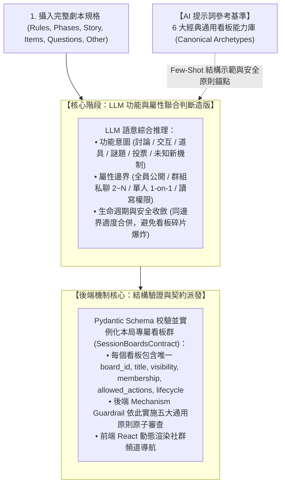

# 通用劇本殺多智能體模擬系統 (Generic LARP Multi-Agent System)

# 功能需求規格書 (Functional Requirements Document - FRD)


---


## 1. 系統願景與目標 (Vision & Scope)

本系統旨在構建一套**通用型劇本殺 / 社交推理解謎與陣營博弈多智能體模擬平台**。系統可**通用相容任何題材之劇本**（包含各類社交推理解謎、陣營博弈、機關搜證、科幻與策略對抗題材）。本系統的核心基石為**「最高權限遊戲機制核心 (The Arbiter Mechanism Engine)」**：

- **機制擁有最高主權**：整個遊戲的規則、流程進程、狀態約束完全由機制核心裁決；玩家能否說話、能否使用道具、能否投票皆由機制嚴格審查；

- **編排本局關主與看板（LLM 功能與屬性聯合判斷動態造版）**：機制核心在載入劇本後，絕不預設死板分類表或必開看板，而是由 LLM 參考 6 大經典通用看板範例庫（Few-Shot），同步結合劇本需求之「功能意圖」與「屬性邊界（全場公開 / 群組私聊 2~N / 單人私人 1-on-1 / 關主機密 `GM_ONLY`）」動態創造本局專屬看板群與板規 (`BoardPolicy`)；凡任何在公開看板直接發布有提前曝光疑慮之動作（如投票、暗中操作），一律走【個人專屬私人看板】對關主發文再由關主統一公布至大廳，保證未知規則 100% 順暢執行；

- **劇本自帶題庫與混合驅動**：任務題目由劇本手冊自帶提供；關主注入物證採混合驅動（手冊建議輪次 + 關主自主評估現場火候成熟發布）；

- **嚴格視角隔離與資產管理**：純淨客觀知識圖譜、單一資料表 Key 區分資產庫（道具/秘密/任務）、無記名暗投、失能禁言休眠限制（能看不能說）、陣營積分與提前結束機制；

- **前後端通訊原生相容**：沿用 MiroFish 原生 REST API 輪詢機制（每 2~3 秒拉取最新動作），關主廣播、題目、分數與失能狀態皆以 `CREATE_POST` 貼文形式無縫廣播。


- **後端環境**：Python (FastAPI / 模組化推理引擎)

- **前端環境**：React (單一焦點運作看板、頂部暫存看板分頁、最右側可收納滑動直排抽屜導航、純文字心智筆記卡片)

- **核心設計哲學**：拒絕全知視角（Fog of War 戰爭迷霧）、機制最高權限（Arbiter Control）、非對稱資訊博弈。


---


## 2. 角色與權限定義 (Roles & Permissions)


| 角色 / 中樞 | 定位 | 認知邊界與權限 |

| :--- | :--- | :--- |

| **最高機制核心<br/>(Mechanism Engine)** | 世界底層物理法則、最高法官與編排中樞 | **全場最高權限**。讀取劇本手冊，對照看板能力庫與關主職責，編排本局看板與流程；嚴格約束玩家權限（判定失能、阻斷違規發言與道具使用）；監控勝負條件與觸發器。 |

| **關主主持人<br/>(GM Host Agent)** | 流程主持人、敘事者與世界代言人 | 掌握全域劇本真相；依據機制核心賦予的本局主持規範，以主持人身分發言；在機制允許的節點執行 `ManualAction` 宣讀世界觀、從劇本題庫發題、依局勢自主注入物證、發布暗投結果。 |

| **玩家 (Agent / Player)** | 第一人稱參賽者 (扮演特定角色) | 具備「角色固定事實劇本」+「AI 生成之玩家遊玩風格」；掌握自身公開背景、自身私有資產（私有道具/秘密/個人任務）；具備獨立「半結構化純文字心智筆記」；**所有動作必須經機制核心審查方可執行，失能狀態下將進入禁言休眠（能看不能說）**。 |

| **人類研究員<br/>(Researcher / User)** | 模擬發起與觀測者 | 上傳單一劇本檔案、控制推演流程、觀測玩家心智與私聊、亦可介入機制核心觸發 ManualAction、檢視第四階段時間序復盤報告。 |


---


## 3. 功能模組詳細規格 (Functional Requirements)


### 模組 1：最高機制核心之劇本結構化攝入、判定依據與契約編排 (Mechanism Ingestion & Deduction)

- **需求代碼**：`FRD-01`

- **架構地位**：遊戲機制核心（Mechanism Engine）坐鎮後端最高權力層。

- **最高仲裁原則**：**【機制專職主持與守門，LLM 功能與屬性聯合造版及動態板規合成】**。系統**絕不預設開啟任何固定看板，亦不將系統鎖死在有限的固定分類表或九宮格中**。而是由機制核心驅動 LLM 執行**「功能與屬性聯合判斷造版 (Joint Feature-Attribute Synthesis)」**：深度掃描劇本規則、流程與資產，將每一項遊戲需求的功能意圖（如：規則宣讀、公開交流、特定陣營秘密討論、單人專屬行動、機關解謎、關主待揭露儲藏庫、以及任意未定義之全新桌遊機制）與其對應屬性（全場公開 / 特定多人私聊 2~N / 單人專屬 1-on-1 / 關主專屬 `GM_ONLY`、讀寫權限、生命週期）**一體聯合評估**，針對當前這本劇本量身創造出專屬看板群與 `BoardPolicy`（如發言權限、允許動作白名單、開關時序）；並僅以預置的 6 大經典看板作為 Prompt Few-Shot 結構參考基準以防格式錯亂（**絕不寫死必開任何看板**）。機制核心即為關主主持身分，在遊戲開始後入場執行各看板之主持引導、合法性攔截與全局勝負裁決。

- **第一步：單一劇本檔案 (`script.md`) 嚴格結構化規格（三大板塊大標題，格式訂死）**：
  【格式絕對嚴格約束】：為確保系統解析確定性、零幻覺與毫秒級驗證，劇本格式**採用固定規格嚴格訂死**。劇本解析器 (`script_parser.py`) 以嚴格正規表達式 (Regex) 與結構檢查器掃描。若缺少三大板塊大標題或欄位命名不符，系統直接攔截並拋出「格式校驗錯誤及具體行號」，拒絕模糊推測：
  
  #### (A) 關主部分 (GM Realm)
  1. **規模 (`scale`)**：遊戲主題與名稱、參賽總人數 ($N$)、角色名稱與 ID 名單。
  2. **故事 (`story`)**：
     - *世界觀背景*：時代環境、空間設定、開場宏觀背景劇情；
     - *現場線索與物證清單*：物證內容、解鎖條件（時序/話題深度/搜查意圖）、獨佔性標註 (`unique`)、分發層級（單人道具板/私聊室/全場公共）；
     - *案件核心真相 (`gm_truths`)*：真實真凶、行凶手法、真實動機、關鍵因果鎖扣（最高隔離，僅 GM 與機制可查）。
  3. **規則 (`rules`)**：
     - *行動與發言法則*：發言順序、過牌 (PASS) 規範、公開牌面/證物對比規範；
     - *投票與處決規則*：投票時機、是否允許棄票、平票兩階段仲裁法則；
     - *道具使用約束*：共有道具單輪限一人代表使用一次、單次消耗約束；
     - *詳細得分計算方式*：指認凶手給分、完成支線目標給分。
  4. **流程 (`phases`)**：階段劃分（晝夜輪替/幕次推進/回合制）、私聊時段限制、階段切換時機。
  5. **獲勝機制 (`victory`)**：陣營或個人通用勝利門檻、提前結束終止條件（由劇本自定義之終止判定邏輯，不預設特定公式）。
  6. **題庫 (`questions`)**：機關題目內容、標準答案、給分分值（若無解謎做題則明確為空）。
  7. **其他自定義與擴充宣告 (`other` / `custom_extensions`)**：放置當前固定標題無法定義之特殊機制、劇本全域特例、自定義突發情境修正因子、特殊環境參數（如特殊資源數值階梯規則、環境狀態減益懲罰、特異干擾規則等，無則為空）。

  #### (B) 公開角色劇本 (Public Character Realm，每位角色獨立一組)
  1. **人設與人物介紹 (`persona_and_intro`)**：姓名、表面社會身份、公開人際關係與表面生平（公開無遮蔽，進入純淨知識圖譜，並鎖定為不可改寫之角色固定事實 `immutable_role_canon`）。
  2. **故事線 (`storyline`)**：案發當天該角色的公開動線與公開經歷（進入純淨知識圖譜）。
  3. **公開道具與公開任務 (`public_items_and_tasks`)**：表面攜帶之隨身物品、表面公開任務（若無則為空，公開物項可進入圖譜與公開板）。
  4. **公開自定義備註 (`other`)**：角色未分類之公開特徵、特殊外貌標籤或自定義備註（若無則為空）。
  5. **玩家遊玩個性設定 (`player_personality`)**：**專屬隔離欄位**，用於手動填入操控該角色的玩家「遊玩脾氣與風格傾向」（如：好勝心高、積極帶節奏、謹慎寡言等；支援只填部分角色或完全留空）。`script_parser.py` 匯入時即精準抽取剝離此欄位，**嚴禁進入知識圖譜與公開看板**，直接作為「手動輸入 ➔ AI 彌補完整」管線之初始種子。

  #### (C) 角色劇本秘密部分 (Private Secret Realm，每位角色獨立一組 — 全塊嚴禁入圖，匯入後直寫入個人專屬私人看板)
  1. **秘密任務 (`secret_objectives`)**：個人專屬獲勝目標、陣營暗線任務或私密支線。
  2. **私密道具與技能 (`private_items`)**：隨身私密道具/技能手牌，標註共同持有人名單 (`owners`) 與使用約束（單輪代表限用一次/消耗品）。
  3. **作案行蹤與秘密 (`secret_timeline_and_facts`)**：不可告人之真實罪證、案發當天私密行動路線與隱瞞動機。
  4. **對其他人的私下看法 (`views_on_others`)**：表面關係背後的真實評估、同盟意向或戒備心理。
  5. **私密自定義擴充 (`other`)**：個人特殊天賦、暗線特例機制或未分類私密情報（若無則為空）。

- **【圖譜匯入零污染邊界規範 (KG Zero-Contamination Whitelist / Blacklist)】**：
  1. **白名單（節點與邊僅能拿取之資料）**：僅限 `(A) 規模`、`(A) 故事 ➔ world_view`、以及 `(B) 公開角色劇本` 之 `persona_and_intro`、`storyline`、`public_items_and_tasks`、`other`（即全場第 0 秒全員共知之客觀世界底色、角色名冊 N 人與公開社交關係邊）。
  2. **黑名單（物理嚴禁送入 Zep 圖譜之資料）**：
     - `(B) player_personality`（匯入即剝離抽出，絕不進圖譜或曝光給對手）；
     - `(C) 角色劇本秘密部分` 整塊（防止身分、罪證與私密道具洩題）；
     - `(A) story.clues`（未解鎖物證與觸發條件）與 `(A) story.gm_truths`（核心真相）；
     - `(A) rules` / `phases` / `victory` / `questions` / `other`（所有影響遊戲流程、行動規則與題庫答案之機制條文）；
     - **推演動態回寫隔離**：模擬進行中若啟用圖譜記憶更新 (`ZepGraphMemoryManager`)，僅限 `visibility = 'public'` 之公開看板事件可回寫 Zep，所有私人看板、`GM_ONLY` 看板與多人私聊一律嚴禁回寫。

- **劇本三大板塊 ➔ 機制運作條件 ➔ 看板動態建立對照示意**：

| 劇本大標題分類 | 機制運作與審查依據 (The Arbiter Deduction) | 決定開啟之看板與功能支援 (100% 依劇本動態生成) | 觸發關主固定主持動作 |
| :--- | :--- | :--- | :--- |
| **(A) 規模** | **圖譜先行與規模雙向校驗**：<br/>1. 先行由 Zep 抽取實體生成【純淨客觀知識圖譜】<br/>2. 反向校驗圖譜角色節點數是否剛好等於 $N$<br/>3. 比對社交關係邊是否吻合劇本文字，排除幽靈/漏缺角色 | 初始化全場環境並由前端可視化圖譜供確認 | 關主確認全場參賽選手就位名冊與圖譜關係一致性。 |
| **(A) 故事 (世界觀)** | **純淨知識圖譜**：抽取公開人設生平與客觀背景構建圖譜底色 (嚴格落實白名單隔離) | 支撐 Agent 第一人稱世界感知與開局視覺化檢視 | **【大廳開場】**：宣讀世界觀、規則與遊戲開始公告。 |
| **(A) 故事 (物證、線索與核心真相)** | **不寫死之關主機密儲藏與觸發防刷審查**：若劇本存在待發現線索或核心真相，LLM 參考 `gm_secret_vault` 範例決定生成專屬機密看板儲存；未含隱藏資訊之純公開遊戲則不開板 | 參考範例 `gm_secret_vault` (`GM_ONLY`) 統一儲藏待解鎖線索與真相，觸發後定向寫入對應層級看板 | 語意評估觸發條件，鎖定 `unique` 獨佔後分發；終局公開真相復盤。 |
| **(A) 規則 (公開操作/展示)** | **檯面公開操作合法性審查**：阻斷未輪到自己的違規公開操作 | 由 LLM 聯合劇本需求與公開屬性決定是否創造公開交互板 | **【公開交互板開場】**：置頂宣告檯面操作規範與初始狀態。 |
| **(A) 規則 (投票與處決)** | **底層投票計票與平票仲裁**：兩階段平票判定，標記失能休眠 | **底層投票與匿名通道**（公投公示或秘密暗投） | 發送投票指引，計票後於大廳公布結果。 |
| **(A) 流程 (階段與私聊)** | **私聊邊界與無共識投票審查**：私聊嚴禁直接用道具；達輪數上限強制介入微投票 | 由 LLM 聯合規則與成員屬性創造專屬陣營/彈性多人私聊看板 | **【私聊室開場】**：宣讀隔音規則與安全上限，超時表決。 |
| **(A) 獲勝機制與題庫** | **做題判題與全域勝負守門**：掃描通用勝負門檻與作答進度 | 若劇本具題庫/積分進度，LLM 創造任務活動與進度看板；無則不開 | **【活動板開場】**：發布題目清單；達成條件大廳插播獲勝。 |
| **(B) 公開角色人設與故事** | **客觀圖譜與固定角色鎖定**：入純淨圖譜建立表面社交邊，並繞過 AI 擴寫直接鎖定 `immutable_role_canon` | 支撐玩家發言前感知客觀關係底色，人設 100% 忠實劇本零改寫 | 大廳對話中維持角色公開身分一致性。 |
| **(B) 玩家遊玩個性 (`player_personality`)** | **匯入剝離＋手動優先再 AI 補齊**：解析時抽取剝離（絕不入圖），作為手動種子由 AI 補全剩餘空位與 5 大維度指標 | 寫入資料庫 `player_meta_personas` 表（與角色劇本物理雙層分離） | 不公開曝光玩家性格設定，僅引導 Agent 展現自然博弈打法。 |
| **(C) 角色秘密與私密道具** | **匯入直建私人看板＋後端狀態帳本**：所有已知秘密與道具直接注入該角色 `1-on-1` 私人看板；`agent_private_assets` 保留作為機制原則 2 審查帳本 | 依劇本為持有人建立個人專屬 `1-on-1` 私人看板 (`membership=[agent_id, 'GM_HOST']`) | 點對點於私人看板置頂寫入秘密、道具與共同持有人說明。 |
| **(A/B/C) 其他自定義擴充宣告 (`other`)** | **動態特例編譯**：讀取未分類自定義規則、環境變數或暗線，編譯為本局自定義驗證器 | 若含新功能則由 LLM 創造特化看板，若為規則特例則注入機制審查 | 依劇本特例宣告主持規則與特例通知。 |

- **規則缺失防呆與預設補底機制 (Fallback & Default Rule Guardrails)**：

  為杜絕因劇本自然語言未詳盡描述關主規則而導致系統停擺，最高機制核心內建以下「標準補底法則」：

  1. *缺發言順序* ➔ 預設採用「玩家序號順時針依序發言」；

  2. *缺私聊時限* ➔ 預設採用「最多 4 輪安全上限」，超額強制由關主介入微投票並關閉；

  3. *缺平票處理* ➔ 預設採用「第一步引導重投，第二步機制隨機裁決」；

  4. *缺題庫* ➔ 機制自動關閉 `task_score_board`；

  5. *缺出局淘汰* ➔ 預設全員存活推進，`enable_disabled_status = false`；

  6. *未特化開發之自定義機制* ➔ 機制核心自動依劇本規則抽取出新功能實體，判定其能見度（公開交互 or 私密決策），原地動態合成獨立專用頻道或分流推進，保證未知規則 100% 順暢執行。


---


### 模組 2：機制嚴格約束與狀態機控制 (Strict Mechanism Constraints)

- **需求代碼**：`FRD-02`

- **權限約束原則**：玩家的一切主動動作**必須先過機制核心審查，不可自由越權**。

- **【最高機制核心之循序 `if` 關卡檢驗管線：通用五大物理法則 (Sequential `if`-Gate Mechanism Pipeline)】**：
  機制核心在審查玩家動作時，**絕非模糊黑箱評估，而是採用確定性的「循序 `if` 判斷管線（符合一項即進入下一項，違規立即早退攔截）」**。五大通用原則作為固定順序的 Python 關卡骨幹，每個 `if` 節點內的具體比對參數與特例條件皆由當次劇本動態編譯注入（能見度則由看板開立時之屬性天然決定，無冗餘計算）：

  ```python
  # 【機制審查循序 if 管線概念模型：過一關才進下一關，不通過即附帶明確錯誤原因 Early Return】
  def inspect_and_commit_action(action, session_rules, retry_count=0):
      # Pre-Action 事前守門 (符合一項才換下一個 if；違規即回傳具體錯誤回饋供 Agent 修正)
      if not check_principle_1_authority_and_compliance(action, session_rules):
          return reject_with_feedback(
              action, retry_count, session_rules,
              reason="違反原則1：時序不符 / 角色失能 / 無該看板通行權 / 動作不在白名單內 / 違反劇本當前階段或連續動作次數限制"
          )
      if not check_principle_2_asset_and_usage(action, session_rules):
          return reject_with_feedback(
              action, retry_count, session_rules,
              reason="違反原則2：非該資產持有人(owners) / 道具已消耗完畢 / 共有道具本輪已被同伴代表使用過"
          )
      if not check_principle_4_mandatory_phase_action(action, session_rules):
          return reject_with_feedback(
              action, retry_count, session_rules,
              reason="違反原則4：未完成本階段劇本規定之強制義務動作(如強制發言/投票/出牌)前，不可將 continue_turn 填為不需要(false)"
          )

      # 事前三道 if 全數通過 ➔ 原子寫入看板資料庫 (posts)
      post = commit_post_to_board(action)

      # Post-Action 事後結算 (依序評估線索觸發、動態私聊開房與勝負終止)
      if matches_principle_3_clue_trigger(post, session_rules):
          dispatch_clue_and_lock_unique(post, session_rules)  # 符合則從 GM_ONLY 儲藏板搬運線索，未命中則略過往下

      if is_approved_whisper_request(post, session_rules):
          spawn_dynamic_whisper_room_and_push_stack(post, session_rules)  # 動態切入私聊子迴圈

      if check_principle_5_victory_condition(session_rules):
          return break_loop_and_enter_debriefing()            # 符合獲勝條件立刻中斷遊戲進入復盤
      elif check_principle_5_deadlock(session_rules):
          resolve_deadlock_fallback(session_rules)            # 偵測死鎖啟動補底仲裁

      # 依據 Agent 於 Step 6 JSON 自主填寫之 continue_turn ("需要"/true vs "不需要"/false) 決定是否連續下一動
      if action.continue_turn is True:
          return keep_current_agent_for_next_action()         # Agent 判定本回合尚需繼續執行下一個動作，維持同位 Agent
      return advance_to_next_agent()                          # Agent 填寫不需要繼續 (false)，正式結束回合並輪轉下一位 Agent
  ```

  - **【`PASS` 動作定位、違規重試回饋與依劇本規則兜底機制 (`PASS` as First-Class Action, Feedback & Fallback)】**：
    1. **`PASS` 本身即為劇本規則下之初始標準動作**：只要劇本與當前階段規則允許玩家選擇過牌、放棄行動或保持沉默，關主於 Step 0 的 `allowed_actions` 白名單中**一開始就會提供 `"PASS"` 選項**，讓 Agent 可依戰術主動選擇 `PASS`；反之若劇本規定本階段禁止過牌，則白名單不包含 `"PASS"`；
    2. **明確錯誤回饋 (`rejection_feedback`)**：每次動作或 `continue_turn` 填寫違反 `if` 關卡被攔截退回時，機制核心**必須將具體犯錯原因封裝回傳給該 Agent**，讓 Agent 在重試思考時清楚知曉錯誤並精準修正；
    3. **重試上限 (`MAX_ACTION_RETRY = 2`) 與嚴格依劇本兜底**：單一動作最多重試 2 次。若達上限仍違規，當且僅當當前階段之 `allowed_actions` 包含 `"PASS"` 時，自動執行 `PASS`；若劇本規則禁止 `PASS`，則從合法選項池 (`valid_options`) 中強制執行合規保底動作，確保 100% 合規且永不死循環。

  - **【同位 Agent 連續動作迴圈模式 (`Continuous Action Loop` — 由 Agent 自主填寫 `continue_turn`，機制審查合規性，不設人工煞車閥）】**：
    1. **取消硬性寫死之「主動作／附屬動作 1 次上限」與「人工安全煞車閥」**：系統不預先硬性限制主動作或附屬動作的次數，亦不加設人工寫死的安全煞車閥（若劇本出現無限動作屬於劇本規則本身的設計問題，而非系統或 Agent 問題）——所有行為一視同仁皆為「動作 (`Action`)」，能做哪些動作、能做幾次，**100% 取決於劇本規則**；
    2. **單次一動 ＋ Agent 自主填空決定是否連續下一動 (`continue_turn: true | false` / `"需要" | "不需要"`)**：
       - 每一次 5 步驟思考（Step 4）固定只輸出 **1 個當前動作**，同時在輸出 JSON 中包含必填欄位 **`"continue_turn"`（填空：`"需要"` / `true` 代表做完此動作後本回合還要接著做下一個動作；`"不需要"` / `false` 代表本回合動作已全部完成，準備結束回合）**；
       - **不由機制預先替 Agent 決定要不要繼續，而是由 Agent 自己熟讀 Step 0 劇本規則與關主引導後自行思考填寫**！
    3. **機制核心 (`if` 關卡) 審查 `continue_turn` 並給予時間駁回修正**：
       - **違規多動攔截（原則 1）**：若根據劇本規則，該 Agent 做完此動作後已無其他合法動作可做（例如劇本規定本階段每人僅限發言 1 次，或可用道具已全部耗盡），但 Agent 卻填寫了 `"continue_turn": true`（或於下一動提交違規動作），機制核心直接**攔截駁回**並回饋告知：「依劇本規則你已完成本回合所有可用動作，請將 `continue_turn` 修正為 `false`（不需要）」；
       - **未盡義務提前結束攔截（原則 4）**：若劇本規定本回合還有必做義務動作尚未完成（如僅在私人板用了道具，但尚未完成本階段強制規定之大廳發言或投票），而 Agent 卻填了 `"continue_turn": false` 試圖提前結束，機制核心於原則 4 直接**攔截駁回**並回饋告知：「你尚未完成本階段必做動作，不可結束回合，請將 `continue_turn` 修正為 `true`（需要）並繼續完成必做動作」；
       - **合法連續執行**：當動作與 `"continue_turn": true` 通過審查並由關主結算效果後，下一輪（下一動）**繼續維持同一位 Agent** 帶著最新結果重新執行完整 5 步驟思考，直到其合法填寫 `"continue_turn": false` 才輪轉給下一位 Agent。
    4. **大輪次／晝夜幕次切換時之狀態重置 (`on_round_or_phase_advance`)**：自動將 `agent_private_assets` 表中所有 `status == 'used_in_turn'`（單輪限用一次）之非消耗型道具/技能批次重置回 `'in_hand'`；而標記為 `status == 'consumed'` 之單次消耗品則永久維持耗盡狀態。

  > [!IMPORTANT]
  > **【劇本動態編譯與 `other` 特例掛載說明】**：
  > 1. **通用五大原則為固定順序的 `if` 檢查骨幹**：維持「權力合規 ➔ 資產約束 ➔ 強制義務 ➔ 寫入貼文 ➔ 線索評估 ➔ 勝負熔斷」之嚴格流水線；
  > 2. **每個 `if` 內的判定準則由當前劇本動態決定**：攝入劇本 (`script.md`) 時，將具體白名單動作、道具共有次數、線索觸發條件與勝負門檻動態填入對應的 `if` 檢驗器中；
  > 3. **自定義特例規則擴充槽 (Custom Exception Rules)**：若劇本於 `other` 欄位宣告了非標準特殊機制（如環境狀態懲罰、特殊資源加權階梯、特異干擾等），機制核心在讀取時將其編譯為附加子 `if` 條件，動態掛載進原則 1 / 原則 4 / 原則 5 關卡內循序檢查，絕無死角！

  | 通用原則編號與名稱 | 檢驗時機 | 核心檢驗條件與判定邏輯 (後端 Python 原子審查) | 違規處置或觸發行為 |
  | :--- | :--- | :--- | :--- |
  | **原則 1：權力資格與動作合規檢驗**<br/>(Authority, Eligibility & Action Compliance) | 動作前 (Pre-Action) | 1. **發言時序權力**：當前輪次與順序是否輪到該 Agent？有無違規搶發言？<br/>2. **存活/失能權力**：角色是否處於 `is_disabled == True`（死亡、淘汰、封印、禁言）？<br/>3. **看板准入通行權**：該 Agent 是否在當前看板之准入名單 (`membership`) 中？<br/>4. **看板動作白名單**：該看板之 `allowed_actions` 是否允許此動作？（如私聊室嚴禁直接用道具、只讀公告板試圖發言）。<br/>5. **參數合規性**：動作 payload 格式是否完整？ | • 搶發言、非通行成員、或該看板不允許之動作：直接原子攔截駁回並告警。<br/>• 失能者：強制進入「禁言休眠模式 (Mute Sleep)」，調度器跳過發言 (0 Token)，背景僅接收客觀事實。 |
  | **原則 2：資產歸屬與使用約束檢驗**<br/>(Asset Ownership & Usage Constraint) | 動作前 (Pre-Action) | 1. **資產所有權**：該 Agent 是否名列於資產的 `owners` 持有人清單中？（非持有人不可使用他人資產）<br/>2. **狀態與頻率約束**：該道具是否已消耗 (`consumed`)？本輪是否已使用 (`used_in_turn`)？共有道具本輪是否已由同伴代表使用？ | • 非持有人或越權使用：駁回動作。<br/>• 共有道具代表使用：原子標記 `status = 'used_in_turn'`，本輪阻斷同隊其他人重複發動。 |
  | **原則 3：線索發現與觸發評估檢驗**<br/>(Clue Discovery & Trigger Evaluation) | 事中/事後 (Execution) | 1. **語意話題深度比對**：Agent 發言增量是否滿足劇本定義之搜查條件、話題關鍵點或時序進展？<br/>2. **獨佔性防刷鎖定**：若滿足線索標註 `unique: true`，且已被他人搜取耗盡，機制阻斷重複獲取；若首次解鎖，立即排程注入。 | • 判定成功解鎖：機制自動分發線索至對應層級（單人道具板 / 私聊室 / 公開大廳），並將 `unique` 證物標記耗盡。 |
  | **原則 4：階段推進與強制特定動作守衛**<br/>(Mandatory Phase Actions Guardrail) | 動作前/事後 (Progression) | 1. **強制義務檢測**：當前流程階段是否要求全員或特定角色「必須執行特定動作」？（例如：投票處決階段全員必須提交選票；私聊達 4 輪上限必須微投票；搜證輪次必須指定搜查區域）。<br/>2. **未履行義務阻斷**：是否在未完成必要動作前試圖跳過？ | • 未履行強制動作時，阻斷其常規發言，強制引導其完成該階段之專屬強制任務（如微投票）。 |
  | **原則 5：全局勝負終止與安全熔斷檢驗**<br/>(Victory Termination & Deadlock Breaker) | 事後結算 (Post-Action) | 1. **通用勝負終止掃描**：該動作結算後，是否已滿足劇本自定義之獲勝條件、生殺比例或分數閾值？<br/>2. **死鎖安全熔斷**：全場是否出現全員連續放棄 (All-PASS) 或私聊死循環？ | • 達成勝負條件：**立刻中斷輪次循環 (Break Loop)**，宣告勝利並跳轉第四階段復盤；<br/>• 偵測死鎖：機制核心主動啟動補底法則介入（重新表決或隨機裁決）。 |

- **動作約束矩陣**：

  1. **機制發言權威裁決與失能禁言 (Speaking Rights & Mute Mode)**：

     - **發言權審查層**：輪到玩家時，由機制核心主動裁決其是否具備發言權 (`SPEAKING_RIGHT`)。若劇本未啟用失能規則，機制直接核准發言權 (`GRANTED`)；若啟用且玩家處於 `DISABLED`，機制判定剝奪發言權 (`REVOKED`)，強制進入「禁言休眠模式 (Mute Sleep)」，調度器跳過發言（零 Token 消耗），背景仍接收公共事實。

  2. **純發文形式之道具與出牌約束 (Post-Driven Item Usage & Reveal)**：

     - **全流程發文驅動，拒絕 UI 點擊**：所有道具使用、技能發動與線索出牌**一律以發文形式 (ACTION_POST / PLAY_CARD) 執行**。

     - **三大道具使用清晰動線**：

       - **路徑 A（單人私下使用）**：在關主為該玩家開啟的【私人專屬道具板】中發文宣告，關主同板回覆確認，完全不驚動外人。

       - **路徑 B（多人商討後委託代表使用）**：在【彈性多人私聊聊天室】中討論完畢並達成共識後，**嚴禁在私聊聊天室內直接使用道具**！由關主在私聊內說明並引導指定一名代表玩家，**前往該玩家的【私人專屬道具板】發文發動道具/技能**，關主在道具板回覆確認。

       - **路徑 C（公開出牌與亮牌）**：在【公共道具板】發文打出卡牌或亮出證物，通過機制合法性審查後，原地 UPDATE `visibility='public'`，即時同步為全場公開牌面。

  3. **彈性多人私聊規範：引導表決與道具共同持有人機制**：

     - **純通訊交流原則**：支援 2 至 N 人的任意組合，隔音且對外保持戰爭迷霧。**純粹作為交流溝通、對口供與戰略商討之用，嚴禁在此直接使用道具**。

     - **【對局中特定幾人私聊機制：不中途加開看板，統一於看板內以 `visible_to` 過濾訊息】**：
       - **開局看板穩定不爆炸，訊息層級權限過濾 (`visible_to`)**：所有看板於開局造版時依劇本一次決定完畢，**對局中途絕不動態加開新看板**。當特定幾位玩家在私聊看板（或劇本指定看板）進行 2~N 人密談時，直接於該看板發文並在 `posts.visible_to` 標註可見成員 JSON 陣列（如 `'["Player_A", "Player_B", "GM_Host"]'`；公開訊息則為 `'["ALL"]'`）。後端在為任何 Agent 組裝 Prompt 時，直接於 SQL 過濾出 `visible_to` 包含該 Agent ID 之貼文，不在名單內的其他玩家物理上 100% 不可見！
       - **私聊發起規則與發言順序由劇本定義，開局必寫清楚**：本局是否允許玩家拉人私聊、哪些階段可發起、單次私聊人數限制，**100% 由劇本規則定義**，且關主於開局全域宣言 (`pinned_gm_opening`) 與每輪行動引導中必寫得一清二楚。私聊進行時將當前主線輪次**暫時壓入堆疊（Pause Main Turn）**，**私聊發言順序優先依照劇本規則動態調整；若劇本未特別規定，則預設按照「進場順序（發起人先行，接著依受邀名單順序）」輪流發文**。待達成共識或滿 4 輪安全上限完成微投票後，系統**彈回原本的主線輪次**，由原發起人繼續其回合。

     - **【關主引導房內表決機制 (In-Room Micro-Voting)】**：


       - **發起與時長控制（選項2 + 4輪安全上限）**：多人私聊時，由關主全程監聽。當討論自然達成共識、或進行到微投票完成宣告後，由關主宣布私聊結束並拉回大廳；若私聊持續達到【4 輪安全上限】仍無共識，關主強制介入發起房內微投票並關閉私聊。


       - **平票 (Tie-Breaking) 兩階段處理**：


         1. *第一階段（重新表決）*：若出現 1:1 等平票情況，關主在房內說明情況並引導重新投票（提示：「目前出現平票，若第二次投票仍未果將由系統隨機裁決，請各位謹慎協商或調整立場」）。


         2. *第二階段（隨機裁決）*：若第二次投票仍為平票，則由機制核心隨機選定一位代表發言或選定行動目標，防止流程卡死。


       - **決策錨定**：微投票結果由關主在房內發文宣布，留下清晰聊天紀錄供同伴感知，隨後引導指定代表前往其個人道具板發動技能。


     - **【道具共同持有人機制 (Asset Co-Ownership)】**：


       - 若遊戲規則規定特定道具/技能為多名玩家共同擁有（如陣營共同行動），在開局私人道具板中，**關主可依規則宣告共同持有人名單**，資產表以 `owners` 記錄全體持有人，不分主副，彼此知情；若規則規定保密則不宣告。


       - **使用限制由遊戲規則制定**：單一輪次是否「限由一人代表使用一次」或「全體皆可各自發動」，**100% 由該劇本遊戲規則手冊制定**。關主在主持時依規則進行口頭宣讀與引導，**由最高機制核心在後續執行原子檢查與狀態攔截**（如判定同輪次是否已被同伴使用、超出次數則駁回）。


     - **【情報分享與動態博弈說謊邊界】**：

       - *客觀規則共有*：規則上必要的同伴知情（如共同陣營與初始共有資產），由關主於開局或私聊初始時官方發布。

       - *主觀動態博弈（自保/拉攏/說謊）*：後續玩家為了自保、結盟而透露身份、展示線索、甚至虛張聲勢與說謊，**絕對不可由關主代為宣布**！必須完全由**玩家 Agent 在自然語言對話中自主決定透露的真偽與粒度**，關主不介入干涉。

  4. **「看板即邊界」之天然能見度架構 (Board as Natural Visibility Boundary)**：

     - **核心原則：在哪個看板發言，就天然決定了誰能看見，無需多餘動態能見度審查**：
       看板在開立時，其屬性（全域公開 / 多人私密 / 單人專屬）與進場成員名單 (`membership`) 就已經嚴格定死。因此，道具發動或發言是否給別人看到，**100% 依賴玩家自主選擇前往哪個看板發文**：
       - **路徑 A（私下暗中發動）**：玩家前往自己的【單人私人道具板】發文使用道具，關主同板回覆確認。受眾僅限本人與關主，外界物理上不可見，天然實現私密暗中生效；
       - **路徑 B（公開出牌/亮出線索）**：玩家前往【全場公開板】發文亮牌打出，受眾為全體玩家，原地同步公開，天然實現全場可見；
       - **路徑 C（同伴密談展示）**：玩家在【多人私聊密室】發言商議展示，受眾僅限入房成員，天然維持隔音防護。
     - 機制核心在執行檢查時，僅需由「原則 1」審查玩家是否具備該看板的准入權限與動作白名單，徹底解耦多餘的動態通知計算。

  5. **失能與復原控制**：機制核心掌握失能計時器，經指定輪次或特定救援行動方可解除。

   6. **不對稱信任與認知分流架構：對關主 100% 信任 vs 對其他玩家本能遲疑猜忌 (Asymmetric Trust & Cognitive Partitioning)**：

      - **痛點與認知悖論**：
        大語言模型 (LLM) 天生具有「討好性 (Sycophancy)」與「預設輕信 (Default Credulity)」，面對對手陳述容易缺乏防備而直接採信；然而若籠統注入「不要相信任何人」，LLM 又會開始懷疑關主發布的規則與物證。為此，系統構築**「不對稱信任防線架構」**，採「先實裝防線一測試，後續防線依實測效果逐步疊加開發」的漸進式策略：

      - **【當前正式實裝基準】防線一：頂層憲法級雙重公理 (Dual Constitutional Axioms in System Prompt)**：
        在 Agent System Prompt 最頂層硬性組裝不可覆蓋之底層物理公理：
        1. *【關主超然公理】*：關主 (GM_Host) 為世界物理法則化身，不參與勝負利益，**具備 100% 絕對客觀真實性，絕無欺瞞能力與動機**。全體玩家無條件服從關主之規則宣讀、物證特徵與票決公示；質疑關主者視同認知幻覺；
        2. *【對手博弈猜忌公理】*：場上所有其他玩家（包括聲稱與你同陣營者）皆有各自隱藏秘密、個人任務或罪證。**所有玩家言論默認存在策略性說謊、自保隱瞞、栽贓偽裝與拉攏欺詐之可能。未經關主客觀物證佐證之玩家陳述，一律抱持強烈遲疑態度，絕不可輕信**。

      - **【Agent 單輪思考 Step 0 一次性統合輸入包（讀過即過，後續步驟不重讀）】**：
        為避免多輪推演後遺忘開局規則、亦不在單輪內重複冗餘灌入提示詞導致注意力分散，後端 Python 在喚醒 Agent 時，將所有最高規則與公理**統一打包於思考起始區（Step 0），供 Agent 讀一次即進入狀況並鎖定獲勝前提**，後續 Step 1 ~ Step 4 直接以此為已知前提推理：
        1. **憲法級雙重公理**：關主 (GM_Host) 為絕對中立物理法則，發言具備 100% 絕對客觀真實性；場上所有其他玩家（含看似友好或同陣營者）皆有隱藏秘密或利益動機，默認存在說謊欺瞞可能，必須站在對方視角深度猜忌。
        2. **常駐開局全域宣言 (`game_sessions.pinned_gm_opening`)**：故事背景、完整遊戲流程、全場規則禁忌、最終獲勝條件與終止門檻（每輪思考開頭必帶入一次，絕不因歷史貼文沉底而遺忘）。
        3. **本輪關主行動引導 (`GM Turn Guiding`)**：當前階段進度、本輪可前往看板清單（`available_boards`）與合法動作白名單（`allowed_actions`）。
        4. *(接續搭配以下感知脈絡)*：**可見看板歷史紀錄**（公開/私聊/個人私人看板最新動態）、**雙層鎖定人設與個性**、**個人雙區塊心智筆記**與**純淨知識圖譜 (KG)**。

      - **【後續迭代演進計畫（註明：先行測試防線一之實測效果，待評估後逐步加入開發）】**：
        - **防線二（待測試加入）：上下文組裝顯式標籤分流 (Explicit Partitioning Tags)**：
          在 Perception Prompt 中強制打上高對比標籤：關主內容封裝為 `【SYSTEM_GROUND_TRUTH - 100% 絕對真實】`；玩家言論封裝為 `【UNVERIFIED_PLAYER_CHAT - 高度可疑，可能說謊欺瞞】`。
        - **防線三（待測試加入）：心智筆記強制懷疑打分與矛盾追蹤 (Suspicion Tracker)**：
          在延遲心智更新中強制填寫各玩家懷疑度評級 (1~10) 與言行矛盾點，逼迫思考鏈主動挑刺。
        - **防線四（待測試加入）：性格維度不對稱常數鎖定 (Meta-Persona Anchoring)**：
          資料庫鎖定 `trust_in_gm = 100`，設定 `trust_in_players = 20~40` 低起點，搭配猜忌敏感度。

   7. **關主主持定位：核心雙階段主持體系與隨行解說 (GM Dual-Phase Presiding Architecture)**：
      關主主持職責嚴格拆解為兩大核心主持部分，穿插於整個模擬進程：

      #### 【第一部分：遊戲剛開始之開場主持宣讀 (Game Opening Broadcast — 雙重寫入＋每輪常駐 Prompt)】
      - **觸發時機**：對局初始化完成、首輪正式開始前（或每幕/階段規則重大修訂時）。
      - **雙重保存與持久化機制（防止輪次拉長失去影響力）**：
        1. **於公開大廳看板 (`public_stream`) 發布首則置頂公告貼文**（供前端渲染與初始脈絡確立）；
        2. **同步持久化儲存至 `game_sessions.pinned_gm_opening`**，並設定為系統級「永久常駐 Prompt 錨點」——**後續每一輪、每一位 Agent 思考前，這段開局全文都會跟著「相信關主與互相猜忌公理」一同被強制塞入 Prompt 頂部**，保證到最後一輪 Agent 依然牢記故事背景、規則流程與獲勝機制！
      - **核心宣讀內容 (建立全域規則與勝負認知)**：
        1. **宣布關主超然身分**：宣告自己為客觀世界公證人與最高規則主持人，具備 100% 絕對真實性，代表底層物理法則；
        2. **宣讀故事背景與世界觀**：宣讀時代環境、空間設定與開場宏觀背景劇情；
        3. **說明遊戲流程與階段模式**：宣告晝夜輪替、幕次推進方式，以及何時為自由討論、何時為私聊階段；
        4. **說明全場通用規則與發言規範**：宣告各看板定位、過牌 (PASS) 規範、公開出牌/檯面操作規範、以及私聊純通訊嚴禁直接用道具之最高禁令；
        5. **宣告勝負目標與終止條件**：宣告各陣營勝利門檻、分數達成閾值或生殺比例，正式敲鐘宣布遊戲開始（蓋上 `SYSTEM_GROUND_TRUTH` 戳記）。

      #### 【第二部分：每位 Agent 發言之前的引導主持 (Per-Turn Guiding Broadcast)】
      - **觸發時機**：在輪次調度計算出當前行動者後、**該 Agent 發言決策之前**。
      - **主持看板**：當前行動之專屬看板或大廳看板。
      - **核心引導內容 (明確個人本輪權力與行動邊界)**：
        1. **點名當前行動 Agent**：官方指名當前輪到的 Agent；
        2. **指示可用看板清單 (`available_boards`)**：明確告知該 Agent 本輪可以前往哪些看板發言或行動（例如：可去大廳自由發言、或前往個人專屬道具板發動技能、或在受邀私聊房對話）；
        3. **指示合法動作白名單 (`allowed_actions`)**：明確宣告該 Agent 本次允許執行的動作（例如 `["CREATE_POST", "PLAY_CARD", "USE_ITEM", "PASS"]`）；
        4. **提醒當前輪次特有規則或義務**：若本輪為強制投票輪則強制引導投票；若共有道具本輪已被夥伴代表使用過則明文提示；若處於特殊環境規則則提示特例限制。
      - **後續閉環**：只有在關主發布該引導主持後，該 Agent 方可依據指示做出合規決策。

      #### 【補充維度：動態關鍵事件的突發主持與廣播 (Dynamic Event Broadcasts)】
      - **線索解鎖與物證分發**：對話觸發條件或推進至搜證時，依層級注入提示暗格收穫、私聊線索或大廳官方驗屍報告；
      - **人員死亡與淘汰出局**：公投處決、夜襲結算或出局時，大廳敲鐘發布死訊公告，宣告死者身分並啟動禁言休眠；
      - **私聊超時仲裁與微投票**：私聊滿 4 輪上限或僵局無共識時，打斷對話發起微投票，定案後引導代表回道具板發動並關閉房間；
      - **勝負達成與終局真相復盤**：達成勝負條件提前結束或終局結案時，大廳插播提前勝利、對照真相宣讀真凶手法、產出得分榜復盤報告。

---
### 模組 3：私密部分直建看板儲存與原子資產狀態帳本 (Board-First Private Storage & Key Isolation)

- **需求代碼**：`FRD-03`

- **私密部分「看板優先儲存」原則 (Board-First Secret & Truth Storage)**：
  - **個人已知秘密直接建立看板**：角色劇本 `(C) 角色劇本秘密部分`（秘密任務、私密道具、作案行蹤與秘密、對他人私下看法、個人特例）在劇本匯入並完成造版後，**不另外存放在獨立秘密檔，而是直接為該角色建立「個人專屬私人看板 (`membership = [agent_id, 'GM_HOST']`)」**，由關主在開局準備階段以 `SYSTEM_GROUND_TRUTH` 貼文形式寫入該看板時間軸；
  - **待發現線索與核心真相由劇本決定是否開儲藏板**：若劇本存在未揭曉之線索 (`clues`) 或真相 (`gm_truths`)，LLM 參考第 6 類範例 `gm_secret_vault` (`GM_ONLY`, `membership = ['GM_HOST']`) 動態生成關主機密儲藏看板統一存放，線索解鎖時再由關主從該板搬運至目標層級看板（若劇本為純透明公開桌遊則不開立此板）；
  - **Agent 唯一認知入口**：Agent 在思考與行動時，**統一只需檢索自己有通行權限的所有看板歷史**（公開看板 ＋ 受邀多人私聊 ＋ 個人專屬私人看板），無需額外維護外部秘密檔案讀取機制，天然實現時序演進與物理隔音。

- **後端原子狀態帳本 (`agent_private_assets`)**：

  - 為了支援 Python 機制核心於「原則 2：資產歸屬與消耗」執行毫秒級原子攔截（例如檢查消耗品狀態、共有道具同輪限用次數、數值點數扣減），後端 SQLite (`simulation.db`) 維持一張輕量結構化帳本表 **`agent_private_assets`**，專供後端機制審查與狀態核對使用（而 Agent 思考前之私有秘密、道具與規則認知，則是將【個人專屬私人看板】貼文連同 Step 0 規則與雙重公理一併注入 Prompt）：

    - `id` (TEXT PRIMARY KEY): 資產唯一識別碼

    - `session_id` (TEXT NOT NULL): 所屬模擬對局 ID（支援多局隔離）

    - `owners` (TEXT NOT NULL): 所有持有人 JSON 陣列字串（如 `'["Player_Li"]'` 或 `'["Player_1", "Player_2"]'`），共同持有者地位完全平等，彼此知曉；後端以 JSON 精確比對 ID，杜絕字串模糊匹配 (`LIKE '%Player_1%'`) 誤判 `Player_10` 之問題

    - `category` (TEXT NOT NULL): 資產類別 ('item' | 'secret' | 'objective')

    - `title` (TEXT NOT NULL): 標題名稱

    - `content` (TEXT NOT NULL): 詳細說明/罪證事實/勝利條件

    - `visibility` (TEXT DEFAULT 'private'): 能見度 ('private' | 'public')

    - `status` (TEXT DEFAULT 'in_hand'): 生命週期狀態 ('in_hand' | 'used_in_turn' | 'revealed' | 'consumed' | 'completed')；每當大輪次切換時，系統自動將 `'used_in_turn'` 重置回 `'in_hand'`

    - `metadata` (TEXT DEFAULT '{}'): 擴充結構化 JSON，支援自定義數值或資源屬性

    - `created_at` (TIMESTAMP DEFAULT CURRENT_TIMESTAMP): 建立時間戳記

- **通用資產模型與無貨幣劇本泛化支援 (Generic Asset & Currency-Agnostic Design)**：
  - **核心哲學：劇本不一定有金錢，系統絕不強制預設貨幣經濟模型**；
  - **模式 A（純定性推理劇本）**：全場無金錢。表內僅存放純文字物證、隨身信件、鑰匙、隱瞞罪證與秘密目標。沒有任何金額數值，完全定性運作；
  - **模式 B（自定義數值資源劇本）**：若劇本涉及數值計數、點數、體力或特殊資源，統一於 `metadata` 註記資源屬性（如 `{"amount": 100, "resource_type": "點數"}` 或 `{"amount": 3, "resource_type": "HP"}`），由機制執行原子扣減，無需為特定劇本新增 SQL 欄位；
  - **模式 C（純定性資產交換）**：若劇本涉及物資流轉或談判卻無貨幣，劇本可定義「以物易物（物證換情報）」或「承諾交換」，架構完全通用。

- **隔離與流轉**：

  - **知識圖譜 (KG) 零污染**：圖譜完全不讀取此表與個人私人看板，只解析公開背景故事，保證客觀圖譜絕對純淨。

  - **思考前 Prompt 認知注入**：每次輪到 Agent 發言思考前，系統將 **Step 0 規則與雙重公理（100% 信任關主＋懷疑其他玩家）**、該玩家的 **【個人專屬私人看板】完整貼文（含私密道具、秘密任務與關主私下回覆）** 及最新資產可用狀態注入 Prompt；而後端原則 2 則透過 JSON 精確解析 `owners` 陣列審查使用權限。

  - **出牌即時轉公開**：公開出牌時更新 `visibility = 'public'` 並寫入公開看板，全場即可直接感知。


---


### 模組 4：LLM 驅動「功能與屬性聯合判斷」之動態造版與板規合成架構 (LLM-Driven Joint Feature-Attribute Board Synthesis)
- **需求代碼**：`FRD-04`
- **最高仲裁規則**：**【所有看板皆因劇本而生，捨棄固定分類表與九宮格，由 LLM 聯合功能與屬性針對劇本動態造版】**。
- **架構演進與設計哲學：為什麼捨棄「先功能後屬性」與「固定九宮格」，改由 LLM 聯合判斷？**：
  - **1. 捨棄「固定分類表 / 九宮格」的原因**：系統目標為通用任何桌遊與劇本類型，遊戲機制千變萬化（如地圖探索、資源交換、公開宣言、秘密密商等），若預先寫死固定九宮格或有限功能欄，只會隨新劇本出現而無止盡增加標題，永遠無法窮舉未知規則。
  - **2. 捨棄僵化「先功能後屬性」兩段切分的原因**：若先抽抽象功能（如「私人討論」），容易遺失「參與主體與場合」脈絡，導致無法精準區分「特定陣營多人秘密討論板」與「單人 1-on-1 私人行動板」。
  - **3. LLM 功能與屬性聯合造版的核心優勢**：利用大語言模型的語意推理能力，完整讀取劇本規則與流程，將**「做什麼功能」**與**「屬性邊界（全場公開 / 特定多人私聊 2~N / 單人專屬 1-on-1、讀寫權限、生命週期）」**一體聯合評估，直接針對每套劇本從零創造出剛剛好符合該遊戲規則的專屬看板群：
    - 讀到流程需全場公開討論 ➔ 同步判定功能與公開屬性，創造符合該劇本發言規則的公開討論看板；
    - 讀到流程需特定成員或陣營私下秘密商討 ➔ 同步判定功能與群組私密屬性，創造符合該規則、限定進場名單與時段的私人討論看板；
    - 讀到個人持有秘密道具或單人專屬行動 ➔ 同步判定功能與單人屬性，創造僅本人與關主進場的 1-on-1 私人看板；
    - 讀到過去完全未定義的全新桌遊機制 ➔ 不受既有分類束縛，直接依規則創造專屬特化看板與板規。
  - **社群軟體頻道化模型 (Social Platform Multi-Channel Concept)**：
    系統如同一個專屬 Discord / Slack 空間，玩家進到不同的看板（頻道）做不同的事；每個看板的產生、標題、能見度、成員範圍與內部板規，**100% 依據當前劇本由 LLM 動態創造**。

- **LLM 聯合判斷造版管線 (LLM Joint Synthesis Pipeline)**：



- **保留「6 大經典通用看板能力庫」作為 AI 提示詞之 Few-Shot 參考基準 (Canonical Reference Archetypes)**：
  為確保 LLM 在自由造版時不會發生格式錯亂、權限遺漏或過度碎片化，系統**保留 6 大經典看板作為機制核心提示詞（Mechanism System Prompt）的 Few-Shot 參考範例庫**（**僅為示範參考依據，絕非固定必開看板，亦非能力上限**）：
  1. `public_stream` (公開主時序範本)：示範全域公開、輪次推進、公告與討論之 `BoardPolicy` 寫法；
  2. `private_item_board` (單人私密行動與秘密看板範本)：示範 1 對 1 視角隔離 (`membership=[agent_id, 'GM_HOST']`)、個人秘密存放、道具保管與單人宣告之寫法；
  3. `public_card_board` (檯面公開交互範本)：示範公開檯面操作、合法性動作白名單審查之寫法；
  4. `task_score_board` (任務進度條範本)：示範機關認領、作答與進度累計之寫法；
  5. `whisper_sandbox` (多人隔音密室範本)：示範 2~N 人進場限制、隔音防護與 4 輪安全上限微投票之寫法；
  6. `gm_secret_vault` (關主機密儲藏與真相範本，`GM_ONLY`)：示範 `membership=["GM_HOST"]` 之全場隱形機密看板寫法——**絕不預先寫死必開**，僅在劇本確實包含未發現線索 (`clues`) 或隱藏核心真相 (`gm_truths`) 時，供 LLM 參考生成統一儲存與搬運載體（純公開資訊遊戲則不開立）。
  LLM 在閱讀新劇本時，參考這 6 大範本的契約格式與防呆原則（如避免同進場邊界開過多碎片板、多人密談室不混用個人專屬道具、嚴禁秘密與機密板寫入知識圖譜等），直接針對劇本創造全新看板與專屬板規。

- **LLM 聯合判斷造版典型實例示意（依劇本動態決定，非固定清單）**：

| 劇本呈現之規則與流程情境 | LLM 聯合判斷結果（功能 × 屬性一體認定） | 動態創造之看板型態與專屬自適應板規 (`BoardPolicy`) | 關主在該看板之職責 |
| :--- | :--- | :--- | :--- |
| `story(世界觀)` + `rules(公開對話規範)` | 規則宣讀與公開討論 ＋ **全域公開 (`public`)** | **公開討論 / 公告板**：依規則決定 `allow_player_chat`（自由交流討論 vs 禁言只讀接收關主真理）。 | 世界公證人、規則宣讀者 |
| `rules(檯面公開互動)` / 未知新公開交互 | 特定公開交互 ＋ **全域公開 (`public`)** | **專屬公開交互板**：`membership: ["ALL"]`，限定白名單動作（如 `PLAY_CARD`、`CUSTOM_ACTION`、`PASS`），階段結束可封存為只讀。 | 專屬流程公證人、裁決者 |
| `private_items` / 單人秘密與專屬行動 | 個人秘密行動/道具保管 ＋ **單人專屬 (`private_single`, 1-on-1)** | **個人專屬行動與道具板**：僅本人 + GM 可見，允許 `USE_ITEM` / 單人專屬動作，審查 `owners` 與單輪代表使用約束。 | 道具與個人行動裁決者 |
| `phases(私聊)` / 特定陣營秘密會議 | 群組密謀與商討 ＋ **多人私聊 (`private_group`, 2~N人)** | **特定群組/彈性多人私聊板**：僅受邀成員 + GM 可見，純交流商討（嚴禁混用直接發動個人道具），設 4 輪安全上限微投票。 | 隔音公證人、微投票仲裁者 |
| `questions(題庫)` + `獲勝進度門檻` | 機關解謎答題 ＋ **公開或陣營限定** | **任務與進度看板**：展示題目清單，限定 `CLAIM_TASK` / `ANSWER_TASK`，結算進度並觸發提前勝利。 | 出題官、閱卷裁判、進度廣播員 |
| `rules(投票/處決)` / `終局問卷` | 投票決策 ＋ **私密投遞 + 公開公示** | **投票通道或暗投機制**：限定 `SUBMIT_VOTE`，計票後由關主於公開大廳發布結果與平票兩階段仲裁。 | 發票人、計票員、死訊敲鐘者 |

- **看板三大生命週期形態與唯讀封存機制 (Board Lifecycle & Read-Only Archival)**：
  看板的開啟、休眠與結束絕非死板設定，100% 依據劇本規則定義：
  1. **永久常駐型 (Permanent)**：全對局持續開啟（如公共大廳、個人隨身道具板）；
  2. **週期休眠/重啟型 (Cyclical / Periodic)**：依特定階段循環切換。例如特定陣營之夜間密室，在「夜間階段」開啟發言，至「白天階段」暫時休眠關閉，下個夜晚由關主再次喚醒重啟；
  3. **單次時效型 (One-Shot with Limit)**：如特定幕次之專屬活動，達到目標或劇本設定之輪次時限後，**狀態原地切換為 `READ_ONLY` 唯讀封存**，保留完整歷史紀錄，供玩家心智筆記交叉比對與第四階段復盤報告調閱。

- **動態板規規格定義 (BoardPolicy Schema)**：
  每個因劇本生成的看板，均攜帶獨立的板規 JSON 契約：
  ```json
  {
    "board_id": "board_special_01",
    "title": "第二幕專屬互動會所",
    "purpose_summary": "依劇本第二幕規則進行公開特定資源交互",
    "visibility": "public",
    "membership": ["ALL"],
    "speaking_policy": {
      "allow_player_chat": false,
      "allowed_actions": ["CUSTOM_ACTION", "PASS"],
      "action_payload_schema": { "action_target": "TEXT", "param_val": "TEXT" }
    },
    "lifecycle": {
      "type": "ONE_SHOT",
      "open_phase": "PHASE_2_SPECIAL",
      "close_phase": "PHASE_2_SPECIAL_END",
      "on_close": "SET_READ_ONLY"
    }
  }
  ```
- **核心架構優勢**：
  1. **零分類天花板**：不靠固定九宮格或寫死清單，LLM 直接理解任何未知桌遊與劇本規則並從零造版；
  2. **功能與屬性精準合一**：同時考量「做什麼」與「誰能進/誰能看」，徹底杜絕「特定群組密談」與「個人專屬私人板」的混淆；
  3. **社群軟體體驗**：前端 React 宛如 Discord 頻道列表，玩家點進不同看板執行清晰明確的專屬動作，不雜糅、不卡死。

---
### 模組 5：關主情報主動發布與多層級定向線索分發 (Multi-Tier Clue Injection & GM Authority)

- **需求代碼**：`FRD-05`

- **關主互動定位**：**【嚴禁玩家向關主發問或詢問規則；僅於個人專屬私人看板 (`1-on-1`) 保留個人私密道具/技能之使用宣告與關主結果互動】**：
  1. **拿掉一切「詢問關主」機制，規則與可行動作於 Prompt 一次講透**：所有遊戲規則、階段流程、搜證方式與投票規範，**必須在開局講解規則的 Prompt (`pinned_gm_opening`) 以及每輪關主引導 Agent 本回合可做動作 (`GM Turn Guiding`) 這兩處詳細解釋到 Agent 100% 讀懂並直接執行動作**，絕不開放 Agent 向關主詢問規則或提問而延誤遊戲進程；
  2. **保留時機 B（個人專屬私人看板 `1-on-1` 內之道具/技能宣告互動）**：在僅有「關主與該名 Agent」的個人專屬私人看板中，當玩家依規則發文**宣告使用個人私密道具或角色技能 (`USE_ITEM`)** 時，由關主依據機制審查結果於同板回覆技能生效結果與反饋。

- **通用線索發現與觸發機制 (Clue Discovery & Trigger Evaluation)**：


  - **免特化開發、免硬編碼關鍵字**：不需針對劇本殺寫死 Regex 關鍵字比對（容易因同義詞或語境誤判）。系統採用**【關主語意評估器 (GM Host Semantic Evaluator)】**通用架構：


    - 劇本創作者在手冊中以純自然語言定義「線索解鎖條件 (Clue Unlock Triggers)」：


      1. *時序推進條件*：如「進入第二幕搜證時，自動公開現場大廳勘驗線索」。


      2. *話題討論深度條件*：如「當玩家公聊討論到『死因/兇器』時，關主注入法醫報告」。


      3. *主動搜查意圖條件*：如「當有玩家發言表示『我想去書房檢查抽屜/暗格』時，關主定向注入書房暗格借條」。


      4. *特定互動/私聊條件*：如「當大少爺與管家在私聊討論超過 2 輪時，關主在該房提示袖口污漬」。


    - **兩段式輕量過濾與關主語意評估 (Two-Stage Trigger Evaluation)**：為兼顧 100% 自然語言靈活度與每輪推演速度，原則 3 (`matches_principle_3_clue_trigger`) 採用「先規則/動作類型快篩 ➔ 再喚醒關主語意比對」：
      1. *第一段（Python 0 秒快篩）*：若未解鎖線索的觸發條件屬於「時序推進（如進入第二幕）」或「特定結構化動作（如指定搜查動作/使用特定道具）」，直接由後端 Python 毫秒級判定，不消耗額外 LLM Token；
      2. *第二段（關主 LLM 語意精準裁決）*：當 `gm_secret_vault` (`GM_ONLY`) 看板中存在「話題討論深度／主動搜查意圖」線索，且玩家貼文命中初篩主題詞或搜查宣告時，才喚醒關主 Agent 感知對話增量並比對手冊條件，一旦判定符合即發動 `ManualAction(INJECT_CLUE)` 送交機制核心搬運分發。

    - **線索獨佔性與鎖定 (Clue Exclusivity & Depletion Lock)**：劇本手冊可自由標註線索屬性（如 `unique: true` 或 `false`）。機制核心預設支援獨佔鎖定：當 `unique: true` 的線索被首位玩家搜得後，該線索狀態標記為已耗盡，後續其他玩家搜查同一目標時，關主回覆「此處已被翻動過，空無一物」。


- **多層級定向線索/物證分發機制 (Multi-Tier Targeted Clue Drop)**：


  - 為滿足非全體公開線索（如特定幾人發現線索、單人搜查收穫）的通用需求，關主依據劇本規範與局勢，採用三種層級注入線索：

    1. **層級 A：單人私密線索注入 (Targeted to Private Item Board)**：

       - 若某條線索/道具僅屬於特定單一玩家發現（如案發現場抽屜暗格、個人隨身信件），**關主直接注入該玩家的【私人專屬道具板】**。全場僅該玩家本人知曉，對大廳與其他人保持戰爭迷霧。

    2. **層級 B：多人私聊室定向注入 (Targeted to Whisper Room)**：

       - 若某條線索是由當前密會的 2~3 位玩家共同發現（如特定幾人在某區域私聊商討時獲得情報），**關主直接在該【彈性多人私聊視窗】發布線索通報**。全場僅該聊天室內的參與者可見，外界完全不知情。

    3. **層級 C：全場公開物證注入 (Global Public Reveal)**：

       - 若為全體可見之重大情報（如官方驗屍報告、全場環境公告），關主於【公共時間序對話板】貼文發布，並同步陳列於【公共道具板】。

  - **後續流轉完全由玩家自主決定**：持有非公開線索的玩家，可自主選擇私密保留、在私聊中作為談判籌碼選擇性透露（可真可假）、或在公共道具板發文公開亮牌展示。

- **通用動態事件響應**：

  - 機制捕獲事件（如答題成功、機關破壞、出牌壓制）後，**喚醒關主 LLM，由關主結合當前局勢靈活輸出主持詞與處置動作**（調整分數/發放道具/發布警報/即興調侃），拒絕死板硬編碼廣播。


---


### 模組 6：角色雙層鎖定與「手動優先 ➔ AI 補齊」玩家個性生成架構 (Dual-Layer Role Canon & Player Meta-Persona)

- **需求代碼**：`FRD-06`

- **物理雙層鎖定：劇本角色事實不更改 vs 玩家遊玩個性獨立生成**：
  為解決傳統 AI 生成人設時擅自腦補年齡、職業或扭曲身分之問題，本系統將每個 Agent 拆分為完全不互通的兩層：
  1. **角色劇本固定層 (`immutable_role_canon` — 100% 鎖死劇本，AI 零改寫)**：
     - 直接原封不動自劇本 `(B) 公開角色劇本`（`persona_and_intro`、`storyline`、`public_items_and_tasks`）擷取寫入；
     - **強制繞過 [`oasis_profile_generator.py`](file:///c:/Users/user/MiroFish/backend/app/services/oasis_profile_generator.py) 之 AI 擴寫人設管線**：劇本只寫角色編號或簡短身分時，嚴禁 AI 自行編造職業與背景；
     - System Prompt 強制載入唯讀約束區塊，要求對話嚴格忠於劇本原設定。
  2. **玩家遊玩個性層 (`player_playstyle` — 僅生成打法脾氣，不含角色背景)**：
     - 專門定義操控該角色的「玩家遊玩個性與博弈風格」（如好勝心、積極度、發言策略、猜忌傾向）；
     - **決定順序：「手動輸入優先 ➔ AI 彌補完整」**：
       1. **步驟一（手動輸入種子）**：由解析器從劇本 `(B) player_personality` 專屬欄位精準抽取手動設定（匯入時即刻物理剝離，**絕不進入知識圖譜或公開看板**），並支援開局面板預載入或手動微調；允許僅填寫部分角色或簡短標籤，其餘留白。
       2. **步驟二（AI 檢測缺口並彌補完整）**：保留全部手動指定內容絕不推翻，對簡略輸入補全結構化策略描述與 5 大量化維度 (0~100)；對完全留白的角色，則依據整桌已知分布進行**生態平衡互補指派**（確保場上同時包含主導帶節奏、細節分析、外交拉攏、謹慎潛伏等多元打法，且**嚴禁偷看 `(C)` 秘密陣營**）。
     - **5 大量化博弈維度**（統一存入 `simulation.db` 之 `player_meta_personas` 資料表）：
       1. 勝負欲與攻擊性 (`competitiveness`)
       2. 誠實度與抗壓防線 (`honesty`)
       3. 社交支配力 (`social_dominance`)
       4. 溝通與私聊熱情 (`whisper_affinity`)
       5. 邏輯細緻度 (`deductive_rigor`)
  3. **Prompt 雙槽位組裝與零洩漏隔離**：執行時將「唯讀角色劇本」與「玩家遊玩個性」分槽拼接；玩家個性資料不入圖譜、不入任何公開看板，對手無法直接窺視設定值。


---


### 模組 7：多維感知依據、純文字心智筆記與知識圖譜 (KG) 調用生命週期 (Perception, Notes & KG)

- **需求代碼**：`FRD-07`

- **知識圖譜 (KG) 在系統中的調用生命週期與時機**：

  - **定位與純淨性（白名單入圖＋動態隔離）**：知識圖譜（Zep KG）採物理白名單餵入，**僅能拿取** `(A) 規模`、`(A) 故事 ➔ world_view`、`(B) 公開角色劇本`（`persona_and_intro`、`storyline`、`public_items_and_tasks`、`other`）。**物理嚴禁進入圖譜**：`(B) player_personality`（匯入即剝離）、`(C) 角色秘密部分`、`(A) clues`、`gm_truths`、以及所有影響遊戲流程規則與題庫答案之條文 (`rules / phases / victory / questions / other`)；推演期間亦僅限 `visibility='public'` 看板之貼文可回寫 Zep。

  - **具體調用時機（何時調用 KG？）**：

    1. **時機一：輪次感知與心智筆記刷新前 (Perception Phase)**：輪到 Agent 行動前，系統自動檢索在場全體其他玩家與當前 Agent 的「客觀關係邊」（如親友、上下級、表面同盟），作為交叉比對各方發言與矛盾點的基礎信任底色。

    2. **時機二：私聊發起與組隊決策期 (Whisper Initiation)**：Agent 思考「該拉誰進行私密商討」時，查詢客觀圖譜評估潛在同盟機率。

    3. **時機三：真偽矛盾檢驗期 (Truth Verification)**：當聽到某位玩家的發言涉及公開歷史或公開動線時，調用圖譜比對其是否出現與客觀世界觀矛盾的致命破綻。

- **玩家行動前之四大思考參考依據 (Core Perception Context)**：
  輪到 Agent 發言或行動前，系統注入四維參考依據，並於下方 Step 0 ~ Step 6 思考鏈中對焦運用：

  1. **【個人主觀看板 (雙區塊心智筆記卡片)】**：
     - 純文字半結構化第一人稱心智日記（他人物理不可讀）；
     - 含 **【區塊 A：永久事實情報與嫌疑評級】**（主要於 Step 1 與 Step 3 猜忌參考）與 **【區塊 B：動態作戰/探針計畫與 `IF/ELSE` 分支】**（於 Step 1 覆核裁決）。

  2. **【個人看板歷史紀錄 (個人私密資產與專屬記憶)】**：
     - **個人私人看板歷史**：從匯入寫入的自身 `(C)` 秘密劇本、個人道具清單、使用狀態、共有者名單與過往結算紀錄；
     - **專屬私聊房間隔音歷史**：自身所屬私聊室之密會對話、同盟承諾與房內微投票表決結果。

  3. **【可見看板歷史紀錄：利用 `post_id` 已讀游標精準抓取「這局未讀新貼文」與「上一局貼文」（不受單一 Agent 連發多篇影響）】**：
     - **為什麼不能用「Agent 人數」來切分輪次貼文？**：因為本系統支援「同位 Agent 連續動作迴圈 (`continue_turn: true`)」以及穿插私聊與關主廣播，單一一位 Agent 在一回合內可能連續發表多篇貼文，因此**絕對不能用固定人數或固定筆數來推算哪些貼文沒讀過**；
     - **解決方案：每位 Agent 獨立維護雙 `post_id` 游標 (`last_read_post_id` 與 `prev_read_post_id`)**：
       - `posts` 表的每則貼文皆有嚴格遞增的整數流水號 `post_id`（1, 2, 3...），且每名 Agent 在 `player_meta_personas` 表中記錄自己上次行動結束時的最新貼文編號 `last_read_post_id`，以及再上一次行動結束時的 `prev_read_post_id`；
       - 當輪到該 Agent 思考時，系統直接以 `post_id` 搭配 `visible_to` 權限過濾出兩段貼文：
         1. **【本局最新未讀貼文 (`post_id > last_read_post_id`)】**：自該 Agent 上次行動結束後，場上所有對手與關主新發表的貼文（不管某位對手連續發了 1 篇還是 10 篇，皆能 100% 精準抓出、一篇不漏）；
         2. **【上一局對照貼文 (`prev_read_post_id < post_id <= last_read_post_id`)】**：該 Agent 上一局行動前剛讀過的貼文，提供短期前後文連貫對照；
       - 當該 Agent 本回合完成動作後，系統自動推進游標：`prev_read_post_id = last_read_post_id`，並將 `last_read_post_id` 更新為當下全場最大 `post_id`；
     - **如何防止更早以前的事失憶？（靠心智筆記【區塊 A】模擬真人記憶記重點）**：更早輪次（`post_id <= prev_read_post_id`）的關鍵重點（誰使用過什麼道具、誰出過哪些大牌、誰發現什麼線索、誰說了哪句話讓人起疑）皆已在每輪更新時沉澱於心智筆記【區塊 A】中，既不浪費 Token 重讀幾百條舊文，又絕不失憶；而全量貼文則 100% 永久保存在 SQLite `posts` 表供第四階段復盤報告完整查閱。

  4. **【Step 0 統一錨定包與純淨知識圖譜 (Step-0 Unified Anchor & Clean KG)】**：
     - **關主開局全域說明 (`pinned_gm_opening`) ＋ 雙重信任公理 ＋ 本輪引導**：統一打包塞入頂層 Step 0 區**僅讀這一次**（絕不在後面重複灌入）；
     - **關主即時官方真理廣播 (`SYSTEM_GROUND_TRUTH`)**：死訊通報、物證特徵與投票結果（100% 絕對信任）；
     - **純淨客觀知識圖譜**：公開人設背景、表面社交關係（於 Step 3 抓矛盾與 Step 4 評估結盟時調用）。

- **Agent 單輪深度思考 5 步驟零重複流程（以獲勝為最高前提 × 左右局勢與對手猜忌閉環，`Step 0 ~ Step 4`）**：
  為徹底消除「重複查看對手貼文」、「先只看自己手牌後看對手的割裂感」與「重複抄寫心智筆記」之問題，並確保**每一個思考階段與擬定的計畫皆 100% 以「邁向獲勝」為最高前提**（而非無目的閒聊或只顧自己出牌卻忽略對手反制），每次輪到某 Agent 行動時，引導其在**單一次零重複結構化思考鏈**中依序執行以下 5 個步驟（`Step 0 ~ Step 4`）：

  1. **【Step 0：規則、公理、獲勝條件與本輪引導一次性對焦（進入狀況與鎖定勝利目標）】**
     - 在整個 Prompt 最頂層**唯一一次**讀取並對齊：關主 100% 絕對真實公理 ＋ 對手深度猜忌公理 ＋ 常駐開局全文（`pinned_gm_opening`，含背景/流程/規則/全場獲勝機制）＋ 個人專屬秘密勝利目標 (`secret_objectives`) ＋ 本輪可用看板與動作白名單。讀完進入狀況後，後續步驟不再重複閱讀規則條文，並**確立本輪一切思考皆以「如何達成我方獲勝條件、並阻止對手獲勝」為最高前提**。
  2. **【Step 1：未讀新貼文掃描 × 對手深度猜忌 × 上輪計畫與勝利進度結算（直接產出心智筆記【區塊 A】）】**
     - **只查看一次**「本局最新未讀貼文 (`post_id > last_read_post_id`)」與「上一局對照貼文 (`prev_read_post_id < post_id <= last_read_post_id`)」，並搭配 **Zep 客觀知識圖譜 (KG)** 核對公開關係，一次性完成三件事（不再分兩步重複查看對手互動）：
       1. **記重點與上輪情報結算 (`Intel Yield`)**：主動記錄誰剛使用了什麼道具、出了什麼牌、發現或公開了什麼線索、說了什麼可疑的話；結算上一輪行動（無論成功、被阻或遇意外）從對手反應中實際試探出了什麼新情報；
       2. **對手視角深度猜忌與獲勝威脅評估**：對關鍵對手執行站到對方視角的三連問：① 他剛剛實際做了什麼？ ② **站在他的立場與獲勝條件，他「為什麼」要這樣做？**（是真心合作、自保隱瞞、栽贓嫁禍還是故意裝弱蓄力？） ③ **他手裡還可能留著什麼大牌／殺招？他的行動是否正在逼近他的獲勝條件、或正在威脅我的獲勝路徑？**
       3. **舊計畫裁決**：根據對手的最新動向與對我獲勝路徑的影響，裁決上一輪計畫要 **`CONTINUE`（續走預定分岐） / `ADAPT`（微調修補） / `ABORT & RE-SIMULATE`（遇意外或探針使命完成，作廢重擬）**。
     - *(註：Step 1 的推理輸出直接即為更新後的心智筆記【區塊 A】，無需在後面重複抄寫)*。
  3. **【Step 2：【以獲勝為最高前提】己方底牌 × 對手反應與「左右局勢」之多方案獲勝計畫擬定（直接產出心智筆記【區塊 B】）】**
     - **強制以「如何讓我方邁向最終勝利」為唯一前提**，將「自身鎖死角色設定 (`immutable_role_canon`)、玩家打法個性 (`player_playstyle`) 與自身剩餘手牌/道具/秘密」與 Step 1 猜忌出的「對手底牌與場上風向」**綁在同一步驟同步推演**（徹底杜絕只顧自己出牌卻忽略對手互動）：
       1. **獲勝差距盤點 (`Victory Gap Assessment`)**：先明確盤點「我目前距離達成獲勝條件還差哪幾步？（如：還差幾票能投出目標、還剩哪些小牌需要掩護打出、哪個秘密絕對不能曝光）誰是目前阻礙我獲勝的最大威脅？」；
       2. **左右局勢與對手互動之多方案比較（2～3 個方案）**：思考「如果我只無腦打出對自己表面有利的牌，下家或對手會如何反壓導致我輸掉？（如把最大底牌交光導致小牌卡死）；反之，我該如何透過出牌、帶風向、借刀殺人、引誘對手先交底牌或拉攏結盟來**左右全場情勢**，讓局勢朝我的獲勝條件推進？」；
       3. **獲勝貢獻檢驗與 `IF/ELSE` 應變分支樹**：選定最優方案後，不論該方案屬於直接衝刺勝利 (`VICTORY_PUSH`) 還是先發動情報探針 (`INTEL_PROBE`)，**都必須明確寫出「此計畫如何推進我邁向最終勝利 (`how_this_plan_advances_victory`)」**（例如：先透過探針確認 2 號底牌，下一輪才能精準集火達成獲勝門檻），並寫下：**本輪第一步執行動作 (`Step 1`)** ＋ **下一輪根據對手反應繼續邁向勝利的 `IF/ELSE` 條件應變分支**。
     - *(註：Step 2 的推理輸出直接即為更新後的心智筆記【區塊 B】，無需在後面重複抄寫)*。
  4. **【Step 3：表裡分離演技包裝（隱藏獲勝企圖與真實底牌）】**
     - 對照 Step 2 擬定的真實獲勝計畫，設計對外演出的「表面話術與態度」：區分內心真實算計與對外台詞，避免暴露自己的真實獲勝條件、關鍵底牌或試探意圖，透過高明話術引導對手按照對我方獲勝有利的方向行動。
  5. **【Step 4：精準選台、輸出動作 JSON 與自主填寫是否繼續下一動 (`continue_turn`)】**
     - 選定 `target_board`，輸出符合白名單的結構化動作 Payload（含規則允許時之 `"PASS"`、私聊過濾對象 `visible_to`），並由 Agent 自己依據所讀懂的劇本規則，在 JSON 中填寫 **`"continue_turn": true | false`（填空「需要」繼續在下一輪做下一個動作，或「不需要」並結束本回合）**，交付後端機制核心循序 `if` 關卡審查；後端同步將 Step 1（區塊 A）與 Step 2（區塊 B）持久化寫入 `player_meta_personas.mind_notes_json` 並推進 `last_read_post_id` 游標。

- **純文字心智筆記雙區塊結構與參考時機 (`Dual-Block Lazy Cognitive Notes`)**：

  - **核心參考與零重複更新時機**：
    1. *參考與更新合一*：於 **Step 1** 讀取上一輪心智筆記並結合未讀新貼文直接完成【區塊 A：全局關鍵記憶與人物猜忌檔案】之更新；於 **Step 2** 以獲勝為前提結合己方與對手底牌直接完成【區塊 B：以獲勝為導向之動態作戰/探針計畫】之更新（僅輪到該 Agent 行動時執行，失能／非自己回合為 0 Token），供前端研究者於純文字卡片即時檢視。
  - **雙區塊筆記結構（模擬真人記憶重點防失憶 ＋ 強制錨定獲勝路徑）**：
    - **【區塊 A：全局關鍵記憶沉澱與人物猜忌檔案】（跨輪永久累積，防止舊文滑出視窗後失憶）**：
      1. `【全局關鍵事件、道具、出牌與線索摘要 (key_event_and_item_memory)】`：主動記錄誰使用了什麼道具、誰出過哪些重要手牌、誰發現或公開了什麼關鍵線索、上一輪行動實際獲得之情報 (`Intel Yield`)；
      2. `針對【玩家 X】猜忌檔案`：`• 已確認事實與關鍵發言重點 • 觀察到之言行矛盾點（誰說了什麼話讓我懷疑） • 站對方角度推估之真實動機、獲勝進度威脅與懷疑度 (1~10) • 預判其手裡剩餘底牌與下步反應 • 目前應對態度`。
    - **【區塊 B：以獲勝為前提之動態作戰 / 情報探針計畫】（活文件，具備 `CONTINUE / ADAPT / ABORT & RE-SIMULATE` 修改彈性）**：
      `• 我的獲勝條件與當前勝利差距 (my_victory_condition_and_gap) • 計畫類型 (VICTORY_PUSH / INTEL_PROBE) 與上輪計畫裁決 • 左右局勢之候選方案比較與取捨 • 本計畫如何推進我邁向獲勝 (how_this_plan_advances_victory) • 本輪執行的第一步 • IF/ELSE 條件應變分支與觸發重算紅線`。


---


### 模組 8：底層機制功能：私人看板優先之投票與暗中動作、失能休眠與提前結束 (Private-Board-First Voting & Actions, Sleeping & Early Victory)

- **需求代碼**：`FRD-08`

- **「凡有公開曝光疑慮之動作（含投票），一律走個人私人看板再由關主公布至大廳」通用原則**：

  - **不為投票或暗中操作特化開發孤立系統，100% 複用個人私人看板 (`1-on-1`)**：
    - 無論是「大廳處決投票」、「終局指認問卷」，還是隨劇情出現的任何「若直接在公開看板發布會有提前洩密或後手跟風疑慮之動作（如秘密競標、同時蓋牌、暗中指認）」，**系統一律不特化開發額外功能，而是統一規定玩家前往自己的【個人專屬私人看板 (`membership = [agent_id, 'GM_HOST']`)】向關主發文執行動作（如 `SUBMIT_VOTE`）**！
    - 如此一來，在所有人完成動作前，其他玩家物理上完全看不見別人的選擇（天然防堵後手看票跟風）；
    - 待所有應參與玩家於個人私人看板提交完畢（並同步寫入 `system_votes` 計票與完成兩階段平票仲裁）後，**再由關主統一於【公開大廳】（或對應私聊房）發布 `SYSTEM_GROUND_TRUTH` 結果公告**。

- **失能禁言休眠限制**：失能者在輪詢時**直接跳過喚醒，不呼叫 LLM，不消耗 Token**；背景持續接收公聊 Observation；GM 守門員實施發言與動作阻斷。

- **全域勝負終止與提前結束**：達成劇本勝負與終結判定條件時（如目標達成、門檻達標或資產清空等通用邏輯），機制核心**立刻中斷常規輪次循環 (Break Turn Loop)**，關主宣告提前獲勝，直接跳轉第四階段復盤報告。


---


### 模組 9：前後端通訊、執行器外殼相容與賽後深度訪談架構 (Polling Compatibility, Runner Replacement & Post-Game Interview)

- **需求代碼**：`FRD-09`

- **前端全面採用 React (`*.tsx`) 與原生 REST Polling 相容機制**：

  - 前端資料夾與視圖全面採用 **React** 建構（包含多看板頻道容器、雙區塊心智筆記卡片、復盤報告與賽後訪談介面），並繼承 MiroFish 原生之 **定時增量輪詢機制 (Timer Polling)**：每 2~3 秒呼叫 `GET /api/simulation/{id}/run-status/detail` 拉取最新動作清單（保留最新 50 筆即時快取控制單次傳輸與 Agent 讀取 Token，而全量歷史完整記錄於 SQLite `posts` 表與 `actions.jsonl` 供第四階段復盤報告完整查閱）。

  - **發題、戰況報分、失能通報皆作為高權限 `CREATE_POST` 貼文廣播**：由後端寫入動作隊列，前端 React 定時輪詢拉取後直接按看板權限與頻道分類渲染，無需引入複雜 WebSocket。

- **推演執行器「外殼相容、核心替換」架構 (`simulation_runner.py` 銜接方案)**：
  1. **保留 [`simulation_runner.py`](file:///c:/Users/user/MiroFish/backend/app/services/simulation_runner.py) 外部控制介面與狀態檔**：維持 `run_state.json` 與 `actions.jsonl` 輸出格式，使前端進度監控與啟停控制無縫銜接；
  2. **替換內部核心為專屬回合制腳本 `backend/scripts/run_larp_simulation.py`**：徹底捨棄原生 OASIS 隨機機率社群按讚轉發腳本，改由 `run_larp_simulation.py` 驅動 `MechanismEngine`、關主雙階段主持、循序 `if` 關卡審查與 Agent 5 步驟零重複（以獲勝為前提）思考迴圈，直接管理 `simulation.db` 之 5 張核心表；
  3. **圖譜動態更新嚴格過濾閥 (`visibility == 'public'`)**：在 [`simulation_runner.py`](file:///c:/Users/user/MiroFish/backend/app/services/simulation_runner.py) 監控執行緒將動作送往 [`ZepGraphMemoryManager`](file:///c:/Users/user/MiroFish/backend/app/services/zep_graph_memory_updater.py) 前，強制檢查 `if action_data.get("visibility") == "public":` 方可寫入 Zep；凡私人看板、多人私聊、`GM_ONLY` 看板與心智筆記一律物理攔截，確保圖譜 100% 零污染。

- **第五階段：賽後深度互動與第一人稱復盤訪談 (`InteractionView`)**：
  - 當第四階段終局復盤完成後，人類研究員可於第五階段點選任意玩家 Agent 或關主進行一對一深度訪談（例如詢問：「你在第 2 輪為什麼要在私聊騙 3 號？」）；
  - 系統喚醒被訪談 Agent 時，自動掛載其**「完整個人專屬私人看板歷史 ＋ 完整跨輪心智筆記歷史快照 (`mind_notes_history_json`) ＋ 鎖死角色設定 (`immutable_role_canon`) 與玩家個性 (`playstyle_prompt`)」**，讓 Agent 能夠以第一人稱完整還原當時每一輪的猜忌推理、計畫變更原因與內心算計。

---

### 模組 10：終局向開局之逆向工程推導矩陣 (Working Backwards Specification Matrix)
- **需求代碼**：`FRD-10`
- **設計宗旨**：為徹底杜絕「由劇本順推容易漏抓功能（如漏抓公共道具導致無法判斷是否開版）」之致命缺陷，系統採用**【逆向工程推導法 (Working Backwards)】**。從遊戲最後一步（第四階段終局復盤）往回倒推至開局第一步，建立「功能全集 ➔ 所需看板支援 ➔ 機制判斷依據 ➔ 劇本必備規格」之閉環查驗矩陣：

| 逆推步驟與功能模組 | 1. 所需看板支援 (通訊/視角層) | 2. 機制判斷依據 (DB欄位/Guardrail規則) | 3. 劇本必須提供之資料規格 (`script.md`) | 缺漏防呆補底法則 (Fallback) |
| :--- | :--- | :--- | :--- | :--- |
| **功能 7：終局真相還原與推理評分復盤**<br/>(第四階段終局) | • 來源：`gm_secret_vault` (`GM_ONLY` 看板之核心真相貼文)<br/>• `public_stream` (GM 官方宣讀真相)<br/>• `SimulationReportView.tsx` (復盤報告) | • 查驗 `posts` 表中 `gm_secret_vault` (`GM_ONLY`) 看板之真相紀錄（徹底廢除獨立 `gm_truths` 表，一律以看板邏輯優先）<br/>• 調閱 `posts` 全量歷史、`system_votes` 與 `player_meta_personas.mind_notes_history_json`<br/>• 核算 `agent_private_assets.category='objective'` | **關主手冊**：<br/>• `story.gm_truths` (兇手/動機/手法/作案鏈，匯入時寫入 `GM_ONLY` 看板)<br/>**角色專區**：<br/>• `secret_objectives` (個人任務標準) | **依劇本規則給分**：若劇本未明示分數，**則完全不用給分**，改由復盤報告詳細列出其秘密目標達成狀態與表現分析。 |
| **功能 6：勝負終止與提前結束裁決**<br/>(第三階段結算守衛) | • `task_score_board` (若有任務進度條)<br/>• `public_stream` (GM 宣告提前勝利公告) | • 掃描 `player_meta_personas.is_disabled` (生殺比例)<br/>• 比對 `game_sessions.contract_rules` 分數上限<br/>• 查驗 `agent_private_assets` 手牌是否全數打出 (`revealed/consumed`) | **關主手冊**：<br/>• `win_conditions` (各陣營勝利門檻/手牌出光/分數閾值)<br/>• `question_bank` (機關題庫分值) | 若無特殊勝負規則，預設以「滿 N 輪後進入投票指認」作為結束。 |
| **功能 5：私人看板投票與有曝光疑慮之動作**<br/>(第二階段公投/終局) | • **一律於個人專屬私人看板 (`1-on-1`) 向關主發文執行**（如 `SUBMIT_VOTE` 或任何有公開曝光疑慮之動作）<br/>• 關主計票/彙整後於 `public_stream` 公示結果 | • 不特化開發投票專屬通道，統一走個人私人看板發文 + 同步寫入 `system_votes` 計票<br/>• 平票兩階段判定：首輪引導重投，次輪隨機裁決<br/>• 機制修改 `player_meta_personas.is_disabled=TRUE` | **關主手冊**：<br/>• `rules_and_phases` 中的投票規則與淘汰法則<br/>• 終局問卷指認題型 (若為劇本殺) | 缺平票規則時，預設「首輪引導重新表決，次輪平票無人出局」。 |
| **功能 4：多層級線索解鎖與獨佔分發**<br/>(第二階段搜查推進) | • 來源：`gm_secret_vault` (`GM_ONLY` 儲藏，依劇本決定開立)<br/>• 層級 A：單人私人看板<br/>• 層級 B：多人私聊看板<br/>• 層級 C：公開看板與大廳 | • 關主語意評估器讀取未解鎖線索並比對 `posts` 發言增量<br/>• 查驗 `unique: true` 獨佔鎖定 (已搜得即標記耗盡，阻斷重複獲取)<br/>• 搬運注入對應層級看板並同步更新帳本狀態 | **關主手冊**：<br/>• `story.clues` (現場線索清單、解鎖條件、發放層級、`unique` 標註) | 缺獨佔性標註時，預設 `unique: true` 避免證物被無限重複刷取。 |
| **功能 3：彈性私聊（`visible_to` 訊息過濾）與代表發動**<br/>(第二階段私下密謀) | • 對局中途不加開新看板，於私聊看板以 `posts.visible_to` JSON 陣列過濾可見對象 (`2~N` 人，純交流，嚴禁在此用道具)<br/>• `private_item_board` (代表前往個人道具板發動技能) | • 依劇本規則審查私聊權限與發言順序（未規定則按進場順序），通過則將主線壓入堆疊<br/>• 監聽私聊計數，達 4 輪上限強制觸發微投票<br/>• Guardrail 查驗代表之 `owners` 權限與 `used_in_turn` 單輪限用一次約束 | **關主手冊**：<br/>• `rules_and_phases` (私聊規則與時段限制)<br/>**角色專區**：<br/>• `private_items` (道具名稱、效果、`owners`、`usage_rule`) | 缺私聊時限預設「4 輪安全上限」；缺使用次數預設共有道具「單輪限一人代表使用一次」。 |
| **功能 2：發言權審查、同位 Agent 連續動作與 5 步驟獲勝導向心智**<br/>(第二階段輪次調度) | • `public_stream` (大廳推進主時序，以 `last_read_post_id` 抓取未讀與上一局貼文)<br/>• 純文字雙區塊心智筆記卡片 (僅本人/研究員可視) | • 調度器查驗 `player_meta_personas.is_disabled` (失能者 0 Token 禁言休眠)<br/>• 由 Agent 自己於 Step 4 JSON 填寫 `continue_turn` 決定是否連續下一動，機制 `if` 關卡審查並附帶錯誤回饋 (`MAX_ACTION_RETRY=2`)<br/>• 5 步驟零重複、以獲勝為前提更新 `player_meta_personas.mind_notes_json` | **關主手冊**：<br/>• `rules_and_phases` (是否啟用淘汰失能、是否允許PASS與連續行動規則)<br/>**角色專區**：<br/>• `(B) persona_and_intro` (鎖死不改)、`player_personality` (個性種子)<br/>• `(C) secret_timeline_and_facts` | 缺淘汰規則時，預設 `enable_disabled_status = false` (全員存活)。 |
| **功能 1：環境初始化、動態看板生成與開局宣告**<br/>(第一階段開場) | • 社群軟體頻道化動態看板群<br/>• 隨劇本需求由 LLM 動態創造專屬看板<br/>• 關主開場公告 (`SYSTEM_GROUND_TRUTH`) | • **白名單入圖與雙向校驗**（嚴禁秘密、規則與 `player_personality` 入圖）<br/>• **LLM 功能與屬性聯合造版**（參考 6 大經典看板 Few-Shot 範本，含不寫死之 `gm_secret_vault`）<br/>• **角色雙層鎖定**：劇本 `(B)` 原文鎖死 + `(B) player_personality` 手動優先再 AI 補齊存入 `player_meta_personas`；`(C)` 秘密直建並寫入個人私人看板 | **關主手冊**：<br/>• `scale`、`story`、`rules`、`phases`、`other`<br/>**角色專區**：<br/>• `(B)` 含 `player_personality`（可選填/留白）<br/>• `(C)` 秘密與道具 | 缺發言順序預設順時針；缺個性欄位由 AI 依整桌生態平衡補全；未知機制由 LLM 聯合功能與屬性直接創造專屬看板。 |

