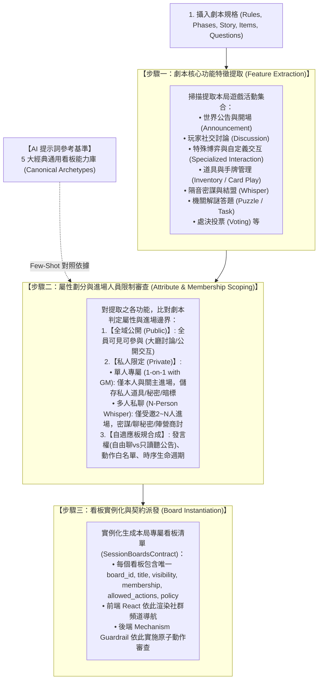

# 通用劇本殺多智能體模擬系統 (Generic LARP Multi-Agent System)

# 功能需求規格書 (Functional Requirements Document - FRD)


---


## 1. 系統願景與目標 (Vision & Scope)

本系統旨在構建一套**通用型劇本殺 / 社交推理解謎與陣營博弈多智能體模擬平台**。系統可**通用相容任何題材之劇本**（包含各類社交推理解謎、陣營博弈、機關搜證、科幻與策略對抗題材）。本系統的核心基石為**「最高權限遊戲機制核心 (The Arbiter Mechanism Engine)」**：

- **機制擁有最高主權**：整個遊戲的規則、流程進程、狀態約束完全由機制核心裁決；玩家能否說話、能否使用道具、能否投票皆由機制嚴格審查；

- **編排本局關主與看板（公開/私人雙基底架構）**：機制核心在載入劇本後，以「公開版」與「私人版」為底層基石，比對預置的【專用擴充看板能力庫】自主決定本局啟用的看板清單。若遭遇未特化開發之自定義特殊規則，系統自動按公開/私密屬性降級至雙基底由關主主持發文推進，保證未知規則絕不卡死，同時完整保留所有已開發之專用看板能力；

- **劇本自帶題庫與混合驅動**：任務題目由劇本手冊自帶提供；關主注入物證採混合驅動（手冊建議輪次 + 關主自主評估現場火候成熟發布）；

- **嚴格視角隔離與資產管理**：純淨客觀知識圖譜、單一資料表 Key 區分資產庫（道具/秘密/任務）、無記名暗投、失能禁言休眠限制（能看不能說）、陣營積分與提前結束機制；

- **前後端通訊原生相容**：沿用 MiroFish 原生 REST API 輪詢機制（每 2~3 秒拉取最新動作），關主廣播、題目、分數與失能狀態皆以 `CREATE_POST` 貼文形式無縫廣播。


- **後端環境**：Python (FastAPI / 模組化推理引擎)

- **前端環境**：React (單一焦點運作看板、頂部暫存看板分頁、最右側可收納滑動直排抽屜導航、純文字心智筆記卡片)

- **核心設計哲學**：拒絕全知視角（Fog of War 戰爭迷霧）、機制最高權限（Arbiter Control）、非對稱資訊博弈。


---


## 2. 角色與權限定義 (Roles & Permissions)


| 角色 / 中樞 | 定位 | 認知邊界與權限 |

| :--- | :--- | :--- |

| **最高機制核心<br/>(Mechanism Engine)** | 世界底層物理法則、最高法官與編排中樞 | **全場最高權限**。讀取劇本手冊，對照看板能力庫與關主職責，編排本局看板與流程；嚴格約束玩家權限（判定失能、阻斷違規發言與道具使用）；監控勝負條件與觸發器。 |

| **關主主持人<br/>(GM Host Agent)** | 流程主持人、敘事者與世界代言人 | 掌握全域劇本真相；依據機制核心賦予的本局主持規範，以主持人身分發言；在機制允許的節點執行 `ManualAction` 宣讀世界觀、從劇本題庫發題、依局勢自主注入物證、發布暗投結果。 |

| **玩家 (Agent / Player)** | 第一人稱參賽者 (扮演特定角色) | 具備「角色固定事實劇本」+「AI 生成之玩家遊玩風格」；掌握自身公開背景、自身私有資產（私有道具/秘密/個人任務）；具備獨立「半結構化純文字心智筆記」；**所有動作必須經機制核心審查方可執行，失能狀態下將進入禁言休眠（能看不能說）**。 |

| **人類研究員<br/>(Researcher / User)** | 模擬發起與觀測者 | 上傳單一劇本檔案、控制推演流程、觀測玩家心智與私聊、亦可介入機制核心觸發 ManualAction、檢視第四階段時間序復盤報告。 |


---


## 3. 功能模組詳細規格 (Functional Requirements)


### 模組 1：最高機制核心之劇本結構化攝入、判定依據與契約編排 (Mechanism Ingestion & Deduction)

- **需求代碼**：`FRD-01`

- **架構地位**：遊戲機制核心（Mechanism Engine）坐鎮後端最高權力層。

- **最高仲裁原則**：**【機制專職主持與守門，功能優先與動態板規合成】**。系統**絕不預設開啟任何固定看板**，亦不在開局直接粗暴切分公開與私人板。而是採用**「功能優先 ➔ 能見度審查 ➔ 動態板規合成」**決策管線：首先深度掃描劇本規則與流程，整理出本局遊戲實際需要的「功能機制清單（如：規則宣讀、自由討論、特殊博弈互動、手牌對比、小組密談、機關解謎等）」；接著針對每項功能，依劇本規範判定其為「全場公開」或「私人/隔音」，並動態合成專屬板規（如發言權限、允許動作白名單、時序生命週期）；最後動態實例化生成本局專屬之社群軟體式頻道列表。機制核心即為關主主持身分，在遊戲開始後入場執行各看板之主持引導、合法性攔截與全局勝負裁決。

- **第一步：單一劇本檔案 (`script.md`) 嚴格結構化規格（三大板塊大標題，格式訂死）**：
  【格式絕對嚴格約束】：為確保系統解析確定性、零幻覺與毫秒級驗證，劇本格式**採用固定規格嚴格訂死**。劇本解析器 (`script_parser.py`) 以嚴格正規表達式 (Regex) 與結構檢查器掃描。若缺少三大板塊大標題或欄位命名不符，系統直接攔截並拋出「格式校驗錯誤及具體行號」，拒絕模糊推測：
  
  #### (A) 關主部分 (GM Realm)
  1. **規模 (`scale`)**：遊戲主題與名稱、參賽總人數 ($N$)、角色名稱與 ID 名單。
  2. **故事 (`story`)**：
     - *世界觀背景*：時代環境、空間設定、開場宏觀背景劇情；
     - *現場線索與物證清單*：物證內容、解鎖條件（時序/話題深度/搜查意圖）、獨佔性標註 (`unique`)、分發層級（單人道具板/私聊室/全場公共）；
     - *案件核心真相 (`gm_truths`)*：真實真凶、行凶手法、真實動機、關鍵因果鎖扣（最高隔離，僅 GM 與機制可查）。
  3. **規則 (`rules`)**：
     - *行動與發言法則*：發言順序、過牌 (PASS) 規範、公開牌面/證物對比規範；
     - *投票與處決規則*：投票時機、是否允許棄票、平票兩階段仲裁法則；
     - *道具使用約束*：共有道具單輪限一人代表使用一次、單次消耗約束；
     - *詳細得分計算方式*：指認凶手給分、完成支線目標給分。
  4. **流程 (`phases`)**：階段劃分（晝夜輪替/幕次推進/回合制）、私聊時段限制、階段切換時機。
  5. **獲勝機制 (`victory`)**：陣營或個人通用勝利門檻、提前結束終止條件（由劇本自定義之終止判定邏輯，不預設特定公式）。
  6. **題庫 (`questions`)**：機關題目內容、標準答案、給分分值（若無解謎做題則明確為空）。
  7. **其他自定義與擴充宣告 (`other` / `custom_extensions`)**：放置當前固定標題無法定義之特殊機制、劇本全域特例、自定義突發情境修正因子、特殊環境參數（如特殊拍賣加價規則、環境傷害懲罰、特異干擾規則等，無則為空）。

  #### (B) 公開角色劇本 (Public Character Realm，每位角色獨立一組)
  1. **人設與人物介紹 (`persona_and_intro`)**：姓名、表面社會身份、公開人際關係與表面生平（公開無遮蔽）。
  2. **故事線 (`storyline`)**：案發當天該角色的公開動線與公開經歷。
  3. **公開道具與公開任務 (`public_items_and_tasks`)**：表面攜帶之隨身物品、表面公開任務（若無則為空）。
  4. **公開自定義備註 (`other`)**：角色未分類之公開特徵、特殊外貌標籤或自定義備註（若無則為空）。

  #### (C) 角色劇本秘密部分 (Private Secret Realm，每位角色獨立一組)
  1. **秘密任務 (`secret_objectives`)**：個人專屬獲勝目標、陣營暗線任務或私密支線。
  2. **私密道具與技能 (`private_items`)**：隨身私密道具/技能手牌，標註共同持有人名單 (`owners`) 與使用約束（單輪代表限用一次/消耗品）。
  3. **作案行蹤與秘密 (`secret_timeline_and_facts`)**：不可告人之真實罪證、案發當天私密行動路線與隱瞞動機。
  4. **對其他人的私下看法 (`views_on_others`)**：表面關係背後的真實評估、同盟意向或戒備心理。
  5. **私密自定義擴充 (`other`)**：個人特殊天賦、暗線特例機制或未分類私密情報（若無則為空）。

- **劇本三大板塊 ➔ 機制運作條件 ➔ 看板動態開關對照矩陣**：

| 劇本大標題分類 | 機制運作與審查依據 (The Arbiter Deduction) | 決定開啟之看板與功能支援 | 觸發關主固定主持動作 |
| :--- | :--- | :--- | :--- |
| **(A) 規模** | **圖譜先行與規模雙向校驗**：<br/>1. 先行由 Zep 抽取實體生成【客觀知識圖譜】<br/>2. 反向校驗圖譜角色節點數是否剛好等於 $N$<br/>3. 比對社交關係邊是否吻合劇本文字，排除幽靈/漏缺角色 | 初始化全場環境並由前端可視化圖譜供確認 | 關主確認全場參賽選手就位名冊與圖譜關係一致性。 |
| **(A) 故事 (世界觀)** | **純淨知識圖譜**：抽取公開人設生平與客觀背景構建圖譜底色 (絕不含秘密區) | 支撐 Agent 第一人稱世界感知與開局視覺化檢視 | **【大廳開場】**：宣讀世界觀、規則與遊戲開始公告。 |
| **(A) 故事 (物證與線索)** | **線索解鎖與獨佔審查**：語意比對發言增量，獨佔性防刷鎖定 | • 層級 A ➔ `private_item_board`<br/>• 層級 B ➔ `whisper_sandbox`<br/>• 層級 C ➔ `public_card_board` | 關主依解鎖層級定向分發線索物證。 |
| **(A) 故事 (核心真相)** | **真相隔離防線**：物理隔離，玩家決策時物理不可讀 | 支撐第四階段復盤報告 | 終局對照真相宣讀真凶、手法與因果復盤。 |
| **(A) 規則 (公開操作/展示)** | **檯面公開操作合法性審查**：阻斷未輪到自己的違規公開操作 | **【公共道具板】動態開關**：<br/>• 有公開道具或檯面操作規則 ➔ **開啟**<br/>• 無公開道具 ➔ **關閉** | **【公共道具板開場】**：置頂宣告檯面操作規範與初始狀態。 |
| **(A) 規則 (投票與處決)** | **底層投票計票與平票仲裁**：兩階段平票判定，標記失能休眠 | **底層私密投票功能** (無獨立板，大廳公示) | 私下發送投票指引，計票後於大廳公布結果。 |
| **(A) 流程 (階段與私聊)** | **私聊邊界與無共識投票審查**：私聊嚴禁直接用道具；若需共識但無共識或達輪數上限強制進入投票環節 | **【多人私聊房間】動態開關**：<br/>• 允許私聊 ➔ **開啟**<br/>• 禁止私聊 ➔ **關閉** | **【私聊室開場】**：宣讀隔音規則與安全上限，超時表決。 |
| **(A) 獲勝機制與題庫** | **做題判題與全域勝負守門**：掃描通用勝負門檻與作答進度 | **【任務活動與分數看板】動態開關**：<br/>• 有題庫且有進度門檻 ➔ **開啟**<br/>• 無題庫 ➔ **關閉** | **【活動板開場】**：發布題目清單；達成條件大廳插播獲勝。 |
| **(B) 公開角色人設與故事** | **客觀圖譜關係**：建立角色表面社交邊，零污染 | 支撐玩家發言前感知客觀關係底色 | 大廳對話中維持角色公開身分一致性。 |
| **(C) 角色私密道具與技能** | **資產防呆審查**：審查 `owners` 共同持有與單輪一人代表使用約束 | **【私人專屬道具板】動態開關**：<br/>• 任一角色有私密手牌/道具 ➔ **開啟**<br/>• 全無私密道具 ➔ **關閉** | **【道具板開場】**：點對點發放道具並告知共有者。 |
| **(C) 角色秘密與任務** | **雙通道組裝**：注入個人私密通道；終局核算個人目標得分 | 支撐玩家策略性說謊、自保與復盤個人得分 | 終局對照個人秘密目標評判給分。 |
| **(A/B/C) 其他自定義擴充宣告** | **動態特例編譯**：讀取未分類自定義規則、環境變數或暗線，編譯為本局自定義驗證器 | 若含新功能則動態開立特化看板，若為規則特例則注入機制審查 | 依劇本特例宣告主持規則與特例通知。 |

- **規則缺失防呆與預設補底機制 (Fallback & Default Rule Guardrails)**：

  為杜絕因劇本自然語言未詳盡描述關主規則而導致系統停擺，最高機制核心內建以下「標準補底法則」：

  1. *缺發言順序* ➔ 預設採用「玩家序號順時針依序發言」；

  2. *缺私聊時限* ➔ 預設採用「最多 4 輪安全上限」，超額強制由關主介入微投票並關閉；

  3. *缺平票處理* ➔ 預設採用「第一步引導重投，第二步機制隨機裁決」；

  4. *缺題庫* ➔ 機制自動關閉 `task_score_board`；

  5. *缺出局淘汰* ➔ 預設全員存活推進，`enable_disabled_status = false`；

  6. *未特化開發之自定義機制* ➔ 機制核心自動依劇本規則抽取出新功能實體，判定其能見度（公開交互 or 私密決策），原地動態合成獨立專用頻道或分流推進，保證未知規則 100% 順暢執行。


---


### 模組 2：機制嚴格約束與狀態機控制 (Strict Mechanism Constraints)

- **需求代碼**：`FRD-02`

- **權限約束原則**：玩家的一切主動動作**必須先過機制核心審查，不可自由越權**。

- **【最高機制核心之通用檢驗五大物理法則 (The 5 Universal Mechanism Guardrail Principles)】**：
  為杜絕因不同劇本規則多變而導致邏輯失序，最高機制核心在玩家執行任何動作時，除比對當前劇本特有規則外，**硬性貫徹以下「五大通用原則性檢驗矩陣」**，貫穿動作「事前審查、事中執行、事後結算」三大環節（能見度則由看板開立時之屬性天然決定，無冗餘計算）。
  
  > [!IMPORTANT]
  > **【元架構與具體規則動態編譯說明】**：
  > 1. **通用五大原則為頂層「元物理法則 (Meta-Invariants)」**：這五大原則是系統不變的最高法規架構，作為攔截違規與推動狀態機的固定檢查卡點；
  > 2. **具體審查規則由劇本動態編譯生成**：機制核心在攝入劇本 (`script.md`) 時，將劇本所宣告的具體規則（如哪些動作合法、道具歸誰、共有道具使用頻率、線索觸發關鍵詞、獲勝條件門檻）動態實例化為五大原則下的具體驗證邏輯；
  > 3. **自定義特例規則擴充槽 (Custom Exception Rules)**：若劇本於 `other` 欄位宣告了非標準的特殊機制（如環境掉血懲罰、拍賣暗標加價階梯、特異技能干擾等），機制核心在讀取時動態掛載為「原則 1 / 原則 4 之特例校驗器」，確保任何未知例外規則在機制中都能精確執行原子級審查，絕無死角！

  | 通用原則編號與名稱 | 檢驗時機 | 核心檢驗條件與判定邏輯 (後端 Python 原子審查) | 違規處置或觸發行為 |
  | :--- | :--- | :--- | :--- |
  | **原則 1：權力資格與動作合規檢驗**<br/>(Authority, Eligibility & Action Compliance) | 動作前 (Pre-Action) | 1. **發言時序權力**：當前輪次與順序是否輪到該 Agent？有無違規搶發言？<br/>2. **存活/失能權力**：角色是否處於 `is_disabled == True`（死亡、淘汰、封印、禁言）？<br/>3. **看板准入通行權**：該 Agent 是否在當前看板之准入名單 (`membership`) 中？<br/>4. **看板動作白名單**：該看板之 `allowed_actions` 是否允許此動作？（如私聊室嚴禁直接用道具、只讀公告板試圖發言）。<br/>5. **參數合規性**：動作 payload 格式是否完整？ | • 搶發言、非通行成員、或該看板不允許之動作：直接原子攔截駁回並告警。<br/>• 失能者：強制進入「禁言休眠模式 (Mute Sleep)」，調度器跳過發言 (0 Token)，背景僅接收客觀事實。 |
  | **原則 2：資產歸屬與使用約束檢驗**<br/>(Asset Ownership & Usage Constraint) | 動作前 (Pre-Action) | 1. **資產所有權**：該 Agent 是否名列於資產的 `owners` 持有人清單中？（非持有人不可使用他人資產）<br/>2. **狀態與頻率約束**：該道具是否已消耗 (`consumed`)？本輪是否已使用 (`used_in_turn`)？共有道具本輪是否已由同伴代表使用？ | • 非持有人或越權使用：駁回動作。<br/>• 共有道具代表使用：原子標記 `status = 'used_in_turn'`，本輪阻斷同隊其他人重複發動。 |
  | **原則 3：線索發現與觸發評估檢驗**<br/>(Clue Discovery & Trigger Evaluation) | 事中/事後 (Execution) | 1. **語意話題深度比對**：Agent 發言增量是否滿足劇本定義之搜查條件、話題關鍵點或時序進展？<br/>2. **獨佔性防刷鎖定**：若滿足線索標註 `unique: true`，且已被他人搜取耗盡，機制阻斷重複獲取；若首次解鎖，立即排程注入。 | • 判定成功解鎖：機制自動分發線索至對應層級（單人道具板 / 私聊室 / 公開大廳），並將 `unique` 證物標記耗盡。 |
  | **原則 4：階段推進與強制特定動作守衛**<br/>(Mandatory Phase Actions Guardrail) | 動作前/事後 (Progression) | 1. **強制義務檢測**：當前流程階段是否要求全員或特定角色「必須執行特定動作」？（例如：投票處決階段全員必須提交選票；私聊達 4 輪上限必須微投票；搜證輪次必須指定搜查區域）。<br/>2. **未履行義務阻斷**：是否在未完成必要動作前試圖跳過？ | • 未履行強制動作時，阻斷其常規發言，強制引導其完成該階段之專屬強制任務（如微投票）。 |
  | **原則 5：全局勝負終止與安全熔斷檢驗**<br/>(Victory Termination & Deadlock Breaker) | 事後結算 (Post-Action) | 1. **通用勝負終止掃描**：該動作結算後，是否已滿足劇本自定義之獲勝條件、生殺比例或分數閾值？<br/>2. **死鎖安全熔斷**：全場是否出現全員連續放棄 (All-PASS) 或私聊死循環？ | • 達成勝負條件：**立刻中斷輪次循環 (Break Loop)**，宣告勝利並跳轉第四階段復盤；<br/>• 偵測死鎖：機制核心主動啟動補底法則介入（重新表決或隨機裁決）。 |

- **動作約束矩陣**：

  1. **機制發言權威裁決與失能禁言 (Speaking Rights & Mute Mode)**：

     - **發言權審查層**：輪到玩家時，由機制核心主動裁決其是否具備發言權 (`SPEAKING_RIGHT`)。若劇本未啟用失能規則，機制直接核准發言權 (`GRANTED`)；若啟用且玩家處於 `DISABLED`，機制判定剝奪發言權 (`REVOKED`)，強制進入「禁言休眠模式 (Mute Sleep)」，調度器跳過發言（零 Token 消耗），背景仍接收公共事實。

  2. **純發文形式之道具與出牌約束 (Post-Driven Item Usage & Reveal)**：

     - **全流程發文驅動，拒絕 UI 點擊**：所有道具使用、技能發動與線索出牌**一律以發文形式 (ACTION_POST / PLAY_CARD) 執行**。

     - **三大道具使用清晰動線**：

       - **路徑 A（單人私下使用）**：在關主為該玩家開啟的【私人專屬道具板】中發文宣告，關主同板回覆確認，完全不驚動外人。

       - **路徑 B（多人商討後委託代表使用）**：在【彈性多人私聊聊天室】中討論完畢並達成共識後，**嚴禁在私聊聊天室內直接使用道具**！由關主在私聊內說明並引導指定一名代表玩家，**前往該玩家的【私人專屬道具板】發文發動道具/技能**，關主在道具板回覆確認。

       - **路徑 C（公開出牌與亮牌）**：在【公共道具板】發文打出卡牌或亮出證物，通過機制合法性審查後，原地 UPDATE `visibility='public'`，即時同步為全場公開牌面。

  3. **彈性多人私聊規範：引導表決與道具共同持有人機制**：

     - **純通訊交流原則**：支援 2 至 N 人的任意組合，隔音且對外保持戰爭迷霧。**純粹作為交流溝通、對口供與戰略商討之用，嚴禁在此直接使用道具**。

     - **【關主引導房內表決機制 (In-Room Micro-Voting)】**：


       - **發起與時長控制（選項2 + 4輪安全上限）**：多人私聊時，由關主全程監聽。當討論自然達成共識、或進行到微投票完成宣告後，由關主宣布私聊結束並拉回大廳；若私聊持續達到【4 輪安全上限】仍無共識，關主強制介入發起房內微投票並關閉私聊。


       - **平票 (Tie-Breaking) 兩階段處理**：


         1. *第一階段（重新表決）*：若出現 1:1 等平票情況，關主在房內說明情況並引導重新投票（提示：「目前出現平票，若第二次投票仍未果將由系統隨機裁決，請各位謹慎協商或調整立場」）。


         2. *第二階段（隨機裁決）*：若第二次投票仍為平票，則由機制核心隨機選定一位代表發言或選定行動目標，防止流程卡死。


       - **決策錨定**：微投票結果由關主在房內發文宣布，留下清晰聊天紀錄供同伴感知，隨後引導指定代表前往其個人道具板發動技能。


     - **【道具共同持有人機制 (Asset Co-Ownership)】**：


       - 若遊戲規則規定特定道具/技能為多名玩家共同擁有（如陣營共同行動），在開局私人道具板中，**關主可依規則宣告共同持有人名單**，資產表以 `owners` 記錄全體持有人，不分主副，彼此知情；若規則規定保密則不宣告。


       - **使用限制由遊戲規則制定**：單一輪次是否「限由一人代表使用一次」或「全體皆可各自發動」，**100% 由該劇本遊戲規則手冊制定**。關主在主持時依規則進行口頭宣讀與引導，**由最高機制核心在後續執行原子檢查與狀態攔截**（如判定同輪次是否已被同伴使用、超出次數則駁回）。


     - **【情報分享與動態博弈說謊邊界】**：

       - *客觀規則共有*：規則上必要的同伴知情（如共同陣營與初始共有資產），由關主於開局或私聊初始時官方發布。

       - *主觀動態博弈（自保/拉攏/說謊）*：後續玩家為了自保、結盟而透露身份、展示線索、甚至虛張聲勢與說謊，**絕對不可由關主代為宣布**！必須完全由**玩家 Agent 在自然語言對話中自主決定透露的真偽與粒度**，關主不介入干涉。

  4. **「看板即邊界」之天然能見度架構 (Board as Natural Visibility Boundary)**：

     - **核心原則：在哪個看板發言，就天然決定了誰能看見，無需多餘動態能見度審查**：
       看板在開立時，其屬性（全域公開 / 多人私密 / 單人專屬）與進場成員名單 (`membership`) 就已經嚴格定死。因此，道具發動或發言是否給別人看到，**100% 依賴玩家自主選擇前往哪個看板發文**：
       - **路徑 A（私下暗中發動）**：玩家前往自己的【單人私人道具板】發文使用道具，關主同板回覆確認。受眾僅限本人與關主，外界物理上不可見，天然實現私密暗中生效；
       - **路徑 B（公開出牌/亮出線索）**：玩家前往【全場公開板】發文亮牌打出，受眾為全體玩家，原地同步公開，天然實現全場可見；
       - **路徑 C（同伴密談展示）**：玩家在【多人私聊密室】發言商議展示，受眾僅限入房成員，天然維持隔音防護。
     - 機制核心在執行檢查時，僅需由「原則 1」審查玩家是否具備該看板的准入權限與動作白名單，徹底解耦多餘的動態通知計算。

  5. **失能與復原控制**：機制核心掌握失能計時器，經指定輪次或特定救援行動方可解除。

   6. **不對稱信任與認知分流架構：對關主 100% 信任 vs 對其他玩家本能遲疑猜忌 (Asymmetric Trust & Cognitive Partitioning)**：

      - **痛點與認知悖論**：
        大語言模型 (LLM) 天生具有「討好性 (Sycophancy)」與「預設輕信 (Default Credulity)」，面對對手陳述容易缺乏防備而直接採信；然而若籠統注入「不要相信任何人」，LLM 又會開始懷疑關主發布的規則與物證。為此，系統構築**「不對稱信任防線架構」**，採「先實裝防線一測試，後續防線依實測效果逐步疊加開發」的漸進式策略：

      - **【當前正式實裝基準】防線一：頂層憲法級雙重公理 (Dual Constitutional Axioms in System Prompt)**：
        在 Agent System Prompt 最頂層硬性組裝不可覆蓋之底層物理公理：
        1. *【關主超然公理】*：關主 (GM_Host) 為世界物理法則化身，不參與勝負利益，**具備 100% 絕對客觀真實性，絕無欺瞞能力與動機**。全體玩家無條件服從關主之規則宣讀、物證特徵與票決公示；質疑關主者視同認知幻覺；
        2. *【對手博弈猜忌公理】*：場上所有其他玩家（包括聲稱與你同陣營者）皆有各自隱藏秘密、個人任務或罪證。**所有玩家言論默認存在策略性說謊、自保隱瞞、栽贓偽裝與拉攏欺詐之可能。未經關主客觀物證佐證之玩家陳述，一律抱持強烈遲疑態度，絕不可輕信**。

      - **【Agent 行動決策之四大輸入依據 (The 4 Input Dimensions)】**：
        當輪到 Agent 行動時，其思考與發言決策嚴格基於以下四大依據組裝：
        1. **可見看板歷史紀錄 (Accessible Boards History)**：該 Agent 具備准入通行權之所有看板（大廳公聊、受邀多人私聊隔音房、自身私人道具板）的最新貼文歷史，即時掌握最新情報與對話局勢；
        2. **憲法級雙重公理 (Dual Constitutional Axioms)**：對關主 100% 絕對信任真理 vs 對所有對手預設博弈猜忌（**此處已天然涵蓋自保隱瞞與秘密防線，無需重複贅述**）；
        3. **個人私密資產與任務 (Private Assets & Objectives)**：自身持有之道具、秘密與個人獲勝目標；
        4. **關主當前主持指示 (GM Turn Guiding)**：關主在該輪發言前剛發布的可用看板清單（`available_boards`）與合法動作（`allowed_actions`）。

      - **【後續迭代演進計畫（註明：先行測試防線一之實測效果，待評估後逐步加入開發）】**：
        - **防線二（待測試加入）：上下文組裝顯式標籤分流 (Explicit Partitioning Tags)**：
          在 Perception Prompt 中強制打上高對比標籤：關主內容封裝為 `【SYSTEM_GROUND_TRUTH - 100% 絕對真實】`；玩家言論封裝為 `【UNVERIFIED_PLAYER_CHAT - 高度可疑，可能說謊欺瞞】`。
        - **防線三（待測試加入）：心智筆記強制懷疑打分與矛盾追蹤 (Suspicion Tracker)**：
          在延遲心智更新中強制填寫各玩家懷疑度評級 (1~10) 與言行矛盾點，逼迫思考鏈主動挑刺。
        - **防線四（待測試加入）：性格維度不對稱常數鎖定 (Meta-Persona Anchoring)**：
          資料庫鎖定 `trust_in_gm = 100`，設定 `trust_in_players = 20~40` 低起點，搭配猜忌敏感度。

   7. **關主主持定位：核心雙階段主持體系與隨行解說 (GM Dual-Phase Presiding Architecture)**：
      關主主持職責嚴格拆解為兩大核心主持部分，穿插於整個模擬進程：

      #### 【第一部分：遊戲剛開始之開場主持宣讀 (Game Opening Broadcast)】
      - **觸發時機**：對局初始化完成、首輪正式開始前（或每幕/階段初始切換時）。
      - **主持看板**：全域公開大廳看板 (`public_stream`)。
      - **核心宣讀內容 (建立全域規則與勝負認知)**：
        1. **宣布關主超然身分**：宣告自己為客觀世界公證人與最高規則主持人，具備 100% 絕對真實性，代表底層物理法則；
        2. **宣讀故事背景與世界觀**：宣讀時代環境、空間設定與開場宏觀背景劇情；
        3. **說明遊戲流程與階段模式**：宣告晝夜輪替、幕次推進方式，以及何時為自由討論、何時為私聊階段；
        4. **說明全場通用規則與發言規範**：宣告各看板定位、過牌 (PASS) 規範、公開出牌/檯面操作規範、以及私聊純通訊嚴禁直接用道具之最高禁令；
        5. **宣告勝負目標與終止條件**：宣告各陣營勝利門檻、分數達成閾值或生殺比例，正式敲鐘宣布遊戲開始（蓋上 `SYSTEM_GROUND_TRUTH` 戳記）。

      #### 【第二部分：每位 Agent 發言之前的引導主持 (Per-Turn Guiding Broadcast)】
      - **觸發時機**：在輪次調度計算出當前行動者後、**該 Agent 發言決策之前**。
      - **主持看板**：當前行動之專屬看板或大廳看板。
      - **核心引導內容 (明確個人本輪權力與行動邊界)**：
        1. **點名當前行動 Agent**：官方指名當前輪到的 Agent；
        2. **指示可用看板清單 (`available_boards`)**：明確告知該 Agent 本輪可以前往哪些看板發言或行動（例如：可去大廳自由發言、或前往個人專屬道具板發動技能、或在受邀私聊房對話）；
        3. **指示合法動作白名單 (`allowed_actions`)**：明確宣告該 Agent 本次允許執行的動作（例如 `["CREATE_POST", "PLAY_CARD", "USE_ITEM", "PASS"]`）；
        4. **提醒當前輪次特有規則或義務**：若本輪為強制投票輪則強制引導投票；若共有道具本輪已被夥伴代表使用過則明文提示；若處於特殊環境規則則提示特例限制。
      - **後續閉環**：只有在關主發布該引導主持後，該 Agent 方可依據指示做出合規決策。

      #### 【補充維度：動態關鍵事件的突發主持與廣播 (Dynamic Event Broadcasts)】
      - **線索解鎖與物證分發**：對話觸發條件或推進至搜證時，依層級注入提示暗格收穫、私聊線索或大廳官方驗屍報告；
      - **人員死亡與淘汰出局**：公投處決、夜襲結算或出局時，大廳敲鐘發布死訊公告，宣告死者身分並啟動禁言休眠；
      - **私聊超時仲裁與微投票**：私聊滿 4 輪上限或僵局無共識時，打斷對話發起微投票，定案後引導代表回道具板發動並關閉房間；
      - **勝負達成與終局真相復盤**：達成勝負條件提前結束或終局結案時，大廳插播提前勝利、對照真相宣讀真凶手法、產出得分榜復盤報告。

---
### 模組 3：私密資產儲存位置與 Key 權限隔離機制 (Secret Storage & Key Isolation)

- **需求代碼**：`FRD-03`

- **單一資料表存儲**：

  - 角色劇本中【私密專區】所屬的**道具、秘密、個人任務**，在推演資料庫（`simulation.db`）中，**全部集中儲存在同一張 SQLite 資料表 `agent_private_assets` 裡**，絕不拆分成零散多檔。

  - **欄位詳細設計（無主副區分，全面扁平）**：


    - `id` (TEXT PRIMARY KEY): 資產唯一識別碼


    - `owners` (TEXT NOT NULL): 所有持有人清單 (逗號分隔玩家ID，如 'Player_Li' 或 'Player_1,Player_2')，共同持有者地位完全平等，彼此知曉


    - `category` (TEXT NOT NULL): 資產類別 ('item' | 'secret' | 'objective')


    - `title` (TEXT NOT NULL): 標題名稱


    - `content` (TEXT NOT NULL): 詳細說明/罪證事實/勝利條件


    - `visibility` (TEXT DEFAULT 'private'): 能見度 ('private' | 'public')


    - `status` (TEXT DEFAULT 'in_hand'): 生命週期狀態 ('in_hand' | 'used_in_turn' | 'revealed' | 'consumed' | 'completed')

    - `metadata` (TEXT DEFAULT '{}'): 擴充結構化 JSON，支援自定義數值或資源屬性

    - `created_at` (TIMESTAMP DEFAULT CURRENT_TIMESTAMP): 建立時間戳記

- **通用資產模型與無貨幣劇本泛化支援 (Generic Asset & Currency-Agnostic Design)**：
  - **核心哲學：劇本不一定有金錢，系統絕不強制預設貨幣經濟模型**；
  - **模式 A（純定性推理劇本）**：全場無金錢。表內僅存放純文字物證、隨身信件、鑰匙、隱瞞罪證與秘密目標。沒有任何金額數值，完全定性運作；
  - **模式 B（自定義數值資源劇本）**：若劇本涉及數值計數、點數、體力或特殊資源，統一於 `metadata` 註記資源屬性（如 `{"amount": 100, "resource_type": "點數"}` 或 `{"amount": 3, "resource_type": "HP"}`），由機制執行原子扣減，無需為特定劇本新增 SQL 欄位；
  - **模式 C（純定性資產交換）**：若劇本涉及物資流轉或談判卻無貨幣，劇本可定義「以物易物（物證換情報）」或「承諾交換」，架構完全通用。

- **隔離與流轉**：


  - **知識圖譜 (KG) 零污染**：圖譜完全不讀取此表，只解析公開背景故事，保證客觀圖譜絕對純淨。


  - **個人 Prompt 注入**：以 `WHERE (owners LIKE '%' || ? || '%') AND visibility = 'private'` 查詢注入該玩家私有資產。


  - **出牌即時轉公開**：出牌時僅更新 `visibility = 'public'`，公共手牌看板即可直接顯示。


---


### 模組 4：劇本功能優先之看板動態生成與自適應板規合成架構 (Function-First Board Deduction & Dynamic Policy Synthesis)
- **需求代碼**：`FRD-04`
- **最高仲裁規則**：**【所有看板皆因劇本而生，規則絕不事先寫死，機制核心專職守門】**。
- **決策流程辯證：為什麼「先功能，再判斷公開/私人」是最佳解？**：
  - **核心哲學**：在遊戲本質中，「做什麼行為（功能活動）」是第一性的，而「誰能看到（能見度：公開 vs 私人）」與「允許怎麼做（板規權限）」是該功能的屬性。若一開始就生硬地先開兩個「公開版」與「私人版」，會導致看板定位模糊且功能雜糅。
  - **社群軟體頻道化模型 (Social Platform Multi-Channel Concept)**：
    系統如同一個專屬 Discord / Slack 空間，使用者進到不同的看板（頻道）做不同的事；每個看板的產生、標題、能見度、成員範圍與內部板規，**全部依據當前劇本的需求動態生成**。

- **三階段動態看板生成管線 (3-Stage Dynamic Board Synthesis Pipeline)**：



- **保留「5 大經典通用看板能力庫」作為 AI 提示詞之對照基準 (Canonical Reference Archetypes)**：
  為保證後端 LLM 推理之穩定性與結構規範，系統**完整保留原本梳理之 5 大經典看板，作為機制核心提示詞（Mechanism System Prompt）的標準 Few-Shot 參考範本庫**：
  1. `public_stream` (公開主時序範本)：示範全域公開、輪次推進、公告與討論之規範；
  2. `private_item_board` (單人私密道具範本)：示範 1 對 1 視角隔離、道具保管與單人宣告之規範；
  3. `public_card_board` (檯面明牌比大小範本)：示範公開檯面操作、合法性出牌審查之規範；
  4. `task_score_board` (任務進度條範本)：示範機關認領、做題判題與分數累計之規範；
  5. `whisper_sandbox` (多人隔音密室範本)：示範 2~N 人進場限制、隔音防護與 4 輪安全上限微投票之規範。
  機制核心在閱讀新劇本時，以這 5 大範本為能力錨點，結合劇本具體規則，推導或派生出專屬於本局的全新特化看板（如特殊公開交互版、專屬決策通道、禁言廣播版等）。

- **劇本功能 ➔ 能見度審查 ➔ 看板動態生成與自適應板規對照表**：

| 劇本提取之功能活動 | 劇本判定依據 (觸發特徵) | 能見度判定 (公開 vs 私人) | 生成之看板型態與專屬自適應板規 (Board Policy - 隨劇本動態調整) | 關主在該看板之職責 |
| :--- | :--- | :--- | :--- | :--- |
| **世界觀與規則宣讀** | `story(世界觀)`、`rules` | **全域公開** (`public`) | • **案例 A (劇本一：自由交流大廳)**：`allow_player_chat: true`，允許玩家發言質詢。<br/>• **案例 B (劇本二：聆聽專用公告板)**：`allow_player_chat: false`，**玩家強制禁言只讀 (`READ_ONLY`)**，僅供接收關主權威真理。 | 世界公證人、規則宣讀者 |
| **特殊自定義交互活動** | `rules(自定義規則)`、特殊互動規範 | • 若為公開互動 ➔ **全域公開**<br/>• 若為秘密決策 ➔ **私人獨立視角** | • **專屬自定義板規**：禁止普通公聊閒聊，**嚴格限制僅能執行劇本定義之動作 (如 `CUSTOM_ACTION` / `PASS`)**。<br/>• 依劇本規範注入參數限制；僅在特定階段開啟，任務完成後封存為只讀。 | 專屬流程公證人、裁決者 |
| **隨身道具與個人秘密** | `story(物證)`、`private_items`、`secret_timeline` | **私人限定：單人專屬** (`private_single`)<br/>進場限制：僅本人 + GM | • **專屬個人板規**：儲存個人私密道具、隨身技能、隱瞞罪證與私密目標；允許動作 `["USE_ITEM", "PLAY_CARD"]`；共有道具受「單輪限一人代表使用」約束。 | 道具效果裁決者、發放解說員 |
| **小組密會與聊秘密** | `phases(私聊)`、`rules(允許私聊)` | **私人限定：多人私聊** (`private_group`)<br/>進場限制：受邀 2~N 人 + GM | • **專屬密室板規**：聊秘密、對口供、商討戰術；**純通訊交流，嚴禁在此直接使用道具**；設有 4 輪安全上限，超時強制由關主介入微投票。 | 隔音公證人、微投票仲裁者 |
| **機關謎題與做題** | `questions(題庫)`、`獲勝分數閾值` | **全域公開** 或 **陣營私密** | • **專屬任務板規**：展示待解題目清單，允許動作 `["CLAIM_TASK", "ANSWER_TASK"]`；自動判定答案正誤並累計陣營進度條，滿分觸發提前獲勝。 | 出題官、閱卷裁判、進度廣播員 |
| **投票處決/指認** | `rules(投票/處決)`、`終局問卷` | **私人投票** + **公開公示** | • **專屬投票板規**：無記名暗投通道，僅能執行 `["SUBMIT_VOTE"]`；計票後結果於大廳發布，平票啟動兩階段重投/隨機仲裁。 | 發票人、計票員、死訊敲鐘者 |

- **看板三大生命週期形態與唯讀封存機制 (Board Lifecycle & Read-Only Archival)**：
  看板的開啟、休眠與結束絕非死板設定，100% 依據劇本規則定義：
  1. **永久常駐型 (Permanent)**：全對局持續開啟（如公共大廳、個人隨身道具板）；
  2. **週期休眠/重啟型 (Cyclical / Periodic)**：依特定階段循環切換。例如特定陣營之夜間密室，在「夜間階段」開啟發言，至「白天階段」暫時休眠關閉，下個夜晚由關主再次喚醒重啟；
  3. **單次時效型 (One-Shot with Limit)**：如特定幕次之專屬活動，達到目標或劇本設定之輪次時限後，**狀態原地切換為 `READ_ONLY` 唯讀封存**，保留完整歷史紀錄，供玩家心智筆記交叉比對與第四階段復盤報告調閱。

- **動態板規規格定義 (BoardPolicy Schema)**：
  每個因劇本生成的看板，均攜帶獨立的板規 JSON 契約：
  ```json
  {
    "board_id": "board_special_01",
    "title": "第二幕專屬互動會所",
    "function_type": "SPECIAL_INTERACTION",
    "visibility": "public",
    "membership": ["ALL"],
    "speaking_policy": {
      "allow_player_chat": false,
      "allowed_actions": ["CUSTOM_ACTION", "PASS"],
      "action_payload_schema": { "action_target": "TEXT", "param_val": "TEXT" }
    },
    "lifecycle": {
      "type": "ONE_SHOT",
      "open_phase": "PHASE_2_SPECIAL",
      "close_phase": "PHASE_2_SPECIAL_END",
      "on_close": "SET_READ_ONLY"
    }
  }
  ```
- **核心架構優勢**：
  1. **零固定死板**：沒有任何看板是硬性綁定的，大廳、專屬特化板、道具、私聊皆因劇本而生；
  2. **規則動態可塑**：同一個看板型態在不同劇本中擁有截然不同的權限（如聊天 vs 聆聽公告），徹底滿足多樣化題材需求；
  3. **社群軟體體驗**：前端 React 宛如 Discord 頻道列表，玩家點進不同看板執行清晰明確的專屬動作，不雜糅、不卡死。

---
### 模組 5：關主情報主動發布與多層級定向線索分發 (Multi-Tier Clue Injection & GM Authority)

- **需求代碼**：`FRD-05`

- **關主互動定位**：**【關主以宣布事項、主持與注入情報為主，暫不開放玩家主動向關主發問】**。玩家探索與盤問聚焦於玩家與玩家之間的對話、辯論、私聊與對質，維持關主作為客觀世界裁判的超然地位。

- **通用線索發現與觸發機制 (Clue Discovery & Trigger Evaluation)**：


  - **免特化開發、免硬編碼關鍵字**：不需針對劇本殺寫死 Regex 關鍵字比對（容易因同義詞或語境誤判）。系統採用**【關主語意評估器 (GM Host Semantic Evaluator)】**通用架構：


    - 劇本創作者在手冊中以純自然語言定義「線索解鎖條件 (Clue Unlock Triggers)」：


      1. *時序推進條件*：如「進入第二幕搜證時，自動公開現場大廳勘驗線索」。


      2. *話題討論深度條件*：如「當玩家公聊討論到『死因/兇器』時，關主注入法醫報告」。


      3. *主動搜查意圖條件*：如「當有玩家發言表示『我想去書房檢查抽屜/暗格』時，關主定向注入書房暗格借條」。


      4. *特定互動/私聊條件*：如「當大少爺與管家在私聊討論超過 2 輪時，關主在該房提示袖口污漬」。


    - 關主 Agent 每輪感知對話增量，比對手冊條件，一旦判定符合，自主發動 `ManualAction(INJECT_CLUE)`，送交機制核心分發。

    - **線索獨佔性與鎖定 (Clue Exclusivity & Depletion Lock)**：劇本手冊可自由標註線索屬性（如 `unique: true` 或 `false`）。機制核心預設支援獨佔鎖定：當 `unique: true` 的線索被首位玩家搜得後，該線索狀態標記為已耗盡，後續其他玩家搜查同一目標時，關主回覆「此處已被翻動過，空無一物」。


- **多層級定向線索/物證分發機制 (Multi-Tier Targeted Clue Drop)**：


  - 為滿足非全體公開線索（如特定幾人發現線索、單人搜查收穫）的通用需求，關主依據劇本規範與局勢，採用三種層級注入線索：

    1. **層級 A：單人私密線索注入 (Targeted to Private Item Board)**：

       - 若某條線索/道具僅屬於特定單一玩家發現（如案發現場抽屜暗格、個人隨身信件），**關主直接注入該玩家的【私人專屬道具板】**。全場僅該玩家本人知曉，對大廳與其他人保持戰爭迷霧。

    2. **層級 B：多人私聊室定向注入 (Targeted to Whisper Room)**：

       - 若某條線索是由當前密會的 2~3 位玩家共同發現（如特定幾人在某區域私聊商討時獲得情報），**關主直接在該【彈性多人私聊視窗】發布線索通報**。全場僅該聊天室內的參與者可見，外界完全不知情。

    3. **層級 C：全場公開物證注入 (Global Public Reveal)**：

       - 若為全體可見之重大情報（如官方驗屍報告、全場環境公告），關主於【公共時間序對話板】貼文發布，並同步陳列於【公共道具板】。

  - **後續流轉完全由玩家自主決定**：持有非公開線索的玩家，可自主選擇私密保留、在私聊中作為談判籌碼選擇性透露（可真可假）、或在公共道具板發文公開亮牌展示。

- **通用動態事件響應**：

  - 機制捕獲事件（如答題成功、機關破壞、出牌壓制）後，**喚醒關主 LLM，由關主結合當前局勢靈活輸出主持詞與處置動作**（調整分數/發放道具/發布警報/即興調侃），拒絕死板硬編碼廣播。


---


### 模組 6：Profile 玩家個性生成（5 大博弈維度）(Player Meta-Persona Generation)

- **需求代碼**：`FRD-06`

- **演員與角色解耦**：劇本客觀事實寫死（零幻覺），Profile 階段生成操控該角色的「玩家遊玩風格」：

  1. 勝負欲與攻擊性 (Competitiveness)

  2. 誠實度與抗壓防線 (Honesty & Panic Baseline)

  3. 社交支配力 (Social Dominance)

  4. 溝通與私聊熱情 (Whisper Affinity)

  5. 邏輯細緻度 (Deductive Rigor)


---


### 模組 7：多維感知依據、純文字心智筆記與知識圖譜 (KG) 調用生命週期 (Perception, Notes & KG)

- **需求代碼**：`FRD-07`

- **知識圖譜 (KG) 在系統中的調用生命週期與時機**：

  - **定位與純淨性**：知識圖譜（Zep KG）僅存儲客觀世界觀、公開人設背景、各角色表面社交關係與客觀地理資訊，**絕對不存儲任何私密道具、個人秘密與私有任務**（保證零污染）。

  - **具體調用時機（何時調用 KG？）**：

    1. **時機一：輪次感知與心智筆記刷新前 (Perception Phase)**：輪到 Agent 行動前，系統自動檢索在場全體其他玩家與當前 Agent 的「客觀關係邊」（如親友、上下級、表面同盟），作為交叉比對各方發言與矛盾點的基礎信任底色。

    2. **時機二：私聊發起與組隊決策期 (Whisper Initiation)**：Agent 思考「該拉誰進行私密商討」時，查詢客觀圖譜評估潛在同盟機率。

    3. **時機三：真偽矛盾檢驗期 (Truth Verification)**：當聽到某位玩家的發言涉及公開歷史或公開動線時，調用圖譜比對其是否出現與客觀世界觀矛盾的致命破綻。

- **玩家行動前之四大思考參考依據 (步驟 4 核心感知體系)**：
  輪到 Agent 發言或行動前，系統完整注入四維參考依據，驅動深度思考與博弈決策：

  1. **【個人主觀看板 (心智筆記卡片)】**：
     - 純文字半結構化第一人稱心智日記（他人物理不可讀）；
     - 包含對場上各玩家之**主觀懷疑度與信用評級**、私密推理假設、隱密作戰計畫與偽裝自保話術。

  2. **【個人看板歷史紀錄 (個人私密資產與專屬記憶)】**：
     - **個人道具視窗歷史**：自身持有的私密道具清單、使用狀態、共有者名單與過往使用結算紀錄；
     - **專屬私聊房間隔音歷史**：自身所屬私聊室之密會對話、同盟承諾與房內微投票表決結果；
     - **秘密角色劇本**：個人不可告人之秘密行蹤、作案罪證與專屬個人獲勝目標。

  3. **【公共看板歷史紀錄 (全域時序與檯面動態)】**：
     - **全場公開大廳歷史**：全體存活玩家的公開陳述、質詢、辯論與表態對話流；
     - **公共道具板歷史**：檯面展示之公開道具、歷史操作與檯面共享狀態；
     - **任務分數看板現況**：當前挑戰題目進度、作答嘗試與陣營累計總分。

  4. **【客觀真理與知識圖譜 (關主權威與社交底色)】**：
     - **關主官方真理公告通道 (`SYSTEM_GROUND_TRUTH`)**：世界觀、流程階段、死訊通報與投票指引（100% 絕對信任，不可質疑）；
     - **純淨客觀知識圖譜**：公開人設背景、表面社交關係與客觀世界常識。

- **純文字心智筆記刷新：延遲心智更新機制 (Lazy Cognitive Update)**：


  - **精準喚醒原則**：**僅在輪到該 Agent 進行發言或決策行動時，方喚醒並增量更新其第一人稱心智筆記**；其餘非行動輪次或處於失能禁言休眠狀態時，完全不呼叫 LLM 進行筆記更新，極致優化 Token 消耗並避免零碎重寫。


  - **筆記結構**：三方交叉比對後，針對在場所有其餘玩家生成/刷新第一人稱心智筆記：


    `【[角色名] 的第一人稱心智筆記 (輪次 [R])】：- 針對【目標玩家 A】：• 觀察與矛盾點 • 當前評估與態度 • 下一步策略`。


---


### 模組 8：底層機制功能：私密投票詢問、失能休眠與提前結束 (Private Voting Feature, Sleeping & Early Victory)

- **需求代碼**：`FRD-08`

- **私密投票詢問功能 (非看板)**：

  - 投票不是看板，而是機制底層的功能模組。

  - 當到達投票或結案問卷指認節點時，機制核心驅動關主**在私聊通道向各存活玩家發起投票/問卷詢問**。

  - 玩家以私密發文形式向關主提交選票（選票對其他玩家隱蔽）。

  - 機制核心在後端完成安全計票與平票仲裁後，**由關主依規則在【公共時間序對話板】發布投票結果公告**。

- **失能禁言休眠限制**：失能者在輪詢時**直接跳過喚醒，不呼叫 LLM，不消耗 Token**；背景持續接收公聊 Observation；GM 守門員實施發言與動作阻斷。

- **全域勝負終止與提前結束**：達成劇本勝負與終結判定條件時（如目標達成、門檻達標或資產清空等通用邏輯），機制核心**立刻中斷常規輪次循環 (Break Turn Loop)**，關主宣告提前獲勝，直接跳轉第四階段復盤報告。


---


### 模組 9：前後端通訊架構：原生 REST Polling 相容機制 (Native Polling Compatibility)

- **需求代碼**：`FRD-09`

- 前端 React 完全繼承 MiroFish 原生之 **定時增量輪詢機制 (Timer Polling)**：

  - 前端每 2~3 秒呼叫 `GET /api/simulation/{id}/run-status/detail`，拉取伺服器最新動作清單 `all_actions`。

  - **發題、戰況報分、失能通報皆作為高權限 `CREATE_POST` 貼文廣播**：由後端寫入動作隊列，前端定時輪詢拉取後直接渲染於對話與活動看板上，架構穩定，無需引入複雜 WebSocket。

---

### 模組 10：終局向開局之逆向工程推導矩陣 (Working Backwards Specification Matrix)
- **需求代碼**：`FRD-10`
- **設計宗旨**：為徹底杜絕「由劇本順推容易漏抓功能（如漏抓公共道具導致無法判斷是否開版）」之致命缺陷，系統採用**【逆向工程推導法 (Working Backwards)】**。從遊戲最後一步（第四階段終局復盤）往回倒推至開局第一步，建立「功能全集 ➔ 所需看板支援 ➔ 機制判斷依據 ➔ 劇本必備規格」之閉環查驗矩陣：

| 逆推步驟與功能模組 | 1. 所需看板支援 (通訊/視角層) | 2. 機制判斷依據 (DB欄位/Guardrail規則) | 3. 劇本必須提供之資料規格 (`script.md`) | 缺漏防呆補底法則 (Fallback) |
| :--- | :--- | :--- | :--- | :--- |
| **功能 7：終局真相還原與推理評分復盤**<br/>(第四階段終局) | • `public_stream` (GM 官方宣讀真相)<br/>• `SimulationReportView.tsx` (復盤報告) | • 查驗 `gm_truths` (客觀真相)<br/>• 統計 `system_votes` (指認選票)<br/>• 核算 `agent_private_assets.category='objective'` (達成狀態) | **關主手冊**：<br/>• `gm_truths` (兇手/動機/手法/作案鏈)<br/>**角色專區**：<br/>• `private_objectives` (個人任務標準) | **依劇本規則給分**：若劇本未明示分數，**則完全不用給分**，改由復盤報告詳細列出其秘密目標達成狀態與表現分析。 |
| **功能 6：勝負終止與提前結束裁決**<br/>(第三階段結算守衛) | • `task_score_board` (若有任務進度條)<br/>• `public_stream` (GM 宣告提前勝利公告) | • 掃描 `player_meta_personas.is_disabled` (生殺比例)<br/>• 比對 `game_sessions.contract_rules` 分數上限<br/>• 查驗 `agent_private_assets` 手牌是否全數打出 (`revealed/consumed`) | **關主手冊**：<br/>• `win_conditions` (各陣營勝利門檻/手牌出光/分數閾值)<br/>• `question_bank` (機關題庫分值) | 若無特殊勝負規則，預設以「滿 N 輪後進入投票指認」作為結束。 |
| **功能 5：底層私密投票與問卷指認**<br/>(第二階段公投/終局) | • **無專用看板** (純後端機制功能)<br/>• 藉由 `private_item_board` 或私聊私密發票<br/>• `public_stream` 僅公示票決結果公告 | • 狀態機核驗輪次是否抵達投票節點<br/>• 寫入 `system_votes` (安全計票)<br/>• 平票兩階段判定：首輪引導重投，次輪隨機裁決<br/>• 機制修改 `player_meta_personas.is_disabled=TRUE` | **關主手冊**：<br/>• `rules_and_phases` 中的投票規則與淘汰法則<br/>• 終局問卷指認題型 (若為劇本殺) | 缺平票規則時，預設「首輪引導重新表決，次輪平票無人出局」。 |
| **功能 4：多層級線索解鎖與獨佔分發**<br/>(第二階段搜查推進) | • 層級 A：單人 `private_item_board`<br/>• 層級 B：多人 `whisper_sandbox`<br/>• 層級 C：公開 `public_card_board` 與大廳 | • 關主語意評估器比對 `posts` 發言增量<br/>• 查驗 `unique: true` 獨佔鎖定 (已搜得即標記耗盡，阻斷重複獲取)<br/>• 寫入 `agent_private_assets` 或公開 `posts` | **關主手冊**：<br/>• `public_clues` (公共物證清單、搜查點、自然語言解鎖條件、分發層級、`unique` 標註) | 缺獨佔性標註時，預設 `unique: true` 避免證物被無限重複刷取。 |
| **功能 3：彈性私聊、房內微投票與代表發動**<br/>(第二階段私下密謀) | • `whisper_sandbox` (2~N人，純交流，嚴禁在此用道具)<br/>• `private_item_board` (代表前往個人道具板發動技能) | • 監聽房間計數，達 4 輪上限強制觸發微投票<br/>• `system_votes` 房內微投票計票<br/>• Guardrail 查驗代表之 `owners` 權限與 `used_in_turn` 單輪限用一次約束 | **關主手冊**：<br/>• `rules_and_phases` (私聊時段限制)<br/>**角色專區**：<br/>• `private_items` (道具名稱、效果、`owners`、`usage_rule`) | 缺私聊時限預設「4 輪安全上限」；缺使用次數預設共有道具「單輪限一人代表使用一次」。 |
| **功能 2：發言權審查、失能休眠與延遲心智**<br/>(第二階段輪次調度) | • `public_stream` (大廳推進主時序)<br/>• 純文字心智筆記卡片 (僅本人/研究員可視) | • 調度器查驗 `player_meta_personas.is_disabled` (失能者 0 Token 禁言休眠)<br/>• 延遲心智更新：僅輪到行動時喚醒刷新筆記<br/>• Prompt 雙通道分流：公理 vs 博弈言論 | **關主手冊**：<br/>• `rules_and_phases` (是否啟用淘汰失能)<br/>**角色專區**：<br/>• `public_persona` (公開人設生平)<br/>• `private_secrets` (個人秘密罪證) | 缺淘汰規則時，預設 `enable_disabled_status = false` (全員存活)。 |
| **功能 1：環境初始化、動態看板生成與開局宣告**<br/>(第一階段開場) | • 社群軟體頻道化動態看板群<br/>• 隨劇本功能生成專屬看板<br/>• 關主開場公告 (`SYSTEM_GROUND_TRUTH`) | • 圖譜先行雙向校驗人數名額與社交邊<br/>•「功能優先 ➔ 屬性劃分」動態合成看板與自適應板規<br/>• GM 流水線執行開場宣讀、私發道具與每輪選台引導 | **關主手冊**：<br/>• `scale` (遊戲名稱、人數、名冊)<br/>• `story(世界觀)` (背景世界觀)<br/>• `rules`、`phases` (流程階段與自定義規則)<br/>**角色專區**：<br/>• `private_items` (隨身道具與秘密) | 缺發言順序預設「序號順時針輪流」；缺題庫自動關閉任務板；缺私聊關閉私聊板；未知新機制自動動態適配。 |

