# 通用劇本殺多智能體模擬系統：端到端全景運作流程圖與落地實施計畫書
# (Universal LARP Master Flowchart & End-to-End Implementation Plan)

> 💡 **視覺化互動檢視器**：系統已在工作區生成專屬的單一網頁檔案 [FLOWCHART_VIEWER.html](file:///c:/Users/user/MiroFish/docs/FLOWCHART_VIEWER.html)，您可以直接用瀏覽器開啟，自由縮放、平移檢視完整全景圖！

---

## 1. 系統端到端全景運作流程圖 (Single Master End-to-End Flowchart)

本圖為系統之**唯一全景連貫大流程圖**，無縫串聯「劇本匯入 ➔ 圖譜校驗 ➔ 功能開版 ➔ 關主主持 ➔ 動態時序 ➔ 四維感知心智 ➔ 五大守門法則 ➔ 動態穿插 ➔ 事件熔斷 ➔ 終局復盤」全生命週期：

```mermaid
%%{init: {
  'theme': 'base',
  'themeVariables': {
    'background': '#000000',
    'primaryColor': '#000000',
    'primaryTextColor': '#ffffff',
    'primaryBorderColor': '#ffffff',
    'lineColor': '#ffffff',
    'secondaryColor': '#000000',
    'tertiaryColor': '#000000',
    'fontSize': '16px',
    'fontFamily': '"Fira Code", consolas, "Microsoft JhengHei", "Noto Sans TC", sans-serif'
  }
}}%%
flowchart TD
    %% ==================== 階段 0：劇本嚴格攝入與儲存分流 ====================
    Start_Script([0. 載入單一劇本檔案 script.md<br/>三大標籤格式訂死]) --> Parser_Regex["【步驟 1：劇本正則與格式校驗】<br/>script_parser.py 驗證大標題與段落標籤"]

    Parser_Regex --"格式缺漏/正則失敗"--> Halt_Format["❌ 格式錯誤：立即報錯中斷 (Halt)"]
    Parser_Regex --"正則校驗通過"--> Split_Drives

    subgraph Split_Drives["【劇本三大區塊原子拆解與物理儲存分流】"]
        direction TB
        Part_Public["公開客觀人設與世界觀背景"]
        Part_Private["私密專區 (道具/技能/秘密/個人目標)"]
        Part_Truth["全局核心作案真相 (GM Truth)"]
    end

    %% ==================== 階段 0.2：圖譜先行規模一致性校驗 ====================
    Part_Public --> Zep_KG_Builder["純淨客觀知識圖譜構建 (Zep KG)"]
    Part_Private --> Asset_DB["單一私密資產表 (agent_private_assets)<br/>通用 metadata JSON 容器，無硬編碼資產"]
    Part_Truth --> Truth_DB["關主真相庫 (GM Truth DB)<br/>最高物理隔離，僅 GM 與結算模組可讀"]

    Zep_KG_Builder --> Graph_Check{"【步驟 2：圖譜先行規模一致性校驗】<br/>1. 角色節點總數是否精確等於 N 人?<br/>2. 角色間關係邊是否吻合無孤立?"}

    Graph_Check --"角色數不符/拓撲異常"--> Halt_Graph["❌ 圖譜規模異常：立即報錯中斷 (Halt)"]
    Graph_Check --"規模與關係驗證吻合"--> Deduction_Engine

    %% ==================== 階段 0.5：功能優先動態開版演繹與板規契約 ====================
    subgraph Deduction_Engine["【步驟 3：功能優先動態開版演繹與板規契約派發】"]
        direction TB
        Deduce_Func["① 功能優先提取 (Function-First)<br/>讀取劇本純規則與流程，提取互動功能需求<br/>(公聊辯論/隔音密會/手牌公開/謎題挑戰/票決)"]
        Deduce_Visibility["② 能見度與進場人員劃分 (Visibility Scoping)<br/>• 公開看板 (Public): 全員可進 (members: [*])<br/>• 私人看板 (Private):<br/>  - 1 人私人看板: 專屬道具庫/私密小本本 (本人+GM)<br/>  - 多人私聊看板: 隔音密談室 (限定 members 名單)"]
        Deduce_Policy["③ 動態板規契約合成 (BoardPolicy Synthesis)<br/>• allowed_actions: 允許動作字串清單<br/>• speaking_permissions: chat 自由發言 vs read-only 唯讀<br/>• lifecycle: permanent 永久 / cyclical 週期 / one_shot 單次"]
        Deduce_Centric["④ 看板中心化可見性綁定 (Board-Centric Visibility)<br/>看板自帶受眾邊界，發布貼文直接決定能見度"]

        Deduce_Func --> Deduce_Visibility --> Deduce_Policy --> Deduce_Centric
    end

    Archetypes_Lib["5 大通用看板能力原型庫<br/>(Few-Shot Prompt 基準母範本)"] -.-> Deduction_Engine

    Deduction_Engine --> Session_Contract["產出本局執行契約 (Session Contract)<br/>動態看板清單 + BoardPolicy + 功能開關"]
    Session_Contract --> Profile_Generator["雙層人設 Profile 生成器<br/>客觀劇本 + 5 大博弈性格維度"] --> Agents_Init["初始化玩家 Agent 陣列完畢"]

    %% ==================== 階段 1：通訊層動態掛載與關主開場主持 ====================
    Session_Contract --> Mount_Channels["【步驟 4：通訊層動態掛載契約看板群】<br/>實例化所選看板路由 (前端 REST 輪詢同步)"]

    Mount_Channels --> GM_Round0["【步驟 5：關主 Round 0 開場主持 (ManualAction)】<br/>宣讀世界觀、勝負目標、時序流程與關主中立裁判職責<br/>(強制打上 authority_level='SYSTEM_GROUND_TRUTH')"]

    GM_Round0 --> Public_Stream_Pin["置頂於公共大廳看板頂端<br/>作為全場 100% 信任之客觀物理公理"]

    %% ==================== 階段 2：動態時序、關主每輪引導與輪次主循環 ====================
    Public_Stream_Pin --> Turn_Loop_Start(["進入推演輪次循環 (Round N)"])

    Turn_Loop_Start --> Dynamic_Scheduler["【步驟 6：動態時序計算器 (Dynamic Turn Scheduler)】<br/>每輪開場依據劇本規則動態重算發言順序<br/>(例如：上輪最落後者先發 / 領先者先發 / 順時針輪替)"]

    Dynamic_Scheduler --> Pick_Next_Agent["選取當前行動順位之 Agent X"]

    Pick_Next_Agent --> GM_Preturn_Guide["【步驟 7：關主每輪 Pre-Turn 行動引導廣播】<br/>關主發布主持引導：'輪到 Agent X，本輪依據規則<br/>可前往哪些看板、可執行哪些合法動作'"]

    GM_Preturn_Guide --> Perm_Check{"【步驟 8：機制發言權威審查】<br/>該 Agent 是否處於 DISABLED 失能狀態?"}

    Perm_Check --"是 (處於失能狀態)"--> Skip_Mute_Sleep["【禁言休眠模式 (Mute Sleep)】<br/>機制剝奪發言權 / 0 Token / 背景持續接收事實"]
    Skip_Mute_Sleep --> Check_Turn_Finished

    Perm_Check --"否 (狀態正常)"--> Agent_Wake["喚醒 Agent X 進入行動決策"]

    %% ==================== 階段 2.5：Agent 四維感知與心智審議 ====================
    subgraph Agent_Mind_Process["【步驟 9：Agent 四維感知與第一人稱心智審議】"]
        direction TB
        subgraph Four_Perceptions["【行動前發言參考之四大輸入維度】"]
            direction TB
            P_Notes["維度 1：主觀心智筆記 (Cognitive Notes)<br/>• 對全場維持非零和猜忌 (認為所有人都不完全可信)<br/>• 對每位玩家之懷疑評級 (1~10分) 與矛盾記錄"]
            P_Private["維度 2：個人私有看板歷程與資產 (Personal Board)<br/>• 本人曾參與之多人私聊隔音歷史 (外界無法窺探)<br/>• 個人專屬道具、不可告人秘密與專屬個人目標"]
            P_Public["維度 3：公共看板歷史紀錄 (Public Board)<br/>• 大廳公共對話流、手牌明牌檯面、任務進度看板"]
            P_Truth["維度 4：客觀物理真理與圖譜 (Ground Truth & Zep KG)<br/>• 關主真理公告 (100% 絕對信任真理，絕無說謊動機)<br/>• Zep 知識圖譜檢索世界觀與公開客觀人設"]
            P_Notes ~~~ P_Private ~~~ P_Public ~~~ P_Truth
        end

        Write_Notes["比對矛盾，撰寫/刷新第一人稱心智筆記"]

        subgraph Deliberation_Output["【第一人稱決策輸出四元組】"]
            direction TB
            Out_Board["target_board: 決定前往之目標看板"]
            Out_Thought["thought: 內心算計與猜忌推導 (對外隱蔽)"]
            Out_Speech["speech: 檯面說辭 (公開或私聊)"]
            Out_Action["action: 機制動作調用 (speak/use_item/vote)"]
            Out_Board --> Out_Thought --> Out_Speech --> Out_Action
        end

        Four_Perceptions --> Write_Notes --> Deliberation_Output
    end

    Agent_Wake --> Agent_Mind_Process
    Agent_Mind_Process --> Submit_Action["提交決策四元組至最高機制核心審查"]

    %% ==================== 階段 2.6：機制五大通用守門法則審查 ====================
    subgraph Arbiter_Five_Guardrails["【步驟 10：機制核心五大通用守門法則審查 (5 Universal Invariants)】"]
        direction TB
        Inv1{"原則一：權限資格與動作合規<br/>順序是否正確? 是否處於失能?<br/>是否在看板 members 白名單?<br/>動作是否被 target_board 的 allowed_actions 允許?"}
        Inv2{"原則二：資產所有權與使用約束<br/>資產是否在 agent_private_assets 且屬本人?<br/>是否已被消耗 (consumed)?<br/>多人共有道具單輪是否已被隊友代表使用?"}
        Inv3{"原則三：線索探索與唯一性鎖定<br/>發言是否命中線索語意觸發詞?<br/>若線索標記 unique:true 是否已觸發鎖定?"}
        Inv4{"原則四：強制作業與階段卡點守衛<br/>本階段若有強制暗投/微投票等作業，<br/>未全員完成前機制核心強制攔截阻擋推進"}
        Inv5{"原則五：勝負終止與安全熔斷<br/>是否達成劇本勝負條件或觸發提前勝利?<br/>若是立即中斷輪次；死局超時則仲裁破局"}

        Inv1 --> Inv2 --> Inv3 --> Inv4 --> Inv5
    end

    Submit_Action --> Arbiter_Five_Guardrails

    Inv1 --"違規"--> Rollback_Action["❌ 動作違規：強制攔截並 Rollback 重思"] -.-> Deliberation_Output
    Inv2 --"違規"--> Rollback_Action
    Inv3 --"重複觸發"--> Rollback_Action
    Inv4 --"卡點攔截"--> Rollback_Action

    %% ==================== 階段 2.7：看板中心化發布與動態穿插 ====================
    Inv5 --"全部合規放行"--> Board_Centric_Publish["【步驟 11：看板中心化發布與動態穿插執行】<br/>直接寫入 target_board (能見度自動由看板房間決定)"]

    subgraph Spawned_Channels_Execution["【動態看板穿插執行分支】"]
        direction TB
        Act_Public["大廳公聊發言 ➔ 公共時間序看板 (推演主幹)"]
        Act_Whisper["隔音密談交流 ➔ 多人私聊房間 (無共識由 GM 主持房內微投票)"]
        Act_Inventory["發動私有道具 ➔ 個人專屬道具庫 (單輪限一人代表使用)"]
        Act_Card["公開物證出牌 ➔ 公共手牌與物證看板"]
        Act_Task["認領任務答題 ➔ 機關任務與分數看板"]
        Act_Ballot["無記名暗投表決 ➔ 暗投沙盒 (私密提交，關主大廳公示)"]
    end

    Board_Centric_Publish --> Spawned_Channels_Execution
    Spawned_Channels_Execution --> Event_Engine

    %% ==================== 階段 3：通用事件響應、即興主持與勝負熔斷 ====================
    subgraph Event_Response_Phase["【步驟 12：通用事件響應、即興主持與勝負熔斷】"]
        direction TB
        Event_Engine["通用事件捕獲引擎 (Event Trigger Engine)<br/>捕獲狀態改變：題目解答/出牌/發動道具/投票"]
        GM_Improv["關主即興動態處置 (GM Dynamic Action)<br/>• 靈活自主組裝主持詞 (公布正誤/調侃矛盾/通報票決)<br/>• 依線索指南時機以 ManualAction 空投物證線索"]
        Early_Check{"機制法則五審查：<br/>達成提前勝利條件?"}

        Event_Engine --> GM_Improv --> Early_Check
    end

    Early_Check --"達成提前勝利"--> Early_Win_Trigger["🏆 觸發提前勝負熔斷！<br/>機制立刻 Break Turn Loop，終止後續發言"]
    Early_Check --"未達成提前勝利"--> Check_Turn_Finished{"全體順序清單行動完畢?"}

    Check_Turn_Finished --"否"--> Pick_Next_Agent
    Check_Turn_Finished --"是"--> Round_End_Check{"達到劇本最大輪次上限?"}

    Round_End_Check --"未達上限"--> Next_Round(["輪次 + 1 ➔ 返回步驟 6 動態時序"]) --> Turn_Loop_Start
    Round_End_Check --"到達上限"--> Normal_End["正常推演結束，交棒階段 4"]

    %% ==================== 階段 4：終局客觀結算與多維復盤報告 ====================
    Early_Win_Trigger --> Stage4_Report
    Normal_End --> Stage4_Report

    subgraph Stage4_Report["【步驟 13：階段 4 終局客觀結算與多維復盤報告】"]
        direction TB
        Rep_Truth["1. 真相大白：調用 GM Truth DB 公布作案手法與真兇真相"]
        Rep_Goals["2. 目標審計：逐項客觀核對各角色個人秘密任務與陣營勝負目標"]
        Rep_Score{"3. 分數結算判定：<br/>劇本是否有定義分數公式?"}
        Rep_NoScore["無分數規則：不強制給分，產出質性貢獻點評"]
        Rep_HasScore["有分數規則：依劇本公式客觀核算陣營/個人積分"]
        Rep_Timeline["4. 全局歷史軌跡復盤 (心智日記演變 + 私聊決策樹)"]

        Rep_Score --"無"--> Rep_NoScore
        Rep_Score --"有"--> Rep_HasScore
        Rep_Truth --- Rep_Goals --- Rep_Score --- Rep_Timeline
    end

    Stage4_Report --> Final_View(["🏁 前端展示終局復盤報告視圖 (SimulationReportView.tsx)"])

    %% 樣式渲染
    style Start_Script fill:#000000,stroke:#ffffff,stroke-width:2px,color:#ffffff
    style Parser_Regex fill:#000000,stroke:#ffffff,stroke-width:2px,color:#ffffff
    style Halt_Format fill:#000000,stroke:#ffffff,stroke-width:3px,color:#ffffff
    style Split_Drives fill:#000000,stroke:#ffffff,stroke-width:2px,color:#ffffff
    style Part_Public fill:#000000,stroke:#ffffff,stroke-width:2px,color:#ffffff
    style Part_Private fill:#000000,stroke:#ffffff,stroke-width:2px,color:#ffffff
    style Part_Truth fill:#000000,stroke:#ffffff,stroke-width:2px,color:#ffffff
    style Zep_KG_Builder fill:#000000,stroke:#ffffff,stroke-width:2px,color:#ffffff
    style Asset_DB fill:#000000,stroke:#ffffff,stroke-width:2px,color:#ffffff
    style Truth_DB fill:#000000,stroke:#ffffff,stroke-width:2px,color:#ffffff
    style Graph_Check fill:#111827,stroke:#ffffff,stroke-width:2px,color:#ffffff
    style Halt_Graph fill:#000000,stroke:#ffffff,stroke-width:3px,color:#ffffff
    style Deduction_Engine fill:#000000,stroke:#ffffff,stroke-width:2px,color:#ffffff
    style Archetypes_Lib fill:#000000,stroke:#ffffff,stroke-width:2px,color:#ffffff
    style Session_Contract fill:#000000,stroke:#ffffff,stroke-width:2px,color:#ffffff
    style Profile_Generator fill:#000000,stroke:#ffffff,stroke-width:2px,color:#ffffff
    style Agents_Init fill:#000000,stroke:#ffffff,stroke-width:2px,color:#ffffff
    style Mount_Channels fill:#000000,stroke:#ffffff,stroke-width:2px,color:#ffffff
    style GM_Round0 fill:#000000,stroke:#ffffff,stroke-width:2px,color:#ffffff
    style Public_Stream_Pin fill:#000000,stroke:#ffffff,stroke-width:2px,color:#ffffff
    style Turn_Loop_Start fill:#000000,stroke:#ffffff,stroke-width:2px,color:#ffffff
    style Dynamic_Scheduler fill:#000000,stroke:#ffffff,stroke-width:2px,color:#ffffff
    style Pick_Next_Agent fill:#000000,stroke:#ffffff,stroke-width:2px,color:#ffffff
    style GM_Preturn_Guide fill:#000000,stroke:#ffffff,stroke-width:2px,color:#ffffff
    style Perm_Check fill:#111827,stroke:#ffffff,stroke-width:2px,color:#ffffff
    style Skip_Mute_Sleep fill:#000000,stroke:#ffffff,stroke-width:2px,color:#ffffff
    style Agent_Wake fill:#000000,stroke:#ffffff,stroke-width:2px,color:#ffffff
    style Agent_Mind_Process fill:#000000,stroke:#ffffff,stroke-width:2px,color:#ffffff
    style Submit_Action fill:#000000,stroke:#ffffff,stroke-width:2px,color:#ffffff
    style Arbiter_Five_Guardrails fill:#000000,stroke:#ffffff,stroke-width:2px,color:#ffffff
    style Inv1 fill:#111827,stroke:#ffffff,stroke-width:2px,color:#ffffff
    style Inv2 fill:#111827,stroke:#ffffff,stroke-width:2px,color:#ffffff
    style Inv3 fill:#111827,stroke:#ffffff,stroke-width:2px,color:#ffffff
    style Inv4 fill:#111827,stroke:#ffffff,stroke-width:2px,color:#ffffff
    style Inv5 fill:#111827,stroke:#ffffff,stroke-width:2px,color:#ffffff
    style Rollback_Action fill:#000000,stroke:#ffffff,stroke-width:2px,color:#ffffff
    style Board_Centric_Publish fill:#000000,stroke:#ffffff,stroke-width:2px,color:#ffffff
    style Spawned_Channels_Execution fill:#000000,stroke:#ffffff,stroke-width:2px,color:#ffffff
    style Event_Response_Phase fill:#000000,stroke:#ffffff,stroke-width:2px,color:#ffffff
    style Early_Check fill:#111827,stroke:#ffffff,stroke-width:2px,color:#ffffff
    style Early_Win_Trigger fill:#000000,stroke:#ffffff,stroke-width:3px,color:#ffffff
    style Check_Turn_Finished fill:#111827,stroke:#ffffff,stroke-width:2px,color:#ffffff
    style Round_End_Check fill:#111827,stroke:#ffffff,stroke-width:2px,color:#ffffff
    style Next_Round fill:#000000,stroke:#ffffff,stroke-width:2px,color:#ffffff
    style Normal_End fill:#000000,stroke:#ffffff,stroke-width:2px,color:#ffffff
    style Stage4_Report fill:#000000,stroke:#ffffff,stroke-width:2px,color:#ffffff
    style Final_View fill:#000000,stroke:#ffffff,stroke-width:3px,color:#ffffff
```



---

## 2. 全景流程圖逐節點 1 對 1 詳細解釋手冊

本節針對上述全景大流程圖中從上至下出現的**全部 13 個核心步驟、連線判定與分支**進行逐條詳細解釋：

### 步驟 1：劇本正則與格式校驗 (`Parser_Regex`)
- **輸入**：單一結構化劇本檔案 (`script.md`)。
- **正則排錯規範**：格式完全訂死，必須依序包含 `=== [關主規則手冊 (GM Rulebook)] ===`、`=== [關主核心真相 (GM Truth)] ===`、`=== [角色客觀劇本庫 (Character Scripts)] ===` 三大一級標記，以及角色段落標記。
- **分支判定**：
  - 若有任何大標題遺漏或正則語法不合法，觸發 `Halt_Format` 立即報錯中止，並提示錯誤行號。
  - 正則檢驗通過，將檔案原子拆解為三個獨立區塊。

### 步驟 2：圖譜先行規模一致性校驗 (`Graph_Check`)
- **三庫物理儲存分流**：
  1. 公開客觀人設與背景故事 ➔ 送入 **Zep 知識圖譜構建器 (Zep KG)**。
  2. 私密專區（私有道具、秘密、個人任務） ➔ 寫入 **單一私密資產資料表 (`agent_private_assets`)**，資產額外數值採用通用 `metadata` JSON 存放，無硬編碼。
  3. 全局核心作案真相 ➔ 寫入 **關主真相庫 (`GM Truth DB`)**，實施最高物理隔離，玩家完全不可見。
- **圖譜反向規模校驗**：
  - 機制核心主動向 Zep KG 查詢提取出的 `Character` 節點總數，核對是否**精確等於手冊記載的建議人數 $N$**。
  - 遍歷角色間的關係邊（`Edge`），確認所有角色均有連通人際網絡，杜絕幽靈角色或斷裂無名節點。
  - 若數量不合或存在孤立節點，觸發 `Halt_Graph` 立即報錯中止；校驗完全吻合則放行進入開版演繹。

### 步驟 3：功能優先動態開版演繹與板規契約派發 (`Deduction_Engine`)
- **劇本怎麼判斷開版**：
  - 機制核心以「功能優先 (Function-First)」原則讀取劇本規則手冊（包含故事、玩法、流程、道具、題庫與表決說明），提取本局必備功能需求（例如：公聊辯論、隔音密會、手牌公開、謎題挑戰、票決）。
  - 後端 5 大通用看板能力原型庫（大廳、私聊、手牌、任務、暗投）僅作為 Few-Shot Prompt 的基礎母範本，供 LLM 比對推導。
- **開版規則與屬性劃分 (`BoardPolicy Synthesis`)**：
  - **能見度與進場人員劃分**：
    - *公開看板 (Public)*：全員可見可進（`members: ["*"]`）。
    - *一人私人看板 (Single-Player)*：專屬道具庫/私密小本本，進場人員限制為該角色與 GM（`members: [Agent_X, GM]`）。
    - *多人私聊看板 (Multi-Player Whisper)*：隔音密談室，進場人員限制為指定的 members 清單。
  - **合成專屬板規契約 (`BoardPolicy`)**：
    - `allowed_actions`: 該看板允許執行的動作集合（如公聊板僅允許 `speak`；專屬道具庫允許 `use_item`；暗投板僅允許 `cast_vote`）。
    - `speaking_permissions`: 發言權限（`chat` 自由發言 vs `read-only` 唯讀僅供閱覽）。
    - `lifecycle`: 3 種生命週期模式：
      1. `permanent`: 永久開啟，全程可用（如公共大廳、個人專屬道具庫）。
      2. `cyclical`: 週期性/輪次開啟與休眠（依劇本在特定輪次開啟，過後暫時關閉，條件滿足再重啟）。
      3. `one_shot_read_only`: 拋棄式/單次結算後轉唯讀封存（如投票結束後封存公示）。
  - **看板中心化可見性原則 (Board-Centric Visibility)**：看板即受眾邊界，Agent 在哪個看板發布貼文，能見度自動由該看板決定，後端不需額外計算複雜過濾。
- **產出契約與 Profile**：生成本局唯一 `Session Contract` JSON，並透過 Profile 生成器為每位角色疊加 5 大博弈維度人設（勝負欲、表達欲、懷疑度、社交主動度、規則熟悉度）。

### 步驟 4：通訊層動態掛載契約看板群 (`Mount_Channels`)
- 通訊層依據契約中被啟用的看板清單，動態實例化相應的通訊路由與記憶體快取。未被劇本啟用的看板絕不實例化。前端 REST 輪詢 API 同步綁定。

### 步驟 5：關主 Round 0 開場主持宣讀 (`GM_Round0`)
- 關主在輪次 0 觸發高權限廣播（`ManualAction`），跳過 LLM 幻覺隨機性，所有發文自動標記 `authority_level='SYSTEM_GROUND_TRUTH'`。
- **宣讀核心內容**：
  1. 世界觀與突發危機事件背景。
  2. 本局勝負目標、時序輪次上限與流程推進規則。
  3. 關主職責宣導：超然中立裁判、維護秩序、引導推演、絕不偏袒任何陣營。
- 貼文置頂於公共大廳看板頂端，作為全場 100% 絕對信任之物理公理。

### 步驟 6：動態時序計算器 (`Dynamic_Scheduler`)
- 破除固定不變的死板發言順序。每輪開場時，機制時序調度器依據劇本自帶規則動態重算發言順序清單（例如：上一輪最輸/最落後者先發言、或領先者先發言、或依特定事件排序、或順時針輪替）。

### 步驟 7：關主每輪 Pre-Turn 行動引導廣播 (`GM_Preturn_Guide`)
- 每輪輪到順位中的某位 Agent 行動前，關主率先主持發文點名：「輪到 Agent X 行動，本輪依據規則可前往哪些看板、可執行哪些動作（如公聊大廳發言、前往某私聊房密談、私人道具庫發動道具）」，明確指出當前合法邊界。

### 步驟 8：機制發言權威審查 (`Perm_Check`)
- 最高機制核心主動審查該 Agent 當前狀態：
  - 若處於失能狀態 (`DISABLED`)，機制裁決剝奪發言權，將其導向 `Skip_Mute_Sleep`（禁言休眠模式：0 Token 消耗、跳過發言、背景持續接收事實）。
  - 若狀態正常，放行進入 Agent 行動流程。

### 步驟 9：Agent 四維感知與第一人稱心智審議 (`Agent_Mind_Process`)
- **發言參考之四大輸入維度 (4-Tier Perception)**：
  - **維度 1：主觀心智筆記 (Cognitive Notes)**：上輪撰寫的心智日記。基於**非零和猜忌原則（防線 1）**，Agent 對在場所有其他角色抱持天然戒心，認為每個人都有自身利益、可能說謊隱瞞，梳理矛盾並維護懷疑評級（1~10 分）。
  - **維度 2：個人私有看板歷程與資產 (Personal Board)**：本人私下參與過的多人私聊記錄（外界無法窺探）、自己擁有的私有暗牌道具、不可告人秘密與專屬個人目標。
  - **維度 3：公共看板歷史紀錄 (Public Board)**：全體船員皆可見的大廳對話流、公開打出的物證手牌、任務活動看板累計進度。
  - **維度 4：客觀物理真理與圖譜 (Ground Truth & Zep KG)**：
    - **關主 100% 絕對信任原則（防線 1）**：關主帶有 `SYSTEM_GROUND_TRUTH` 的開場、規則、引導與死訊公告為世界真理，絕無欺瞞動機，不可質疑。
    - Zep KG 檢索世界觀與公開生平客觀背景。
- **刷新心智筆記 ➔ 決策輸出四元組**：
  - `target_board`: 決定前往哪一塊看板發言（自動決定受眾邊界）。
  - `thought`: 內心真實盤算（對他人猜忌、計謀與掩護）。
  - `speech`: 台面公開或私聊說辭。
  - `action`: 機制動作調用（如 `speak`、`use_item` 等）。

### 步驟 10：機制核心五大通用守門法則審查 (`Arbiter_Five_Guardrails`)
Agent 提交決策後，最高機制核心強制審查五大客觀法則（5 Universal Invariants）：
1. **原則一 (權限資格與動作合規)**：審查輪次順序、失能狀態、看板 `members` 進場白名單，以及動作是否在該看板的 `BoardPolicy.allowed_actions` 允許集合中。
2. **原則二 (資產所有權與約束)**：檢查道具是否真實在 `agent_private_assets` 且屬於該角色、是否已被消耗 (`consumed`)、多人共有道具單輪是否已有同伴代表使用過。
3. **原則三 (線索探索與唯一性鎖定)**：比對玩家發言是否命中線索語意觸發詞，若標記為 `unique: true` 則觸發後立即鎖定，防止重複刷題重複空投。
4. **原則四 (強制作業與階段卡點守衛)**：若劇本規定該階段有強制作業（如暗投、微投票），未全員完成前機制核心強制攔截阻擋推進下一階段。
5. **原則五 (勝負終止與安全熔斷)**：檢查是否達成劇本勝負條件或提前勝利；超時死局則啟動仲裁破局。
- **分支判定**：
  - 若違反任何一條守則，機制觸發 `Rollback_Action`，強制攔截駁回並要求 Agent 重新思考。
  - 全部合規，核准放行。

### 步驟 11：看板中心化發布與動態穿插執行 (`Board_Centric_Publish`)
- 動作寫入資料庫並發布至 `target_board`。看板所屬的進場人員限制自然決定了該次行動的可見範圍：
  - 大廳公聊發言 ➔ 推進推演主時序。
  - 隔音密談交流 ➔ 多人私聊室（若討論僵持無共識，由關主引導「房內微投票」決議；結束後無縫回歸大廳）。
  - 發動私有道具 ➔ 個人專屬道具庫（單輪共享道具一人代表使用）。
  - 公開物證出牌 ➔ 公共手牌看板（暗牌轉明牌）。
  - 認領任務答題 ➔ 機關任務與分數看板（即時核驗給分）。
  - 無記名暗投表決 ➔ 暗投沙盒（特定輪次插入，私密提交，關主大廳公示）。

### 步驟 12：通用事件響應、即興主持與勝負熔斷 (`Event_Response_Phase`)
- **事件捕獲**：通用事件引擎捕獲狀態變更（答題成功、出牌展示、投票完成）。
- **關主即興動態處置**：關主 LLM 評估戰局，自主組裝主持詞（公布正誤、調侃破綻、通報票決失能者），並依線索指南時機以 `ManualAction` 空投物證。
- **勝負熔斷判定**：
  - 機制法則五審查是否達成劇本提前勝利條件。若達成，立即觸發 `Early_Win_Trigger`，**中斷輪次循環 (Break Loop)**，直接宣告獲勝並交棒階段 4！
  - 若未達提前勝負，且未達最大輪次上限，則推進下一順位或下一輪次繼續循環；若達到輪次上限則正常結束推演。

### 步驟 13：階段 4 終局客觀結算與多維復盤報告 (`Stage4_Report`)
- **真相大白 (`Rep_Truth`)**：調用 `GM Truth DB` 公開案件核心真相、真兇身分與作案手法。
- **目標審計 (`Rep_Goals`)**：客觀盤點每位角色的私有任務與陣營勝負目標是否達成。
- **分數結算判定 (`Rep_Score`)**：依據劇本規範，若劇本未定義分數公式，則**絕不硬給數值分數**，產出客觀質性貢獻點評；若有分數公式則精確計分。
- **全局歷史軌跡復盤 (`Rep_Timeline`)**：提供時間軸、發言紀錄、心智日記演化與私聊決策樹。
- 前端 React `SimulationReportView.tsx` 渲染完整的終局復盤報告。

---

## 3. 工程落地實施模組劃分 (Python 後端與 React 前端)

```
MiroFish/
├── backend/
│   └── app/
│       ├── parser/
│       │   ├── script_parser.py           # 步驟 1：劇本正則校驗與三區原子拆解
│       │   └── graph_scale_validator.py   # 步驟 2：Zep KG 圖譜先行建圖與 N 人規模校驗器
│       ├── engine/
│       │   ├── board_deducer.py           # 步驟 3：功能優先開版演繹器與 BoardPolicy 合成
│       │   ├── session_orchestrator.py    # 步驟 4：通訊層契約看板掛載編排
│       │   ├── dynamic_scheduler.py       # 步驟 6：每輪動態發言順序調度器
│       │   └── arbiter_guardrail.py       # 步驟 8 & 10：發言權威審查與五大通用守門法則
│       ├── agents/
│       │   ├── gm_host_agent.py           # 步驟 5, 7, 12：關主開場、Pre-Turn 引導與即興處置
│       │   ├── player_agent.py            # 步驟 9：Agent 四維感知、心智日記刷新與決策輸出
│       │   └── profile_generator.py       # 步驟 3：雙層人設 5 大博弈維度 Profile 生成器
│       ├── db/
│       │   ├── models.py                  # agent_private_assets (通用 metadata JSON 容器)
│       │   └── storage.py                 # 三庫物理隔離操作 (Zep KG, SQLite, GM Truth DB)
│       └── report/
│           └── simulation_reporter.py     # 步驟 13：終局客觀真相與質性/定量復盤報告生成器
└── frontend/
    └── src/
        ├── components/
        │   ├── layout/ChannelNav.tsx      # 右側直排收納滑動看板導航列 (折疊符號抽屜)
        │   ├── boards/ActiveBoardView.tsx # 當前唯一運作看板之聊天流展示
        │   ├── boards/GMHostCard.tsx      # 關主開場與每輪 Pre-Turn 引導置頂卡片 (SYSTEM_GROUND_TRUTH)
        │   ├── drawer/AgentMindDrawer.tsx # Agent 第一人稱心智筆記抽屜 (懷疑評級與矛盾梳理)
        │   └── report/SimulationReportView.tsx # 步驟 13：終局客觀復盤報告視圖
```

---

## 4. 相關文件快速連結

- 系統端到端全景運作流程圖與計畫書：[**`docs/UNIVERSAL_LARP_EXECUTION_PLAN.md`**](file:///c:/Users/user/MiroFish/docs/UNIVERSAL_LARP_EXECUTION_PLAN.md)
- 視覺化互動網頁檢視器：[**`docs/FLOWCHART_VIEWER.html`**](file:///c:/Users/user/MiroFish/docs/FLOWCHART_VIEWER.html)
- 系統流程圖詳細手冊：[**`docs/WORKFLOW_FLOWCHART.md`**](file:///c:/Users/user/MiroFish/docs/WORKFLOW_FLOWCHART.md)
- 系統架構設計書 (Section 1.1 流程圖)：[**`docs/ARCHITECTURE.md`**](file:///c:/Users/user/MiroFish/docs/ARCHITECTURE.md)
- 功能需求說明書 (通用五大守則與功能規範)：[**`docs/FRD.md`**](file:///c:/Users/user/MiroFish/docs/FRD.md)
