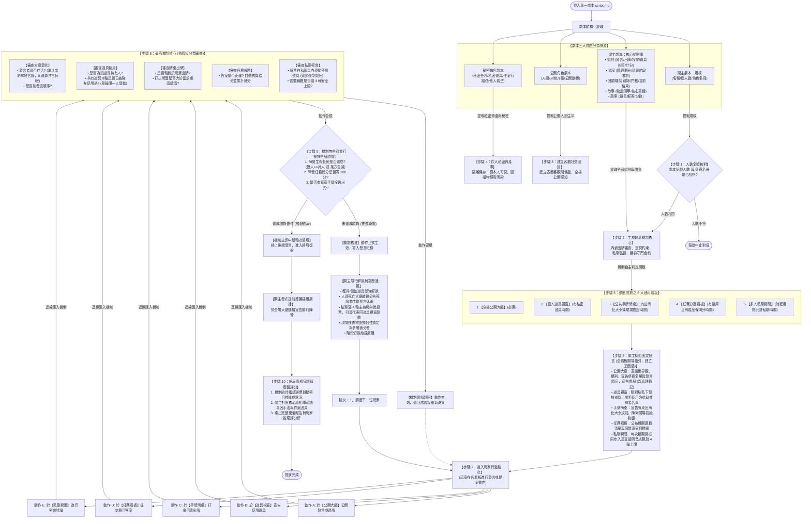

# 通用多智能體社交博弈模擬系統：架構流轉與機制決策流程檢測計劃書
# (Universal LARP Architecture Dataflow & Lifecycle Verification Plan)

---

## 1. 系統端到端總體運作流程圖 (有因果連線與固定主持版)

本流程圖嚴格依據最新討論架構繪製，具備清楚的因果連線與嚴謹的流程推進：
1. **【劇本提取連線】**：明確標註從劇本的哪一部分提取，轉化為下一步驟（提取規模做人數核對、提取規則/流程/獲勝條件/物證/真相生成機制核心、提取角色生平建立客觀圖譜、提取秘密存入私密資產庫）；
2. **【關主初始固定發言】**：看板開放後，關主固定在各大看板進行開場引導，建立玩家遊戲感與規則認知；
3. **【玩家發言過機制審查】**：玩家在各看板發言或提案動作，連線匯入中心機制，機制依據來源看板進行分類審查，同時並行掃描全局勝負條件！

---

## 2. 劇本提取 ➔ 機制生成 ➔ 流程推進深度解析

### 2.1 劇本提取與生成連線解析 (圖中步驟 1 ~ 4)

系統在載入劇本的第一時間，嚴格按照三大標題進行定向提取與轉化：
1. **從【關主劇本：規模】提取** ➔ 傳送至 **【步驟 1：人數名額核對】**，核對進場 Agent 數量與名單是否相符；
2. **從【關主劇本：規則、流程、獲勝機制、題庫、物證、真相】提取** ➔ 匯聚生成 **【步驟 2：最高機制核心】**：
   - 提取出牌規則 ➔ 生成牌面比大小合法性審查合約；
   - 提取道具約束 ➔ 生成共有道具單輪限一人發動審查合約；
   - 提取私聊限制 ➔ 生成私聊房間管理與 4 輪安全上限監聽合約；
   - 提取獲勝條件 ➔ 生成全局勝負掃描守門員合約；
   - 提取物證清單 ➔ 生成物證獨佔性鎖定審查合約；
   - 提取題庫內容 ➔ 生成自動判題給分與進度條累計合約；
   - 提取核心真相 ➔ 物理隔離保存於關主真相庫，用於終局對照。
3. **從【公開角色劇本：人設、人物介紹、公開動線】提取** ➔ 傳送至 **【步驟 3：建立客觀社交圖譜】**，生成全體角色表面公開關係邊；
4. **從【秘密角色劇本：秘密任務、私密道具、作案行蹤、對他人看法】提取** ➔ 傳送至 **【步驟 4：存入私密資產庫】**，1 對 1 隔離保存，僅本人可見。

---

### 2.2 關主初始固定發言解析 (圖中步驟 6)

當機制完成開板後、進入玩家行動前，**關主固定在各大開放的看板進行開場引導，建立玩家的「遊戲感與規則認知」**：
1. **在【全場公開大廳】開場**：宣讀背景世界觀、宣告參賽選手名冊、發言順序、過牌 (PASS) 規範與勝負目標，正式宣布遊戲開始（蓋上 `SYSTEM_GROUND_TRUTH` 戳記，讓玩家認知進入遊戲情境）；
2. **在【個人道具視窗】開場**：點對點進入每位玩家的專屬道具視窗，私下發放該玩家的隨身道具與技能，說明使用方式與共同持有人清單；
3. **在【公共手牌牌桌】開場**：置頂宣告牌桌出牌比大小規範，陳列開場已知的初始公開物證，說明合法出牌動線；
4. **在【任務活動看板】開場**：公布當前階段待解的機關題目清單、解題給分標準與陣營滿分目標線；
5. **在【多人私聊房間】開場**：每次玩家新發起私聊房間，關主必定同步入房宣讀隔音規範、嚴禁在此直接用道具、宣告 4 輪安全上限。

---

### 2.3 玩家發言過機制審查：分類判斷與勝負掃描 (圖中步驟 8 ~ 9)

當玩家在各看板發動發言或動作提案時，連線匯入中心機制，機制執行**「來源分類審查 + 並行勝負掃描」**：

1. **依據看板來源進行【分類專屬審查】**：
   - **動作來自【全場公開大廳】**：審查發言者是否存活？（淘汰者剝奪發言權，0 運算消耗禁言休眠，跳過 LLM 喚醒）；審查是否按順序發言、是否為合規陳述或宣告過牌 (PASS)。
   - **動作來自【個人道具視窗】**：審查該玩家是否在持有人名單中；審查共有道具本輪是否已被同伴使用過（單輪限一人發動約束）；審查是否為單次消耗品。
   - **動作來自【公共手牌牌桌】**：審查是否輪到該玩家出牌；審查打出牌面是否大於當前桌面最高牌面（小牌直接駁回）。
   - **動作來自【任務分數看板】**：審查提交解答是否正確；答對時自動核算給分並實時累計陣營總進度條。
   - **動作來自【多人私聊房間】**：**嚴格審查：嚴禁在私聊房內直接使用道具（純通訊交流，違規直接阻斷駁回）**；監聽對話輪數是否達 4 輪上限？（滿 4 輪強制發起房內微投票並關閉房間）。

2. **全域無差別執行【並行勝負終止掃描】**：
   無論動作來自哪一個看板，結算後機制必定同時掃描全域三大勝負條件：
   - 檢查生殺存活比例（如狼人人數 >= 好人，或某陣營全滅）；
   - 檢查任務累積總分是否滿 100 分；
   - 檢查是否有玩家手牌全數出光。
   - **結論分流**：
     - 若動作違規 ➔ **機制阻斷駁回**，退回該看板重新決策；
     - 若合規且未達勝負 ➔ **機制核准生效**，關主進行隨行解說、死亡敲鐘、私聊超時仲裁或階段切換，推進輪次；
     - 若合規且達成勝負 ➔ **機制立即中斷發言循環**，關主大廳插播提前獲勝，進入終局復盤。

---

### 2.4 終局真相宣讀與復盤評分 (圖中步驟 10)

當達成提前勝利或全部幕次結束時，流程推進至終局復盤：
1. **機制統計**：統計全體玩家私下提交的指認選票，核算每位角色秘密任務的達成狀態；
2. **關主宣讀**：關主對照核心真相庫，於大廳公開真實真凶、行凶動機、完整作案因果鏈條；
3. **產出報告**：系統產出完整 Markdown 格式復盤報告，包含全場時間線復盤、玩家推理得分榜與心理變化軌跡。
