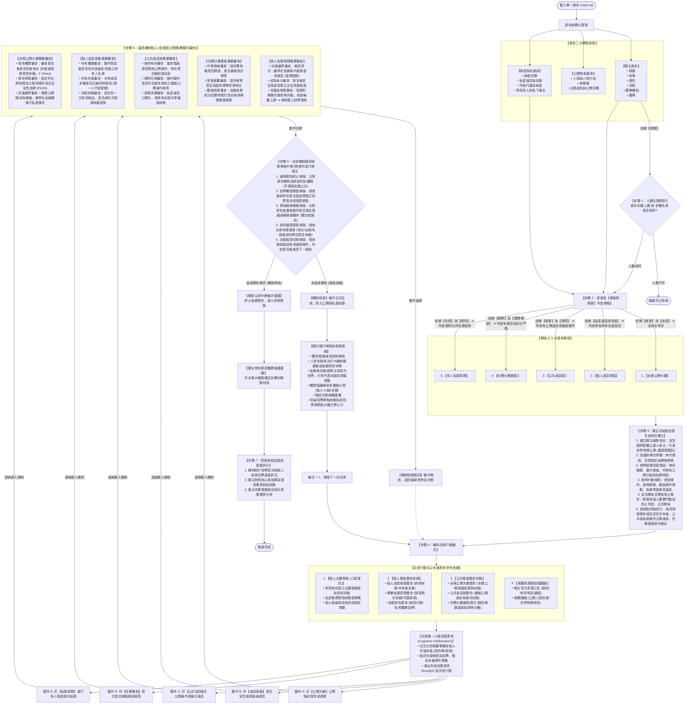
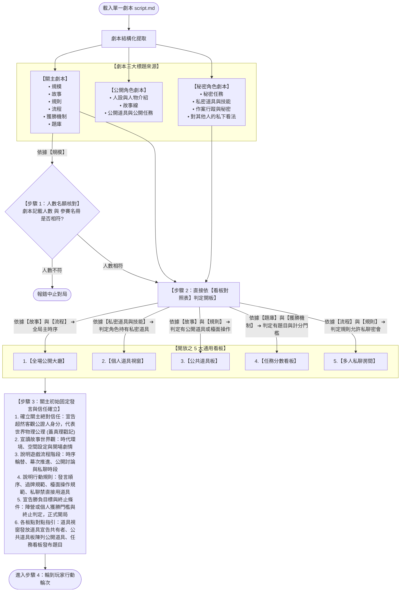
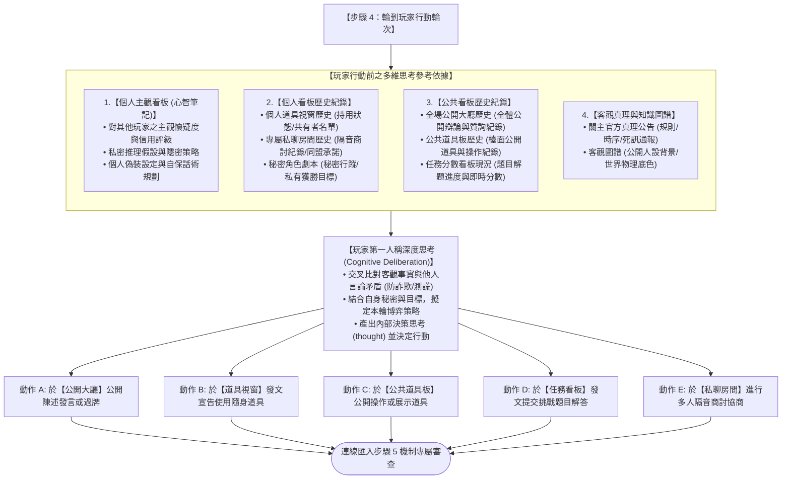
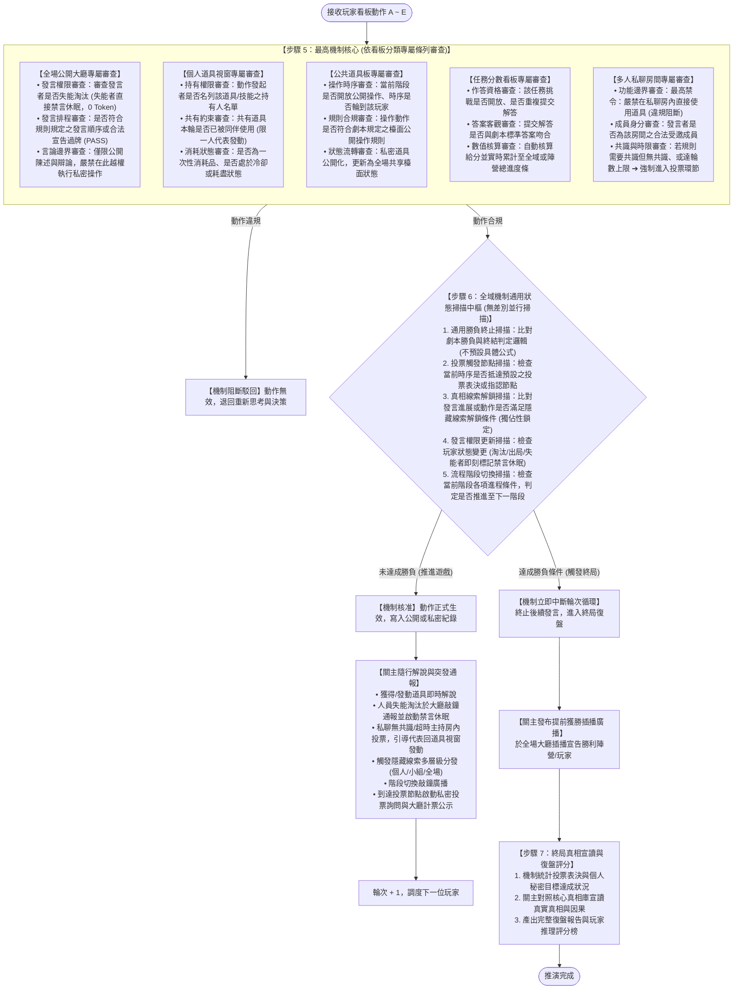

# 通用多智能體社交博弈模擬系統：架構流轉與機制決策流程檢測計劃書
# (Universal LARP Architecture Dataflow & Lifecycle Verification Plan)

> 💡 **視覺化互動檢視器**：系統已在工作區生成專屬的互動檢視網頁 [FLOWCHART_VIEWER.html](file:///c:/Users/user/MiroFish/docs/FLOWCHART_VIEWER.html)，您可以直接用瀏覽器開啟，自由切換分階段放大圖或全景總覽圖！

---

## 1. 系統端到端總體運作流程圖 (全景總覽圖)

本流程圖徹底摒棄針對單一桌遊的特化詞彙，全數採用**通用桌遊機制標準**：
1. **【步驟 4 玩家思考參考依據中樞】**：清晰刻畫玩家在決策行動前，必須調閱的**「個人主觀看板 (心智筆記)」、「個人看板歷史紀錄」、「公共看板歷史紀錄」與「客觀真理與圖譜」**，並進行內部深度思考 (thought)；
2. **【步驟 5 看板專屬機制審查】**：針對 5 大看板，以條列式清晰定義各自專屬的機制審查條件；在私聊房間中特別納入**「若規則需要有共識，但無共識則進入投票環節」**；
3. **【步驟 6 全域通用狀態掃描中樞】**：徹底拿掉特定桌遊勝負字眼，不解釋具體贏的條件為何，由機制在動作結算後**同時並行掃描 5 大通用狀態**（通用勝負終止、是否需要投票、是否觸發真相線索、全體發言權限更新、流程階段切換）；
4. **【關主主持職責】**：在各看板開場指引建立遊戲感，並在狀態掃描觸發事件時即時進行解說、敲鐘通報與終局復盤。

---

## 2. 分階段高清晰放大流程圖 (超大字體・細節無損)

為避免完整長圖在部分螢幕上文字縮小，以下將系統流程拆解為三大高清晰大圖：

### 2.1 【階段一：開局準備與開板判定 (步驟 1 ~ 3)】

---

### 2.2 【階段二：玩家思考參考依據與輪次決策行動 (步驟 4)】

---

### 2.3 【階段三：中心機制審查、全域狀態掃描與終局流轉 (步驟 5 ~ 7)】

---

## 3. 核心架構流轉與判斷依據文字詳解

### 3.1 步驟 4：玩家行動前之多維思考參考依據詳解

在步驟 4 輪到玩家行動時，玩家 Agent 透過以下四大參考維度進行深度思考：
1. **【個人主觀看板 (心智筆記卡片)】**：記錄對其他玩家之主觀懷疑度、私密推理假設、自保話術與偽裝風格；
2. **【個人看板歷史紀錄】**：個人道具視窗歷史（持用狀態/共有名單/使用結算）、專屬私聊隔音歷史（情報約定/房內微投票結果）、秘密角色劇本（秘密行蹤/私有獲勝目標）；
3. **【公共看板歷史紀錄】**：全場公開大廳歷史對話流、公共道具板檯面操作紀錄、任務分數看板進度現況；
4. **【客觀真理與知識圖譜】**：關主官方公告 (`SYSTEM_GROUND_TRUTH` 規則/時序/死訊通報)、純淨客觀圖譜 (公開人設與世界物理常識)；
5. **【延遲心智更新 (Lazy Cognitive Updating)】**：僅輪到行動時才喚醒思考引擎，調用上述四大參考依據完成交叉比對，產出決策思考 (`thought`)，再分發為具體看板動作。

### 3.2 步驟 5：5 大看板專屬機制審查條列詳解

1. **【全場公開大廳】**：審查存活與發言權限（失能禁言休眠 0 Token）、發言時序排程（順時針輪流或合法過牌）、言論邊界（嚴禁執行私密操作）。
2. **【個人道具視窗】**：審查道具持有權限、共有道具單輪限一人發動約束、單次消耗與冷卻狀態。
3. **【公共道具板】**：審查操作時序權限、檯面公開操作規則合規性、道具狀態公開化流轉。
4. **【任務分數看板】**：審查作答資格與重複作答、解答客觀吻合度、數值核算與進度累計。
5. **【多人私聊房間】**：
   - 嚴禁直接在房內使用道具（違規強制阻斷）；
   - 審查成員合法身分；
   - **共識要求與無共識投票審查**：若規則需共識但無共識、或達輪數上限（預設 4 輪）➔ 機制強制在房內發起微投票表決，定案後關閉房間。

### 3.3 步驟 6：全域機制通用狀態掃描中樞 (五大並行審查詳解)

不預設任何具體贏的公式，無差別並行執行以下 5 大通用狀態判定：
1. **通用勝負終止條件掃描**：比對劇本勝負判定邏輯（不預設特定公式）。滿足即中斷輪次循環，插播提前獲勝。
2. **是否需要觸發投票環節掃描**：檢查當前時序是否抵達預設之投票表決或指認節點。抵達即啟動投票程序。
3. **是否觸發真相與隱藏線索掃描**：比對發言進展或動作是否滿足解鎖條件，並執行獨佔性鎖定，定向多層級分發。
4. **全體玩家發言權限與狀態更新掃描**：檢查本次動作是否導致玩家狀態變更（淘汰/出局/失能），即時標記禁言休眠模式。
5. **流程階段切換判斷掃描**：檢查當前階段各項進程條件，判定是否推進至下一流程階段並驅動關主廣播。
