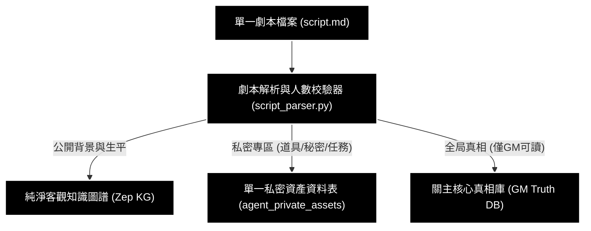
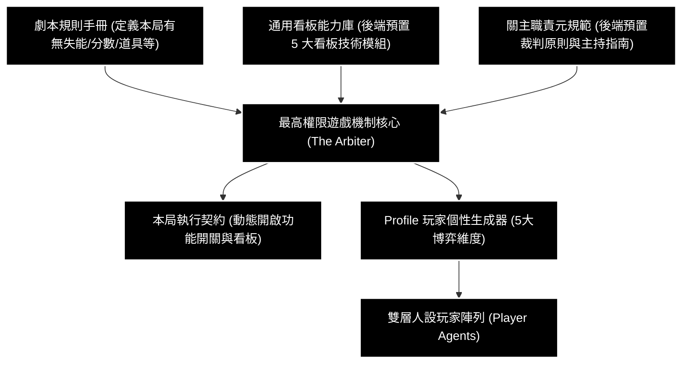
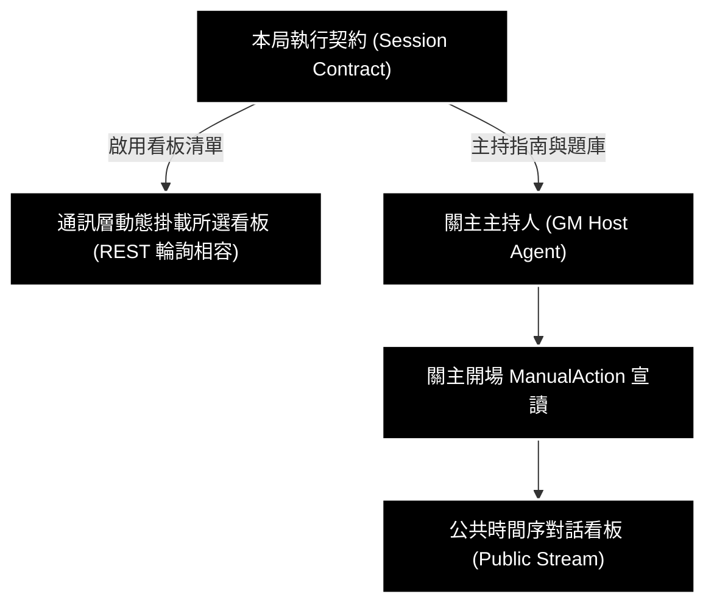
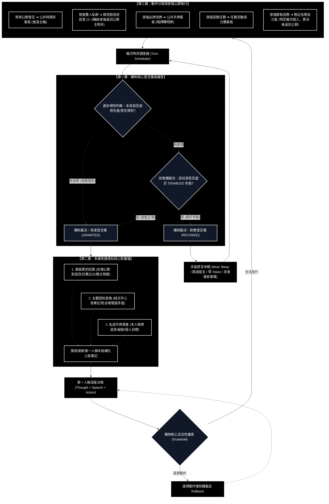
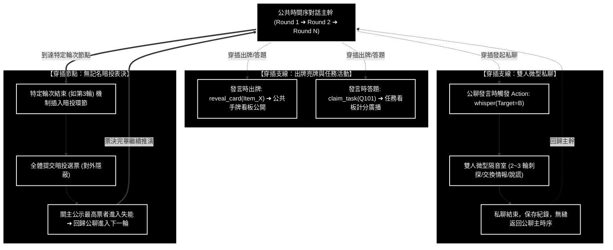
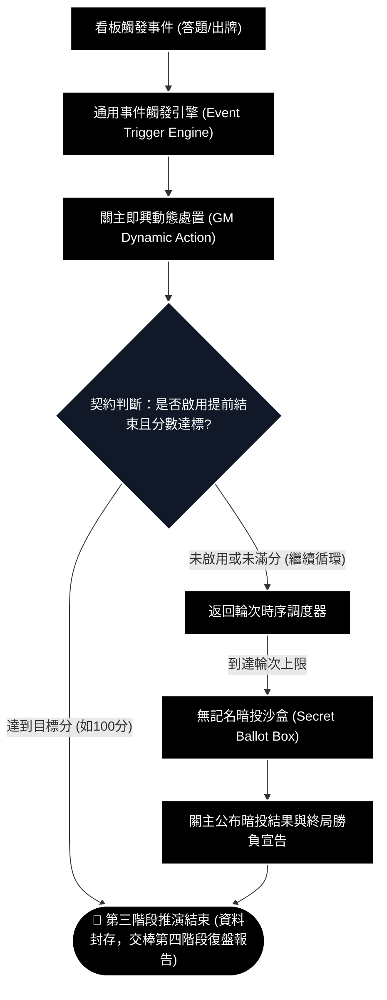

# 通用劇本殺多智能體模擬系統 (Generic LARP Multi-Agent System)
# 系統端到端完整流程圖與格式規範手冊 (劇本攝入 ➔ 第三階段結束)

---

## 1. 系統端到端流程圖體系 (各階段模組化放大獨立視圖與圖形逐節點詳解)

> **圖形規範與視覺清晰度保證**：
> 1. **獨立大圖化呈現**：將總體架構與各階段拆解為**「1 張總體階段流轉圖 + 6 張各階段獨立放大流程圖」**。每張圖獨立渲染，文字大、排版清晰。
> 2. **節點僅保留標題**：圖形內各節點遵循指示**僅保留核心標題與流轉關係**，絕不堆砌長篇文字。
> 3. **圖形下方逐節點對齊詳解**：每張獨立流程圖下方，**直接針對該圖中出現的每個節點、連線判定與輸入輸出進行 1 對 1 解釋**，杜絕圖文脫節。
> 4. **機制發言權限權威裁決**：在檢查失能狀態時，由**後端機制核心 (The Arbiter)** 統一依據劇本規則與狀態機，主動判定與裁決該玩家當前「是否具備發言權 (Speaking Rights)」！
> 5. **發言前三大參考依據**：玩家發言決策前，必須綜合參考**「看板歷史紀錄」+「主觀認知表格」+「私密手牌資產」**，刷新心智筆記後再行決策。
> 6. **私聊與投票穿插於公聊主軸**：彈性私聊/陣營密會與向 GM 私密投票**並非獨立分離，而是作為子線程與決策節點，動態穿插在圓桌公聊主時序之中**！
> 7. **純黑底白字高對比度**：全面採用純黑背景 (`#000000`)、純白邊框 (`#ffffff`) 與純白字體 (`#ffffff`)，視覺反差極致鮮明。

---

### 1.1 端到端總體階段流轉概觀 (Pipeline Overview)


#### 【1.1 流程圖各節點詳細解釋】
- **節點 `【階段 0】劇本攝入與儲存分流`**：輸入單一劇本檔案，正則提取出關主手冊、核心真相與角色雙區，並實施資料庫與圖譜的物理隔離。
- **節點 `【階段 0.5】最高機制編排與玩家生成`**：後端最高權限機制核心讀取手冊規則，從預置能力庫中自主決策開啟哪些功能與看板，並驅動 5 大博弈維度的 Profile 生成。
- **節點 `【階段 1】環境動態掛載與關主開場`**：通訊層根據契約掛載已啟用的看板，關主執行 ManualAction 宣讀世界觀與目標。
- **節點 `【階段 2】圓桌推演與博弈循環 (彈性私聊與私密投票穿插公聊)`**：輪次調度器依序運行；機制先裁決玩家是否具備發言權，正常玩家綜合看板歷史、主觀心智表格與手牌資產生成決策，並在公聊主時序中隨機穿插彈性私聊/陣營密談（同聊天室窗純發文商議與純發文宣告發動道具/技能）、出牌、答題與向關主私密發文投票。
- **節點 `【階段 3】事件動態觸發與投票結算`**：答題與出牌觸發關主即興動態處置；守衛判定是否提前勝出；抵達時限則進行私密投票結果彙整與公聊公示。
- **節點 `🏁 第三階段推演結束`**：第三階段圓桌博弈資料封存，交棒第四階段產出時間序復盤報告。

---

### 1.2 【階段 0：劇本攝入與物理儲存分流】獨立流程圖



#### 【1.2 流程圖各節點詳細解釋】
- **節點 `單一劇本檔案 (script.md)`**：推演的唯一輸入來源，內部劃分為三個一級標題區塊（關主規則手冊、關主核心真相、角色客觀劇本庫）。
- **節點 `劇本解析與人數校驗器 (script_parser.py)`**：負責文字分流前置校驗，強制比對手冊中的 `玩家人數` 與 `角色名單` 數量，不符則即刻報錯中斷。
- **連線 `公開背景與生平 ➔ 純淨客觀知識圖譜 (Zep KG)`**：僅將角色公開區的世界觀與客觀事實送入建圖，保證圖譜乾淨，防止 GraphRAG 檢索時好人開天眼。
- **連線 `私密專區 ➔ 單一私密資產資料表 (agent_private_assets)`**：將全場所有角色的道具、秘密、個人任務寫入同一個 SQLite 資料表，透過 `category` 與 `visibility` 欄位區分。
- **連線 `全局真相 ➔ 關主核心真相庫 (GM Truth DB)`**：案件兇手身分與作案手法僅存入後端真相快取，僅 GM 與結算模組可讀，物理隔絕於玩家之外。

---

### 1.3 【階段 0.5：最高機制編排與玩家生成】獨立流程圖



#### 【1.3 流程圖各節點詳細解釋】
- **節點 `劇本規則手冊 (定義本局有無失能/分數/道具等)`**：本局劇本提供的自然語言機制說明。機制核心讀取此手冊以辨識：「這局有沒有失能規則？有沒有積分比分？有沒有手牌道具？有沒有私聊密談？有沒有暗投？」。
- **節點 `通用看板能力庫 (後端預置 5 大看板技術模組)`**：後端預先開發完備的**通用模組能力池**，包含 5 大看板能力規範：
  1. 公共時間序對話看板能力 (Public Stream)
  2. 公共手牌/物證亮牌看板能力 (Card Board)
  3. 任務活動認領與陣營分數看板能力 (Task & Score Board)
  4. 雙人微型隔音私聊室能力 (Whisper Sandbox)
  5. 無記名暗投沙盒能力 (Secret Ballot Box)
- **節點 `關主職責元規範 (後端預置裁判原則與主持指南)`**：後端固定給關主 LLM 的系統級提示詞元規範（GM Meta-Prompt），明訂關主的通用職責：中立裁判、不可擅自洩露核心真相、何時執行 ManualAction、主持詞語氣與事件通報格式。
- **節點 `最高權限遊戲機制核心 (The Arbiter)`**：後端最高權力中樞。比對劇本規則與能力庫，**自主決定本局功能開關 (`feature_flags`)**：劇本有失能就開啟失能檢查，有題庫計分就開啟分數看板，無相關規則就關閉。
- **節點 `本局執行契約 (動態開啟功能開關與看板)`**：機制核心輸出的本局唯一契約 JSON，包含功能開關、看板啟用清單、關主主持指南與玩家行為約束規則。
- **節點 `Profile 玩家個性生成器` ➔ `Player_Agents`**：在客觀劇本之上，為每位玩家注入勝負欲、表達欲、懷疑度、社交主動度、規則熟悉度等 5 大風格維度，生成鮮活的雙層人設玩家。

---

### 1.4 【階段 1：環境動態掛載與關主開場】獨立流程圖



#### 【1.4 流程圖各節點詳細解釋】
- **節點 `本局執行契約 (Session Contract)`**：前一階段產出的規格契約，向通訊層與關主派發執行參數。
- **節點 `通訊層動態掛載所選看板 (REST 輪詢相容)`**：通訊中心依據契約中 `activated_boards` 的布林值，只掛載本局被啟用的看板（未啟用的看板不實例化），並與前端定時輪詢路由綁定。
- **節點 `關主主持人 (GM Host Agent)`**：接收契約中的主持指南與題庫清單，準備開場。
- **節點 `關主開場 ManualAction 宣讀`**：在輪次 0 執行高權限廣播，跳過 LLM 隨機性，宣讀世界觀、陣營任務與本局規則。
- **節點 `公共時間序對話看板 (Public Stream)`**：接收關主開場貼文並推送到頂端，作為全場 100% 信任的絕對客觀事實。

---

### 1.5 【階段 2：第三階段圓桌推演與博弈循環】獨立流程圖



#### 【1.5 流程圖各節點詳細解釋】
- **第一層：機制核心發言權威審查 (`Arbiter_Gate`)**：
  - **節點 `Rule_Check` (劇本規則判斷)**：調度器喚醒玩家時，由**機制核心**先依本局契約判斷劇本是否有失能規則。若無（如純本格推理本），機制直接核准發言權 (`Perm_Granted`)，完全不卡關。
  - **節點 `State_Check` (狀態機裁決)**：若有失能規則，機制查詢玩家當前狀態。若該玩家被判定為 `DISABLED`，機制主動裁決**剝奪發言權 (`Perm_Revoked`)**，將其導向 `Skip_Sleep`（禁言休眠模式：零 Token 消耗、跳過發言、但背景持續接收事實）。若狀態正常，機制**核准發言權 (`Perm_Granted`)**。
- **第二層：多維依據感知與心智審議 (`Multi_Perception`)**：
  - **節點 `1. 看板歷史紀錄`**：玩家拉取全場時間序發言、他人供詞矛盾、任務進度與關主物證。
  - **節點 `2. 主觀認知表格`**：玩家讀取個人先前的「純文字心智筆記」，檢視對在場每位玩家的懷疑度、防備態度與假定身分。
  - **節點 `3. 私密手牌資產`**：玩家檢視自身私密手牌（暗牌道具、不可告人秘密、私有任務目標）與全場公開明牌。
  - **節點 `撰寫/刷新心智筆記` ➔ `深度決策`**：三方比對後，先更新對全場最新主觀看法，再輸出結構化決策（Thought + Speech + Action）。
- **決策審查與第三層：動作分發與穿插公聊執行 (`Interleaved_Execution`)**：
  - **節點 `Arbiter_Guard` & `Action_Rollback`**：機制審查動作合法性，違規強制駁回重新思考。
  - **穿插機制 (核心架構)**：**公聊為主軸，私聊與投票動態穿插其間**：
    - `Action_Speech`：常規公聊發言，推進主時序。
    - `Action_Whisper`：玩家在公聊中發起私聊，機制開啟雙人隔音密談室，進行 2~3 輪私聊後，**自動關閉並無縫返回公聊主時序**！
    - `Action_Card` & `Action_Quest`：出牌亮牌與任務答題穿插於發言中同步執行。
    - `Action_Vote`：當推演進行至特定規則輪次（如第 3 輪結束），機制核心**在公聊主軸中穿插插入暗投沙盒**，全員投票並由關主公示結果後，**再度回歸公聊主時序繼續下一輪**！

---

### 1.6 【階段 2 看板分發與公聊穿插架構】獨立流程圖



#### 【1.6 流程圖各節點詳細解釋】
- **節點 `公共時間序對話主幹`**：圓桌博弈的主時間軸，全體船員的發言順序與客觀物證流動在此推進。
- **支線 `【穿插支線：雙人微型私聊】`**：玩家在公聊輪次中發起 `whisper` 動作，調度器暫時掛起大廳主幹，將兩人移入獨立微型隔音室。進行 2~3 輪私密對話後，私聊室關閉，控制權與記憶無縫回到公聊主幹。
- **支線 `【穿插支線：出牌亮牌與任務活動】`**：玩家可在公聊發言當下，同步打出私密暗牌（亮明於公共手牌看板）或搶答機關題目（任務看板即刻驗證計分）。
- **節點 `【穿插節點：無記名暗投表決】`**：劇本手冊指定之表決點（如第 3 輪結束），機制核心暫停常規發言，插入無記名暗投沙盒。所有人完成密投後，關主公布票決與失能結果，隨後大廳主時序重新啟動，進入第 4 輪推演。

---

### 1.7 【階段 3：事件動態觸發、暗投與提前結束 (推演終點)】獨立流程圖



#### 【1.7 流程圖各節點詳細解釋】
- **節點 `看板觸發事件 (答題/出牌)`**：玩家操作引發的遊戲狀態改變。
- **節點 `通用事件觸發引擎 (Event Trigger Engine)`**：捕獲動作事件並核對機制規則（如題目正誤判定）。
- **節點 `關主即興動態處置 (GM Dynamic Action)`**：關主 LLM 評估戰局，自主生成非死板的主持廣播（報分、調侃、發放物證）。
- **決策節點 `契約判斷：是否啟用提前結束且分數達標?`**：檢查契約中的獲勝條件。若本局有積分提前獲勝規則且人類達到 100 分，**立刻 Break Turn Loop 提前獲勝**！若無此規則或未滿分，則返回輪次循環。
- **節點 `無記名暗投沙盒 (Secret Ballot Box)`**：推演達指定輪次後進入終局投票環節，加密收集個人選票。
- **節點 `關主公布暗投結果與終局勝負宣告`**：關主計票並宣告投票結果與勝負，正式完成第三階段。
- **節點 `🏁 第三階段推演結束`**：第三階段圓滿結束，封存推演歷程並移交第四階段復盤報告。

---

## 2. 各階段詳細細節說明與標準格式規範範例

本節針對上述流程圖各階段的運作機制進行完整說明，並提供資料庫 DDL、劇本 Markdown、契約 JSON、心智筆記等**可直接落地執行的具體格式範例**。

---

### 2.1 階段 0：單一劇本檔案結構與儲存分流規範 (超詳細完整劇本範例)

為確保後端機制核心 LLM 能透過自然語言的規則敘述，自主精確判斷出應啟用哪些看板與遊戲規則，劇本必須包含完整的基礎設定、陣營勝負目標、輪次推演流程、機關任務題庫、關主物證線索與角色雙區結構：

#### 【完整單一劇本示範檔案：`script.md`】
```markdown
=== [關主規則手冊 (GM Rulebook)] ===
劇本名稱: 星艦深淵：核心危機
題材類型: 科幻機制陣營對抗與社交推理
建議人數: 5人 (3好人 / 1狼人 / 1中立搖擺)
角色名單: [李工兵, 王艦長, 白醫官, 趙通訊, 劉安保]

【一、世界觀與突發危機背景】:
遠征星艦「啟明星號」在穿越南十字躍遷點時，主動力核心突發過載熔斷，全艦進入一級紅色警報。
常規航行系統已鎖死，氧氣維生系統預估僅能維持 6 個時鐘週期（輪次）。
更危險的是，艦載感應器檢測到核心故障并非自然老化，而是有人安裝了非法干擾晶片——全艦船員中隱藏著異星寄生的破壞者！

【二、陣營劃分與勝負目標】:
1. 人類陣營 (王艦長、白醫官、趙通訊、劉安保):
   - 核心目標: 必須在 6 輪推演時間耗盡前，透過維修三大機關任務，使星艦動力維修進度累計達到【100分】，或透過投票成功找出破壞者並予以失能禁閉。
   - 獲勝判定: 分數達到 100 分時立即觸發提前勝利；或終局投票成功投出破壞者。
2. 狼人破壞者陣營 (李工兵):
   - 核心目標: 阻止人類陣營在時限內達到 100 分，或暗中誘導好人互相猜忌，利用投票使關鍵工程人員陷入失能。
   - 獲勝判定: 6 輪結束後人類分數未滿 100 分，且自身身分未被投票驅逐。

【三、遊戲機制與流程推進規則 (機制核心審查指南)】:
1. 輪次發言規則 (公共時間序對話):
   - 每輪全體船員依序發言，輪到的玩家可發表觀點、質疑他人供詞，或公開出示手中證物。
   - 處於失能狀態 (DISABLED) 的船員不可發言，直接跳過發言權利。
2. 道具與手牌規則 (公共手牌與物證看板):
   - 玩家初始持有的道具為私有暗牌，存在個人私密專區中。
   - 玩家在自身發言輪次中，可宣告【打出/公開展示】特定道具。一旦展示，該道具狀態變更為公開明牌，展示於公共手牌看板，全場玩家均可查驗其真偽。
3. 機關任務與答題規則 (任務活動與分數看板):
   - 艦上設有電力、維生、通訊三大機關，關主在每輪開場公布可認領的機關維修題目。
   - 每位玩家每輪可宣告認領 1 道題目並提交答案；機制核心自動驗證答案正確性，答對為陣營累計分數，答錯則產生系統警告。
4. 點對點緊急密談規則 (雙人微型私聊室):
   - 在各輪公聊之間，玩家可向任意一名其他玩家發起 1 對 1 私聊密談。
   - 受邀者不可拒絕進入密談室，但受邀者有權根據自身陣營立場選擇說實話、提供虛假線索或敷衍應對。密談限制 2~3 輪對話，外界完全隔音。
5. 審判投票與失能機制 (無記名暗投沙盒):
   - 當推演進行至第 3 輪結束與第 5 輪結束時，關主啟動全艦緊急安全表決。
   - 所有存活船員必須向暗投箱提交投票目標，投票過程絕對匿名；得票最高者將被關入安全禁閉艙，進入【失能狀態 (DISABLED)】。
   - 失能效果: 該玩家在接下來的 2 輪內無法發言、無法認領題目、無法出牌（禁言休眠模式），但仍可持續收聽全場廣播以獲取資訊。
6. 提前勝利判斷機制:
   - 一旦人類陣營在任何時間點將維修積分累積至 100 分，遊戲機制核心立刻終止所有推演輪次，直接宣告人類陣營提前獲勝！

【四、劇本自帶備選機關題庫】:
- 題目 Q101 [電力系統]:
  • 題目背景: 主發電機過載報警，1號配電盤電弧閃爍。
  • 題目內容: "主發電機回路異常過載時，應優先切斷何種電路？"
  • 標準答案關鍵字: "副回路接地開關" 或 "接地開關"
  • 答對獎勵: 人類陣營進度 +20分
  • 答錯懲罰: 扣除 5 分
- 題目 Q102 [維生系統]:
  • 題目背景: 艦橋氧氣循環過濾器受不明黏液堵塞。
  • 題目內容: "氧氣循環過濾器受生物黏液堵塞，需注入哪種化學中和劑？"
  • 標準答案關鍵字: "藍色穩定劑" 或 "硫酸銅水溶液"
  • 答對獎勵: 人類陣營進度 +25分，並可立即救活一名失能船員
  • 答錯懲罰: 無法清除堵塞
- 題目 Q103 [通訊系統]:
  • 題目背景: 超空間通訊陣列頻率偏離標準值。
  • 題目內容: "發送遇險求救信標時，深空解碼信標的標準頻率應設置為多少？"
  • 標準答案關鍵字: "1420MHz" 或 "氫線頻率"
  • 答對獎勵: 人類陣營進度 +20分
  • 答錯懲罰: 通訊雜音干擾 1 輪
- 題目 Q104 [核心反應爐]:
  • 題目背景: 反應爐冷卻閥門卡死，需要手動超頻重置。
  • 題目內容: "手動重啟磁力偏轉盾需要輸入幾位數緊急驗證密鑰？"
  • 標準答案關鍵字: "7709"
  • 答對獎勵: 人類陣營進度 +35分
  • 答錯懲罰: 反應爐溫度上升

【五、關主物證線索與注入時機指南 (混合驅動)】:
- 物證線索 1: 【燒焦的微型破壞晶片】
  • 內容描述: 在主發電機 3 號閥門深處發現一枚被焊槍融化破壞的晶片，外殼印有總工程部專用鋼印。
  • 建議注入時機: 建議於第 3 輪現場討論激烈且李工兵供詞出現漏洞時，由關主以 ManualAction 注入對話流。
- 物證線索 2: 【監控日誌殘留片段】
  • 內容描述: 案發前 09:25，機房氣密門曾被總工程師專用權限卡刷開，並停留了長達 20 分鐘。
  • 建議注入時機: 建議於第 4 輪或好人陣營陷入推理解謎僵局時注入。

=== [關主核心真相 (GM Truth)] ===
- 案件真相: 真正的狼人破壞者為【李工兵】。他在啟航前探測異星遺跡時被微型寄生蟲感染意識，持有一枚微型破壞晶片。
- 作案時間線: 09:20 李工兵藉故維護名義進入機房，將晶片插入電力主回路引發短路，隨後將焊槍調至最高溫銷毀表面痕跡。
- 致命破綻: 李工兵工作服內襯沾有特殊焊渣，且其私有工具箱內短缺了一枚 3 號接地端子。
- (物理隔離規範: 僅 GM 與結算模組可讀，絕對禁止進入 Zep 知識圖譜建構器)

=== [角色客觀劇本庫 (Character Scripts)] ===

## 角色：李工兵

### 【公開客觀區 (進入 Zep 知識圖譜)】
【一、基礎身分與外貌人設】
- 姓名: 李工兵 (35歲)
- 身分: 啟明星號星艦總工程師，穿著沾滿油污與灰燼的工作服，隨身攜帶重型金屬工具箱。
- 公開人際: 技術精湛，性格沉穩少言，深得王艦長與全艦船員的信任。

【二、過往生平與客觀背景故事】
你為星艦動力維護部門服務超過十年，對星艦的每條線路與管線配置了如指掌。半年前曾隨探測隊前往第 7 號未知星系勘測古代遺跡。

【三、案發當日核心時間線】
- 08:00【啟航會議】：在主控室與王艦長、白醫官等人討論航線與能源配給。
- 09:15【例行巡檢】：領取維護工具，前往 B 區電力機房巡檢。
- 09:40【巡檢完畢】：在走廊偶遇劉安保，向其點頭致意後返回工兵休息室。
- 10:30【突發警報】：星艦核心警報大作，動力系統驟降至 20%。

### 【私密專區 (寫入 agent_private_assets 單一表，嚴禁進圖譜)】
【四、私有暗牌道具】
- 道具 1: 【多功能電路扳手】 (可用於修復維生系統或輔助電力答題)
- 道具 2: 【微型破壞晶片殘片】 (狼人作案證物，若被搜查出將直接暴自身身分)

【五、不可告人秘密】
- 秘密 1: 你就是【狼人陣營】！你已被異星寄生體同化，正是你在 09:25 將破壞晶片插入電力系統引發能源崩潰！
- 秘密 2: 你的工作服內襯殘留有銷毀晶片時濺落的微量金屬焊渣，一旦有人要求搜身將百口莫辯。

【六、私有個人任務】
- 個人任務 1: 隱瞞狼人身分，在公聊中將電力過載歸咎於零件老化意外。
- 個人任務 2: 阻止人類在 6 輪內達成 100 分；若局勢危急，引導眾人票決趙通訊或劉安保。

---

## 角色：王艦長

### 【公開客觀區 (進入 Zep 知識圖譜)】
【一、基礎身分與外貌人設】
- 姓名: 王艦長 (48歲)
- 身分: 啟明星號星艦最高指揮官，神情嚴肅威嚴，身著深藍色艦長制服，配戴指揮官徽章。
- 公開人際: 全艦船員的領導者，處事果決，格外看重總工程師李工兵的專業意見。

【二、過往生平與客觀背景故事】
曾參與三次深空勘探戰役，擁有極高威望，對星艦的安全負有最高法定責任。

【三、案發當日核心時間線】
- 08:00【啟航會議】：主持航線例會，要求李工兵加強機房巡檢。
- 09:00【艦橋值班】：在主艦橋查閱導航日誌。
- 10:30【全艦警報】：下令啟動緊急預案，召集全體船員召開圓桌會議。

### 【私密專區 (寫入 agent_private_assets 單一表，嚴禁進圖譜)】
【四、私有暗牌道具】
- 道具 1: 【艦長金屬權限卡】 (在關鍵表決時可擁有雙倍投票權)
- 道具 2: 【緊急備份日誌存儲盤】 (可用於查驗 1 次特定船員的時間線記錄)

【五、不可告人秘密】
- 秘密 1: 啟航前你曾收到總部的機密警告，指出船員中疑似潛伏著異星仿生間諜，但你為了按時啟航而隱瞞了此事。
- 秘密 2: 你高度信賴李工兵，甚至在未經雙重審核的情況下，私下授權他單獨進入主反應爐。

【六、私有個人任務】
- 個人任務 1: 帶領人類船員在 6 輪內累積滿 100 分，修復星艦動力。
- 個人任務 2: 查明破壞真凶身分，防止間諜逃脫。

---
... (其餘白醫官、趙通訊、劉安保角色比照相同標準結構定義) ...
```

---

### 2.2 道具、秘密與個人任務儲存格式範例 (單一 SQLite 表 `agent_private_assets`)

#### 1. 核心儲存原則
- **單一檔案集中儲存**：全場所有道具、秘密、個人任務集中存放在單一 SQLite 資料表 `agent_private_assets`，**絕不拆分成多個檔案**。
- **欄位 Key 嚴密區分**：
  - 類型區分：`category` (`item` | `secret` | `objective`)
  - 可見性區分：`visibility` (`private` | `public`)
  - 狀態區分：`status` (`in_hand` | `revealed` | `completed`)

#### 2. 資料庫表結構 DDL
```sql
CREATE TABLE IF NOT EXISTS agent_private_assets (
    id TEXT PRIMARY KEY,                     -- 唯一識別碼 (例如: "item_001", "sec_002")
    agent_id TEXT NOT NULL,                  -- 所屬玩家 ID (例如: "Player_Li")
    category TEXT NOT NULL,                  -- 'item' (道具) | 'secret' (秘密) | 'objective' (個人任務)
    title TEXT NOT NULL,                     -- 標題 (例如: "微型破壞晶片", "我是狼人")
    content TEXT NOT NULL,                   -- 詳細內容 / 案件事實 / 勝利條件
    visibility TEXT DEFAULT 'private',       -- 'private' (私密) | 'public' (公開明牌)
    status TEXT DEFAULT 'in_hand'            -- 'in_hand' (持有中) | 'revealed' (已打出) | 'completed' (已完成)
);
CREATE INDEX idx_asset_agent_vis ON agent_private_assets(agent_id, visibility);
```

#### 3. 資料操作與流轉 SQL 範例
1. **初始化寫入 (劇本解析完成後一次性寫入)**：
   ```sql
   INSERT INTO agent_private_assets (id, agent_id, category, title, content, visibility, status) VALUES 
   ('item_001', 'Player_Li', 'item', '微型破壞晶片殘片', '作案證物，若被搜查出身分將暴露', 'private', 'in_hand'),
   ('sec_001', 'Player_Li', 'secret', '我是狼人破壞者', '已在電力機房插入破壞晶片，需阻止滿分', 'private', 'in_hand'),
   ('obj_001', 'Player_Li', 'objective', '阻止100分任務', '阻止人類修復星艦並誘導票決趙通訊', 'private', 'in_hand');
   ```
2. **玩家輪次私密資產注入 (注入玩家思考 Prompt)**：
   ```sql
   -- 僅查詢屬於本人且為 private 的資產，他人 100% 無法讀取
   SELECT category, title, content FROM agent_private_assets 
   WHERE agent_id = 'Player_Li' AND visibility = 'private';
   ```
3. **玩家出牌 / 亮牌時的狀態流轉**：
   ```sql
   -- 玩家宣告打出暗牌，原地更新 visibility 欄位，無需搬移檔案
   UPDATE agent_private_assets 
   SET visibility = 'public', status = 'revealed' 
   WHERE id = 'item_001' AND agent_id = 'Player_Li';
   ```
4. **公共手牌看板查詢 (全場可見的已打出明牌)**：
   ```sql
   -- 公共手牌看板僅查詢全場 public 的道具
   SELECT agent_id, title, content FROM agent_private_assets 
   WHERE category = 'item' AND visibility = 'public';
   ```

---

### 2.3 階段 0.5：最高機制編排器與本局執行契約 (Session Contract)

#### 1. 運作細節說明
- **機制擁有最高主權**：劇本檔案本身不硬編碼開啟什麼看板，由後端「最高權限遊戲機制核心 (The Arbiter)」讀取劇本、通用看板庫與 GM Meta-Prompt 後自主編排。
- **本局執行契約 (Session Contract)**：生成唯一 JSON 契約，精確輸出 `feature_flags`（功能開關）、`activated_boards`（啟用的看板）、關主主持指南與玩家行為約束規則。
- **Profile 生成器 5 大博弈維度**：生成玩家外在性格偏好（勝負欲、表達欲、懷疑度、社交主動度、規則熟悉度），疊加在客觀生平之上。

#### 2. 本局執行契約標準 JSON 範例 (`session_contract.json`)
```json
{
  "session_id": "sim_larp_starship_001",
  "validated_player_count": 5,
  "feature_flags": {
    "enable_disabled_status": true,
    "enable_scoring_system": true,
    "enable_card_revealing": true,
    "enable_whisper_sandbox": true,
    "enable_secret_voting": true
  },
  "activated_boards": {
    "public_stream": true,
    "task_score_board": true,
    "public_card_board": true,
    "whisper_sandbox": true,
    "secret_ballot_box": true
  },
  "gm_execution_guide": {
    "opener": "輪次 0 執行 ManualAction 宣讀星艦世界觀與 100 分目標",
    "question_pool": ["Q101", "Q102", "Q103", "Q104"],
    "clue_injection_policy": "建議於第 3 輪現場討論激烈時，自主以 ManualAction 注入【燒焦的微型破壞晶片】",
    "voting_trigger": "輪次 3 與輪次 5 啟動無記名暗投沙盒"
  },
  "player_rules": {
    "disabled_policy": "MUTE_ONLY (禁言休眠：跳過發言但背景接收事實)",
    "victory_score_target": 100
  }
}
```

---

### 2.4 階段 1：環境動態掛載與關主開場規範

#### 1. 運作細節說明
- **動態掛載**：通訊層依契約中的 `activated_boards` 初始化看板實體。
- **關主開場**：關主主持人 (GM Host Agent) 在輪次 0 透過 `ManualAction` 廣播星艦背景、陣營目標與活動題目，作為全場絕對客觀事實注入對話流頂端。

#### 2. 關主開場廣播格式範例
```json
{
  "action_type": "MANUAL_ACTION_BROADCAST",
  "author": "關主 (GM)",
  "badge": "官方公告 / 絕對客觀事實",
  "content": "【星艦深淵：核心危機・推演開始】\n全體船員請注意：星艦主動力驟降，人類陣營需完成維修任務累積至 100 分以重啟動力；隱藏的破壞者正在暗中阻撓！\n任務看板已發布首批機關題目 [Q101, Q102, Q103]，請各位船員發言並展開行動！"
}
```

---

### 2.5 階段 2：第三階段圓桌推演、發言權審查與穿插執行細節

#### 1. 機制核心發言權威審查與失能休眠機制
- **第一層：機制權限裁決 (Speaking Rights Authority)**：
  - 調度器喚醒 Agent 時，由**機制核心**先查詢本局契約是否具備失能機制 (`feature_flags.enable_disabled_status`)。
  - 若劇本無失能規則 ➔ 機制核心直接裁定：**核准發言權 (`GRANTED`)**。
  - 若劇本有失能規則 ➔ 機制查詢狀態機該 Agent 是否處於 `DISABLED`：
    - 若處於失能 ➔ 機制核心裁定：**剝奪發言權 (`REVOKED`)**！強制作業進入「禁言休眠模式 (Mute Sleep)」，調度器直接跳過其發言輪次（零 Token 消耗），廣播系統提示，背景持續寫入全場事實，失能輪數 -1。
    - 若狀態正常 ➔ 機制核心裁定：**核准發言權 (`GRANTED`)**，放行進入多維感知與心智審議。

#### 2. 玩家發言前的三大多維參考依據 (Multi-Source Perception)
玩家決策前，系統並非僅提供單純的對話文字，而是完整注入三大參考源：
1. **各看板歷史紀錄 (Board History)**：
   - 公共時間序對話流（他人最新發言、不在場證明矛盾）
   - 任務活動與分數看板（機關進度 40/100、已解答題目與錯誤嘗試）
   - 關主物證公告（關主 ManualAction 強制注入之客觀鐵證）
2. **個人主觀認知表格 (Subjective Mind Table / 心智筆記)**：
   - 玩家上一輪記錄的秘密筆記，包含對在場每一位玩家的疑點、矛盾、立場假定與防備策略。
3. **私密手牌資產 (Hand Assets)**：
   - 自身持有的私密暗牌道具、不可告人秘密、私有任務目標，以及全場已打出之公開明牌。

#### 3. 雙人私聊與暗投表決穿插於公聊主軸之時序架構
- **私聊穿插機制**：
  - 公聊對話為全局推演主軸。
  - 輪到玩家發言或公聊間隙，玩家可輸出動作 `action: whisper(target="王艦長")`。
  - 機制核心審查通過後，在大廳時間軸中**動態插入「雙人微型隔音室」子線程**。兩位玩家在封閉房間進行 2~3 輪來回私密交鋒（可刺探、說謊、結盟），對話結束後房間關閉，**無縫返回大廳公聊主時序**繼續發言！
- **投票穿插機制**：
  - 依本局契約規定之特定輪次節點（如第 3 輪與第 5 輪結束），機制核心**在公聊主軸中穿插暫停常規發言，插入無記名暗投沙盒**。
  - 全體存活玩家提交加密選票，關主計票並在公聊看板廣播最高票者進入失能禁閉，隨後**繼續回歸公聊主軸啟動下一輪推演**！

#### 4. 半結構化純文字心智筆記格式範例
輪到玩家思考時，針對在場其他每位玩家產出私密心智筆記（取代舊數值矩陣）：

```markdown
【李工兵的第一人稱秘密心智筆記 (輪次 2)】：
- 針對【王艦長】：
  • 觀察與矛盾點：艦長一直在催促大家修復電力，但他誤以為是單純的電路老化意外，完全沒有懷疑有人為破壞。
  • 當前評估與態度：他極度信任我，這是極佳的掩護屏障，不可主動破壞關係。
  • 下一步策略：在公聊中聲稱零件短缺以拖延進度，暗中觀察誰持有中和劑。
- 針對【趙通訊】：
  • 觀察與矛盾點：他剛才偷偷在維生系統機房附近徘徊，神色慌張，可能持有陣營查驗類道具。
  • 當前評估與態度：頭號威脅！一旦他查驗我，我的狼人身分將徹底暴露。
  • 下一步策略：在私聊中挑撥劉安保去孤立趙通訊，並在暗投環節集中票決趙通訊。
```

#### 5. 玩家決策輸出格式 (Thought + Speech + Action)
```json
{
  "thought": "王艦長信任我，我可以藉機提出檢查線路，同時在公聊中出牌混淆視聽，並發起與劉安保的私聊！",
  "speech": "艦長，我剛才去檢查了主發電機，回路確實有異常。我這裡有一件工具可以提供協助。",
  "action": {
    "type": "REVEAL_CARD",
    "item_id": "item_001",
    "target_board": "public_card_board"
  }
}
```

#### 6. 機制核心合法性審查 (Guardrail) 與 Rollback
- 機制核心檢驗 `action`：
  - 若動作違規（如試圖出非本人持有之道具、或發起已被封鎖的私聊），機制攔截並強制 Rollback，附帶錯誤提示要求 Agent 重試（上限 3 次）。
  - 若動作合法，機制核心放行並將動作分發至對應看板。

---

### 2.6 階段 2 分支動作看板細節

1. **公聊發言看板 (Public Stream)**：
   - 記錄公聊時間序對話，所有人可見，滑動保留全域對話流。
2. **公共手牌看板 (Public Card Board)**：
   - 接收 `reveal_card` 動作，執行 SQL 更新 `agent_private_assets` 的 `visibility='public'`，將道具公開展示給全場。
3. **任務活動與分數看板 (Task & Score Board)**：
   - 玩家提交答題動作 `claim_task(task_id, answer)`，由機制核對答案與計算陣營分數。
4. **雙人微型私聊室 (Whisper Sandbox)**：
   - 兩兩私密對話（不可拒絕但可說謊/敷衍），獨立沙盒隔音，外部完全不可見。

---

### 2.7 階段 3：通用動態事件觸發、暗投與提前結束 (推演結束點)

#### 1. 動態事件觸發與關主處置流程
- **事件捕獲**：玩家提交答題動作 `claim_task(task_id="Q101", answer="副回路接地開關")`。
- **校驗與計分**：機制驗證答案正確，將人類陣營分數累加（`camp_scores["human"] += 20`）。
- **關主即興處置**：機制將事件傳遞給關主 LLM，關主自主生成生動主持廣播：
  > `[關主播報] 王艦長身手敏捷，成功排除電力回路過載！人類陣營進度 +20 分！目前累積：40/100 分！`

#### 2. 提前結束判定 (Early Victory Guard)
- 機制核心在每次答題或計分後執行守衛判定：
  ```python
  if camp_scores["human"] >= 100:
      # 觸發提前獲勝！
      trigger_early_termination(
          winner="human",
          reason="人類陣營在時限內達成 100 分！星艦核心動力全面修復，人類陣營獲勝！"
      )
  ```
- **中斷輪次**：調度器立刻終止輪流發言（Break Turn Loop），關主公布終局結算，直接交棒第四階段生成復盤報告。

#### 3. 無記名暗投沙盒 (Secret Ballot Box)
- **觸發條件**：達到預設輪次上限或關主宣告進入票決。
- **隱密投票**：全場玩家各自提交私密投票 JSON，互不知曉他人票選對象。
- **關主計票與宣判**：機制統計票數最高者施加失能狀態或判定淘汰，關主廣播投票結果與終局勝負。

---

### 2.8 前後端通訊相容機制 (MiroFish 原生定時輪詢相容)

- **通訊架構選擇**：完全沿用 MiroFish 現有之 REST 定時輪詢架構，無需引入複雜 WebSocket 連線，確保極高穩定度。
- **前端輪詢邏輯**：前端每 2~3 秒呼叫一次 `GET /api/simulation/{id}/run-status/detail`。
- **後端增量推送**：後端回傳最新之 `all_actions` 增量陣列（包含玩家發言、關主發題、分數更新、亮牌資訊）。
- **前端去重渲染**：前端依據唯一的 `actionId` 進行去重，動態在圓桌與看板介面上增量渲染卡片。
