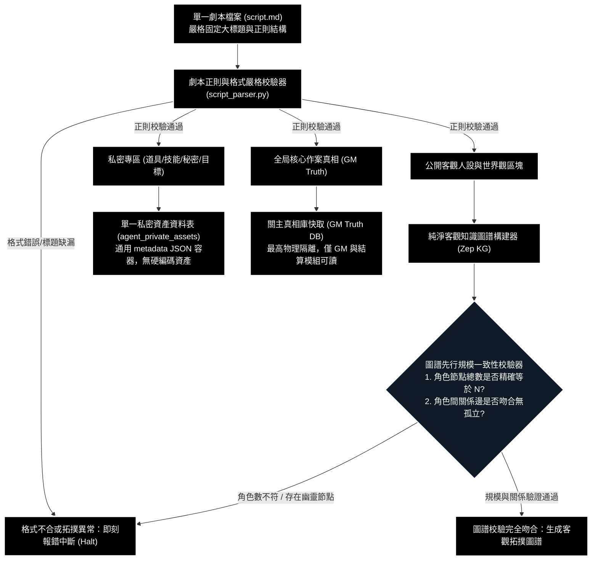
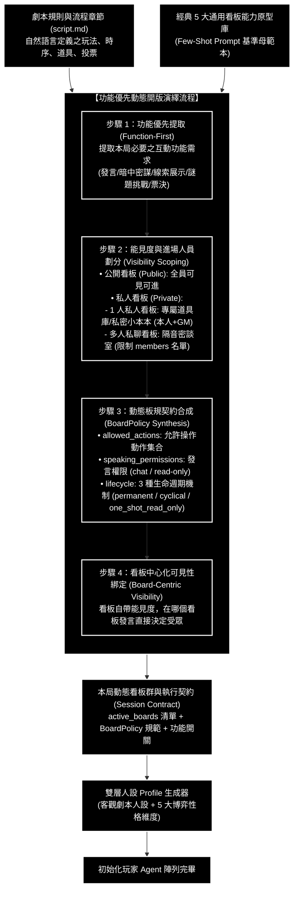
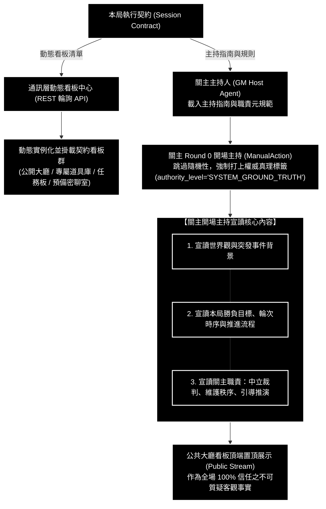
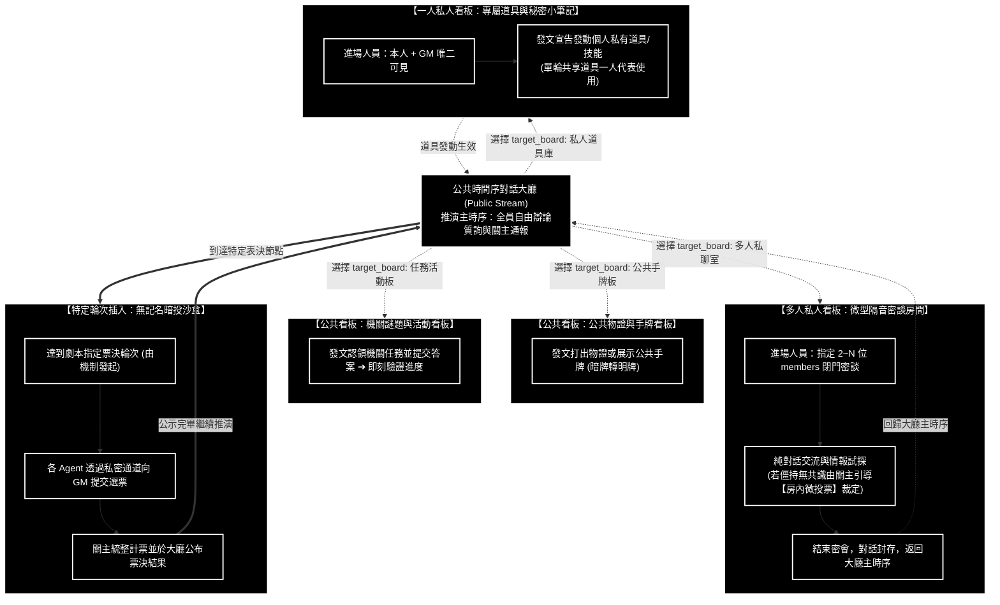
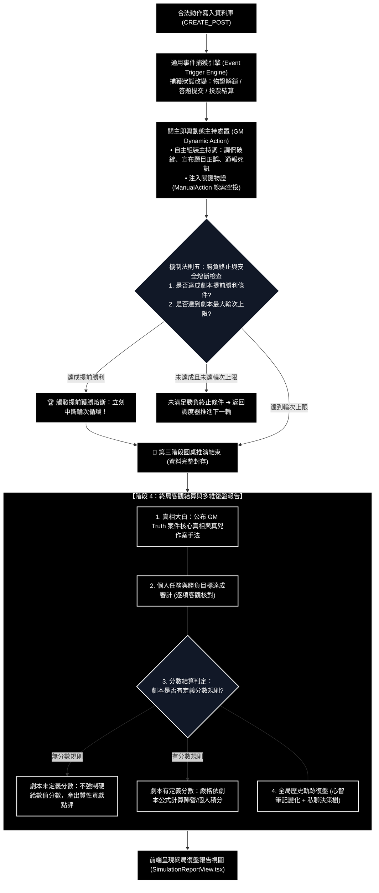

# 通用劇本殺多智能體模擬系統 (Generic LARP Multi-Agent System)
# 系統端到端完整流程圖與格式規範手冊 (劇本攝入 ➔ 第四階段復盤)

---

## 1. 系統端到端流程圖體系 (各階段模組化放大獨立視圖與圖形逐節點詳解)

> **圖形規範與視覺清晰度保證**：
> 1. **獨立大圖化呈現**：將總體架構與各階段拆解為**「1 張總體階段流轉概觀圖 + 7 張各階段獨立放大流程圖」**。每張圖獨立渲染，版面開闊、排版清晰。
> 2. **節點僅保留標題與流轉關係**：遵循高階視覺圖規範，節點內**僅保留核心標題與流轉關係**，絕不堆砌長篇文字。
> 3. **圖形下方逐節點對齊詳解**：每張獨立流程圖下方，**直接針對該圖中出現的每個節點、連線判定與輸入輸出進行 1 對 1 條列解釋**，杜絕圖文脫節。
> 4. **劇本驅動功能優先開版**：機制核心讀取劇本規則，自主推導功能需求，劃分公開/私人屬性（單人專屬庫 vs 多人私聊），動態合成 `BoardPolicy`（發言權限、允許動作、3 種生命週期）。
> 5. **關主主持與每輪前置引導**：關主不僅負責 Round 0 開場宣讀，更在每一輪輪到 Agent 行動前，發表主持引導：「輪到 Agent X，本輪可前往哪些看板、可執行哪些動作」，提供合法邊界。
> 6. **機制核心五大通用守門法則**：機制在動作提交時強制審查五大客觀法則（①權限資格合規、②資產歸屬約束、③線索獨佔鎖定、④強制作業卡點、⑤勝負終止熔斷）。
> 7. **Agent 發言參考四大維度**：Agent 決策前必先汲取「①心智筆記 (對全場維持懷疑猜忌)」、「②個人私有看板歷程與資產」、「③公共看板歷史紀錄」、「④關主絕對客觀真理 (100% 絕對信任) 與 Zep 知識圖譜」，刷新第一人稱日記後再行決策。
> 8. **純黑底白字高對比度**：全面採用純黑背景 (`#000000`)、純白邊框 (`#ffffff`) 與純白字體 (`#ffffff`)，視覺反差極致鮮明。

---

### 1.1 端到端總體階段流轉概觀 (Pipeline Overview)

```mermaid
%%{init: {
  'theme': 'base',
  'themeVariables': {
    'background': '#000000',
    'primaryColor': '#000000',
    'primaryTextColor': '#ffffff',
    'primaryBorderColor': '#ffffff',
    'lineColor': '#ffffff',
    'secondaryColor': '#000000',
    'tertiaryColor': '#000000',
    'fontSize': '20px',
    'fontFamily': '"Fira Code", consolas, "Microsoft JhengHei", "Noto Sans TC", sans-serif'
  }
}}%%
flowchart LR
    P0["【階段 0】<br/>劇本嚴格攝入與圖譜先行校驗"] --> P0_5["【階段 0.5】<br/>功能優先動態開版與契約合成"]
    P0_5 --> P1["【階段 1】<br/>環境動態掛載與關主開場主持"]
    P1 --> P2["【階段 2】<br/>動態時序、關主引導與機制五大守門<br/>(含 Agent 四維感知心智審議)"]
    P2 --> P3["【階段 3】<br/>事件動態響應、即興主持與勝負熔斷"]
    P3 --> P4(["🏁【階段 4】<br/>終局客觀結算與多維復盤報告"])

    style P0 fill:#000000,stroke:#ffffff,stroke-width:2px,color:#ffffff
    style P0_5 fill:#000000,stroke:#ffffff,stroke-width:2px,color:#ffffff
    style P1 fill:#000000,stroke:#ffffff,stroke-width:2px,color:#ffffff
    style P2 fill:#000000,stroke:#ffffff,stroke-width:2px,color:#ffffff
    style P3 fill:#000000,stroke:#ffffff,stroke-width:2px,color:#ffffff
    style P4 fill:#000000,stroke:#ffffff,stroke-width:3px,color:#ffffff
```



#### 【1.1 流程圖各節點詳細解釋】
- **節點 `【階段 0】劇本嚴格攝入與圖譜先行校驗`**：輸入嚴格 Markdown 格式的單一劇本檔案 (`script.md`)，正則解析拆解為三大區塊，並透過 Zep KG 先行建圖，執行角色數量 $N$ 與關係拓撲一致性校驗，落實三庫物理隔離。
- **節點 `【階段 0.5】功能優先動態開版與契約合成`**：機制核心以「功能需求優先」原則自主推導所需看板，劃分能見度屬性（公開 vs 私人[單人專屬庫 vs 多人私聊]），合成動態板規契約 (`BoardPolicy`)，並注入雙層人設。
- **節點 `【階段 1】環境動態掛載與關主開場主持`**：通訊層實例化掛載已啟用的動態看板群；關主於 Round 0 執行 `ManualAction` 高權限開場，宣讀世界觀、目標、時序流程與關主中立裁判職責。
- **節點 `【階段 2】動態時序、關主引導與機制五大守門`**：每輪開場動態計算發言順序；關主在每位 Agent 行動前進行 Pre-Turn 引導廣播；機制檢查失能狀態；正常 Agent 汲取四維依據（心智懷疑、個人私有、公共歷史、關主 100% 信任）刷新第一人稱日記並決策；機制審查五大通用守門法則後看板中心化發布。
- **節點 `【階段 3】事件動態響應、即興主持與勝負熔斷`**：捕獲動作事件觸發關主即興動態處置（空投物證、通報死訊、主持微投票）；機制原則五審查是否達成劇本勝負條件，若達標則立即熔斷循環。
- **節點 `🏁【階段 4】終局客觀結算與多維復盤報告`**：第三階段圓桌博弈結束，機制核心封存完整推演紀錄，依照劇本自帶規則（若無分數則不硬給分）產出客觀真相大白與質性復盤報告。

---

### 1.2 【階段 0：劇本嚴格攝入、物理儲存分流與圖譜先行雙向校驗】獨立流程圖



#### 【1.2 流程圖各節點詳細解釋】
- **節點 `單一劇本檔案 (script.md)`**：推演唯一輸入來源，格式完全固定死：`(A) 關主規則手冊`、`(B) 關主核心真相`、`(C) 角色客觀劇本庫`。
- **節點 `劇本正則與格式嚴格校驗器 (script_parser.py)`**：使用嚴格正則表達式檢查三重大標題、角色段落標籤。若劇本缺少關鍵結構，立即觸發 `Fail_Halt` 拒絕執行並精準回報錯誤行號。
- **節點 `公開客觀人設與世界觀區塊 ➔ Zep_KG_Builder`**：僅將角色公開區的生平、客觀人際關係、公開時間線送入 Zep 建圖，防止好人 Agent 透過 GraphRAG 檢索時開天眼。
- **決策節點 `圖譜先行規模一致性校驗器 (Graph_Scale_Check)`**：
  - 機制核心向 Zep KG 查詢提取出的 `Character` 實體節點總數，強制比對手冊中的 `建議人數: N人`。
  - 遍歷角色間的關係邊（`Edge`），核對是否與劇本敘述的已知人際網一致，防範幽靈角色或無名節點。
  - 若 $N$ 不符或角色孤立，立即報錯中斷 (`Fail_Halt`)；校驗一致則放行 (`Pass_Graph`)，提供圖譜可視化以利確認。
- **節點 `私密專區 ➔ agent_private_assets`**：全場角色私密道具、不可告人秘密、私有任務集中寫入單一 SQLite 資料表，資產附加欄位使用通用 `metadata` JSON 儲存，不硬編碼任何特定遊戲數值（如金錢、體力等）。
- **節點 `全局核心作案真相 ➔ GM Truth DB`**：案件事實真相、真兇身分與關鍵證物細節僅寫入後端 GM 真相庫，物理隔絕於玩家之外。

---

### 1.3 【階段 0.5：功能優先動態開版、能見度劃分與板規契約派發】獨立流程圖



#### 【1.3 流程圖各節點詳細解釋】
- **節點 `經典 5 大通用看板能力原型庫`**：保留作為 Prompt Few-Shot 的基礎母範本（大廳、私聊、手牌、任務、暗投），供機制核心理解常見看板交互型態。
- **子圖 `【功能優先動態開版演繹流程】`**：
  - **步驟 1 (`Step1_Func`)**：機制核心先判斷本局劇本需要哪些「功能」（如是否需要點對點交換秘密？是否需要題目解謎？是否需要物證公開？）。
  - **步驟 2 (`Step2_Visibility`)**：針對識別出的功能，審定其屬性與進場人員限制：
    - **公開看板 (Public)**：如公告大廳、公共線索板，全場 Agent 與 GM 均可進入。
    - **私人看板 (Private)**：
      - *一人私人看板 (Single-Player)*：例如 Agent 專屬私密道具庫、個人秘密小筆記，進場人員嚴格限制為該 Agent 與 GM。
      - *多人私聊看板 (Multi-Player Whisper)*：例如 2~N 人隔音密會房，進場人員限制為指定的 members 清單。
  - **步驟 3 (`Step3_Policy`)**：合成該看板專屬之 `BoardPolicy`：
    - `allowed_actions`: 允許執行的動作集合（如公聊看板僅允許 `["speak"]`；專屬道具板僅允許 `["use_item", "speak"]`；暗投看板僅允許 `["cast_vote"]`）。
    - `speaking_permissions`: 發言權限模式（`"chat"` 自由發言 vs `"read-only"` 唯讀僅供閱覽）。
    - `lifecycle`: 3 種生命週期模式：
      1. `permanent`: 永久開啟，全程可用（如公共大廳、個人私有道具庫）。
      2. `cyclical`: 週期性/輪次開啟與休眠（依據劇本規則在特定輪次開啟，輪次結束後關閉，下次條件達成再重啟）。
      3. `one_shot_read_only`: 拋棄式/單次結算後轉唯讀封存（如投票結束後封存公示）。
  - **步驟 4 (`Step4_Centric`)**：看板中心化可見性（Board-Centric Visibility），Agent 在哪個看板發布貼文，受眾由該看板房間與 membership 自動決定，無需事後複雜計算。
- **節點 `本局動態看板群與執行契約 (Session Contract)`**：產出本局契約 JSON，向通訊層與關主派發執行參數。
- **節點 `Profile 生成器 ➔ Agents_Ready`**：為每位角色疊加勝負欲、表達欲、懷疑度、社交主動度、規則熟悉度 5 大博弈維度，完成玩家生成。

---

### 1.4 【階段 1：通訊層動態掛載與關主世界觀開場主持】獨立流程圖



#### 【1.4 流程圖各節點詳細解釋】
- **節點 `通訊層動態看板中心` ➔ `Mount_Boards`**：依據契約中的動態看板清單，實例化相應路由與記憶體快取。未被劇本啟用的看板絕不掛載。
- **節點 `關主主持人 (GM Host Agent)`**：由後端啟動的主持人實體，加載 GM Meta-Prompt（中立客觀、嚴守真相、維護規則）。
- **節點 `關主 Round 0 開場主持 (ManualAction)`**：在輪次 0 觸發高權限廣播，跳過 LLM 幻想隨機性，所有發文自動標記為 `authority_level='SYSTEM_GROUND_TRUTH'`。
- **子圖 `【關主開場主持宣讀核心內容】`**：
  - 1. **世界觀與突發事件**：故事起因與全域危機。
  - 2. **本局勝負目標與輪次流程**：陣營勝負條件、輪次上限、階段推進機制。
  - 3. **關主職責與紀律宣導**：重申關主為中立裁判，不介入玩家陣營偏好，負責主持秩序與推進流程。
- **節點 `公共大廳看板頂端置頂展示`**：所有玩家 Agent 感知層的絕對真理錨點，不可被質疑。

---

### 1.5 【階段 2：動態時序、關主引導與機制五大通用守門法則】獨立流程圖

```mermaid
%%{init: {
  'theme': 'base',
  'themeVariables': {
    'background': '#000000',
    'primaryColor': '#000000',
    'primaryTextColor': '#ffffff',
    'primaryBorderColor': '#ffffff',
    'lineColor': '#ffffff',
    'fontSize': '17px',
    'fontFamily': '"Fira Code", consolas, "Microsoft JhengHei", "Noto Sans TC", sans-serif'
  }
}}%%
flowchart TD
    Round_Start(["輪次開始 (Round N)"])
    Dynamic_Order["動態時序計算器 (Dynamic Turn Scheduler)<br/>依據劇本規則動態重算發言順序清單<br/>(例如：上輪最落後者先發 / 領先者先發 / 順時針輪替)"]
    Next_Agent["選取當前行動 Agent X"]

    GM_Preturn_Host["關主每輪主持引導 (Pre-Turn Guidance)<br/>GM 發布引導詞：'輪到 Agent X 行動，本輪依據規則<br/>可前往哪些看板、可執行哪些動作'"]

    Arbiter_Perm_Check{"機制發言權威審查<br/>該 Agent 是否處於 DISABLED 失能狀態?"}
    Skip_Sleep["禁言休眠模式 (Mute Sleep)<br/>跳過行動 / 0 Token / 持續於背景接收事實"]

    Agent_Cognitive_Turn["Agent 喚醒：進行四維感知與心智審議<br/>(心智筆記猜忌 + 私有資產 + 公共歷史 + 關主真理)"]
    Agent_Decision["輸出決策三元組：<br/>target_board + thought + speech + action"]

    subgraph Five_Universal_Guardrails["【機制核心五大通用守門法則審查 (5 Universal Invariants)】"]
        direction TB
        Inv1{"原則一：權限資格與動作合規<br/>時序是否正確? 是否具進場資格?<br/>動作是否被 target_board 之 BoardPolicy 允許?"}
        Inv2{"原則二：資產所有權與約束<br/>資產是否在 agent_private_assets 且屬本人?<br/>是否已被消耗? 共享道具單輪限一人?"}
        Inv3{"原則三：線索探索與唯一性鎖定<br/>發言是否命中線索語意觸發詞?<br/>若線索具 unique:true 是否已觸發鎖定?"}
        Inv4{"原則四：強制作業與階段卡點守衛<br/>本階段若有強制暗投/微投票等作業，<br/>未全員完成前強制阻擋跨階段推進"}
        Inv5{"原則五：勝負終止與安全熔斷<br/>是否達成劇本勝負條件或觸發提前勝利?<br/>若是立即中斷輪次；死局超時則仲裁破局"}

        Inv1 --> Inv2 --> Inv3 --> Inv4 --> Inv5
    end

    Action_Rollback["機制強制攔截駁回 (Rollback & Retry)"]
    Board_Publish["看板中心化發布與動態穿插執行<br/>(發布至 target_board，能見度自動由看板決定)"]

    Check_Round_End{"全體順序清單行動完畢?"}
    Round_End(["當前輪次結束 ➔ 進入下一輪或結算"])

    Round_Start --> Dynamic_Order --> Next_Agent
    Next_Agent --> GM_Preturn_Host --> Arbiter_Perm_Check
    Arbiter_Perm_Check --"是 (處於失能)"--> Skip_Sleep --> Check_Round_End
    Arbiter_Perm_Check --"否 (正常行動)"--> Agent_Cognitive_Turn
    Agent_Cognitive_Turn --> Agent_Decision --> Five_Universal_Guardrails

    Inv1 --"違規"--> Action_Rollback -.-> Agent_Decision
    Inv2 --"違規"--> Action_Rollback
    Inv3 --"重複觸發"--> Action_Rollback
    Inv4 --"卡點攔截"--> Action_Rollback
    Inv5 --"達成勝負條件"--> Early_Win(["🏆 觸發提前勝負熔斷！中斷輪次循環"])

    Inv5 --"全部合規放行"--> Board_Publish --> Check_Round_End
    Check_Round_End --"否"--> Next_Agent
    Check_Round_End --"是"--> Round_End

    style Round_Start fill:#000000,stroke:#ffffff,stroke-width:2px,color:#ffffff
    style Dynamic_Order fill:#000000,stroke:#ffffff,stroke-width:2px,color:#ffffff
    style Next_Agent fill:#000000,stroke:#ffffff,stroke-width:2px,color:#ffffff
    style GM_Preturn_Host fill:#000000,stroke:#ffffff,stroke-width:2px,color:#ffffff
    style Arbiter_Perm_Check fill:#111827,stroke:#ffffff,stroke-width:2px,color:#ffffff
    style Skip_Sleep fill:#000000,stroke:#ffffff,stroke-width:2px,color:#ffffff
    style Agent_Cognitive_Turn fill:#000000,stroke:#ffffff,stroke-width:2px,color:#ffffff
    style Agent_Decision fill:#000000,stroke:#ffffff,stroke-width:2px,color:#ffffff
    style Five_Universal_Guardrails fill:#000000,stroke:#ffffff,stroke-width:2px,color:#ffffff
    style Inv1 fill:#111827,stroke:#ffffff,stroke-width:2px,color:#ffffff
    style Inv2 fill:#111827,stroke:#ffffff,stroke-width:2px,color:#ffffff
    style Inv3 fill:#111827,stroke:#ffffff,stroke-width:2px,color:#ffffff
    style Inv4 fill:#111827,stroke:#ffffff,stroke-width:2px,color:#ffffff
    style Inv5 fill:#111827,stroke:#ffffff,stroke-width:2px,color:#ffffff
    style Action_Rollback fill:#000000,stroke:#ffffff,stroke-width:2px,color:#ffffff
    style Board_Publish fill:#000000,stroke:#ffffff,stroke-width:2px,color:#ffffff
    style Early_Win fill:#000000,stroke:#ffffff,stroke-width:3px,color:#ffffff
    style Check_Round_End fill:#111827,stroke:#ffffff,stroke-width:2px,color:#ffffff
    style Round_End fill:#000000,stroke:#ffffff,stroke-width:2px,color:#ffffff
```



#### 【1.5 流程圖各節點詳細解釋】
- **節點 `動態時序計算器 (Dynamic Turn Scheduler)`**：破除死板順序，每輪開場依據劇本規則動態重算（如最輸者先動、領先者先動、或依狀態機規則排序）。
- **節點 `關主每輪主持引導 (Pre-Turn Guidance)`**：每輪輪到某 Agent 行動前，GM 率先發文引導：「輪到 Agent X，本輪依據規則可前往哪些看板、可執行哪些動作」，確立合法思考邊界。
- **決策節點 `機制發言權威審查 (Arbiter_Perm_Check)`**：最高機制審查該玩家當前狀態。若失能（DISABLED），直接剝奪發言權導向 `Skip_Sleep`（禁言休眠模式：0 Token 消耗，跳過發言，背景持續接收事實）。
- **子圖 `【機制核心五大通用守門法則審查 (5 Universal Invariants)】`**：
  - **原則一 (權限資格與動作合規)**：檢查輪次順序、進場權限（是否在看板 members 中）、動作是否被該看板的 `BoardPolicy.allowed_actions` 允許。
  - **原則二 (資產所有權與約束)**：檢查道具是否真實在資料庫、是否屬於該玩家、是否已被消耗、共同持有道具是否已有隊友在該輪代表使用。
  - **原則三 (線索探索與唯一性鎖定)**：比對玩家發言是否命中線索觸發詞，若標記為 `unique: true` 則觸發後立即鎖定，防止重複空投刷分。
  - **原則四 (強制作業與階段卡點守衛)**：若劇本規定該階段有強制作業（如暗投、微投票），未全員完成前機制核心強制攔截阻擋推進下一階段。
  - **原則五 (勝負終止與安全熔斷)**：檢查是否達成劇本勝負條件；若達成提前勝利則立即熔斷輪次循環 (`Early_Win`)；超時死局則啟動仲裁破局。
- **節點 `看板中心化發布與動態穿插執行`**：動作通過五大守門審查後，直接發布至 `target_board`。看板所屬的進場人員限制自然決定了該次行動的可見範圍。

---

### 1.6 【階段 2 看板分發、看板中心化可見性與動態穿插架構】獨立流程圖



#### 【1.6 流程圖各節點詳細解釋】
- **看板中心化架構核心理念**：看板即受眾邊界，不需要複雜的跨看板廣播邏輯。
- **節點 `一人私人看板：專屬道具與秘密小筆記`**：每個角色擁有獨立的單人私密視角，進場人員限制為本人與 GM。私密道具之發動與秘密筆記記錄在此進行。
- **節點 `多人私人看板：微型隔音密談房間`**：2 到 N 人的封閉房間，進場權限限制於指定成員。在房內純交流、商討對策，若發生僵持由關主引導「房內微投票」決議；商討結束後無縫回歸大廳。
- **節點 `公共看板：公共物證與手牌看板` & `任務看板`**：公開視角，所有出牌與認領答題即時更新全局狀態。
- **節點 `特定輪次插入：無記名暗投沙盒`**：符合劇本流程時，機制核心暫停常規輪次發言，啟動暗投沙盒收集選票，關主公布後繼續主幹。

---

### 1.7 【階段 2.5：Agent 四維感知與心智審議閉環 (發言參考依據)】獨立流程圖

```mermaid
%%{init: {
  'theme': 'base',
  'themeVariables': {
    'background': '#000000',
    'primaryColor': '#000000',
    'primaryTextColor': '#ffffff',
    'primaryBorderColor': '#ffffff',
    'lineColor': '#ffffff',
    'fontSize': '17px',
    'fontFamily': '"Fira Code", consolas, "Microsoft JhengHei", "Noto Sans TC", sans-serif'
  }
}}%%
flowchart TD
    Wake_Turn["輪到 Agent 行動 (由調度器喚醒)"]

    subgraph Four_Tier_Perception["【Agent 行動前發言參考之四大輸入維度 (4-Tier Perception)】"]
        direction TB
        Tier1["維度 1：主觀心智筆記 (Cognitive Notes)<br/>• 對全場每位玩家的懷疑度、防備態度與假定身分<br/>• 非零和猜忌原則：認為其他所有人都不完全可信，可能在隱瞞/說謊"]
        Tier2["維度 2：個人私有看板歷程與資產 (Personal History & Assets)<br/>• 本人曾參與之私聊房間對話歷程 (外界無法窺探)<br/>• 個人私密專區 (agent_private_assets 道具、不可告人秘密、私有目標)"]
        Tier3["維度 3：公共看板歷史紀錄 (Public Board History)<br/>• 大廳公共時間序對話流、矛盾辯論、陣營動向<br/>• 公共手牌看板展示之明牌、任務看板當前累積進度"]
        Tier4["維度 4：客觀物理真理與圖譜 (Ground Truth Axiom & Zep KG)<br/>• 關主真理公告 (authority_level='SYSTEM_GROUND_TRUTH') ➔ 100% 絕對信任<br/>• Zep 知識圖譜：公開客觀世界觀事實與人際關係邊"]

        Tier1 ~~~ Tier2 ~~~ Tier3 ~~~ Tier4
    end

    Refresh_Notes["比對矛盾，撰寫/刷新第一人稱心智筆記<br/>(記錄對他人的懷疑評級與自我掩護策略)"]

    subgraph Deliberation_Output["【第一人稱深度審議與決策輸出】"]
        direction TB
        Select_Board["1. target_board: 決定前往之目標看板<br/>(如公共大廳 / 專屬道具庫 / 某特定多人私聊室)"]
        Gen_Thought["2. thought: 內心算計與猜忌推導 (對外隱蔽)"]
        Gen_Speech["3. speech: 檯面公開或私聊說辭 (合適人設語氣)"]
        Gen_Action["4. action: 機制動作調用 (speak / use_item / vote)"]

        Select_Board --> Gen_Thought --> Gen_Speech --> Gen_Action
    end

    Submit_Arbiter["提交至機制核心進行五大通用法則審查"]

    Wake_Turn --> Four_Tier_Perception
    Four_Tier_Perception --> Refresh_Notes
    Refresh_Notes --> Deliberation_Output
    Deliberation_Output --> Submit_Arbiter

    style Wake_Turn fill:#000000,stroke:#ffffff,stroke-width:2px,color:#ffffff
    style Four_Tier_Perception fill:#000000,stroke:#ffffff,stroke-width:2px,color:#ffffff
    style Tier1 fill:#000000,stroke:#ffffff,stroke-width:2px,color:#ffffff
    style Tier2 fill:#000000,stroke:#ffffff,stroke-width:2px,color:#ffffff
    style Tier3 fill:#000000,stroke:#ffffff,stroke-width:2px,color:#ffffff
    style Tier4 fill:#000000,stroke:#ffffff,stroke-width:2px,color:#ffffff
    style Refresh_Notes fill:#000000,stroke:#ffffff,stroke-width:2px,color:#ffffff
    style Deliberation_Output fill:#000000,stroke:#ffffff,stroke-width:2px,color:#ffffff
    style Select_Board fill:#000000,stroke:#ffffff,stroke-width:2px,color:#ffffff
    style Gen_Thought fill:#000000,stroke:#ffffff,stroke-width:2px,color:#ffffff
    style Gen_Speech fill:#000000,stroke:#ffffff,stroke-width:2px,color:#ffffff
    style Gen_Action fill:#000000,stroke:#ffffff,stroke-width:2px,color:#ffffff
    style Submit_Arbiter fill:#000000,stroke:#ffffff,stroke-width:2px,color:#ffffff
```



#### 【1.7 流程圖各節點詳細解釋】
- **核心發言依據四大維度 (`Four_Tier_Perception`)**：
  - **維度 1 (`Tier1` 主觀心智筆記)**：Agent 上一輪撰寫的純文字心智日記。基於**非零和猜忌原則**，Agent 對在場所有其他玩家抱持天然戒心，假定對方的陳述可能摻雜虛假與隱瞞。
  - **維度 2 (`Tier2` 個人私有看板歷程與資產)**：本人私下參與過的多人私聊記錄、自己在 `agent_private_assets` 中的私密道具與不可告人秘密。
  - **維度 3 (`Tier3` 公共看板歷史紀錄)**：所有人可見的公共大廳發言、公共手牌檯面與機關任務板。
  - **維度 4 (`Tier4` 客觀物理真理與圖譜)**：
    - **關主 100% 絕對信任原則**：關主帶有 `SYSTEM_GROUND_TRUTH` 的主持詞與公告具有絕對真實性，Agent 不會對關主產生懷疑。
    - **Zep 知識圖譜**：客觀的世界觀設定與公開人設事實。
- **節點 `Refresh_Notes` (刷新心智筆記)**：Agent 交叉比對上述四維資料，找出供詞矛盾，更新對各角色的懷疑評級（1~10 分）與下一階段策略。
- **子圖 `【第一人稱深度審議與決策輸出】`**：
  - `target_board`: 決定前往哪一個看板行動（由看板決定能見度邊界）。
  - `thought`: 內心真實盤算（包含對他人的懷疑考量與欺瞞計畫）。
  - `speech`: 該看板上的檯面發言。
  - `action`: 機制調用結構體（如 `speak`、`use_item` 等）。

---

### 1.8 【階段 3 & 階段 4：事件動態觸發、即興主持、勝負熔斷與終局復盤報告】獨立流程圖



#### 【1.8 流程圖各節點詳細解釋】
- **節點 `通用事件捕獲引擎` ➔ `關主即興動態主持處置`**：當發生出牌、答題或暗投時，事件引擎捕獲狀態變化，關主 LLM 評估戰局並即興組裝主持詞（如公布題目判定、調侃發言矛盾、通報票決失能者）。
- **決策節點 `機制法則五：勝負終止與安全熔斷檢查`**：
  - 機制核心核對劇本勝利條件。若某陣營已達成獲勝標準（如維修進度滿額、或關鍵目標全部達成），觸發 `Early_Win_Halt`，直接跳出輪次循環。
  - 若未滿足終止條件且未達輪次上限，繼續返回循環；若達輪次上限則正式交棒階段 4。
- **子圖 `【階段 4：終局客觀結算與多維復盤報告】`**：
  - **真相大白**：調用 `GM Truth DB` 公開案件核心真相、真兇身分與作案手法。
  - **目標審計**：客觀盤點每位玩家的私有任務與陣營勝負目標是否達成。
  - **分數結算判定**：依據劇本規範，若劇本未定義分數，則**絕不硬給分數**，僅呈現質性貢獻評估；若有明確計分公式，則精確計分。
  - **全局歷史軌跡**：提供時間軸、發言紀錄、心智筆記演化與私聊互動軌跡，供前端 React `SimulationReportView.tsx` 渲染。

---

## 2. 各階段詳細運作說明、標準格式規範範例與合約落地

本節提供上述端到端流程圖各階段在 Python 後端與 React 前端實際落地執行的具體資料結構、劇本 Markdown、契約 JSON、心智筆記等標準規範範例。

---

### 2.1 階段 0：單一劇本格式規範與完整通用示範 (`script.md`)

劇本檔案必須遵守格式訂死的結構，分為三大區塊：`=== [關主規則手冊 (GM Rulebook)] ===`、`=== [關主核心真相 (GM Truth)] ===`、`=== [角色客觀劇本庫 (Character Scripts)] ===`。

```markdown
=== [關主規則手冊 (GM Rulebook)] ===
劇本名稱: 星艦深淵：核心危機
題材類型: 科幻機制陣營對抗與社交推理
建議人數: 5人 (3守衛陣營 / 1潛伏陣營 / 1中立陣營)
角色名單: [李工兵, 王艦長, 白醫官, 趙通訊, 劉安保]

【一、世界觀與突發危機背景】:
遠征星艦「啟明星號」在穿越南十字躍遷點時，主動力核心突發過載熔斷，全艦進入一級紅色警報。
氧氣維生系統預估僅能維持 6 個時鐘週期（輪次）。更危險的是，感應器檢測到核心故障并非意外，而是有人安裝了破壞晶片！

【二、陣營劃分與勝負目標】:
1. 守衛陣營 (王艦長、白醫官、趙通訊、劉安保):
   - 核心目標: 6 輪推演時間耗盡前，透過維修三大機關任務使進度達到【100分】，或投票成功找出潛伏者予以失能。
   - 獲勝判定: 進度達 100 分時立即觸發提前勝利；或終局投票成功投出潛伏者。
2. 潛伏破壞陣營 (李工兵):
   - 核心目標: 阻止守衛陣營達到 100 分，引導好人互相猜忌，投票使關鍵人員陷入失能。
   - 獲勝判定: 6 輪結束後守衛進度未滿 100 分且自身身分未被投票驅逐。

【三、遊戲機制與流程推進規則 (機制核心審查指南)】:
1. 輪次發言規則 (公共時間序看板):
   - 每輪全體船員依序發言，輪到的玩家可發表觀點、質疑他人供詞，或公開出示手中證物。
   - 處於失能狀態 (DISABLED) 的船員不可發言，直接跳過發言權利 (Mute Sleep)。
2. 道具與手牌規則 (私人道具庫與公共手牌看板):
   - 玩家初始持有的道具為私有暗牌，存於個人專屬私人道具庫中。
   - 玩家在發言輪次中可宣告打出特定道具，公開展示於公共手牌看板。
3. 機關任務與答題規則 (任務活動看板):
   - 艦上設有電力、維生、通訊三大機關，關主在每輪公布可認領的維修題目。
   - 玩家可宣告認領題目並提交解答，機制自動驗證正誤並更新進度。
4. 點對點緊急密談規則 (多人私聊看板):
   - 玩家可向任意一名或多名其他玩家發起隔音私聊，受邀者進場交流。限 2~3 輪對話。
5. 審判投票與失能機制 (無記名暗投沙盒):
   - 第 3 輪結束與第 5 輪結束時，關主啟動全艦緊急安全表決。
   - 全員向暗投箱私密提交選票，最高票者進入【失能狀態 (DISABLED)】2 輪。
6. 提前勝利判斷機制:
   - 守衛進度累積至 100 分時，機制核心立刻中斷輪次循環，宣告提前獲勝。

【四、備選機關題庫】:
- 題目 Q101 [電力系統]: "主發電機回路異常過載時，應優先切斷何種電路？" (標準答案: "接地開關", 答對進度 +20分, 答錯 -5分)
- 題目 Q102 [維生系統]: "氧氣循環過濾器受阻，需注入哪種化學中和劑？" (標準答案: "藍色穩定劑", 答對進度 +25分)

【五、關主物證線索與注入時機指南】:
- 物證線索 1: 【燒焦的微型破壞晶片】(外殼印有工程部專用鋼印，建議第 3 輪發放)
- 物證線索 2: 【監控日誌殘留片段】(案發前機房氣密門曾被總工程師專用卡刷開，建議第 4 輪發放)

=== [關主核心真相 (GM Truth)] ===
- 案件真相: 真正的潛伏破壞者為【李工兵】。他在啟航前探測遺跡時持有一枚破壞晶片，於 09:20 藉故進入機房短路主回路。
- 致命破綻: 李工兵工作服內襯沾有特殊焊渣，且工具箱短缺了一枚 3 號接地端子。
- (物理隔離規範: 僅 GM 與結算模組可讀，嚴禁進入 Zep 知識圖譜)

=== [角色客觀劇本庫 (Character Scripts)] ===

## 角色：李工兵

### 【公開客觀區 (進入 Zep 知識圖譜)】
【一、基礎身分與外貌人設】
- 姓名: 李工兵 (35歲)
- 身分: 啟明星號星艦總工程師，穿著沾滿油污的工作服，隨身攜帶重型金屬工具箱。
- 公開人際: 技術精湛，性格沉穩少言，深得王艦長與全艦船員的信任。

【二、過往生平與客觀背景故事】
為星艦動力維護部門服務超過十年，對星艦的每條線路與管線配置了如指掌。

【三、案發當日核心時間線】
- 08:00【啟航會議】：在主控室討論航線與能源配給。
- 09:15【例行巡檢】：領取維護工具，前往電力機房巡檢。
- 09:40【巡檢完畢】：在走廊偶遇劉安保，點頭致意後返回工兵休息室。
- 10:30【突發警報】：星艦核心警報大作，動力系統驟降至 20%。

### 【私密專區 (寫入 agent_private_assets 單一表，嚴禁進圖譜)】
【四、私有暗牌道具】
- 道具 1: 【多功能電路扳手】 (可用於修復維生系統或輔助電力答題)
- 道具 2: 【破壞晶片殘片】 (作案證物，若被搜查出將直接暴露身分)

【五、不可告人秘密】
- 秘密 1: 你就是【潛伏陣營】！正是你在 09:25 將破壞晶片插入電力系統引發能源崩潰！
- 秘密 2: 你的工作服內襯殘留有銷毀晶片時濺落的微量金屬焊渣。

【六、私有個人任務】
- 個人任務 1: 隱瞞身分，在公聊中將電力過載歸咎於零件老化意外。
- 個人任務 2: 阻止守衛在 6 輪內達成 100 分。

---

## 角色：王艦長

### 【公開客觀區 (進入 Zep 知識圖譜)】
【一、基礎身分與外貌人設】
- 姓名: 王艦長 (48歲)
- 身分: 啟明星號星艦最高指揮官，神情嚴肅威嚴，身著深藍色制服。
- 公開人際: 全艦船員的領導者，處事果決，高度信賴李工兵。

【二、過往生平與客觀背景故事】
曾參與三次深空勘探戰役，擁有極高威望，對星艦的安全負有最高法定責任。

【三、案發當日核心時間線】
- 08:00【啟航會議】：主持航線例會。
- 09:00【艦橋值班】：在主艦橋查閱導航日誌。
- 10:30【全艦警報】：召集全體船員召開圓桌會議。

### 【私密專區 (寫入 agent_private_assets 單一表，嚴禁進圖譜)】
【四、私有暗牌道具】
- 道具 1: 【艦長金屬權限卡】 (在關鍵表決時擁有雙倍投票權)
- 道具 2: 【緊急備份日誌盤】 (可用於查驗 1 次特定船員的時間線記錄)

【五、不可告人秘密】
- 秘密 1: 啟航前曾收到機密警告稱船員中疑似有破壞分子，但為按時啟航而隱瞞。
- 秘密 2: 私下授權李工兵單獨進入主反應爐。

【六、私有個人任務】
- 個人任務 1: 帶領船員在 6 輪內累積滿 100 分。
- 個人任務 2: 查明破壞真兇身分。
```

---

### 2.2 階段 0.5：動態開版與板規契約 JSON 規範範例 (`Session Contract`)

```json
{
  "session_id": "session-starship-001",
  "script_scale": {
    "expected_player_count": 5,
    "graph_verified": true,
    "character_nodes_count": 5
  },
  "active_boards": [
    {
      "board_id": "board-public-main",
      "display_name": "星艦公共大廳",
      "function_type": "public_stream",
      "visibility": "public",
      "members": ["*"],
      "policy": {
        "allowed_actions": ["speak", "whisper_invite", "claim_task"],
        "speaking_permissions": "chat",
        "lifecycle": "permanent"
      }
    },
    {
      "board_id": "board-private-inventory-li",
      "display_name": "李工兵的專屬道具庫",
      "function_type": "private_inventory",
      "visibility": "private",
      "members": ["李工兵", "GM"],
      "policy": {
        "allowed_actions": ["use_item", "examine_item", "speak"],
        "speaking_permissions": "chat",
        "lifecycle": "permanent"
      }
    },
    {
      "board_id": "board-multi-whisper-001",
      "display_name": "氣密艙緊急雙人密談室",
      "function_type": "whisper_room",
      "visibility": "private",
      "members": ["王艦長", "白醫官", "GM"],
      "policy": {
        "allowed_actions": ["speak", "micro_vote"],
        "speaking_permissions": "chat",
        "lifecycle": "cyclical",
        "max_turns": 3
      }
    },
    {
      "board_id": "board-tasks-progress",
      "display_name": "機關維修與動力進度看板",
      "function_type": "task_board",
      "visibility": "public",
      "members": ["*"],
      "policy": {
        "allowed_actions": ["submit_answer"],
        "speaking_permissions": "chat",
        "lifecycle": "permanent"
      }
    },
    {
      "board_id": "board-secret-ballot",
      "display_name": "禁閉安全表決暗投箱",
      "function_type": "secret_ballot",
      "visibility": "private",
      "members": ["*"],
      "policy": {
        "allowed_actions": ["cast_vote"],
        "speaking_permissions": "chat",
        "lifecycle": "one_shot_read_only"
      }
    }
  ],
  "turn_rules": {
    "dynamic_order_strategy": "lead_or_lag_adaptive",
    "max_rounds": 6,
    "disabled_skip_sleep": true
  }
}
```

---

### 2.3 階段 1 & 2：關主主持詞標準規範範例

#### 1. 關主 Round 0 開場主持詞範例
```text
【系統公告 | SYSTEM_GROUND_TRUTH】
各位啟明星號船員，我是本次航行的主控關主。
當前星艦主反應爐遭遇過載短路，氧氣維生系統僅可維持 6 個時鐘週期。
依據艦載法規：
1. 本局全體船員的勝負目標已分發至各人的專屬終端。守衛船員必須在 6 輪內修復動力累積滿 100 分，或票決找出破壞者。
2. 作為中立關主，我的職責是維護全體推演秩序、裁判合法動作與指引流程，絕不偏袒任何陣營。
3. 全體船員請注意，本輪動態發言順序已經生成，請各位聽候引導行動。
```

#### 2. 關主每輪 Pre-Turn 行動引導詞範例
```text
【關主引導 | SYSTEM_GROUND_TRUTH】
現在輪到【Agent 王艦長】行動。
依據本局規則與當前戰局：
- 您本輪可前往【星艦公共大廳】發表公開觀點、質疑他人供詞；
- 或前往【氣密艙緊急雙人密談室】與白醫官進行閉門私聊；
- 若欲發動個人私密道具（如艦長權限卡），請前往您的【專屬道具庫】執行；
- 請在遵守規則的前提下，提交您的本輪行動與發言。
```

---

### 2.4 階段 2：機制五大通用守門法則實踐矩陣 (Python 邏輯核驗範例)

```python
class UniversalGuardrail:
    def __init__(self, db_session, session_contract):
        self.db = db_session
        self.contract = session_contract

    def verify_action(self, agent_id: str, target_board_id: str, action: dict, current_round: int) -> tuple[bool, str]:
        board = self.get_board(target_board_id)
        if not board:
            return False, "目標看板不存在"

        # 【原則一：權限資格與動作合規性審查】
        if board["visibility"] == "private" and agent_id not in board["members"]:
            return False, f"Agent {agent_id} 無權進入私人看板 {target_board_id}"
        
        allowed_actions = board["policy"].get("allowed_actions", [])
        if action["type"] not in allowed_actions:
            return False, f"看板 {target_board_id} 禁止執行動作 {action['type']}"

        # 【原則二：私有資產所有權與使用約束審查】
        if action["type"] == "use_item":
            item_id = action.get("item_id")
            asset = self.db.query_asset(item_id)
            if not asset or agent_id not in asset["owners"]:
                return False, "該資產不存在或非本人所有"
            if asset.get("consumed", 0) == 1:
                return False, "該資產已消耗完畢"
            if asset.get("used_in_turn") == current_round:
                return False, "該共享資產本輪已被其他成員代表使用過"

        # 【原則三：線索探索觸發與唯一性鎖定】
        if action["type"] == "reveal_clue":
            clue_id = action.get("clue_id")
            clue = self.contract.get_clue(clue_id)
            if clue.get("unique", False) and clue.get("triggered", False):
                return False, "該唯一線索已被觸發，禁止重複領取"

        # 【原則四：強制作業與階段卡點守衛】
        if self.contract.is_mandatory_phase_action_pending(current_round, agent_id, action["type"]):
            return False, "當前階段存在必須完成的強制作業（如暗投），禁止執行非必要操作"

        return True, "合規放行"

    def check_victory_termination(self, current_scores: dict, current_round: int) -> tuple[bool, str]:
        # 【原則五：勝負終止與安全熔斷機制】
        if current_scores.get("crew_progress", 0) >= 100:
            return True, "守衛陣營維修進度達到 100 分，觸發提前勝利！"
        if current_round >= self.contract.get("max_rounds", 6):
            return True, "達到最大輪次上限，進入終局結算！"
        return False, "推演繼續"
```

---

### 2.5 階段 2.5：Agent 四維感知與第一人稱日記格式範例 (`Cognitive Notes`)

```markdown
【第一人稱心智筆記 (Cognitive Notes) - 王艦長】
輪次: Round 3
發言目標看板: 星艦公共大廳

一、全場角色信用與懷疑評級 (基於非零和猜忌原則：認為所有人都不完全可信):
1. 李工兵: 懷疑度 8.5/10
   - 矛盾點: 在大廳聲稱 09:15-09:40 在機房例行維護，但方才關主空投的破壞晶片焊渣與其工具箱規格吻合。
   - 假定立場: 極大概率為潛伏破壞者。
2. 白醫官: 懷疑度 4.0/10
   - 觀察: 方才在私聊中態度坦蕩，主動分享維生系統中和劑配方。但仍需防備其是否在博取信任。
3. 趙通訊: 懷疑度 6.0/10
   - 觀察: 發言極少，似乎在故意降低存在感。
4. 劉安保: 懷疑度 5.0/10
   - 觀察: 證詞暫無重大漏洞，但防守態度消極。

二、自身私密狀態與資產狀況:
- 艦長金屬權限卡 (保留至終局投票使用)。
- 緊急備份日誌盤 (尚未消耗)。

三、客觀環境事實 (100% 信任關主公告):
- 關主公告維修進度當前為 45/100，仍需認領兩道電力題目。

四、本輪行動策略:
- 在公共大廳公開質疑李工兵的巡檢時間線，迫使其在全場注視下對晶片焊渣進行辯解，觀察其語氣反應。
```

---

### 2.6 階段 4：終局客觀復盤報告規範範例 (`SimulationReportView.tsx`)

```markdown
# 星艦深淵：核心危機 - 終局復盤報告

## 1. 核心真相揭曉 (GM Ground Truth)
- 案件真兇: 總工程師【李工兵】
- 犯罪手法: 李工兵在 09:25 利用總工權限刷開氣密門，將破壞晶片焊入電力回路，企圖偽裝成線路老化。

## 2. 陣營與個人目標客觀審計
- 守衛陣營:
  - 維修進度: 最終達到 105 分 (目標 100 分) ➔ 【成功 (提前獲勝)】
  - 潛伏者指認: 終局投票以 4 票指認李工兵 ➔ 【成功】
- 潛伏陣營:
  - 阻礙維修進度: 失敗
  - 隱瞞身分: 失敗

## 3. 規則計分審核
> 說明：本劇本手冊中未包含數值量化積分公式，僅設定進度門檻與身分目標，因此本報告不硬性頒發數值分數，以客觀任務完成度作為勝負評判標準。

## 4. 關鍵推演里程碑
- Round 2: 白醫官於任務看板認領 Q102 答對 (+25分)。
- Round 3: 關主依規則空投【燒焦的微型破壞晶片】，王艦長於大廳抓捕李工兵矛盾。
- Round 4: 李工兵與王艦長開啟微型私聊進行辯解，但王艦長心智筆記維持 8.5 懷疑度。
- Round 5: 趙通訊認領 Q104 核心反應爐答對 (+35分)，陣營總進度累計達 105 分，機制法則五觸發提前勝利熔斷！
```
